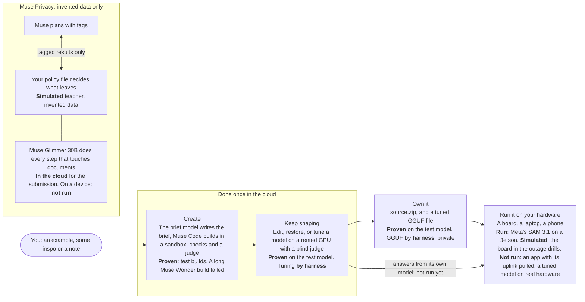

# Muse Muse

**People know their jobs, but getting custom software built takes engineering they often don't have.** Muse Muse turns one sentence into a working app on Meta's models, checks it before it ships, and puts it live at its own link. It is built so an app can keep answering on a Jetson when the cloud is cut.

**Video:** [the 3-minute demo, link added at submission]. **Live:** https://www.musemuse.dev, open to browse with no sign-in. Not an official Meta product.

### Proven, Nov 1 to 4

Each line is logged in [docs/BUILD_LOG.md](docs/BUILD_LOG.md) under the entry named.

- **Meta's SAM 3.1 on a Jetson Orin Nano 8GB: 1.42 s a look** once warm, on Meta's sample photo ("Nov 3, 2026, 2:15 to 4 AM ET: the boards, checked for real").
- **SAM 3.1 tuned on a board:** its detector learned a new word, "muse" (our mascot, Jolly), on jetson-03, from 0 to 38 of 38 held-out made-up images. Meta's SAM 3.1 already finds the same mascot as "plush toy", so the tune adds a name, not accuracy (same entry).
- **An edge build passed all 8 of its simulated outage drills** (cloud refused, cloud hung, both down, tampered reply, for its text answer and its SAM look; `npm run drill` below runs 11, adding board status checks) in its own build sandbox, against a simulated board ("Nov 3, 2026, about noon ET: claim fixes").
- **18 apps built overnight** on Muse Spark 1.3 Contributor with made-up data, at $0.17 to $0.40 each for the 17 whose cost is logged. A hands-on audit found 7 that work, 9 with gaps and 2 broken, though 17 had passed our judge; the 18th, the legal case agent, shipped as partial, with its memo error listed as a known issue ("Nov 3, 2026, 2 to 3 AM ET" and "Nov 3, 2026, 5:30 AM ET: target audit").
- **Glimmer weights, separate from the app:** a one-bit Muse Glimmer file we publish on Hugging Face ran on a Galaxy S25 at 1.94 tokens a second on Nov 1, and runs on a Jetson at about 5 tokens a second with weak answers ("Nov 3, 2026, 10:05 to 10:30 AM ET"). No app calls them.

- **Muse Code drives a rover:** on an Arduino UNO Q rover, Muse Code (Meta's coding agent) plans each move with its own tools, looks through the tuned SAM 3.1 on jetson-04 to find Jolly among other plush toys, and takes spoken hints through Muse Voice Transcribe. Only SAM runs on the board; Muse Code runs in the cloud. First live run: 2 finds, one a picture of Jolly on a laptop screen and one a look-alike plush, which led to a reference photo and a color check; a later run passed over a Stitch plush twice ("Nov 4, 2026, ~12:30 AM ET" and "~1:15 AM ET"). Code: [scripts/edge/sam3/](scripts/edge/sam3/).
- **Public weights on Hugging Face:** the 2026-knowledge Muse Glimmer (https://huggingface.co/OfflineBase/Muse-Glimmer-30B-2026-Knowledge, with its GGUF files at https://huggingface.co/OfflineBase/Muse-Glimmer-30B-2026-Knowledge-GGUF and its LoRA at https://huggingface.co/OfflineBase/Muse-Glimmer-30B-2026-Knowledge-LoRA), trained Oct 30 to Nov 1 ([docs/KNOWLEDGE_RUN_LOG.md](docs/KNOWLEDGE_RUN_LOG.md)), and the tuned SAM 3.1 detector at https://huggingface.co/OfflineBase/sam3.1-muse.

Not proven yet: an app answering on a board with its uplink pulled (not filmed), and the whole chain from a sentence to an app answering with its own tuned model.

### Three commands, no keys

```bash
npm ci && npm run dev:local   # the site on http://localhost:3000; a local run starts empty
npm run drill                 # 11 simulated outage drills on loopback, about 25 s, no model
npm run drill-bench           # remakes and scores the simulated cold-room set, about 2 s (needs python3)
```

| | |
|---|---|
| **Domain** | Agents |
| **Event** | Meta Global AI Developer Hackathon, Startup track |
| **Theme** | Build for Your World |
| **Built** | Oct 26 to Nov 4, 2026. Before the event, Offline Base had its Jetson fleet software and Base Drive; see "Before the event, and not in this repo" below |
| **Entrant** | Offline Base |
| **Team** | Ethan and Hussam |

The opening's last sentence is the aim, not yet the record. Each step below has run on its own, and the diagram marks how. The whole chain has not run as one, and no tuned model from this flow has run on anyone's own hardware. Every number we quote, failures first, is in [eval/](eval/README.md).



**Which model does Muse Privacy's steps.** Muse Glimmer 30B, for the submission. The organizers ruled on Nov 2 that every model the project calls at runtime must be Meta's, so Muse Privacy's name pass, its labels on Muse's requests, and its answers and summaries go to Muse Glimmer 30B in the cloud through OpenRouter, on invented data only, and Glimmer is also the privacy router, deciding each result under floors from the policy file that it can't loosen. Glimmer on a device is the target, not a result: it has not run on a device for this. On this setup, on Nov 2: 0 leaks of names or identifiers on 200 invented items, nothing shared that should have waited or stayed, and the router right 71.5% of the time, with 101 approval requests, 50 of them needless ([report](privacy/eval/reports/glimmer_fresh_200_b_2026-11-02.md)). Earlier Glimmer runs: through OpenRouter on Oct 27, 0 leaks of names or identifiers on 100 invented items; tuned, on a rented A100, it wrote answers and summaries with 0 leaks (80.5% and 81.0%), but as the labeler, the tightener or the decider it scored far worse (41.0% to 64.0%). See [eval/](eval/README.md#muse-privacy) and [privacy/README.md](privacy/README.md).

**What's simulated.** The board in the outage drills, which run in each build's sandbox against a fake board and a blocked cloud. Every cold-room reading. Every teacher and record in Muse Privacy, which has no real users. The fine-tuning results that say harness had a real GPU and judge, on an invented topic, without going through the site's launch path.

Offline Base also makes Base Drive, an offline AI kit on a flash drive, and runs a fleet of Jetson boards. Meta's SAM 3.1 runs on one of them (jetson-04) and was tuned on another (jetson-03), and on Nov 2 a product Muse Muse built counted with SAM 3.1 on jetson-04 from a laptop (docs/BUILD_LOG.md, "Nov 2, 2026, 9 PM ET"). No app has kept answering on a board with its uplink pulled yet. Muse Privacy has run on a board (jetson-05, Nov 3) only on Liquid's LFM3-VL-2B, which is not a Meta model, so that run is outside the submission; Muse Glimmer on a board has not run for Muse Privacy. Muse Privacy lives in [privacy/](privacy/README.md).

## Quickstart

You need Node 22.22.3 or newer (`node -v`; the `@composio/*` packages warn on anything older).

```bash
git clone https://github.com/Offline-Base/muse-muse.git && cd muse-muse
npm ci && cp .env.example .env.local && npm run dev:local   # then open http://localhost:3000
```

`npm run dev:local` sets up a local database (PGlite in `.data/pglite`), keeps files in `.data/files` and turns sign-in off for localhost. It needs no keys. **A local run starts empty:** the Gallery, Models and Fine-tuning pages say "Nothing shipped yet" and "No results yet". The judged results and the shipped products are on the live site, https://www.musemuse.dev, which anyone can browse with no sign-in.

### Judge path

| Goal | What it needs | Command | Time and cost |
|---|---|---|---|
| Open the site | Nothing | https://www.musemuse.dev | None |
| Run the tests | Nothing. Muse Privacy's tests also need [uv](https://docs.astral.sh/uv/) (`brew install uv`) | See [Tests](#tests) | About 3 minutes for the Node tests, and about 3 for Muse Privacy's. No spend |
| Run the outage drills | Nothing | `npm run drill` | About 25 seconds for the eleven drills, all on loopback. No key, no model, no spend |
| Score the drill bench | `python3` | `npm run drill-bench` | About 2 seconds. No model |
| Make one product | Both: a Meta Model API key in `MODEL_API_KEY` **and** a free Vercel account linked for Vercel Sandbox (below). A Meta key alone can't build anything | Make page, after `npm run dev:local` | 3 to 9 minutes and about $0.30 to $1.80 in Meta credits per build in our Oct 27 local batch, which used a warm snapshot (a first build without `BUILDER_SNAPSHOT_ID` takes longer). Full builds on the live site with today's checks took 33 to 100 minutes on Nov 3. Plus Sandbox minutes on your Vercel account |

To make a product, put your Meta key in `MODEL_API_KEY` in `.env.local`, then give Vercel Sandbox its credentials. Muse Code runs only in a Sandbox microVM, so there is no build without them:

```bash
npx vercel link                                       # a free Hobby account works; links this folder to a project of yours
npx vercel env pull .env.vercel.local                 # writes VERCEL_OIDC_TOKEN (good for 12 hours) to its own file
grep '^VERCEL_OIDC_TOKEN=' .env.vercel.local >> .env.local
npm run dev:local
```

Pull into its own file as above: a plain `vercel env pull` writes over `.env.local`. Without a Meta key or Sandbox credentials, the Make page says which one is missing and a build is refused before any paid step (a 503 with `no_model_key` or `no_sandbox`), so nothing is spent on a build that can't finish. `BUILDER_SNAPSHOT_ID` is optional locally: without it, the first build installs Muse Code, Playwright and ffmpeg in the sandbox itself, which is slower. A local build stops after its demo video and gets no link of its own (see [Run it on your machine](#run-it-on-your-machine)).

**The outage drills.** `npm run drill` starts a stand-in gateway that drops or holds every connection (`template/scripts/edge-blackhole.mjs`), a fake edge model server (`template/scripts/edge-fake.mjs`) and a tiny bundled product that answers through the product template's cloud-to-edge fallback (`scripts/drill/demo-product.ts`, using `template/lib/meta/edge.ts`). Then `template/scripts/edge-drill.mjs` runs eleven simulated drills: four on the text answer (cloud refused, cloud hung, both down, a tampered reply rejected), four on the photo look through Meta SAM 3.1's fallback (the same four, with a fake SAM service standing in for the board), two on the board status line (board up, board down) and one that checks the invented sample photo is served. It prints each result, writes JSON to `.data/drill/`, and exits non-zero if any drill fails. A pass shows the fallback logic on loopback with invented cold-room data and an invented photo, and nothing about a real model or board. `npm run drill-bench` remakes the Simulated cold-room set from its seed (`scripts/dev/drill-bench.py make`: 900 training, 50 kept aside, 100 sealed held-out), checks the sealed file matches `eval/drill/sealed.jsonl`, and scores canned answers with no model. See [docs/EDGE_DEMO.md](docs/EDGE_DEMO.md).

| To do this | You need |
|---|---|
| Start the site and browse it | Nothing |
| Write a brief | The same as a build: `MODEL_API_KEY` and Vercel Sandbox credentials. A brief is a build's first step, and without Sandbox credentials the Make page refuses it with `no_sandbox` before any paid call (`buildSetupRefusal` in `lib/quota.ts`) |
| Build a product | `MODEL_API_KEY`, plus Vercel Sandbox credentials: `VERCEL_OIDC_TOKEN` (from `npx vercel link` and `npx vercel env pull .env.vercel.local`, good for 12 hours; see the [Judge path](#judge-path)). `BUILDER_SNAPSHOT_ID` (from `npm run snapshot`) is optional locally and makes builds start faster |
| Publish a product to its own link | Not possible from a local run: a product couldn't reach this machine's gateway. Use a Vercel deployment (see [Setup](#setup)) |
| Train a model | Not from a local run as it stands. Training starts only on production unless `TRAIN_ALLOW_OUTSIDE_PRODUCTION=1`, and a rented GPU has to reach the site to report back. See [docs/TRAINING.md](docs/TRAINING.md) |
| Run the outage drills or the drill bench | Nothing (`python3` for the bench) |

### Docker (not yet built)

```bash
cp .env.example .env.local
docker compose up --build       # then open http://localhost:3000
```

The Dockerfile was written without a Docker daemon to test it on, so the image has **not been built or run yet**. Use the npm path above. What has run nearby: the migrations on an empty PGlite folder, `npx next build` with no database on a laptop, and `npm run dev:local`. `next start` on PGlite has not.

`compose.yaml` runs a production build on PGlite, Postgres in-process, in a Docker volume. Files stay in the same volume, sign-in is off for localhost, and the port is published on 127.0.0.1 only. No secrets go in the image: `.env.local` is read when the container starts, and compose overrides anything in it that would point at production's database or Blob store. There's no Postgres container, because the site uses Neon's HTTP driver, which can't reach a stock Postgres server. To use a Neon database, set `COMPOSE_DATABASE_URL` in your shell. Set `STORY_PAGES=1` in your shell before building to include `/offline`.

## What Muse Muse is

Give it a muse and Muse makes it. Drop in an example or some inspo, like a photo, a screenshot, a sketch, a short video, a voice memo or a PDF, and add a note if you want. Muse Code builds a working product from it on Meta's models. The platform tests it, records a demo, deploys it to its own link, and makes it usable from the Muse app.

Hackathon codename for the Meta Global AI Developer Hackathon, Startup track. Muse is Meta's brand, so pick your own name before taking this further. See the Name section in [docs/DESIGN.md](docs/DESIGN.md#name).

**Live:** https://www.musemuse.dev. Anyone can browse it with no sign-in. The submission write-up, video script and checklist are in [docs/SUBMISSION.md](docs/SUBMISSION.md).

## Status

**License:** Apache-2.0 for Offline Base's code ([LICENSE](LICENSE)); Meta's docs, model files and Meta's marks are not covered ([NOTICE](NOTICE)).

**Built from Oct 26 to Nov 4, 2026, for the Meta Global AI Developer Hackathon.** Before kickoff there was only a scaffold, committed exactly as received in `e3ba154`: design docs, the Meta model catalog, prompt drafts, the product template's rules and skills, types, the database schema, config, and route stubs that returned 501. All working code was written from Oct 26 on.

An Oct 27 audit compared every scaffold file with the current tree. It found five small helpers from the scaffold still in use: `museExecArgs`, `metaClient`, `imagePart` and `videoPart`, `toDataUrl` and `glimmerClient`. They were rewritten the same day; `glimmerClient` became `glimmer()`, which also names the served model. Everything else that survives from the scaffold is types, schema, config, docs or template boilerplate.

**Before the event, and not in this repo.** The organizers asked that anything pre-existing be labeled (Discord, Nov 2). These existed before kickoff (12:24 PM ET, Oct 26) and are used, not submitted:
- Offline Base's fleet of Jetson Orin Nano boards and its control software (a separate private repo, `jetson-infra`, created Sep 29, 2026), including how a board serves a model. The fleet tools on `/device` (#60) and the edge track's board steps talk to it.
- The models some boards ran before the event, made by other companies. They are not part of the submitted project, which is built to call only Meta's models (organizer ruling, Nov 2).
- Base Drive, Offline Base's offline AI kit on a flash drive (created June 2026). The `/offline` page describes it. Muse Muse's own USB export is a separate kit built this week, not a Base Drive.
- Meta's docs, mirrored in `content/meta-docs/` as reference.

Everything else in this repo, and its whole git history, was written from Oct 26 on, apart from the scaffold described above.

## What it does

1. **Muse.** On the Make page you drop in inspo and an optional note. Text alone works too. Three example cards (a receipt, a napkin sketch, a bakery menu board) attach a photo and fill the note in one click.
2. **Brief.** The brief model reads every reference (Muse Wonder 1.0, or Spark 1.3 Contributor while `BUILDS_ON_CONTRIBUTOR` is on, as on the live site for now; `env.briefModel` in `lib/env.ts`): images, video and PDFs directly, and voice memos after Muse Voice Transcribe 1.0 turns them into text. It writes a structured brief: the product, who it's for, the main flow, the Meta models it needs and why, honest limits, cost per use, and what it takes from the inspo and what it leaves out. It can also refuse.
3. **Build.** Muse Code runs headless in a Vercel Sandbox microVM, one per product, started from a warm snapshot. It writes a Next.js product from `template/`, guided by the template's `AGENTS.md`, one skill per Meta model and a manifest it must fill in. Muse Code runs on the build model: Spark 1.3 Contributor while `BUILDS_ON_CONTRIBUTOR` is on, as it is on the live site for now, and Muse Wonder 1.0 with it off (`env.buildModel` in `lib/env.ts`). Every product shares a Meta-family look: Facebook's design tokens in light and dark, Inter and Montserrat, and parts such as an app bar, segmented choices, list rows, a composer and an AI result card, which the template's `meta-ui` skill teaches from public research ([docs/META_DESIGN_RESEARCH.md](docs/META_DESIGN_RESEARCH.md)). The build room shows the live log and a live preview.
4. **Check.** `npm run verify` runs typecheck and `next build`, starts the server and checks for console errors. Then come the Playwright smoke test Muse Code wrote, with real model calls, and a screen check that fails on sideways scroll, clipped text or a loading state left on screen. Last, the judge model (the same rule: Wonder, or Contributor while `BUILDS_ON_CONTRIBUTOR` is on) judges the screenshots against the brief and the inspo.
5. **Fix rounds.** A failure resumes the same Muse Code session with the errors and up to four of the judge's screenshots, for up to `MAX_FIX_ROUNDS` rounds (2 by default in `lib/env.ts`, 4 on the live site since Nov 3). A product that still fails ships as partial only when every mechanical check passed. Otherwise the build ends as failed, with Muse Code's notes.
6. **Demo video.** Demo Studio reruns the smoke test with a recorder that tracks every action, change on screen and wait, then edits it into a 1920×1080 MP4 and a poster: an intro card with the product's models, the app in a browser window with its live URL, a cursor and a camera that zooms in on typing and results, model waits sped up with a badge that says by how much, and captions below the window. See [docs/DEMO_STUDIO.md](docs/DEMO_STUDIO.md). The redacted Muse Code transcript is saved for the product page.
7. **Deploy.** The platform, never the sandbox, publishes the source as its own Vercel project, `musemuse-<slug>`. The product calls Meta only through this platform's gateway, with a product token scoped to its models and endpoints, a daily budget and rate limits.
8. **Connector.** The actions in the product's `musemuse.json` become MCP tools at `/api/mcp/<slug>`. Add that URL to the Muse app as a custom connector, or to Claude Code as an MCP server.

A refinement such as "add a dark mode" resumes the same session in the same sandbox, then checks and ships again. If its checks fail, the live version stays.

The showcase is a batch run, `npm run rebuild-all`, that rebuilds Meta's earlier demo videos on current Muse models from `catalog/meta-resources.json`. It held the first six videos on Meta's Videos page plus first demos for SAM 3.1, Muse Image, Voice Transcribe and Muse Wonder. On Nov 2, 2026 all 30 of Meta's videos were audited: the catalog now feeds the Learn page (/learn), the audit found the six versions wrong or partly wrong, and every improved plan waits on the owner's spend decision (autoBuild false).

## Results from the Oct 27 test runs

- **24 of 24 builds passed their checks** in a local batch, at 3 to 9 minutes and about $0.30 to $1.80 in Meta credits each. The first 17 covered all 10 catalog rebuilds and every model: Spark, Muse Image, SAM 3.1, Voice and Wonder. Every product got a recorded MP4 demo, a Muse Code transcript and an MCP manifest with actions. Local runs stop before the deploy step, so none of the 24 was deployed: they have no live link and are not on the live site's Gallery.
- **Product quality, scored blind.** A judge-style review of the 24 products' screenshots averaged 5.5 out of 10. After a template polish (themes, shared parts, a screen check in each product's own tests, copy rules), an 11-build canary of the same muses scored 5.91, up from 5.14 for those 11, and all 11 passed their checks. A second polish round scored 5.50 and cost 64% more, so it was not merged.
- **Hidden Muse Code spend.** Muse Code's `run.usage` left out its reminder agents. They were 31% to 43% of each build's real Muse Code spend. The platform now reads Muse Code's session logs and charges them.
- **Fine-tuning.** See [the lab](#fine-tuning-lab-spark-teaches-glimmer) below.

## The UI

The platform is laid out like another tab in Meta's Model API dashboard. The layout was measured from screenshots of Meta's pages ([docs/UI_PATTERNS.md](docs/UI_PATTERNS.md)).

- **Sidebar.** Dashboard; Make, Builds, Learn, Gallery; Usage, Models, Fine-tuning, Gadgets; How it works and Model API docs.
- **Make** follows Meta's Image playground: example cards, a composer that is the muse box, and a right panel that shows the build setup (model, builder, fix rounds, judge, demo video, publish, connector) as disabled controls.
- **Build room** follows the Chat playground. The muse is the user turn. The brief, Muse Code's log, the check results and the shipped result are assistant turns, each ending with a time, tokens and cost line. The right panel has a step rail (Brief, Provision, Build, Preview, Check, Record, Deploy), the Muse Code session id, fix rounds, running cost, links and the live preview.
- **Dashboard** leads with "Use your products in Muse": tabs for the Muse app, Claude Code and cURL, a tab per published product, and its connector in a copy box. Below it are Requests, Input tokens, Output tokens, Products and Spend (est.).
- **Usage** leads with "Meta tokens driven", stacked by products and building, then Spend (est.), Builds and a table per product. Charts are inline SVG.
- **Models** (`/models`, public) lists Meta's hosted models with what Muse Muse uses each for, the estimated price and 30 days of calls, then Muse Glimmer and the lab's tuned Glimmer models, linking Hugging Face and GGUF files only when they are public.
- **Gadgets** (`/gadgets`, public) says what a gadget is, whether the option is on for new builds and whether a live board is set up (from the environment, never calling the board), and the shipped products that use one. See [docs/GADGETS.md](docs/GADGETS.md).
- **Product pages** show the live product in a frame, the muse it came from, models, limits, the recorded demo, the connector URL and "How it was built".
- Light and dark themes. Below 760 px the sidebar becomes a top bar and the build panel stacks under the log.

It keeps its own two-sparkle mark, a "Concept" pill and the line "Not an official Meta product." Nobody pastes a Meta key anywhere.

## How builds use Muse Code's own features

- **Headless exec with hardened flags.** Each run is `muse exec --json --yolo --session-id <uuid> --prompt-file <file> --model <build model> --reasoning-effort high --max-model-steps 200 --disable-web-tools`, plus `--image` for each inspo image. The build model is `muse-spark-1.3-contributor` while `BUILDS_ON_CONTRIBUTOR` is on, as on the live site for now; with it off it's `BUILD_MODEL` (`COMPLEX_BUILD_MODEL` for complex briefs), which defaults to `muse-wonder-1.0`. The runner adds `--disable-request-user-input` and `--no-foreign-personal-context` when `muse exec --help` lists them, so a run never waits for a person and never loads `~/.claude` rules or skills. `--yolo` turns off Muse Code's own sandbox, which can't run in the microVM. The disposable, firewalled VM is the boundary. The snapshot script fails unless `muse exec --help` lists every flag a build passes.
- **15 conflicting bundled skills disabled.** Skills such as `browser-game`, `web3d`, `plan`, `requirements-clarification` and `grill` fight a Next.js template or a run with nobody to answer. The builder snapshot turns all 15 off with `muse skills disable`, and the snapshot fails if any is still on (`DISABLED_BUNDLED_SKILLS` in `lib/sandbox/setup.ts`).
- **The template steers it.** `template/AGENTS.md` holds the rules. `template/.agents/skills/` has one skill per Meta model (reasoning, image, SAM, voice, Glimmer) plus product UI, Meta UI and verify skills.
- **Judge screenshots attached to fix rounds.** A fix round resumes the session with `--session-id` and attaches up to four of the judge's screenshots with `--image`. Each is under 2 MB, shrunk with ffmpeg in the sandbox if needed, and kept in a git-ignored folder that never deploys.
- **Reminder and subagent activity, shown and charged.** The build room shows each reminder Muse Code starts and each subagent it spawns. `run.usage` counts only the main agent, so after each run the platform reads the usage records in Muse Code's session logs, adds the reminder and subagent calls, drops the duplicates and charges them (`lib/sandbox/muse-log.ts`).
- **Transcripts.** `muse export --session <id> --redacted` becomes "How it was built" on the product page.

## Fine-tuning lab: Spark teaches Glimmer

Meta has no hosted fine-tuning, so the lab runs on the owner's Lambda Cloud GPUs.

1. **Write.** Muse Wonder writes a dataset for a task: varied user prompts in batches, then its own answers (Muse Spark 1.3 wrote the first run's dataset, below). It holds out 10% (8 to 40) as eval prompts with references.
2. **Train.** The `glimmer-lora` recipe runs a QLoRA fine-tune of Muse Glimmer 30B (Unsloth's 4-bit build) on one Lambda GPU. The Python venv and the 21 GB of weights stay on a Lambda filesystem in the region, so later jobs skip the install and the download.
3. **Judge.** Base and tuned Glimmer answer the held-out prompts. After the GPU is terminated, Muse Wonder scores each pair blind (Muse Spark 1.3 judged the first run), as A and B, with the order switched on every other item.
4. **Try it live.** An admin can serve a trained adapter on one GPU for 10 to 120 minutes (the `glimmer-serve` recipe). Meanwhile its public result page has a box where anyone types an app idea and sees base and tuned Glimmer answer it side by side, from the same GPU. The platform proxies each prompt over HTTPS pinned to the certificate the GPU reported, with a key derived from the job's token hash, and the GPU shuts down at the end like every other job.
5. **Publish to Hugging Face.** Once a run is judged, its adapter and its training data go to the Hub on their own: a model repo and a dataset repo, each with a card. The card opens with "Why this exists", the admin's reason and a story Muse Wonder writes from the run's records, then the method, the eval table, an example and the limits. The story may not state numbers; every count and score on a card comes from the records. The GPU uploads the adapter through presigned URLs the platform asks the Hub for, so the Hugging Face token never leaves the platform. Both repos start private and turn public only after the platform reads them back. The adapter is Apache 2.0 like its base model; the dataset is Spark's output, so it is published under Meta's Model API terms, not an open license. A `glimmer-publish` job uploads an adapter that already sits on the Lambda cache, such as run 2's.

By default both models train and answer under a one-line role prompt, such as "You are Muse Muse's brief writer.", instead of the teacher's full task prompt. That way the score measures what training taught.

Jobs are admin only. The Lambda key never leaves the platform. Each instance gets a one-time job token, and only its hash is stored. Three things terminate a GPU: the job's workflow, the instance's own done callback and a sweep every 5 minutes. A job won't launch unless the sweep ran in the last 15 minutes. Each job has a time limit and a dollar limit, one GPU runs at a time, and a daily cap covers all jobs.

Results are public and read-only at [/fine-tuning](https://www.musemuse.dev/fine-tuning): each judged job with its wins, average scores, GPU time and cost, and every held-out prompt with the writer model's reference, the base answer, the tuned answer and the verdict. The full spec is [docs/TRAINING.md](docs/TRAINING.md).

| Run | GPU | Time | Cost | Result |
|---|---|---|---|---|
| Smoke test | Lambda A10 | about 3 min | $0.06 | GPU, CUDA, disk and network checked |
| Dry run of the full loop | A100 | | $0.13 | Dataset paging, eval items, judging and upload checked, with stand-in answers |
| Dataset "Muse Muse brief writer" | none | | $1.51 | 400 examples written by Muse Spark 1.3: 360 to train on, 40 held out |
| First Glimmer 30B QLoRA run | A100 40 GB | 47 min | $1.59 | 120 steps, final loss 0.47. Base won 28 to 11, which exposed an eval bug |
| Second run, with the fix and the short prompt | A100 40 GB | 42 min | $1.39 | 120 steps, final loss 0.52. **Tuned won all 40 held-out prompts**, average score 8.88 against base 1.95 (judging $0.15) |

The eval bug: training put every answer on Glimmer's final channel, but the eval prompt let the model pick a channel, and the tuned model answered inside its reasoning channel instead. Eval prompts now continue on the final channel, as training does, with 1,024 new tokens. Before any paid generation, the job checks that every training example trains on its answer.

## Architecture


The real Meta key lives in two places only: the platform's server environment and the sandbox firewall rule that injects it. Inside a sandbox, Muse Code holds a per-sandbox placeholder key. The firewall swaps it for the real key on four routes only: `POST /v1/responses`, `/muse-code/models`, `POST /v1/files` and `GET /v1/models`. Every other request to `api.meta.ai` gets a 403 from the firewall. Other hosts are blocked, apart from npm, the platform and Vercel Blob uploads when a smoke test needs them. Published products never hold a Meta key. The Vercel token, the database URL and the Lambda key never enter a sandbox, a product or a GPU.

## Layout

```text
app/                        Platform UI and API routes (Next.js App Router)
  page.tsx                  Make: example cards, the muse box and the build setup panel
  builds/                   Your builds
  b/[buildId]/              Build room
  p/[slug]/                 Product page
  gallery/                  Shipped products
  learn/                    Meta's lessons, Muse Muse's version of each and the plan (/rebuilds redirects here)
  dashboard/                Connectors, requests, tokens and spend
  usage/                    Meta tokens driven, spend and builds
  fine-tuning/              The lab: datasets, jobs and judged results
  how-it-works/             The pipeline in five steps
  sign-in/                  Email, personal password and access code
  api/inspirations/         Save inspo and start a build
  api/builds/[buildId]/     Events (SSE) and refinements
  api/rebuilds/             Start batch rebuilds
  api/admin/import-product/ Import a product built on a local run and publish it
  api/gateway/v1/[...path]/ Meta Model API proxy for products
  api/gateway/uploads/      Upload tickets for large files
  api/mcp/[slug]/           Muse app connector endpoint
  api/train/                Fine-tuning jobs, datasets, GPU callbacks
  api/lab/[id]/try/         The live demo: one idea to base and tuned Glimmer
  api/cron/                 Cleanup and the GPU sweep
components/                 Shell, composer, build room, charts, product and train views
lib/
  brief/                    Brief schema, writer, media handling and policy
  pipeline/                 Build workflow and steps
  sandbox/                  Firewall policy, Muse Code runner, session-log usage, snapshot setup
  gateway/                  Product gateway: tokens, limits, metering, uploads
  publish/                  Vercel deploys for products
  promote/                  Local products to the live site: the import bundle, its parser and publish workflow
  mcp/                      MCP server for product connectors
  train/                    Lambda client, training workflow, sweep, recipes, datasets, judge
  db/schema.ts              Postgres schema (Drizzle)
catalog/meta-models.json    Every Meta model, endpoint, limit and price we know of
catalog/meta-resources.json Meta's 30 lessons, each with its audit verdict and plan
drizzle/                    SQL migrations
docs/                       Design, spikes, UI patterns, training, build plan, submission
scripts/                    dev-local, migrate, make-builder-snapshot, rebuild-all, rerecord-demos, promote-local
privacy/                    Muse Privacy: its own Python and relay, run by the person, never part of the site
template/                   Starter repo Muse Code builds every product from
  AGENTS.md                 Rules Muse Code loads on its own
  .agents/skills/           One skill per Meta model, plus product UI and verify
  inspo/                    Where the user's references land for each build
  tests/                    Smoke test and the screen check
```

## Setup

You need Node 22.22.3 or newer, a Vercel account, a Neon Postgres database from the Vercel Marketplace and a Meta Model API key. Muse Code is installed in the builder snapshot, so you don't need it on your machine.

```bash
npm ci
cp .env.example .env.local      # fill in the values; each one is explained in the file
npx vercel link && npx vercel env pull .env.vercel.local   # VERCEL_OIDC_TOKEN for Sandbox locally (good for 12 hours); copy it into .env.local
npm run snapshot                # makes the warm builder snapshot; put the printed id in BUILDER_SNAPSHOT_ID (required on Vercel)
npm run db:migrate              # applies drizzle/ to DATABASE_URL (npm run build runs it too)
npm run dev                     # http://localhost:3000
```

Run `npm run snapshot` again whenever `template/` changes, and update `BUILDER_SNAPSHOT_ID` in `.env.local` and on Vercel. The script also adds the new id to `lib/sandbox/snapshots.json` with the platform service overlays it installed: commit that file with the id change, since the live site offers only the services its snapshot lists there (docs/CAPABILITIES.md, 2.4a). Run `npm run db:generate` only after you change `lib/db/schema.ts`. To work on the product template itself, run `cd template && npm install`.

On Vercel, set the same variables on the project. A few need care:

- The Blob store must be **public**. Meta fetches media by URL, and products upload straight to the store. Connecting it sets `BLOB_STORE_ID` (used with the deployment's OIDC token) or, for older stores, `BLOB_READ_WRITE_TOKEN`; either works for the platform's own files and inspo uploads. Product uploads through the gateway and training uploads still need `BLOB_READ_WRITE_TOKEN`. With neither set, builds are refused.
- `VERCEL_TOKEN` and `VERCEL_TEAM_ID` publish each product as its own project.
- `OPEN_ACCESS=guest` opens the site with no sign-in: every visitor shares one Builder account and its daily cap. `DAILY_SPEND_CAP_USD` stops new builds and gateway calls for the day once it is reached.
- Fine-tuning needs `LAMBDA_API_KEY` and `CRON_SECRET`. Jobs start only on production, where Vercel runs the sweep cron.
- Publishing to Hugging Face needs `HF_TOKEN` (a fine-grained token with write access to repos under `HF_NAMESPACE`, a user or an organization) and `HF_NAMESPACE`. `HF_PUBLIC=1` makes repos public once checked; anything else keeps them private. Without a token, judged runs say publishing is off.

### Preview database

On Vercel, Preview gets the same `DATABASE_URL` (and the Neon integration's `PG*` and `POSTGRES_*` variables) as Production, and every deployment runs `scripts/migrate.ts` before `next build`. So previews never use `DATABASE_URL`. A preview uses `PREVIEW_DATABASE_URL`, an empty database of its own on a Neon branch, and everything that opens or migrates the database picks it the same way (`lib/db/url.ts`). `lib/db/__tests__/no-direct-database.test.ts` fails if other code reads those variables itself.

| Where | Database the site uses | What the build's migrate does |
| --- | --- | --- |
| Production, `npm run dev`, scripts | `DATABASE_URL`, as before | migrates `DATABASE_URL` (skips when it's unset) |
| `DATABASE_URL=pglite:<folder>` (`npm run dev:local`) | that folder, as before | migrates that folder |
| Preview with `PREVIEW_DATABASE_URL` | `PREVIEW_DATABASE_URL` | migrates `PREVIEW_DATABASE_URL` |
| Preview without it | none: pages show "Not connected yet" and anything that needs the database fails, as with no `DATABASE_URL` | prints that it skips, since previews never touch production's database, and the build goes on |
| Preview with production's database in it | none | refuses with exit 1, so the build stops |

"Production's database" means the same database name on the same Neon endpoint (the `ep-...` id, pooled or not, whatever the rest of the host or the port says) as `DATABASE_URL` or the integration's other URLs, whatever the user, password or options. Off Neon it means the same host, port and database name. Crons don't change this: Vercel runs `vercel.json` crons on production deployments only.

A preview also never publishes a product: a publish goes into production's Vercel project for that name (`musemuse-<slug>`), so it would replace a live product. Builds still run their preview, checks and demo, and the product is saved without a link of its own. A preview takes no card payments and makes no Stripe refunds either, since Stripe's webhook settles on production, so new drive orders there are invoice requests.

To give previews their database and let their builds through (once):

1. In Vercel, open Storage, the Neon database, then Open in Neon. Under Branches, choose New branch, name it `preview`, and keep the default (production) branch as its parent and the data as it is. Don't pick Schema only: the copied tables would have no record of their migrations, and the build would stop. On the `preview` branch, open Roles & Databases and add a database named `preview`, owned by the same role as `neondb`. Then open Connect, pick the `preview` branch and the `preview` database (the pickers start on production's), turn connection pooling on, and copy the string.
2. Run `vercel env add PREVIEW_DATABASE_URL preview`, paste the string, and leave the Git branch empty so every preview gets it. You can also mark it Sensitive in the project's Environment Variables. Previews made after that use it.
3. In the project's Settings, open Deployment Protection and turn on Protection Bypass for Automation by adding a secret there. Vercel then gives every deployment the secret as `VERCEL_AUTOMATION_BYPASS_SECRET`; previews made after that read it. Nothing else needs setting, and the secret never goes in an environment variable of your own.

The `preview` database starts empty, and the first preview build migrates it. Leave the branch's own `neondb` alone: it is a copy of production's rows, and its products still name production's live Vercel projects and sandboxes, its orders real card payments and its people real emails. A preview pointed at it could refine a live product's sandbox or delete its files.

Every preview shares the `preview` database. To start clean, delete it on the branch (Roles & Databases) and add it again with the same name and owner, then redeploy a preview so its migrations run. Don't use Reset from parent: it puts the branch back to production's current state, which drops the `preview` database and leaves previews failing to connect. Migrations reach the preview database in number order too: Drizzle skips a migration older than the newest one applied, so once a preview has applied `0021`, a later preview that brings `0020` skips it there. Recreate the `preview` database before deploying that preview.

What a preview can prove: products and build sandboxes reach the gateway and the build MCP at `env.platformUrl`. A preview with its own database (`previewHasOwnDatabase` in `lib/db/url.ts`) is its own platform: `env.platformUrl` is its branch URL (`VERCEL_BRANCH_URL`), or its deployment URL (`VERCEL_URL`) when there's no branch URL, since its builds and gateway tokens live only in its database and production's gateway would refuse them. `PLATFORM_URL` doesn't change that preview's address. A preview with no database, or with production's, and production itself keep `PLATFORM_URL` as before.

Deployment Protection turns away requests to a preview that carry no Vercel login, and a build sandbox has none, so step 3 lets them through. On a preview with its own database, `env.previewBypass` reads `VERCEL_AUTOMATION_BYPASS_SECRET` together with the preview's own host, and the build firewall adds the secret as the `x-vercel-protection-bypass` header to every request a sandbox makes to that host (`lib/sandbox/policy.ts`), in a build's sandbox and in Prove it's copy. It goes to no other host: on a preview whose `env.platformUrl` is another site's (no database of its own, or no URL of its own), and for a Prove it copy pointed at another site, the sandbox gets no header. The same rule sets each of those requests' `Host` header to the platform's host. The firewall picks a host's rules by the connection's SNI alone, so without that, code in the sandbox could name the platform in the SNI and another site on Vercel's edge in `Host`, and the secret would go to that site. A request that asks for a bypass cookie (`x-vercel-set-bypass-cookie`, as a header or a query parameter, in any case or encoding) gets a 403 from the firewall itself, since the cookie would land inside the sandbox and do the secret's job there. The secret stays in the firewall rule and never enters the sandbox, so the product's code and Muse Code never see it or a cookie made from it. Production never reads it. Only the sandboxes get the header: people opening the preview still sign in to Vercel, and anything else that calls the preview still meets Deployment Protection. That includes Vercel Blob's upload-completion callback (it only writes a log line), a native lab box's selftest, and a training job's GPU reporting back (training starts only on production unless `TRAIN_ALLOW_OUTSIDE_PRODUCTION=1`, and a GPU that can't report back is still ended by its time limit and the sweep). Without step 3, a protected preview's builds can't reach its gateway or build MCP. Once it's on, check it once from a build's sandbox on a preview: a request to the preview with another site's `Host` header still reaches the preview, and one with `x-vercel-set-bypass-cookie: true` gets the firewall's 403 and no `Set-Cookie`.

The branch URL follows the branch's newest deployment, so a build still running when a newer commit deploys on the same branch calls the newer one. Its tokens still work, since every preview shares the `preview` database, but the code serving it can differ from the code that started it.

`npm run rebuild-all` starts the rebuild batch at `PLATFORM_URL` with the `AUTOMATION_SECRET` bearer and prints a table and a total. `npx tsx --env-file=.env.local scripts/rerecord-demos.ts` re-records the demo of every live product (or the ids and slugs you give it) in its own sandbox with Demo Studio, without a Muse Code run; `--dry-run` records in a throwaway copy of each sandbox and saves the videos locally, changing nothing. Vercel Hobby caps sandbox sessions at 45 minutes and Pro at 24 hours. Builds target well under 30 minutes, so Hobby works for the hackathon.

## Run it on your machine

```bash
npm run dev:local               # then open http://localhost:3000
```

Browsing needs nothing. A build needs `MODEL_API_KEY` and `VERCEL_OIDC_TOKEN` (from `npx vercel link` and `npx vercel env pull .env.vercel.local`, good for 12 hours, copied into `.env.local` as in the [Judge path](#judge-path)) in `.env.local`; without either, the Make page says so and builds are refused before anything is paid for. `BUILDER_SNAPSHOT_ID` is optional here: without it, the first build installs its toolchain in the sandbox, which is slower. The database is PGlite in `.data/pglite`, files go to `.data/files`, and sign-in is off for localhost. Builds still run in Vercel Sandbox. The sandbox can't reach your machine, so products call Meta directly through the build firewall instead of the gateway, and their file uploads don't work. A local build stops after the demo video and isn't published to its own link, even with `VERCEL_TOKEN` set: the product would call this machine's gateway, which Vercel can't reach. The live preview in the build room works while the build runs.

To put local products on the live site, run `npx tsx --env-file=.env.local scripts/promote-local.ts --db .data/pglite --slug <slug>,<slug>` (add `--dry-run` first to see what it would upload and send). It reads a copy of the PGlite folder and asks the live site whether it takes each bundle (`POST /api/admin/import-product?check=1`), so nothing is uploaded for a product it would refuse. Then it uploads each product's files from `.data/files` to the live Blob store at the same paths with your `VERCEL_OIDC_TOKEN`, and sends the rows to `POST /api/admin/import-product` with the `AUTOMATION_SECRET` bearer. The live site saves them under its guest account (its builds don't count against the guest's daily builds) and publishes each product from its sandbox the way a live build does, then the script waits up to 10 minutes for the links. Only live products whose latest build is live go; the rest are skipped with the reason. When a publish ends without a link, run the same command with `--republish`: the live site publishes it again, once its last try has ended, with nothing uploaded again.

## Tests

```bash
npm run typecheck
npx tsx --test --experimental-test-module-mocks $(find lib components -name '*.test.ts')
npx tsx --test --experimental-test-module-mocks components/train/__tests__/*.test.tsx
npx tsx --test template/scripts/__tests__/*.test.mjs   # the template's own scripts and theme contrast
```

Nothing in the tests calls Meta, Vercel, Lambda or Neon, and none needs a key. The Node tests take about 3 minutes. The fine-tuning runner test also needs `python3`. CI runs the typecheck and these tests on every pull request ([.github/workflows/ci.yml](.github/workflows/ci.yml)).

Muse Privacy has its own setup and tests in `privacy/`: `cd privacy && uv sync --locked && uv run pytest -q`. They need [uv](https://docs.astral.sh/uv/) (`brew install uv`, or the installer on astral.sh), which fetches Python 3.12 itself, and take about 3 minutes.

The outage drills and the drill bench need no key either: `npm run drill` and `npm run drill-bench` (see the [Judge path](#judge-path)).

## Docs

- [eval/README.md](eval/README.md) collects every measurement with its source, failures first.
- [privacy/README.md](privacy/README.md) covers Muse Privacy, the connector that keeps private files away from Muse. The two
  share no code: neither imports the other, it is left out of the site's deploys, and it adds no migrations.
- [docs/SUBMISSION.md](docs/SUBMISSION.md) has the submission write-up, the video script and the checklist.
- [docs/DESIGN.md](docs/DESIGN.md) covers the architecture, pipeline, security, cost, demo and risks.
- [docs/SPIKES.md](docs/SPIKES.md) has what the day-one spikes measured about the Meta Model API, Muse Code and Vercel Sandbox. Code follows it where older docs disagree.
- [docs/UI_PATTERNS.md](docs/UI_PATTERNS.md) describes Meta's dashboard layout and how each page maps to it.
- [docs/TRAINING.md](docs/TRAINING.md) specifies the fine-tuning lab.
- [docs/META_CATALOG.md](docs/META_CATALOG.md) lists Meta's models, endpoints, limits and prices.
- [docs/PROMPTS.md](docs/PROMPTS.md) has drafts for the brief writer, builder, fix round, judge and refinement prompts.
- [docs/BUILD_PLAN.md](docs/BUILD_PLAN.md) has the rules check, day-one spikes, the Oct 26 to Nov 4 schedule and the test muses.

Muse Muse is not an official Meta product.
