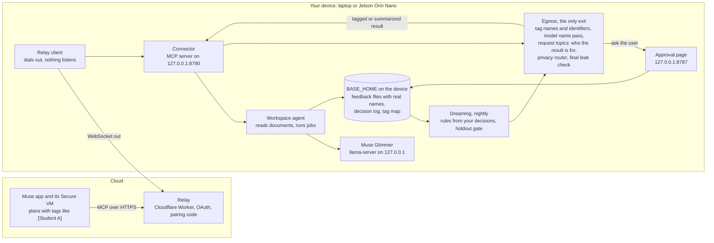
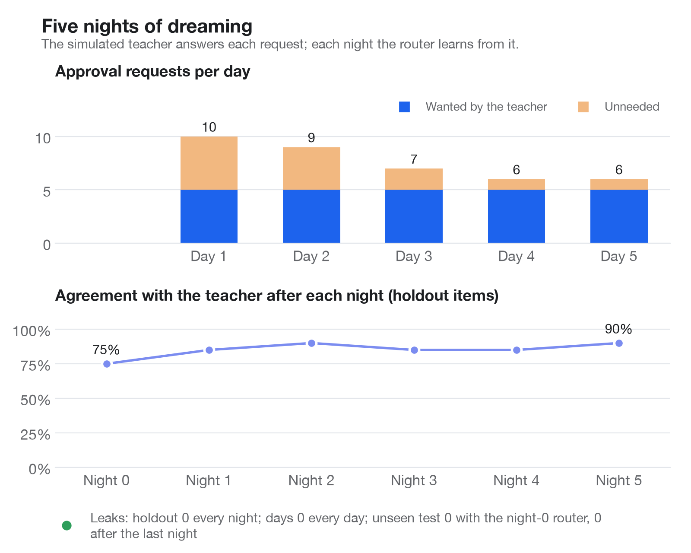

# Muse Privacy

Muse can already reach your files through connectors, but whatever it reads lands in its cloud VM, names and all. That keeps it away from the private, tedious work most ready for automation wherever records have to stay with their owner: grading student papers, medical records, city agency casework. Muse Privacy gives Muse a private workspace on hardware you own, a laptop or a Jetson Orin Nano, connected through a Muse connector. Muse plans the work with tags, your device does every step that touches the documents with Muse Glimmer, and only tagged or summarized results go back: names and identifiers are swapped for tags on the device, and a final leak check runs on every text before it leaves.

Built solo for the Meta Global AI Developer Hackathon, startup track, under the theme Build for Your World. An independent project, not made or endorsed by Meta. Every person, essay and record in this repo is invented.

**Status, Oct 30.** The default setup is now device-only (`DEVICE_ONLY=1`): Liquid's LFM3-VL-2B on the laptop does every model step, your policy file decides what is shared, and no model is reached off the laptop. There are toggles for FERPA, COPPA and HIPAA workflows, a setup page, a receipt for each result and one-command start. On 200 invented items the rules were not written against, there were [0 leaks of names or identifiers, 73.5% agreement with the expected decision and 90 approval requests](eval/reports/device_only_unseen_200.md); 2 results were shared that should have waited or stayed on the device. Grading and nightly learning have not been measured on this model. The plan and its limits are in [docs/COMPLIANCE_PLAN.md](docs/COMPLIANCE_PLAN.md). A toggle does not make anyone compliant, and whatever you type into Muse reaches Meta before the device sees it. Everything below this paragraph that mentions Glimmer describes the earlier setup.

**Status, Oct 28.** The whole path runs and is tested on a laptop. The relay is deployed on Cloudflare, and on Oct 27 a script playing Muse paired with the laptop through it, listed the six tools and called list_documents, which returned the 24 essays as 24 tags, with none of the tag map's 25 names in what left the device. Every Glimmer number so far came from Muse Glimmer on OpenRouter with invented data (a development mode). The final runs were measured after the guard fix for names the model finds, on one code state; the request-label check and the grading comparisons come from earlier runs on Oct 27 ([final.md](eval/reports/final.md), sections 8 and 9). Glimmer on the device, the Jetson and the Muse app itself have not been run yet; [docs/HANDOFF.md](docs/HANDOFF.md) lists what waits on what.

## Who it's for

Teachers first. Ethan builds AI tools with school districts, and grading and feedback, the job this build automates, has a student's name in every file. That is the event's Build for Your World theme: "Solve a problem you know firsthand, free up time and mental space" ([event page](https://dev.meta.ai/events/global-hackathon)). Under FERPA's school-official exception, a school may give education records to an outside service without parent consent only if, among other conditions, the service is "under the direct control of the agency or institution with respect to the use and maintenance of education records" ([US Department of Education](https://studentprivacy.ed.gov/faq/who-school-official-under-ferpa)). Muse Privacy keeps the essays on the teacher's own laptop: Muse plans the job with tags, Glimmer grades them (on the device in the shipping mode; so far only on OpenRouter, with invented essays), and the feedback files with real names are written only there. In the measured run, one grading request from a script playing Muse graded 24 invented essays, wrote 24 feedback files on the laptop and needed one approval from the teacher ([e2e_cloud_no_rules.md](eval/reports/e2e_cloud_no_rules.md)). The same pattern fits clinics and city casework, where records have to stay with whoever holds them. Today it is a laptop install (below); the Jetson box is the version a school could own outright.

## How it works



1. You ask Muse in plain words. Muse plans the job on its VM and calls the connector's six tools: `list_documents`, `search_documents`, `run_private_task`, `get_result`, `run_dreaming`, `dreaming_report`.
2. Muse reaches the device through the relay, which the device dials out to, so nothing on the device is open to the internet.
3. On the device, the agent swaps tags back to names only to choose what to do, and gives Glimmer the documents with every name and identifier already swapped for tags. Finished files with real names (for grading, one feedback file per student) are written only under `BASE_HOME`.
4. Every result goes through `base/egress.py`: exact checks for names on the roster and identifiers (phones, emails, SSNs, Luhn-checked cards, student ids, addresses, dates of birth), and a second pass where Glimmer finds names the roster misses. Then the device reads Muse's request: a keyword scan for never-share topics, and one Glimmer call that labels who the result is for and what it asks (for a student's family, for someone outside the class, a whole text, who a tag really is, a class-level question). The privacy router then decides to share it tagged, share a summary, ask you on the approval page, or keep it. A final leak check runs on every text before it leaves, and fails closed. If a check cannot run, the result is held on the device.
5. Each night, dreaming rebuilds the router's rules from your approve and deny decisions, grouped by the kind of result and its topics, request topics included. It keeps them only if they score no worse on a holdout set with zero leaks. A learned "ask first" or "refuse" rule is a floor: it holds for every narrower group of its kind, so a closer share rule can never loosen it.

On a Jetson, grading can be handed to the laptop's 4-bit Glimmer: the laptop dials out to the Jetson (`base/heavy/worker.py`), so the managed laptop never listens on the network. The interfaces between modules are in [docs/CONTRACTS.md](docs/CONTRACTS.md).

## Built during the event, and before

All of the code in this repository was written during the event; the first commit is from Oct 27, 2026. Three earlier Offline Base projects by the same author were read for ideas only, and nothing was copied from them: decision-guard (exact checks before text is sent, for `base/guard.py`), base-router-subagent (a device that dials out to a Cloudflare relay with OAuth and pairing codes, for `relay/` and `base/connector/`) and decision-tree (a status light, for `base/light.py` and `hardware/light/`). The code was written with Claude Code; Muse Spark 1.3 wrote the 2,000-item practice set and graded the invented essays a second time as a cross-check. Details and the open-source libraries used are in [docs/PRIOR_WORK.md](docs/PRIOR_WORK.md).

## Related work

Parts of this exist elsewhere; [docs/PRIOR_WORK.md](docs/PRIOR_WORK.md#related-work) lists them with links. Perplexity's hybrid compute on Mac (Sep 2026) also has cloud models plan while a local model guards private data, with a gate that can mask sensitive details, keep them local, refuse the action, ask for consent, or rewrite the request. PlanTwin is research on a cloud planner working over a de-identified twin of local private state, ARIEL learns a user's sharing judgments, and Canvas MCP and SafeGrader already give teachers pseudonymous student IDs over MCP and local grading. Meta's Muse Gadgets Linux SDK already pairs a Linux box with Muse so Muse "can run commands and move files on the machine"; Muse Privacy is the version where the device decides what Muse may see. Other entries in this hackathon also put Glimmer redaction in front of Meta's models, through the Meta Model API rather than the Muse app. What we did not find elsewhere is this combination inside Meta's Muse: the documents and the tag map stay on hardware the user owns, Glimmer does the document work there, each result is routed four ways by its content and by who it is for, approvals appear on a page the device serves, and the rules are rebuilt each night from the user's answers behind a holdout gate.

## Setup

You need macOS or Linux, [uv](https://docs.astral.sh/uv/), and for the relay Node 22 and a Cloudflare account.

### Laptop, device-only (the default setup)

Every model runs on the laptop. You need llama.cpp b11960 or newer, the LFM3-VL-2B GGUF and projector in `models/`, and for search the EmbeddingGemma 2 GGUF.

```sh
git clone https://github.com/Offline-Base/muse-privacy.git && cd muse-privacy
uv sync
cp .env.example .env                 # then set DEVICE_ONLY=1, PRIMARY_MODEL=lfm and CHECKER_SERVER_BIN
scripts/start.sh                     # models, approval page and relay client; Ctrl-C stops all
open http://127.0.0.1:8787/setup     # say who you're protecting and finish the checklist
scripts/install_login.sh             # optional: start at login
```

### Laptop, cloud mode (development, invented data only)

Glimmer runs on OpenRouter, so the device reads only folders marked `.synthetic`, such as `demo/`.

```sh
git clone https://github.com/Offline-Base/muse-privacy.git && cd muse-privacy
uv sync
cp .env.example .env                 # then set OPENROUTER_API_KEY in .env
uv run pytest -q                     # unit tests; every model and API is mocked
uv run python -m base                # approval page http://127.0.0.1:8787, connector on 127.0.0.1:8790
```

### Laptop with llama-server (Glimmer on the device)

Not run yet: it needs about 20 GB of free disk. Use llama.cpp b10353 or newer.

```sh
git clone https://github.com/Offline-Base/muse-privacy.git && cd muse-privacy && uv sync && cp .env.example .env
git clone https://github.com/ggml-org/llama.cpp ~/llama.cpp
cmake -S ~/llama.cpp -B ~/llama.cpp/build -DGGML_METAL=ON && cmake --build ~/llama.cpp/build -j --target llama-server
uvx --from huggingface_hub hf download meta-models/Muse-Glimmer-30B-GGUF Muse-Glimmer-30B-KQuant-17GB-Q4_K_M.gguf --local-dir models
printf 'GLIMMER_BACKEND=llama_server\nLLAMA_SERVER_BIN=%s\nGLIMMER_GGUF=%s\nWORKSPACE_ROOT=%s\n' "$HOME/llama.cpp/build/bin/llama-server" "$PWD/models/Muse-Glimmer-30B-KQuant-17GB-Q4_K_M.gguf" "$HOME/<your class folder>" >> .env
scripts/start.sh                     # Glimmer on 127.0.0.1:8081 and 8082, then the server; Ctrl-C stops all
```

Later lines in `.env` win, so the `printf` overrides the cloud defaults. `uv run python -m scripts.bench_speed --label laptop` then writes the laptop's speed report.

### Jetson Orin Nano 8GB

Not run on a board yet. Run as root from a checkout on the board; `install.sh` makes the service user, builds llama.cpp with CUDA, downloads and checks Glimmer i1-IQ1_S (6.5 GB), makes a self-signed certificate for the approval page and installs three systemd units. See [deploy/jetson/README.md](deploy/jetson/README.md).

```sh
git clone https://github.com/Offline-Base/muse-privacy.git && cd muse-privacy
sudo deploy/jetson/install.sh --build-llama
sudoedit /etc/muse-privacy/env       # APPROVAL_HOST, RELAY_URL, WORKSPACE_ROOT, LIGHT_SERIAL
sudo systemctl start muse-privacy-glimmer muse-privacy
j() { sudo -u muse-privacy env BASE_DEVICE=jetson GLIMMER_BACKEND=llama_server BASE_HOME=/var/lib/muse-privacy/home /opt/muse-privacy/app/.venv/bin/python -m "$@"; }
j base.connector.relay_client register --name "Jetson" --relay-url "https://muse-privacy-relay.<your-subdomain>.workers.dev"
sudo systemctl enable --now muse-privacy-relay
j base.connector.relay_client pair   # type this code in Muse
```

To hand grading to the laptop, print the worker token on the board with `j base.heavy.routes`, copy `/var/lib/muse-privacy/home/tls/cert.pem` to the laptop, and run there `uv run python -m base.heavy.worker --jetson-url https://<jetson address>:8787 --token <token> --ca-cert cert.pem`.

## Add the connector to Muse

1. Deploy the relay once: `cd relay && npx wrangler login && ./deploy.sh`. It prints `https://muse-privacy-relay.<your-subdomain>.workers.dev`.
2. On the laptop: put that address in `.env` as `RELAY_URL`, run `uv run python -m base.connector.relay_client register` once, then keep `uv run python -m base.connector.relay_client run` going next to `python -m base`.
3. In Muse, add it as a custom connector. Meta's Help Center says you "can ask Muse to create a Custom Connector" and shows no field for a connector address, so ask in chat: "Create a custom connector for a remote MCP server, then connect to it. Name: Muse Privacy. Transport: remote streamable HTTP. URL: the address plus `/mcp`. Auth: OAuth (the server supports dynamic client registration)." If your app shows an add-custom-connector option under **Settings > Connectors**, use it with the same address and leave the client ID and secret empty. If the app will not take it, use Muse Code, whose docs describe remote MCP servers with OAuth sign-in (step 5 of [docs/MUSE_SETUP.md](docs/MUSE_SETUP.md)).
4. Muse opens the relay's Link your device page. Run `uv run python -m base.connector.relay_client pair` and type the code there within 10 minutes. Each code works once.
5. Tell Muse who each result is for. The connector's instructions ask Muse to say it ("for my own grading", "for the family newsletter") in run_private_task's instructions and in search_documents' optional `purpose`; the device reads it to decide what it can share. A search whose check needs more time or your OK answers with a job id, and Muse gets the snippets with get_result.

[docs/MUSE_SETUP.md](docs/MUSE_SETUP.md) has the full steps, the Muse Code fallback, the two scheduled jobs to give Muse (dreaming at 2 AM, a one-sentence report at 8 AM) and a test script of prompts. None of it has been tried in the Muse app yet.

## What Meta's models do here

- **Muse plans over tags it cannot resolve.** Muse runs the job through six tools and works only with tagged or summarized text: it asks for a grading job and gets back a tagged per-student table, not the essays (so far with a script in Muse's place; the Muse app is not tried yet). Every tool output of both 24-essay grading jobs had 0 leaks ([final.md](eval/reports/final.md#leaks)).
- **One open-weights Glimmer does every private job.** The same 30B Muse Glimmer grades, finds names the roster misses, reads who Muse's request is for, writes summaries and is the privacy router, every call at reasoning strength low, with no second model family. As the router on a first day it never shared an item it should have asked about or kept ([final_cloud.md](eval/reports/final_cloud.md)).
- **It reads who a result is for.** Glimmer labels Muse's request (for a student's family, for someone outside the class, a whole text, who a tag is, a class-level question), and the router decides on that as well as on the content. That follows contextual integrity, the idea Meta's Glimmer paper says its privacy training is inspired by ([arXiv 2610.24628](https://arxiv.org/html/2610.24628v1)). On 160 held-out invented requests, scored against Muse Spark's labels: for someone outside the class, Glimmer found 84% of the requests at precision 0.75, where a keyword list found 50%; for class-level questions, precision and recall 0.94 and 0.94 against the keyword list's 0.92 and 0.67 ([request_topics.md](eval/reports/request_topics.md)).
- **Muse is set up to drive the device's learning.** Two scheduled Muse jobs are meant to start dreaming at 2 AM and ask for a one-sentence report at 8 AM (not yet tried in the app). Each night the device rebuilds its rules from the teacher's answers and keeps them only if they pass a holdout with zero leaks. Over five nights with a simulated teacher, approval requests fell from 10 to 6 a day, and on 100 items no step had seen, accuracy rose from 72% to 81%; the cost was that ask first fell from 100% to 68%, with 8 snippets she wanted to see shared tagged ([final/nights.md](eval/reports/final/nights.md)).
- **Spark builds the test.** Muse Spark 1.3 wrote the 2,000 invented practice items and graded the essays a second time: the same total as Glimmer for 15 of 24, within one point for 23 of 24 ([grading_crosscheck.md](eval/reports/grading_crosscheck.md)).
- **A 30B model for an 8 GB board** (designed, not run on a board): the Jetson uses a published 1-bit Glimmer quant (i1-IQ1_S, 6.5 GB) for lookups and tagging, and hands grading to the laptop's 4-bit Glimmer.

Where each one runs:

| Model | Where | What it does |
|---|---|---|
| Muse, the app and its Secure VM | Meta's cloud | Plans the work with tags, calls the connector, runs the scheduled dreaming jobs. Gets only tags and tagged or summarized results; the documents stay on the device. |
| Liquid LFM3-VL-2B, Q4_K_M | The laptop, llama-server | Today's default: the name check, request labels, search passages, summaries, answers and scans. It does not decide what is shared; the user's policy does. |
| EmbeddingGemma 2, Q8_0 | The laptop, llama-server | Search |
| Muse Glimmer 30B, `meta/muse-glimmer-30b` on OpenRouter | OpenRouter (development only) | Every model step today, on invented data. The device refuses any folder without a `.synthetic` marker in this mode. |
| Muse Glimmer, Meta's Q4_K_M GGUF (`Muse-Glimmer-30B-KQuant-17GB-Q4_K_M.gguf`) | The laptop, llama-server | Grading, the name pass, summaries and the privacy router (Glimmer is its own router; its small assistant model is a speculative-decoding drafter, not a chat model). |
| Muse Glimmer i1-IQ1_S (6.5 GB, `mradermacher/Muse-Glimmer-30B-i1-GGUF`) | The Jetson Orin Nano 8GB, llama-server | Lookups, tagging and routing on the board; grading goes to the laptop's Q4_K_M when its worker is connected. |
| Muse Spark 1.3 | Meta Model API | The eval harness, the 2,000 invented practice items and a second-opinion grading cross-check on the tagged essays. `base/spark.py` refuses any text with a roster name or an identifier, and is never used for user data. |

## Numbers

The device-only numbers are in the status above. The numbers in this section are earlier ones, all on OpenRouter's Glimmer with invented data. Each links to the report, which starts with the command that made it; raw rows are next to each report under `raw/`. The summary with every source is [eval/reports/final.md](eval/reports/final.md).

| What | Number | Report |
|---|---|---|
| Leaks | 0 in every run: the 100-item run (34 approved releases checked too), the holdout, the night-5 rules on the 100 items, every night's holdout scoring, every simulated day with approvals, the unseen test with the night-0 router and after the last night, and both 24-essay grading jobs. The last round's one leak (an invented name off the roster, on the unseen test) came from a guard gap that is now closed: with a full-name-only name pass, that item leaked before the fix and not after. A name the pass misses entirely is still not caught | [final.md](eval/reports/final.md#leaks) |
| What the guard leaves when the name pass reports part of a name (1384 items, fixed answers, no model call) | Full name only: 15 items leaked before the fix, 0 after. Last word only: 31 before, 1 after. The cost: 30 to 33 extra name tags on 15 to 16 items, 0 before | [name_parts.md](eval/reports/name_parts.md) |
| Router accuracy, 100 items, first day, inputs as the connector sends them | 76% overall: share tagged 3 of 25, share a summary 25 of 25, ask first 25 of 25, refuse 23 of 25; 48 approval requests. No item was shared that should have been asked about or kept | [final_cloud.md](eval/reports/final_cloud.md) |
| Agreement with the simulated teacher on the 20 holdout items, first day | 75% | [final_cloud_holdout.md](eval/reports/final_cloud_holdout.md) |
| Router accuracy, the same 100 items with the rules after night 5 | 88%, 35 approval requests. In-sample: the holdout and the day items the rules learned from are among the 100. One item she would refuse (t085, a discipline note) was shared tagged | [final_cloud_night5_rules.md](eval/reports/final_cloud_night5_rules.md) |
| Approval requests per simulated day (20 items a day, 5 she wants to be asked about) | 10, 9, 7, 6, 6 (unneeded ones 5, 4, 2, 1, 1) | [final/nights.md](eval/reports/final/nights.md) |
| Holdout agreement after each of five nights of dreaming | 75, 85, 90, 85, 85, 90%; the gate kept all five nights. The gate selects on the holdout, so this is an upper bound | [final/nights.md](eval/reports/final/nights.md) |
| Unseen test: 100 practice items no step ever saw | 72% with no rules, 81% after the last night; approval requests 53 to 28. Ask first fell from 100% to 68%: 8 snippets she wanted asked about were shared tagged | [final/nights.md](eval/reports/final/nights.md#unseen-test) |
| Grading 24 essays, from Muse's request to the tagged result Muse read | 118.8 s on a first day (the job itself 102.2 s, 28 Glimmer calls), with an instant approval; 84.9 s with one learned rule. OpenRouter was slow that hour: the same job took 33.4 s and 30.1 s earlier the same day, with about the same tokens | [e2e_cloud_no_rules.md](eval/reports/e2e_cloud_no_rules.md), [e2e_cloud.md](eval/reports/e2e_cloud.md) |
| Cloud speed per step | Router 1805 ms mean in the 100-item run (p95 2950 ms). Bench means, taken while OpenRouter was slow: router 1640 ms, name pass 7521 ms, request topics 3031 ms, grading one essay 29030 ms | [final.md, section 7](eval/reports/final.md#7-speed-in-cloud-mode) |
| Request labels on 160 held-out invented requests (precision / recall) | parents 0.86 / 0.86, someone outside the class 0.75 / 0.84, class-level 0.94 / 0.94, who a tag is 1.00 / 1.00 (6 items), whole text 0.50 / 1.00 | [request_topics.md](eval/reports/request_topics.md) |
| Grading consistency | Same total for 21 of 24 essays between two Glimmer runs; Muse Spark 1.3 gave the same total for 15 of 24 and within one point for 23 of 24 | [grading_spotcheck.md](eval/reports/grading_spotcheck.md), [grading_crosscheck.md](eval/reports/grading_crosscheck.md) |



The chart's leak line counts the holdout, the simulated days and the unseen test with both routers. It counts names and identifiers, not policy misses: on day 2 a learned rule shared a discipline note the teacher would have kept (see Known limits).

Not measured yet: Glimmer's speed on the laptop and on a Jetson, the Jetson's memory use, quantization quality (Q4_K_M against i1-IQ1_S), a router LoRA, how often Glimmer's name pass reports only part of a name, and Ethan's own grading spot-check ([eval/reports/grading_spotcheck.md](eval/reports/grading_spotcheck.md) is ready for his scores).

## Known limits

- **No device numbers yet.** Every number is Glimmer on OpenRouter with invented data. Speed on the laptop and the Jetson, the Jetson's memory, and how much the 1-bit quant loses are all unmeasured. Cloud times also swing: the same grading job took 33.4 s in one round and 118.8 s in the next, with about the same tokens.
- **Not tried with the real Muse app.** The relay is deployed, and on Oct 27 a script playing Muse paired, listed the six tools and listed the essays through it; no grading job or approval has gone through the deployed relay yet. Whether the app takes this connector (Meta documents asking Muse in chat to build a custom connector, not a field for an MCP address), which OAuth client style it uses, whether it fills in who a result is for, and its scheduled jobs are untested. Pre-registered OAuth clients are not supported, and redirect URIs must be https or loopback.
- **A name off the roster still depends on Glimmer's name pass finding it once.** The roster cannot know siblings, guardians or staff. The guard now tags every word of a name the pass reports, and a one-word name takes in up to two capitalized words on each side, so a pass that reports "Bennick Cinderfall" also covers a later "Bennick" (the last round's one leak). Each of these values joins the tag map, so later texts are tagged and the final check catches them with no model call. What still depends on the pass: a name it misses entirely, which an approved card releases and the final check cannot stop, and a name it reports only in part where the guard cannot widen it (a lowercase common word, or a name split by a comma or a line break). On a real device you would see the name on the card before you approve. The cost: more tags. A part gets its own `[Person N]`, so Muse can read one person as two, and a capitalized word next to a name, or a part that is also a common word ("Grace period"), can be tagged as a name.
- **The router errs on the strict side on a first day.** It asks about most results the simulated teacher would share tagged without asking (21 of 25 in the final run), and two items she would refuse were asked about instead. It never shared an item it should have asked about or kept, but that is one simulated teacher's policy over 100 items.
- **Dreaming can learn too broad a rule from a few answers.** Two approvals of snippets with no topics taught "share tagged" for every such snippet. On the unseen test the router then no longer asked about 8 of 25 items the teacher wanted to see first, and on day 2 of the simulation it shared t085, a discipline note her policy refuses, with no card (the night-5 rules did the same on the 100 items). These went out tagged, so they are not leaks, and the leak count does not see a policy miss like this.
- **The learning numbers are simulated and partly selected on.** The teacher is a policy file. The gate selects on the 20 holdout items, and the request-topic descriptions were written with the eval requests in view, so the holdout's 75% to 90% is an upper bound, and the night-5 rules' 88% on the 100 items is in-sample. The unseen test's 72% to 81% is the more honest number, and its items are Spark-written in a similar style. One changed decision moves a holdout category by 20 points, and the same rules scored 90% and then 85% on two runs.
- **Request topics depend on how Muse asks.** A search query alone rarely says who the snippets are for, so the device needs Muse to fill in `purpose`. Glimmer over-labels whole-text requests (precision 0.50 on held-out requests), so asking for one paragraph can be treated as asking for a whole essay.
- **A never-share word only in Muse's request asks instead of refusing.** "Do not mention any IEP" is a caution, so it no longer refuses a harmless result; the cost is that "Which students have an IEP?" over a list of tags also asks, unless the router or a learned refuse rule refuses it.
- **A broader learned "ask first" or "refuse" rule outranks a narrower share rule you taught.** If free-text answers with no topics learn "ask first", a learned "share a summary" for class-level answers does not take effect under it.
- **Each result costs up to two extra model calls,** the name pass and the request-topic label (none for document lists and dreaming reports). A name the pass wrongly finds in a summary makes egress refuse that summary. Initials such as "C.R." are not tagged.
- **Long jobs work by polling.** Muse starts a job and calls get_result until it is done; the relay holds no stream open and answers 504 after 60 seconds without a reply from the device. A search whose check runs past 40 seconds or waits for you returns a job id, so Muse has to follow it with get_result too.
- **A Jetson's approval page uses a self-signed certificate,** so browsers warn on first visit; the laptop worker pins it.
- **The status light and the enclosure are designed, not built.** The firmware is unit-tested but not flashed, and the enclosure's mounting holes are placeholders until a board is measured.

## Layout

| Path | What |
|---|---|
| `base/` | The device: guard, model client, workspace and agent, router, approvals, egress, connector, relay client, approval page, heavy-step queue and worker, dreaming, light |
| `relay/` | The Cloudflare Worker Muse connects to |
| `eval/` | The eval set, holdout, invented roster and teacher policy, the harness, and every report |
| `scripts/` | Simulation, charts, synthetic data, speed bench, secrets scan, Modal scripts |
| `deploy/jetson/` | systemd units and the installer for the board |
| `hardware/` | Status light firmware and the enclosure model |
| `demo/` | The invented class folder (marked `.synthetic`) |
| `docs/` | Contracts, decisions, prior work, Muse setup, demo script, handoff |
| `site/` | The landing page with the animated walkthrough: static HTML, CSS and JS that load nothing from other sites. Open `site/index.html`, or serve it with `python3 -m http.server 8765 --bind 127.0.0.1 --directory site` |
