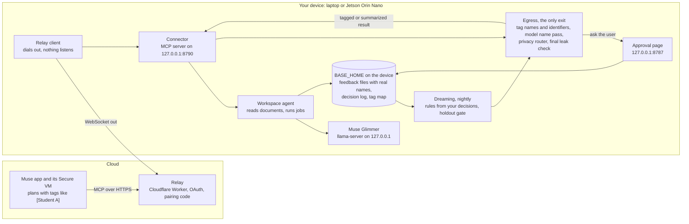

# Muse Privacy

Muse can't touch the private, tedious work that is most ready for automation: grading student papers, medical records, city agency casework, anything with personal information. Muse Privacy gives Muse a private workspace on hardware you own, a laptop or a Jetson Orin Nano, connected through a Muse connector. Muse plans the work, your device does every step that touches private data with Muse Glimmer, and nothing identifying reaches the cloud.

Built solo for the Meta Global AI Developer Hackathon, startup track. Every person, essay and record in this repo is invented.

**Status, Oct 27.** The whole path runs and is tested on a laptop, but every measured number so far used Muse Glimmer on OpenRouter with invented data (a development mode). Glimmer on the device, the Jetson, the deployed relay and the Muse app itself have not been run yet; [docs/HANDOFF.md](docs/HANDOFF.md) lists what waits on what.

## How it works



1. You ask Muse in plain words. Muse plans the job on its VM and calls the connector's six tools: `list_documents`, `search_documents`, `run_private_task`, `get_result`, `run_dreaming`, `dreaming_report`.
2. Muse reaches the device through the relay, which the device dials out to, so nothing on the device is open to the internet.
3. On the device, the agent swaps tags back to names only to choose what to do, and gives Glimmer the documents with every name and identifier already swapped for tags. Finished files with real names (for grading, one feedback file per student) are written only under `BASE_HOME`.
4. Every result goes through `base/egress.py`: exact checks for names on the roster and identifiers (phones, emails, SSNs, Luhn-checked cards, student ids, addresses, dates of birth), a second pass where Glimmer finds names the roster misses, then the privacy router, which decides to share it tagged, share a summary, ask you on the approval page, or keep it. A final leak check runs on every text before it leaves, and fails closed.
5. Each night, dreaming rebuilds the router's rules from your approve and deny decisions, and keeps them only if they score no worse on a holdout set with zero leaks.

On a Jetson, grading can be handed to the laptop's 4-bit Glimmer: the laptop dials out to the Jetson (`base/heavy/worker.py`), so the managed laptop never listens on the network. The interfaces between modules are in [docs/CONTRACTS.md](docs/CONTRACTS.md).

## Built during the event, and before

All of the code in this repository was written during the event; the first commit is from Oct 27, 2026. Three earlier Offline Base projects by the same author were read for ideas only, and nothing was copied from them: decision-guard (exact checks before text is sent, for `base/guard.py`), base-router-subagent (a device that dials out to a Cloudflare relay with OAuth and pairing codes, for `relay/` and `base/connector/`) and decision-tree (a status light, for `base/light.py` and `hardware/light/`). The code was written with Claude Code; the 2,000-item practice set was written by Muse Spark 1.3. Details and the open-source libraries used are in [docs/PRIOR_WORK.md](docs/PRIOR_WORK.md).

## Setup

You need macOS or Linux, [uv](https://docs.astral.sh/uv/), and for the relay Node 22 and a Cloudflare account.

### Laptop, cloud mode (development, invented data only)

Glimmer runs on OpenRouter, so the device reads only folders marked `.synthetic`, such as `demo/`.

```sh
git clone <this repo> muse-privacy && cd muse-privacy
uv sync
cp .env.example .env                 # then set OPENROUTER_API_KEY in .env
uv run pytest -q                     # unit tests; every model and API is mocked
uv run python -m base                # approval page http://127.0.0.1:8787, connector on 127.0.0.1:8790
```

### Laptop with llama-server (Glimmer on the device)

Not run yet: it needs about 20 GB of free disk. Use llama.cpp b10353 or newer.

```sh
git clone <this repo> muse-privacy && cd muse-privacy && uv sync && cp .env.example .env
git clone https://github.com/ggml-org/llama.cpp ~/llama.cpp
cmake -S ~/llama.cpp -B ~/llama.cpp/build -DGGML_METAL=ON && cmake --build ~/llama.cpp/build -j --target llama-server
uvx --from huggingface_hub hf download meta-models/Muse-Glimmer-30B-GGUF Muse-Glimmer-30B-KQuant-17GB-Q4_K_M.gguf --local-dir models
printf 'GLIMMER_BACKEND=llama_server\nLLAMA_SERVER_BIN=%s\nGLIMMER_GGUF=%s\nWORKSPACE_ROOT=%s\n' "$HOME/llama.cpp/build/bin/llama-server" "$PWD/models/Muse-Glimmer-30B-KQuant-17GB-Q4_K_M.gguf" "$HOME/<your class folder>" >> .env
scripts/start.sh                     # Glimmer on 127.0.0.1:8081 and 8082, then the server; Ctrl-C stops all
```

Later lines in `.env` win, so the `printf` overrides the cloud defaults. `uv run python -m scripts.bench_speed --label laptop` then writes the laptop's speed report.

### Jetson Orin Nano 8GB

Not run on a board yet. Run as root from a checkout on the board; `install.sh` makes the service user, builds llama.cpp with CUDA, downloads and checks Glimmer i1-IQ1_S (6.5 GB), makes a self-signed certificate for the approval page and installs three systemd units. See [deploy/jetson/README.md](deploy/jetson/README.md).

```sh
git clone <this repo> muse-privacy && cd muse-privacy
sudo deploy/jetson/install.sh --build-llama
sudoedit /etc/muse-privacy/env       # APPROVAL_HOST, RELAY_URL, WORKSPACE_ROOT, LIGHT_SERIAL
sudo systemctl start muse-privacy-glimmer muse-privacy
j() { sudo -u muse-privacy env BASE_DEVICE=jetson GLIMMER_BACKEND=llama_server BASE_HOME=/var/lib/muse-privacy/home /opt/muse-privacy/app/.venv/bin/python -m "$@"; }
j base.connector.relay_client register --name "Jetson" --relay-url "https://muse-privacy-relay.<your-subdomain>.workers.dev"
sudo systemctl enable --now muse-privacy-relay
j base.connector.relay_client pair   # type this code in Muse
```

To hand grading to the laptop, print the worker token on the board with `j base.heavy.routes`, copy `/var/lib/muse-privacy/home/tls/cert.pem` to the laptop, and run there `uv run python -m base.heavy.worker --jetson-url https://<jetson address>:8787 --token <token> --ca-cert cert.pem`.

## Add the connector to Muse

1. Deploy the relay once: `cd relay && npx wrangler login && ./deploy.sh`. It prints `https://muse-privacy-relay.<your-subdomain>.workers.dev`.
2. On the laptop: put that address in `.env` as `RELAY_URL`, run `uv run python -m base.connector.relay_client register` once, then keep `uv run python -m base.connector.relay_client run` going next to `python -m base`.
3. In Muse, **Settings > Connectors**, add a custom connector with the address plus `/mcp`. Leave the client ID and secret empty.
4. Muse opens the relay's Link your device page. Run `uv run python -m base.connector.relay_client pair` and type the code there within 10 minutes. Each code works once.

[docs/MUSE_SETUP.md](docs/MUSE_SETUP.md) has the full steps, the Muse Code fallback, the two scheduled jobs to give Muse (dreaming at 2 AM, a one-sentence report at 8 AM) and a test script of prompts. None of it has been tried in the Muse app yet.

## Which Meta models run where

| Model | Where | What it does |
|---|---|---|
| Muse, the app and its Secure VM | Meta's cloud | Plans the work with tags, calls the connector, runs the scheduled dreaming jobs. Never sees a name or a raw document. |
| Muse Glimmer 30B, `meta/muse-glimmer-30b` on OpenRouter | OpenRouter (development only) | Every model step today, on invented data. The device refuses any folder without a `.synthetic` marker in this mode. |
| Muse Glimmer, Meta's Q4_K_M GGUF (`Muse-Glimmer-30B-KQuant-17GB-Q4_K_M.gguf`) | The laptop, llama-server | Grading, the name pass, summaries and the privacy router (Glimmer is its own router; its small assistant model is a speculative-decoding drafter, not a chat model). |
| Muse Glimmer i1-IQ1_S (6.5 GB, `mradermacher/Muse-Glimmer-30B-i1-GGUF`) | The Jetson Orin Nano 8GB, llama-server | Lookups, tagging and routing on the board; grading goes to the laptop's Q4_K_M when its worker is connected. |
| Muse Spark 1.3 | Meta Model API | The eval harness and the 2,000 invented practice items. `base/spark.py` refuses any text with a roster name or an identifier, and is never used for user data. |

## Numbers

All on OpenRouter's Glimmer with invented data. Each links to the report, which starts with the command that made it; raw rows are under `eval/reports/raw/`. The summary with every source is [eval/reports/final.md](eval/reports/final.md).

| What | Number | Report |
|---|---|---|
| Leaks | 0 in the 100-item run, the holdout, every night's holdout scoring and both 24-essay grading jobs. One text on simulated day 5 was flagged by the eval's checker; it is a false positive (the verb "rose" in a class summary matched the invented student Rose), explained first in final.md | [final.md](eval/reports/final.md#leaks-one-flagged-and-it-is-not-a-real-leak) |
| Router accuracy, 100 items, first day, inputs as the connector sends them | 75% overall: share tagged 3 of 25, share a summary 24 of 25, ask first 25 of 25, refuse 23 of 25. No item was shared that should have been asked about or kept | [final_cloud.md](eval/reports/final_cloud.md) |
| Agreement with the simulated teacher on the 20 holdout items | 75% | [final_cloud_holdout.md](eval/reports/final_cloud_holdout.md) |
| Approval requests per simulated day (20 items a day, 5 she wants to be asked about) | 11, 12, 9, 8, 10 | [final/nights.md](eval/reports/final/nights.md) |
| Holdout agreement after each of five nights of dreaming | 75, 70, 75, 75, 75, 75%; the gate kept no night's rules | [final/nights.md](eval/reports/final/nights.md) |
| Grading 24 essays, from Muse's request to the tagged result Muse read | 32.4 s on a first day (the job itself 26.3 s, 27 Glimmer calls), with an instant approval | [e2e_cloud_no_rules.md](eval/reports/e2e_cloud_no_rules.md) |
| Cloud speed per step | Router 1.7 s mean (p95 3.3 s), name pass 2.1 s, grading one essay 4.2 to 4.3 s | [final.md, section 6](eval/reports/final.md#6-speed-in-cloud-mode) |
| Grading consistency between two runs | Same total for 21 of 24 essays; same criterion score 92 of 96 times | [grading_spotcheck.md](eval/reports/grading_spotcheck.md) |


The chart's leak line counts the holdout runs; the day-5 flag above is not in it.

Not measured yet: Glimmer's speed on the laptop and on a Jetson, the Jetson's memory use, quantization quality (Q4_K_M against i1-IQ1_S), a router LoRA, and Ethan's own grading spot-check ([eval/reports/grading_spotcheck.md](eval/reports/grading_spotcheck.md) is ready for his scores).

## Known limits

- **No device numbers yet.** Every number is Glimmer on OpenRouter with invented data. Speed on the laptop and the Jetson, the Jetson's memory, and how much the 1-bit quant loses are all unmeasured.
- **Not tried with the real Muse app.** The relay is tested locally with a client playing Muse. Whether the app takes a custom connector, which OAuth client style it uses, and its scheduled jobs are untested. Pre-registered OAuth clients are not supported, and redirect URIs must be https or loopback.
- **The router errs on the strict side.** On a first day it asks about most tagged per-student results the simulated teacher would share without asking (21 of 25 in the final run). It never shared an item it should have asked about or kept, but that is one simulated teacher's policy over 100 items, and two items she would refuse were asked about instead.
- **Dreaming has not learned much from real inputs.** Its rules key on the kind of result and the never-share topics the guard finds, not on Muse's request. What separates this teacher's cases (families, people outside the class, a whole essay) is in the request, so on what the connector really sends the gate kept none of five nights' rules. The rising curves in the tuning run used hand labels. Approving a class-level result also teaches "share tagged", never "share a summary".
- **The eval's leak checker matches names case-insensitively,** so a common word that is also a roster name ("rose") can be flagged; it flagged one model-written summary in the final simulation. The device's own final check did not flag it, correctly.
- **Small holdout.** 20 items, 5 per decision, which the gate also selects on, so a single changed decision moves a category by 20 points and night-over-night gains are an upper bound.
- **The name pass costs a model call per result,** and a name it wrongly finds in a summary makes egress refuse that summary. Initials such as "C.R." are not tagged.
- **Long jobs work by polling.** Muse starts a job and calls get_result until it is done; the relay holds no stream open and answers 504 after 60 seconds without a reply from the device.
- **A Jetson's approval page uses a self-signed certificate,** so browsers warn on first visit; the laptop worker pins it.
- **The status light and the enclosure are designed, not built.** The firmware is unit-tested but not flashed, and the enclosure's mounting holes are placeholders until a board is measured.

## Layout

| Path | What |
|---|---|
| `base/` | The device: guard, model client, workspace and agent, router, approvals, egress, connector, relay client, approval page, heavy-step queue and worker, dreaming, light |
| `relay/` | The Cloudflare Worker Muse connects to |
| `eval/` | The eval set, holdout, invented roster and teacher policy, the harness, and every report |
| `scripts/` | Simulation, charts, synthetic data, speed bench, secrets scan, Modal scripts |
| `deploy/jetson/` | systemd units and the installer for the board |
| `hardware/` | Status light firmware and the enclosure model |
| `demo/` | The invented class folder (marked `.synthetic`) |
| `docs/` | Contracts, decisions, prior work, Muse setup, demo script, handoff |
