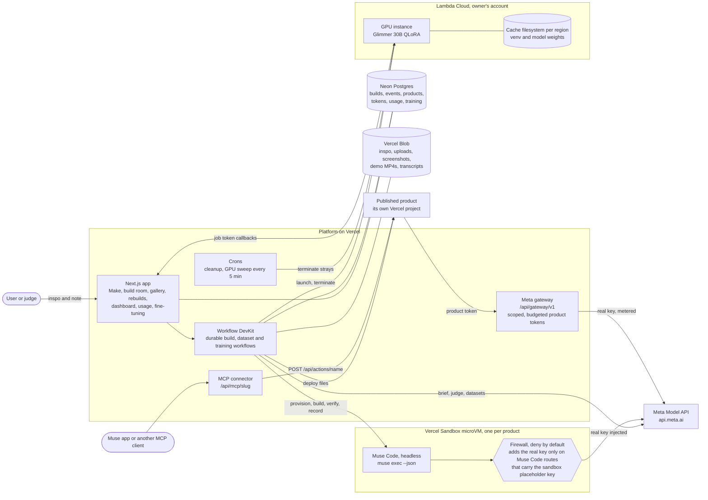

# Muse Muse

Give it a muse and Muse makes it. Drop in an example or some inspo, like a photo, a screenshot, a sketch, a short video, a voice memo or a PDF, and add a note if you want. Muse Code builds a working product from it on Meta's models. The platform tests it, records a demo, deploys it to its own link, and makes it usable from the Muse app.

Hackathon codename for the Meta Global AI Developer Hackathon, Startup track. Muse is Meta's brand, so pick your own name before taking this further. See the Name section in [docs/DESIGN.md](docs/DESIGN.md#name).

**Live:** https://muse-muse.vercel.app. Anyone can browse it with no sign-in. The submission write-up, video script and checklist are in [docs/SUBMISSION.md](docs/SUBMISSION.md).

## Status

**Built from Oct 26 to Nov 4, 2026, for the Meta Global AI Developer Hackathon.** Before kickoff there was only a scaffold, committed exactly as received in `e3ba154`: design docs, the Meta model catalog, prompt drafts, the product template's rules and skills, types, the database schema, config, and route stubs that returned 501. All working code was written from Oct 26 on.

An Oct 27 audit compared every scaffold file with the current tree. It found five small helpers from the scaffold still in use: `museExecArgs`, `metaClient`, `imagePart` and `videoPart`, `toDataUrl` and `glimmerClient`. They were rewritten the same day; `glimmerClient` became `glimmer()`, which also names the served model. Everything else that survives from the scaffold is types, schema, config, docs or template boilerplate.

## What it does

1. **Muse.** On the Make page you drop in inspo and an optional note. Text alone works too. Three example cards (a receipt, a napkin sketch, a bakery menu board) attach a photo and fill the note in one click.
2. **Brief.** Muse Spark 1.3 reads every reference: images, video and PDFs directly, and voice memos after Muse Voice Transcribe 1.0 turns them into text. It writes a structured brief: the product, who it's for, the main flow, the Meta models it needs and why, honest limits, cost per use, and what it takes from the inspo and what it leaves out. It can also refuse.
3. **Build.** Muse Code runs headless in a Vercel Sandbox microVM, one per product, started from a warm snapshot. It writes a Next.js product from `template/`, guided by the template's `AGENTS.md`, one skill per Meta model and a manifest it must fill in. Muse Wonder 1.0 replaces Spark 1.3 as the build model when the brief marks the product complex. The build room shows the live log and a live preview.
4. **Check.** `npm run verify` runs typecheck and `next build`, starts the server and checks for console errors. Then come the Playwright smoke test Muse Code wrote, with real model calls, and a screen check that fails on sideways scroll, clipped text or a loading state left on screen. Last, Muse Spark 1.3 judges the screenshots against the brief and the inspo.
5. **Fix rounds.** A failure resumes the same Muse Code session with the errors and up to four of the judge's screenshots. Three rounds at most. A product that still fails ships as partial only when every mechanical check passed. Otherwise the build ends as failed, with Muse Code's notes.
6. **Demo video.** The smoke test reruns at 1280×720 with video on. ffmpeg makes it an MP4 with a title card and step captions. The redacted Muse Code transcript is saved for the product page.
7. **Deploy.** The platform, never the sandbox, publishes the source as its own Vercel project, `musemuse-<slug>`. The product calls Meta only through this platform's gateway, with a product token scoped to its models and endpoints, a daily budget and rate limits.
8. **Connector.** The actions in the product's `musemuse.json` become MCP tools at `/api/mcp/<slug>`. Add that URL to the Muse app as a custom connector, or to Claude Code as an MCP server.

A refinement such as "add a dark mode" resumes the same session in the same sandbox, then checks and ships again. If its checks fail, the live version stays.

The showcase is a batch run, `npm run rebuild-all`, that rebuilds Meta's Llama-era demo videos on current Muse models from `catalog/meta-resources.json`. That is six videos from Meta's Videos page plus first demos for SAM 3.1, Muse Image, Voice Transcribe and Muse Wonder.

## Results from the Oct 27 test runs

- **24 of 24 builds went live** in a local batch, at 3 to 9 minutes and about $0.30 to $1.80 in Meta credits each. The first 17 covered all 10 catalog rebuilds and every model: Spark, Muse Image, SAM 3.1, Voice and Wonder. Every product got a recorded MP4 demo, a Muse Code transcript and an MCP manifest with actions. Local runs stop before the deploy step, so these products are not on the live site's Gallery yet.
- **Product quality, scored blind.** A judge-style review of the 24 products' screenshots averaged 5.5 out of 10. After a template polish (themes, shared parts, a screen check in each product's own tests, copy rules), an 11-build canary of the same muses scored 5.91, up from 5.14 for those 11, and all 11 went live. A second polish round scored 5.50 and cost 64% more, so it was not merged.
- **Hidden Muse Code spend.** Muse Code's `run.usage` left out its reminder agents. They were 31% to 43% of each build's real Muse Code spend. The platform now reads Muse Code's session logs and charges them.
- **Fine-tuning.** See [the lab](#fine-tuning-lab-spark-teaches-glimmer) below.

## The UI

The platform is laid out like another tab in Meta's Model API dashboard. The layout was measured from screenshots of Meta's pages ([docs/UI_PATTERNS.md](docs/UI_PATTERNS.md)).

- **Sidebar.** Dashboard; Make, Builds, Rebuilds, Gallery; Usage, Fine-tuning; How it works and Model API docs.
- **Make** follows Meta's Image playground: example cards, a composer that is the muse box, and a right panel that shows the build setup (model, builder, fix rounds, judge, demo video, publish, connector) as disabled controls.
- **Build room** follows the Chat playground. The muse is the user turn. The brief, Muse Code's log, the check results and the shipped result are assistant turns, each ending with a time, tokens and cost line. The right panel has a step rail (Brief, Provision, Build, Preview, Check, Record, Deploy), the Muse Code session id, fix rounds, running cost, links and the live preview.
- **Dashboard** leads with "Use your products in Muse": tabs for the Muse app, Claude Code and cURL, a tab per published product, and its connector in a copy box. Below it are Requests, Input tokens, Output tokens, Products and Spend (est.).
- **Usage** leads with "Meta tokens driven", stacked by products and building, then Spend (est.), Builds and a table per product. Charts are inline SVG.
- **Product pages** show the live product in a frame, the muse it came from, models, limits, the recorded demo, the connector URL and "How it was built".
- Light and dark themes. Below 760 px the sidebar becomes a top bar and the build panel stacks under the log.

It keeps its own two-sparkle mark, a "Concept" pill and the line "Not an official Meta product." Nobody pastes a Meta key anywhere.

## How builds use Muse Code's own features

- **Headless exec with hardened flags.** Each run is `muse exec --json --yolo --session-id <uuid> --prompt-file <file> --model muse-spark-1.3 --reasoning-effort high --max-model-steps 200 --disable-web-tools`, plus `--image` for each inspo image. The runner adds `--disable-request-user-input` and `--no-foreign-personal-context` when `muse exec --help` lists them, so a run never waits for a person and never loads `~/.claude` rules or skills. `--yolo` turns off Muse Code's own sandbox, which can't run in the microVM. The disposable, firewalled VM is the boundary. The snapshot script fails unless `muse exec --help` lists every flag a build passes.
- **15 conflicting bundled skills disabled.** Skills such as `browser-game`, `web3d`, `plan`, `requirements-clarification` and `grill` fight a Next.js template or a run with nobody to answer. The builder snapshot turns all 15 off with `muse skills disable`, and the snapshot fails if any is still on (`DISABLED_BUNDLED_SKILLS` in `lib/sandbox/setup.ts`).
- **The template steers it.** `template/AGENTS.md` holds the rules. `template/.agents/skills/` has one skill per Meta model (reasoning, image, SAM, voice, Glimmer) plus product UI and verify skills.
- **Judge screenshots attached to fix rounds.** A fix round resumes the session with `--session-id` and attaches up to four of the judge's screenshots with `--image`. Each is under 2 MB, shrunk with ffmpeg in the sandbox if needed, and kept in a git-ignored folder that never deploys.
- **Reminder and subagent activity, shown and charged.** The build room shows each reminder Muse Code starts and each subagent it spawns. `run.usage` counts only the main agent, so after each run the platform reads the usage records in Muse Code's session logs, adds the reminder and subagent calls, drops the duplicates and charges them (`lib/sandbox/muse-log.ts`).
- **Transcripts.** `muse export --session <id> --redacted` becomes "How it was built" on the product page.

## Fine-tuning lab: Spark teaches Glimmer

Meta has no hosted fine-tuning, so the lab runs on the owner's Lambda Cloud GPUs.

1. **Write.** Muse Spark 1.3 writes a dataset for a task: varied user prompts in batches, then its own answers. It holds out 10% (8 to 40) as eval prompts with references.
2. **Train.** The `glimmer-lora` recipe runs a QLoRA fine-tune of Muse Glimmer 30B (Unsloth's 4-bit build) on one Lambda GPU. The Python venv and the 21 GB of weights stay on a Lambda filesystem in the region, so later jobs skip the install and the download.
3. **Judge.** Base and tuned Glimmer answer the held-out prompts. After the GPU is terminated, Muse Spark 1.3 scores each pair blind, as A and B, with the order switched on every other item.
4. **Try it live.** An admin can serve a trained adapter on one GPU for 10 to 120 minutes (the `glimmer-serve` recipe). Meanwhile its public result page has a box where anyone types an app idea and sees base and tuned Glimmer answer it side by side, from the same GPU. The platform proxies each prompt over HTTPS pinned to the certificate the GPU reported, with a key derived from the job's token hash, and the GPU shuts down at the end like every other job.

By default both models train and answer under a one-line role prompt, such as "You are Muse Muse's brief writer.", instead of the teacher's full task prompt. That way the score measures what training taught.

Jobs are admin only. The Lambda key never leaves the platform. Each instance gets a one-time job token, and only its hash is stored. Three things terminate a GPU: the job's workflow, the instance's own done callback and a sweep every 5 minutes. A job won't launch unless the sweep ran in the last 15 minutes. Each job has a time limit and a dollar limit, one GPU runs at a time, and a daily cap covers all jobs.

Results are public and read-only at [/fine-tuning](https://muse-muse.vercel.app/fine-tuning): each judged job with its wins, average scores, GPU time and cost, and every held-out prompt with Spark's reference, the base answer, the tuned answer and the verdict. The full spec is [docs/TRAINING.md](docs/TRAINING.md).

| Run | GPU | Time | Cost | Result |
|---|---|---|---|---|
| Smoke test | Lambda A10 | about 3 min | $0.06 | GPU, CUDA, disk and network checked |
| Dry run of the full loop | A100 | | $0.13 | Dataset paging, eval items, judging and upload checked, with stand-in answers |
| Dataset "Muse Muse brief writer" | none | | $1.51 | 400 examples written by Muse Spark 1.3: 360 to train on, 40 held out |
| First Glimmer 30B QLoRA run | A100 40 GB | 47 min | $1.59 | 120 steps, final loss 0.47. Base won 28 to 11, which exposed an eval bug |
| Second run, with the fix and the short prompt | A100 40 GB | 42 min | $1.39 | 120 steps, final loss 0.52. **Tuned won all 40 held-out prompts**, average score 8.88 against base 1.95 (judging $0.15) |

The eval bug: training put every answer on Glimmer's final channel, but the eval prompt let the model pick a channel, and the tuned model answered inside its reasoning channel instead. Eval prompts now continue on the final channel, as training does, with 1,024 new tokens. Before any paid generation, the job checks that every training example trains on its answer.

## Architecture



The real Meta key lives in two places only: the platform's server environment and the sandbox firewall rule that injects it. Inside a sandbox, Muse Code holds a per-sandbox placeholder key. The firewall swaps it for the real key on four routes only: `POST /v1/responses`, `/muse-code/models`, `POST /v1/files` and `GET /v1/models`. Every other request to `api.meta.ai` gets a 403 from the firewall. Other hosts are blocked, apart from npm, the platform and Vercel Blob uploads when a smoke test needs them. Published products never hold a Meta key. The Vercel token, the database URL and the Lambda key never enter a sandbox, a product or a GPU.

## Layout

```text
app/                        Platform UI and API routes (Next.js App Router)
  page.tsx                  Make: example cards, the muse box and the build setup panel
  builds/                   Your builds
  b/[buildId]/              Build room
  p/[slug]/                 Product page
  gallery/                  Shipped products
  rebuilds/                 Meta's videos and their rebuilds
  dashboard/                Connectors, requests, tokens and spend
  usage/                    Meta tokens driven, spend and builds
  fine-tuning/              The lab: datasets, jobs and judged results
  how-it-works/             The pipeline in five steps
  sign-in/                  Email, personal password and access code
  api/inspirations/         Save inspo and start a build
  api/builds/[buildId]/     Events (SSE) and refinements
  api/rebuilds/             Start batch rebuilds
  api/gateway/v1/[...path]/ Meta Model API proxy for products
  api/gateway/uploads/      Upload tickets for large files
  api/mcp/[slug]/           Muse app connector endpoint
  api/train/                Fine-tuning jobs, datasets, GPU callbacks
  api/lab/[id]/try/         The live demo: one idea to base and tuned Glimmer
  api/cron/                 Cleanup and the GPU sweep
components/                 Shell, composer, build room, charts, product and train views
lib/
  brief/                    Brief schema, writer, media handling and policy
  pipeline/                 Build workflow and steps
  sandbox/                  Firewall policy, Muse Code runner, session-log usage, snapshot setup
  gateway/                  Product gateway: tokens, limits, metering, uploads
  publish/                  Vercel deploys for products
  mcp/                      MCP server for product connectors
  train/                    Lambda client, training workflow, sweep, recipes, datasets, judge
  db/schema.ts              Postgres schema (Drizzle)
catalog/meta-models.json    Every Meta model, endpoint, limit and price we know of
catalog/meta-resources.json Meta's demo videos, each with a rebuild plan
drizzle/                    SQL migrations
docs/                       Design, spikes, UI patterns, training, build plan, submission
scripts/                    dev-local, migrate, make-builder-snapshot, rebuild-all
template/                   Starter repo Muse Code builds every product from
  AGENTS.md                 Rules Muse Code loads on its own
  .agents/skills/           One skill per Meta model, plus product UI and verify
  inspo/                    Where the user's references land for each build
  tests/                    Smoke test and the screen check
```

## Setup

You need Node 22 or newer, a Vercel account, a Neon Postgres database from the Vercel Marketplace and a Meta Model API key. Muse Code is installed in the builder snapshot, so you don't need it on your machine.

```bash
npm install
cp .env.example .env.local      # fill in the values; each one is explained in the file
vercel link && vercel env pull  # gives VERCEL_OIDC_TOKEN for Sandbox locally (good for 12 hours)
npm run snapshot                # makes the warm builder snapshot; put the printed id in BUILDER_SNAPSHOT_ID
npm run db:migrate              # applies drizzle/ to DATABASE_URL (npm run build runs it too)
npm run dev                     # http://localhost:3000
```

Run `npm run snapshot` again whenever `template/` changes, and update `BUILDER_SNAPSHOT_ID` in `.env.local` and on Vercel. Run `npm run db:generate` only after you change `lib/db/schema.ts`. To work on the product template itself, run `cd template && npm install`.

On Vercel, set the same variables on the project. A few need care:

- The Blob store must be **public**. Meta fetches media by URL, and products upload straight to the store. Connecting it sets `BLOB_STORE_ID` (used with the deployment's OIDC token) or, for older stores, `BLOB_READ_WRITE_TOKEN`; either works for the platform's own files and inspo uploads. Product uploads through the gateway and training uploads still need `BLOB_READ_WRITE_TOKEN`. With neither set, builds are refused.
- `VERCEL_TOKEN` and `VERCEL_TEAM_ID` publish each product as its own project.
- `OPEN_ACCESS=guest` opens the site with no sign-in: every visitor shares one Builder account and its daily cap. `DAILY_SPEND_CAP_USD` stops new builds and gateway calls for the day once it is reached.
- Fine-tuning needs `LAMBDA_API_KEY` and `CRON_SECRET`. Jobs start only on production, where Vercel runs the sweep cron.

`npm run rebuild-all` starts the rebuild batch at `PLATFORM_URL` with the `AUTOMATION_SECRET` bearer and prints a table and a total. Vercel Hobby caps sandbox sessions at 45 minutes and Pro at 24 hours. Builds target well under 30 minutes, so Hobby works for the hackathon.

## Run it on your machine

```bash
npm run dev:local               # then open http://localhost:3000
```

This needs only `MODEL_API_KEY`, `VERCEL_OIDC_TOKEN` (from `vercel env pull`, good for 12 hours) and `BUILDER_SNAPSHOT_ID` in `.env.local`. The database is PGlite in `.data/pglite`, files go to `.data/files`, and sign-in is off for localhost. Builds still run in Vercel Sandbox. The sandbox can't reach your machine, so products call Meta directly through the build firewall instead of the gateway, and their file uploads don't work. A local build stops after the demo video and isn't published to its own link, even with `VERCEL_TOKEN` set: the product would call this machine's gateway, which Vercel can't reach. The live preview in the build room works while the build runs.

## Tests

```bash
npm run typecheck
npx tsx --test --experimental-test-module-mocks $(find lib components -name '*.test.ts')
npx tsx --test --experimental-test-module-mocks components/train/__tests__/*.test.tsx
```

Nothing in the tests calls Meta, Vercel, Lambda or Neon. The fine-tuning runner test also needs `python3`.

## Docs

- [docs/SUBMISSION.md](docs/SUBMISSION.md) has the submission write-up, the video script and the checklist.
- [docs/DESIGN.md](docs/DESIGN.md) covers the architecture, pipeline, security, cost, demo and risks.
- [docs/SPIKES.md](docs/SPIKES.md) has what the day-one spikes measured about the Meta Model API, Muse Code and Vercel Sandbox. Code follows it where older docs disagree.
- [docs/UI_PATTERNS.md](docs/UI_PATTERNS.md) describes Meta's dashboard layout and how each page maps to it.
- [docs/TRAINING.md](docs/TRAINING.md) specifies the fine-tuning lab.
- [docs/META_CATALOG.md](docs/META_CATALOG.md) lists Meta's models, endpoints, limits and prices.
- [docs/PROMPTS.md](docs/PROMPTS.md) has drafts for the brief writer, builder, fix round, judge and refinement prompts.
- [docs/BUILD_PLAN.md](docs/BUILD_PLAN.md) has the rules check, day-one spikes, the Oct 26 to Nov 4 schedule and the test muses.

Muse Muse is not an official Meta product.
