# Muse Muse

<p align="center"><a href="https://www.musemuse.dev">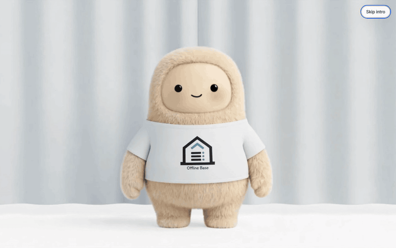</a><br><i>15 seconds on www.musemuse.dev as a first-time visitor: the opening, an ask typed into Make, then Add a folder of data for a model. Nothing was sent and no folder was picked; see <a href="#limits-nov-4">Limits</a> for what has run end to end. Recorded Nov 4, 2026; the pointer is drawn in, since the recording was scripted.</i></p>

**One sentence in, a tested app live at its own link, built and run on Meta's models.**

People know their jobs, but getting custom software built takes engineering they often don't have. Muse Muse is our answer for the hackathon's **Build for Your World** theme. You type a sentence, or drop in a photo, sketch, voice memo or PDF. Muse Code, Meta's coding agent, builds a working app on Meta's models. The platform checks it, records a demo, puts it live, and hands it over as an MCP server, a CLI, a skill and more.

**Video:** [the 3-minute demo, link added at submission]. **Live:** https://www.musemuse.dev, no sign-in: browse the apps, or build one as the shared guest. **Run it yourself:** the [Judge path](#judge-path). Not an official Meta product.


*One of the apps it built, live at its own link: Science Teams Showdown turns a 7th-grade science topic into a team quiz show. The side panel shows its model, its cost per run, its limits ("Sample lesson is invented") and the connector that exposes 3 actions to the Muse app. Live site, Nov 4, 2026, as a guest.*

## In 60 seconds

- **The problem, firsthand.** Ethan works in ed tech, where teachers hop from tool to tool for one day's lessons and paste private data into AI. Hussam has seen aerospace and chip fabs ban or limit chatbots for mission-critical work instead of tuning and testing one. We know these worlds firsthand, but no school or company uses Muse Muse.
- **What it does.** One sentence becomes a brief. Muse Code builds the app in its own sandbox. The platform checks it, runs fix rounds, records a demo, and ships a live link and a connector. Nobody watches the build.
- **What it frees up.** The person who knows the work gets a tested app and its connector without an engineer. Each app reaches Meta only through a metered gateway with a daily budget, so its spend has a ceiling.
- **What it makes possible.** Every app is also an MCP server any MCP client can call, and the edge apps are built to fall back to a Jetson board when the cloud is cut.

## Why it stands out

| | What | Proof |
|---|---|---|
| **One sentence to a deployed app** | Brief, build, test, fix, demo video, live link, MCP server, CLI and skill, with nobody watching. On Nov 3 the live site took 53 builds; 21 did not ship (13 failed their checks after fix rounds, 8 were refused by the daily spend cap) | [Build log, Nov 3, 2 PM](docs/BUILD_LOG.md#nov-3-about-2-pm-et-look-corrected-to-the-meta-ai-app-look-spend-cap-500-rebuilds-skills-set-polish-restarted) |
| **Checks that get checked** | Our judge passed 17 of 18 overnight apps. A hands-on audit found 7 that work, 9 with gaps and 2 broken. The defects became new checks the same day, and the broken apps are hidden from the gallery until rebuilt | [Target audit](docs/BUILD_LOG.md#nov-3-2026-530-am-et-target-audit-batch-2-one-build-per-target), [demos in check](docs/BUILD_LOG.md#nov-3-2026-1030-am-et-demos-in-check-for-judges-branch-tg-p-demos) |
| **Built to hold up in production** | The Meta key never enters a sandbox or an app. Apps get scoped, budgeted tokens. A platform-wide daily spend cap is checked before any new spend | [Holds up in production](#holds-up-in-production) |
| **Meta's open models on our own hardware** | Meta's SAM 3.1 at 1.42 s a look on a Jetson Orin Nano, tuned on another Jetson and public on Hugging Face. A 2026-knowledge Muse Glimmer 30B, built with Muse Spark Open, runs one-bit on a Jetson, and on a Galaxy S25 in AWS Device Farm and an M1 Mac | [Proven](#proven-nov-1-to-4) |
| **Others already quantize it** | An outside publisher made three quantized versions of our Glimmer. About 4,500 downloads across our repos and theirs, as Hugging Face counts them | [See it, 9](#see-it) |
| **Muse Code as an agent in the room** | Muse Code drives a rover with its own tools and looks through the tuned SAM 3.1 on a Jetson | [Rover runs](docs/BUILD_LOG.md#nov-4-2026-1230-am-et-one-screen-demo-view-glowing-best-match-memory-panel-voice-commands-first-live-run) |
| **Private files kept away from Muse** | Muse Privacy, part of this repo (`privacy/`): a separate Meta model reads the files and Muse gets tags like [Student A]. 0 leaks of names or identifiers on 200 invented items | [Muse Privacy](#muse-privacy) |

Every number here is logged with its date in [docs/BUILD_LOG.md](docs/BUILD_LOG.md), and [eval/README.md](eval/README.md) lists every measurement, failures first.

## Limits, Nov 4

Said once, here, so the rest can be read plainly:

- **Test model, made-up data.** Builds on the live site run on Muse Spark 1.3 Contributor, the test model, while `BUILDS_ON_CONTRIBUTOR` is on. Product pages say "in place of Muse Wonder". Meta may train on contributor prompts, so the Make page and each app that runs on it warn about it, and our test builds use made-up data. The only long Muse Wonder build in the Prove run failed ([docs/PROVE_RESULTS.md](docs/PROVE_RESULTS.md)).
- **The edge fallback is simulated.** The outage drills run against a simulated board. No app has answered on a real board with its uplink pulled.
- **The whole chain has not run as one.** No app has answered with a tuned model made from its own sentence, and no Glimmer tuned in the lab has run on anyone's own hardware.
- **Muse Privacy runs on invented data** with Muse Glimmer 30B in the cloud, and has no real users. Glimmer on a device has not run for it.
- **The open weights are separate from the apps.** No app calls the 2026-knowledge Glimmer, and the SAM tune adds a name, not accuracy.
- **CI on main is red at this writing.** The Nov 4 run passed 7,108 of 7,131 Node tests, failed 12 and skipped 11 ([Tests](#tests)).

## See it

In the order of the demo. Click any picture for full size.

<table>
<tr>
<td width="50%" valign="top"><a href="docs/readme/make-page.png">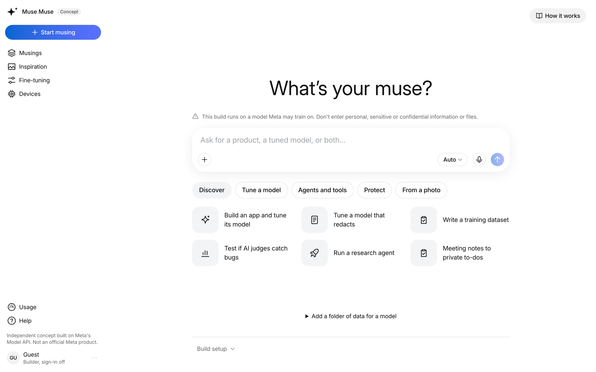</a><br><b>1. Make.</b> Every build starts with one sentence or a photo. The warning says the build runs on a model Meta may train on. <i>Live site, Nov 4, 2026, as a guest.</i></td>
<td width="50%" valign="top"><a href="docs/readme/build-room.jpg">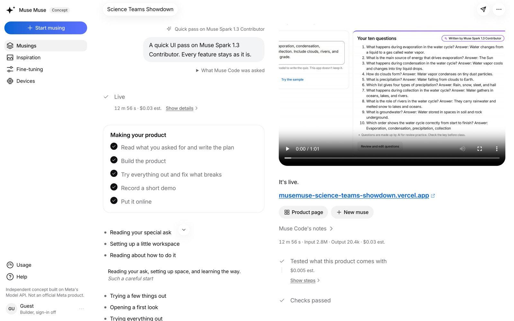</a><br><b>2. The build room.</b> Plan, build, test and fix, record a demo, put it online, then "Checks passed". This one was a quick UI pass on the existing Science Teams Showdown. <i>Live site, Nov 4, 2026.</i></td>
</tr>
<tr>
<td width="50%" valign="top"><a href="docs/readme/get-it-mcp.png">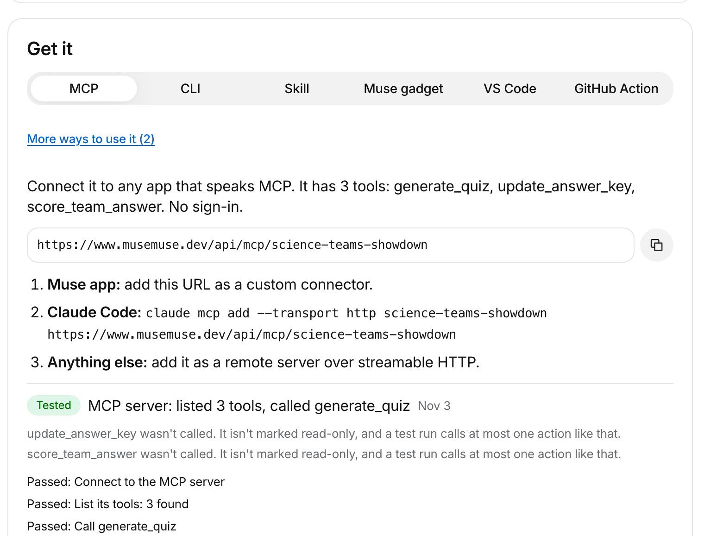</a><br><b>3. Get it.</b> Every product ships as an MCP server, a CLI, a skill and more. This test on Nov 3 listed the app's 3 tools and called one. The "Muse gadget" tab is Muse Muse's own option, not Meta's Muse Gadget SDK. <i>Live site, Nov 4, 2026.</i></td>
<td width="50%" valign="top"><a href="docs/readme/where-it-ran.jpg">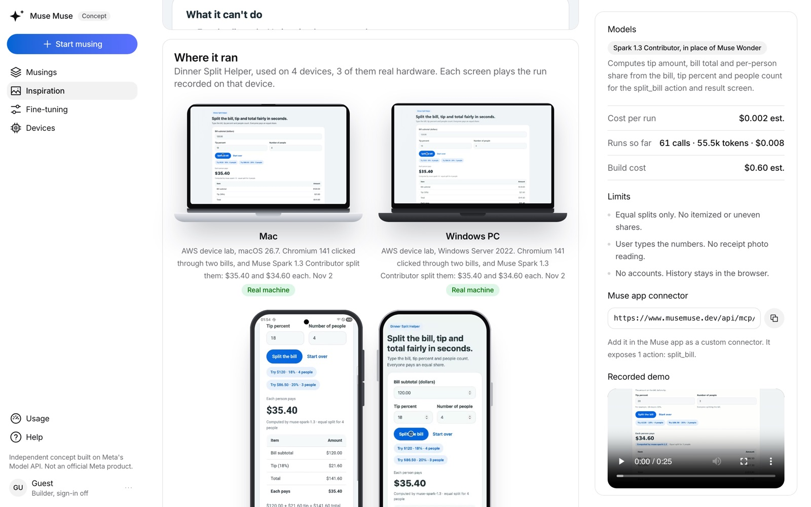</a><br><b>4. Where it ran.</b> Dinner Split Helper on 4 devices, 3 of them real hardware in AWS device labs. Each screen plays the run recorded on that device. <i>Live site, Nov 4, 2026.</i></td>
</tr>
<tr>
<td width="50%" valign="top"><a href="docs/readme/sam-meta-vs-tuned.jpg">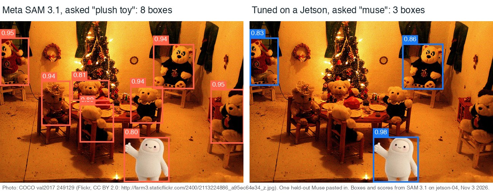</a><br><b>5. SAM 3.1 on a Jetson.</b> Left: Meta's SAM 3.1, "plush toy", 8 boxes. Right: tuned for "muse", top box on Jolly (0.98), but it also boxes 2 other toys (0.83 and 0.86), so it does not reliably tell Jolly apart. <i>Boxes from jetson-04, Nov 3, 2026, drawn on a laptop. Photo: COCO val2017 249129, Flickr, CC BY 2.0.</i></td>
<td width="50%" valign="top"><a href="docs/readme/hf-sam-muse.png">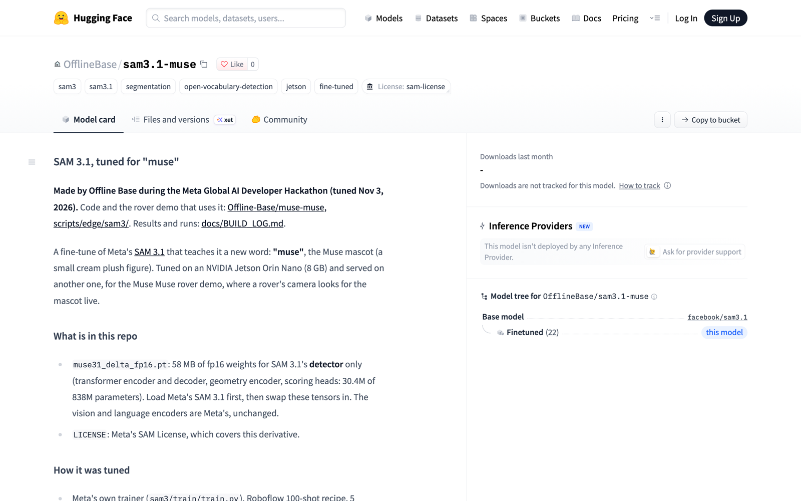</a><br><b>6. The tuned SAM, public.</b> <a href="https://huggingface.co/OfflineBase/sam3.1-muse">OfflineBase/sam3.1-muse</a>: a 58 MB detector-only file under Meta's SAM License, tuned on one Jetson Orin Nano and served on another. <i>Hugging Face, Nov 4, 2026.</i></td>
</tr>
<tr>
<td width="50%" valign="top"><a href="docs/readme/hf-glimmer-2026.jpg">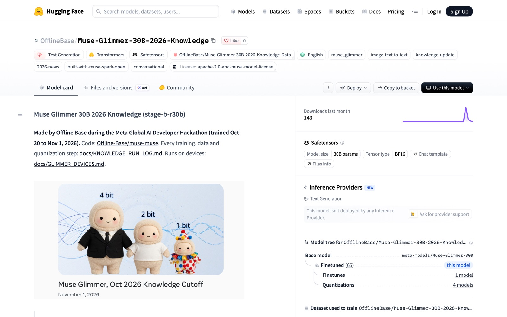</a><br><b>7. The 2026-knowledge Glimmer, public.</b> <a href="https://huggingface.co/OfflineBase/Muse-Glimmer-30B-2026-Knowledge">Muse Glimmer 30B with 2026 knowledge</a>, trained Oct 30 to Nov 1, with its GGUF and LoRA repos. Built with Muse Spark Open, for people 18 and over. No app calls it. <i>Hugging Face, Nov 4, 2026.</i></td>
<td width="50%" valign="top"><a href="docs/readme/privacy-before-after.png">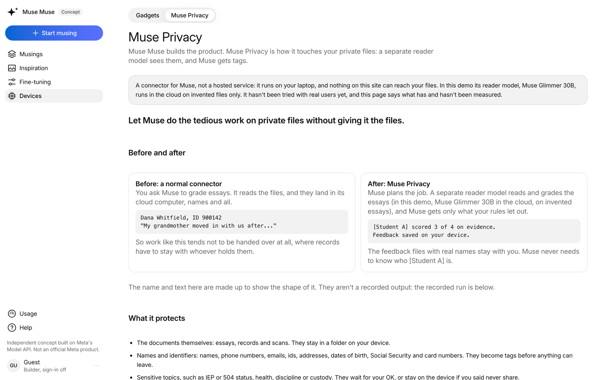</a><br><b>8. Muse Privacy.</b> A separate reader model sees the files, and Muse gets tags like [Student A]. The name and ID are invented, and the page says so. In this demo the reader is Muse Glimmer 30B in the cloud, not tried with real users. <i>Live site, Nov 4, 2026.</i></td>
</tr>
<tr>
<td width="50%" valign="top"><a href="docs/readme/hf-built-on-our-glimmer.jpg">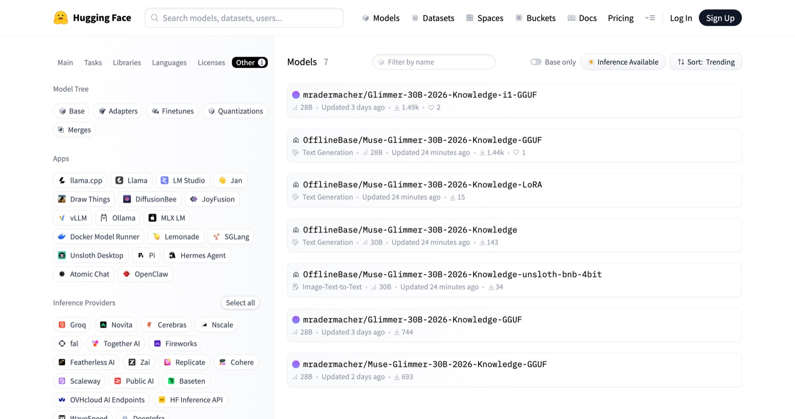</a><br><b>9. An outside publisher quantized it.</b> Hugging Face lists 7 models tagged with our 2026 dataset: our four, plus three quantized versions of our Glimmer by mradermacher, a publisher that quantizes many new models. Downloads include automated pulls. <i>Signed out, Nov 4, 2026.</i></td>
<td width="50%" valign="top"></td>
</tr>
</table>

## Contents

- [Judge path](#judge-path) and [Three commands, no keys](#three-commands-no-keys)
- [Meta models it uses](#meta-models-it-uses) and [Holds up in production](#holds-up-in-production)
- [Proven, Nov 1 to 4](#proven-nov-1-to-4)
- [Built for the hackathon](#built-for-the-hackathon): theme, track, rules and bonus prizes
- [What we learned about Meta's tools](#what-we-learned-about-metas-tools), [What was hard](#what-was-hard) and [The aim, and what has run](#the-aim-and-what-has-run)
- [Muse Privacy](#muse-privacy), [What's simulated](#whats-simulated) and [Offline Base's boards](#offline-bases-boards)
- [What it does](#what-it-does), [Results from the Oct 27 test runs](#results-from-the-oct-27-test-runs), [The UI](#the-ui) and [How builds use Muse Code's own features](#how-builds-use-muse-codes-own-features)
- [Fine-tuning lab: Spark teaches Glimmer](#fine-tuning-lab-spark-teaches-glimmer)
- [Architecture](#architecture), [Layout](#layout), [Tests](#tests), [Status](#status), [Before the event](#before-the-event) and [Docs](#docs)

## Judge path

Pick a row. The first four need no key and spend nothing of yours.

| Goal | What it needs | How | What you'll see, time and cost |
|---|---|---|---|
| **Build one on the live site** | Nothing | Type a sentence on https://www.musemuse.dev | Builds run as one shared guest account, with a daily build cap for all visitors together and a platform-wide daily spend cap. Every visitor sees every guest build, and the build runs on the test model, so use made-up data. Full builds took 33 to 100 minutes on Nov 3 |
| Browse what it built | Nothing | https://www.musemuse.dev/gallery | The live apps, each with its build room, demo video and connector. Apps the audit found broken are hidden until rebuilt |
| Run the outage drills | Node 22.22.3 or newer | `npm ci && npm run drill` | Eleven drills on loopback, each printed with its result, JSON in `.data/drill/`, exit 0 when all pass (11 of 11 on Nov 3). About 25 seconds. No key, no model |
| Run the tests | Node. Muse Privacy's tests also need [uv](https://docs.astral.sh/uv/) | See [Tests](#tests) | About 3 minutes for the Node tests, and about 3 for Muse Privacy's. No spend |
| Make one product on your machine | A Meta Model API key in `MODEL_API_KEY` **and** a free Vercel account linked for Vercel Sandbox (below). A Meta key alone can't build anything | Make page, after `npm run dev:local` | 3 to 9 minutes and about $0.30 to $1.80 in Meta credits per build in our Oct 27 local batch, with a warm snapshot. A local build stops after its demo video and gets no link of its own. Plus Sandbox minutes on your Vercel account |

### Three commands, no keys

```bash
git clone https://github.com/Offline-Base/muse-muse.git && cd muse-muse
npm ci && npm run dev:local   # the full UI on http://localhost:3000; the Gallery starts empty ("Nothing shipped yet")
# in a second terminal, from the same folder:
npm run drill                 # 11 simulated outage drills on loopback, about 25 s, no model
npm run drill-bench           # remakes and scores the simulated cold-room set, about 2 s (needs python3)
```

You need Node 22.22.3 or newer (`node -v`; the `@composio/*` packages warn on anything older). `npm run dev:local` sets up a local database (PGlite in `.data/pglite`), keeps files in `.data/files` and turns sign-in off for localhost. A local run starts empty: the built products live on https://www.musemuse.dev.

**To build on your machine**, put your Meta key in `MODEL_API_KEY` in `.env.local` (`cp .env.example .env.local` first), then give Vercel Sandbox its credentials. Muse Code runs only in a Sandbox microVM, so there is no build without them:

```bash
npx vercel link                                       # links this folder to a project on your Vercel account
npx vercel env pull .env.vercel.local                 # writes VERCEL_OIDC_TOKEN (good for 12 hours) to its own file
grep '^VERCEL_OIDC_TOKEN=' .env.vercel.local >> .env.local
npm run dev:local
```

- Pull into its own file as above: a plain `vercel env pull` writes over `.env.local`.
- Without a Meta key or Sandbox credentials, the Make page says which one is missing. A build is refused before any paid step (a 503 with `no_model_key` or `no_sandbox`), so nothing is spent on a build that can't finish.
- A free Hobby account caps sandbox sessions at 45 minutes, so it may stop a full build; short builds fit. `BUILDER_SNAPSHOT_ID` is optional locally: without it, the first build installs Muse Code, Playwright and ffmpeg in the sandbox itself, which is slower.
- Deploying your own copy, preview databases, putting local products on the live site and the Docker file (not yet built or run) are in [docs/DEPLOY.md](docs/DEPLOY.md).

**What the drills test.** `npm run drill` starts a gateway that drops or holds every connection (`template/scripts/edge-blackhole.mjs`), a fake edge model server (`template/scripts/edge-fake.mjs`) and a tiny bundled product that answers through the product template's cloud-to-edge fallback (`scripts/drill/demo-product.ts`, using `template/lib/meta/edge.ts`). Then `template/scripts/edge-drill.mjs` runs:

- four on the text answer: cloud refused, cloud hung, both down, a tampered reply rejected;
- four on the photo look through Meta SAM 3.1's fallback: the same four, with a fake SAM service standing in for the board;
- two on the board status line: board up, board down;
- one that checks the invented sample photo is served.

It exits non-zero if any drill fails. A pass shows the fallback logic works on loopback, with invented cold-room data and an invented photo. It shows nothing about a real model or board. `npm run drill-bench` remakes the simulated cold-room set from its seed (900 training, 50 kept aside, 100 sealed held-out), checks the sealed file matches `eval/drill/sealed.jsonl`, and scores canned answers with no model. See [docs/EDGE_DEMO.md](docs/EDGE_DEMO.md).

## Meta models it uses

Every model the project calls at runtime is Meta's (organizer ruling, Nov 2).

| Model or tool | What it does here |
|---|---|
| **Muse Code** | Writes every app headless in a Vercel Sandbox microVM: `muse exec --json` with hardened flags, `--session-id` to resume for fix rounds, `--image` for the judge's screenshots, and `muse export --redacted` for each app's "How it was built". It also drives the rover |
| **Muse Spark 1.3 Contributor** | The live site's model while `BUILDS_ON_CONTRIBUTOR` is on, as it is now: briefs, builds, fix rounds and judging. All 18 overnight Nov 3 builds ran on it. Also the test model for test builds with made-up data |
| **Muse Wonder 1.0** | The default for briefs, builds, fix rounds, judging and products when `BUILDS_ON_CONTRIBUTOR` is off. A few gallery products stay on it under the switch. UI passes on Nov 3 ran on it: 15 shipped and 15 failed on new builds ([log](docs/BUILD_LOG.md#nov-3-about-405-pm-et-pause-for-the-laptop)) |
| **Muse Spark 1.3** | Wrote the lab's first dataset (400 examples for $1.51) and judged both lab runs |
| **Muse Image 1.0** | Inside apps: making and editing images. Room Restyle Studio edits a room photo with it |
| **Muse Voice Transcribe 1.0** | Turns voice memos into text for the brief, and spoken hints into text for the rover |
| **SAM 3.1** | Inside apps, in the cloud through the gateway. On a Jetson Orin Nano at 1.42 s a look, and tuned on another Jetson to learn a new word |
| **Muse Glimmer 30B** | The fine-tuning lab's student (QLoRA on rented GPUs, judged blind against base); the 2026-knowledge release and its one-bit files; and Muse Privacy's reader, in the cloud on invented data |
| **Muse Spark Open** | Wrote about 31,800 passages of the 2026-knowledge training data on partner hosts (Fireworks, Baseten and Modal). The 2026-knowledge Glimmer is Built with Muse Spark Open ([run log](docs/KNOWLEDGE_RUN_LOG.md#writers)) |
| **Meta Model API** | `responses`, `images/generations`, `images/edits`, `files` and `asr/transcribe`, which apps reach only through the gateway |

## Holds up in production

The startup track asks whether it holds up in production. These are the parts that make it so, each with its code:

1. **The Meta key never enters a sandbox or an app.** Inside a sandbox, Muse Code holds a per-sandbox placeholder key. A deny-by-default firewall swaps it for the real key on four routes only (`POST /v1/responses`, `/muse-code/models`, `POST /v1/files` and `GET /v1/models`); every other request to `api.meta.ai` gets a 403 ([lib/sandbox/policy.ts](lib/sandbox/policy.ts)). The Vercel token, the database URL and the Lambda key never enter a sandbox, an app or a GPU.
2. **Apps reach Meta only through a metered gateway**, each with its own token scoped to its models and endpoints: 120 requests a minute per token, 20 per end-user IP, 4 calls in flight, and a daily budget sized for 20 runs at the brief's estimated cost, capped at $10 a day ([lib/gateway/policy.ts](lib/gateway/policy.ts)).
3. **Spend is capped before it happens.** A platform-wide `DAILY_SPEND_CAP_USD` stops new builds and gateway calls for the day, and a build missing its key or sandbox is refused before any paid step ([lib/quota.ts](lib/quota.ts)). On Nov 3 the cap refused 8 new builds.
4. **Checks gate shipping.** `npm run verify` (typecheck, `next build`, console errors), the smoke test Muse Code wrote with real model calls, a screen check, then a judge reading screenshots against the brief, with up to 4 fix rounds on the live site. An app that still fails a mechanical check doesn't ship, and a change that fails its checks leaves the live version in place.
5. **Hidden spend is found and charged.** Muse Code's `run.usage` left out its reminder agents, 31% to 43% of a build's real Muse Code spend. The platform reads Muse Code's session logs and charges them ([lib/sandbox/muse-log.ts](lib/sandbox/muse-log.ts)).
6. **GPUs can't run away.** Each training job has a time and dollar limit, and three things end every GPU: the job's workflow, the instance's own done callback and a sweep every 5 minutes. A job won't launch unless the sweep ran in the last 15 minutes.
7. **Previews can't touch production.** A preview gets its own database and refuses production's ([lib/db/url.ts](lib/db/url.ts), [docs/DEPLOY.md](docs/DEPLOY.md#preview-database)).

## Proven, Nov 1 to 4

Each line links to the [docs/BUILD_LOG.md](docs/BUILD_LOG.md) entry it comes from.

### The platform

- **53 builds started on the live site, Nov 3.** 21 did not ship: 13 failed their checks after fix rounds, and 8 were refused by the daily spend cap ([Nov 3, 2 PM](docs/BUILD_LOG.md#nov-3-about-2-pm-et-look-corrected-to-the-meta-ai-app-look-spend-cap-500-rebuilds-skills-set-polish-restarted)).
- **18 apps built overnight** on Muse Spark 1.3 Contributor with made-up data, at $0.17 to $0.40 each for the 17 whose cost is logged.
  - 17 had passed our judge, but a hands-on audit found 7 that work, 9 with gaps and 2 broken. The 18th, the legal case agent, shipped as partial, with its memo error listed as a known issue ([Nov 3, 2 to 3 AM](docs/BUILD_LOG.md#nov-3-2026-2-to-3-am-et-overnight-batch-results-and-the-first-round-of-harness-fixes)).
  - The 6 target builds (VR, phone, desktop, glasses, edge, agent) all went live, at $0.27 to $0.40 and 46 to 100 minutes each, and every room had marked every requirement as working.
  - The same day, fix round 3 made target requirements prove on the target instead of a web stand-in, served samples from `public/`, retried an agent's last step, made board status honest and gave every build a deadline ([target audit](docs/BUILD_LOG.md#nov-3-2026-530-am-et-target-audit-batch-2-one-build-per-target)). Some of these fixes reach new builds only with a new builder snapshot. The broken or self-contradicting apps are hidden from the gallery until rebuilt ([demos in check](docs/BUILD_LOG.md#nov-3-2026-1030-am-et-demos-in-check-for-judges-branch-tg-p-demos)).
- **Connectors tested.** Science Teams Showdown's MCP server listed its 3 tools and called one on Nov 3 (See it, 3).
- **Real devices.** Dinner Split Helper ran on a Mac, a Windows Server box and a Galaxy S25 in AWS device labs on Nov 2 (See it, 4).
- **An edge build passed all 8 of its simulated outage drills**, in its own build sandbox, against a simulated board: cloud refused, cloud hung, both down and a tampered reply, for its text answer and for its SAM look. `npm run drill` runs 11, adding board status checks ([claim fixes](docs/BUILD_LOG.md#nov-3-2026-about-noon-et-claim-fixes-in-the-submission-copy-branch-tg-c-claims-a-draft-for-the-owner-not-merged)).

### Edge and open weights

- **Meta's SAM 3.1 on a Jetson Orin Nano 8GB: 1.42 s a look**, once warm, on Meta's sample photo ([boards checked](docs/BUILD_LOG.md#nov-3-2026-215-to-4-am-et-the-boards-checked-for-real-sam-31-a-sam-tune-on-a-board-one-bit-glimmer-and-a-way-for-hosted-products-branch-tg-boards-nov3)). On Nov 2 an app Muse Muse built counted wheels in a photo with it on jetson-04, run from a laptop, after a follow-up change we specified ([Nov 2, 9 PM](docs/BUILD_LOG.md#nov-2-2026-9-pm-et-a-muse-muse-product-counts-with-sam-31-on-jetson-04-laptop-only)).
- **SAM 3.1 tuned on a board.** Its detector learned a new word, "muse" (our mascot, Jolly), on jetson-03: from 0 to 38 of 38 held-out made-up images. Meta's SAM 3.1 already finds the same mascot as "plush toy", so the tune adds a name, not accuracy (same entry). Public as [OfflineBase/sam3.1-muse](https://huggingface.co/OfflineBase/sam3.1-muse) ([upload](docs/BUILD_LOG.md#nov-4-2026-1245-am-et-tuned-sam-31-on-hugging-face-active-driving-real-muse-check)).
- **Muse Code drives a rover.** On an Arduino UNO Q rover, Muse Code plans each move with its own tools, looks through the tuned SAM 3.1 on jetson-04 to find Jolly among other plush toys, and takes spoken hints through Muse Voice Transcribe. Only SAM runs on the board; Muse Code runs in the cloud. Code: [scripts/edge/sam3/](scripts/edge/sam3/).
  - First live run: 10 moves and 2 recorded finds, neither the plush Jolly. One was a picture of Jolly on a laptop screen; the other was a blue plush, a false match the tuned model scored 0.992. That led to a reference photo and a color check ([first run](docs/BUILD_LOG.md#nov-4-2026-1230-am-et-one-screen-demo-view-glowing-best-match-memory-panel-voice-commands-first-live-run)).
  - A later run made 16 moves, followed spoken directions and passed over a Stitch plush twice. Its records of the on-screen Jolly kept failing until `rover_found` read the last 3 looks ([later run](docs/BUILD_LOG.md#nov-4-2026-115-am-et-owner-drives-spoken-moves-finds-read-the-last-3-looks-color-gate-on-the-page)).
- **2026-knowledge Glimmer on three kinds of hardware.** One-bit files of the 2026-knowledge Muse Glimmer (Built with Muse Spark Open, for people 18 and over) have run on:
  - a Jetson Orin Nano 8GB: the 5.75 GB file, 5.2 to 5.5 tokens a second, weak answers (Nov 3);
  - a Galaxy S25 phone in AWS Device Farm: 1.94 tokens a second, 3 of 3 test prompts, run from adb, not an app (Nov 1);
  - an M1 Mac with 16 GB: 4.2 tokens a second on Metal, with an earlier stage's file.
  - Nothing fits an 8 GB phone, and no iPhone has run it ([devices](docs/BUILD_LOG.md#nov-3-2026-1005-to-1030-am-et-one-bit-glimmer-on-jetson-02-and-on-phones-settings-and-plan-branch-tg-p-glimmer-devices), [docs/GLIMMER_DEVICES.md](docs/GLIMMER_DEVICES.md)).
  - What training taught, measured on an earlier stage of the same run: 30.8% of 1,500 new-knowledge probes right against base 18.6%, with 40 of 40 old facts kept. The probes reword passages it trained on, so this is recall, not new 2026 coverage. At Q4_K_M it kept 29.9%; one-bit lost most of it (8.1%) ([run log](docs/KNOWLEDGE_RUN_LOG.md), [eval](eval/README.md)).
- **An outside publisher quantized it.** By Nov 4, mradermacher had made three quantized versions of the 2026-knowledge Glimmer, each listing ours as its base model: [i1-GGUF](https://huggingface.co/mradermacher/Glimmer-30B-2026-Knowledge-i1-GGUF) (1,494 downloads), [GGUF](https://huggingface.co/mradermacher/Glimmer-30B-2026-Knowledge-GGUF) (744) and [GGUF](https://huggingface.co/mradermacher/Muse-Glimmer-30B-2026-Knowledge-GGUF) (693). Our own four repos had 1,636. Downloads as Hugging Face counts them, which includes automated pulls ([Nov 4](docs/BUILD_LOG.md#nov-4-2026-afternoon-et-readme-screenshots-and-layout)).
- **Public weights on Hugging Face**, trained Oct 30 to Nov 1 ([docs/KNOWLEDGE_RUN_LOG.md](docs/KNOWLEDGE_RUN_LOG.md)):
  - [OfflineBase/Muse-Glimmer-30B-2026-Knowledge](https://huggingface.co/OfflineBase/Muse-Glimmer-30B-2026-Knowledge), with its [GGUF files](https://huggingface.co/OfflineBase/Muse-Glimmer-30B-2026-Knowledge-GGUF), its [LoRA](https://huggingface.co/OfflineBase/Muse-Glimmer-30B-2026-Knowledge-LoRA) and an [Unsloth 4-bit build](https://huggingface.co/OfflineBase/Muse-Glimmer-30B-2026-Knowledge-unsloth-bnb-4bit);
  - the tuned SAM 3.1 detector, [OfflineBase/sam3.1-muse](https://huggingface.co/OfflineBase/sam3.1-muse).

### The fine-tuning lab

- **Spark teaches Glimmer.** A Glimmer 30B QLoRA run on one A100 (42 minutes, $1.39) beat base on all 40 held-out prompts, 8.88 against 1.95, judged blind by Muse Spark 1.3. The topic was Muse Muse's own brief writing, and the run was started by script, not from the site. See [the lab](#fine-tuning-lab-spark-teaches-glimmer).

## Built for the hackathon

| | |
|---|---|
| **Event** | Meta Global AI Developer Hackathon |
| **Track** | Startup track, judged on technical execution and whether it holds up in production |
| **Theme** | Build for Your World |
| **Entrant** | Offline Base |
| **Team** | Ethan and Hussam |
| **Built** | Oct 26 to Nov 4, 2026. Every commit after the 71-file scaffold `e3ba154` is from the event, more than 940 of them. See [Status](#status) |

**The theme.** "Bring Meta's models into your domain. Solve a problem you know firsthand, free up time and mental space, and make something possible that wasn't before." The problem is one we see at work ([In 60 seconds](#in-60-seconds)). It frees up the engineering time between an idea and a working, tested app. It makes possible an app with its own connector, built from one sentence, and an app built to keep answering on a board when the cloud is cut.

**The rules, and where each is met:**

| Rule | How this entry meets it |
|---|---|
| New work only, Oct 26 to Nov 4 | All working code was written from Oct 26 on, over a scaffold committed exactly as received in `e3ba154`. An Oct 27 audit found five scaffold helpers still in use and rewrote them ([Status](#status)) |
| Demo only what you built | What existed before the event is listed in [Before the event](#before-the-event), and used, not submitted |
| Public repo | This repo, https://github.com/Offline-Base/muse-muse, Apache-2.0 for Offline Base's code ([LICENSE](LICENSE), [NOTICE](NOTICE)) |
| Rights to code, data and assets | Third-party content and its terms are in [NOTICE](NOTICE); the training data's sources and terms are in [docs/DATA_RIGHTS.md](docs/DATA_RIGHTS.md). The 2026-knowledge Glimmer carries "Built with Muse Spark Open" and is for people 18 and over |
| Every runtime model is Meta's (organizer ruling, Nov 2) | [Meta models it uses](#meta-models-it-uses). Code refuses a non-Meta model for Muse Privacy (`refuse_non_meta` in `privacy/base/config.py`) |
| Teams of up to four | Two: Ethan and Hussam |

**Bonus prizes it fits:**

| Prize | The entry's case | Limits |
|---|---|---|
| Best Build on Meta Open Weights | The 2026-knowledge Muse Glimmer 30B, built with Muse Spark Open and published with its GGUF, LoRA and 4-bit builds, run one-bit on our own Jetson Orin Nano, and on a Galaxy S25 in AWS Device Farm and an M1 Mac. An outside publisher quantized it three times | No app calls it, and one-bit answers are weak. No infrastructure partner has verified a run yet |
| Best Agentic Use-Case | Muse Code plans, builds, tests and fixes each app with nobody watching (up to 4 fix rounds on the live site), and drives a rover through its own tools, looking through tuned SAM 3.1 on a Jetson | The rover's first live run recorded 2 wrong finds ([Proven](#edge-and-open-weights)) |
| Best Creative Build | Apps that make and edit images with Muse Image, such as Room Restyle Studio, which edits a room photo | Its web app worked in the Nov 3 audit; that day its MCP, CLI and gadget runs failed with a 502 from the image edit |

## What we learned about Meta's tools

- **Muse Code's `run.usage` leaves out its reminder agents**, 31% to 43% of real spend, so the platform reads Muse Code's session logs to bill honestly.
- **15 bundled Muse Code skills fight a headless Next.js build** (`browser-game`, `web3d`, `plan`, `requirements-clarification`, `grill` and more). The builder snapshot turns them off and fails if any is still on.
- **Meta has no hosted fine-tuning**, so the lab runs QLoRA on rented GPUs and publishes adapters and data to Hugging Face.
- **Muse Spark Open on partner hosts** wrote training data at scale: Fireworks, Baseten and Modal, about $165 in all ([run log](docs/KNOWLEDGE_RUN_LOG.md#writers)).

## What was hard

1. **Keeping the key away from generated code while Muse Code still works.** The placeholder key and the four-route firewall above.
2. **Muse Code with nobody watching.** Its launcher tries to self-update from a blocked host and may start a device sign-in, so the runner turns both off. Its own sandbox can't run in the microVM, so the VM is the boundary.
3. **Honest cost.** The hidden reminder-agent spend, now read from session logs.
4. **A fair blind check.** The first Glimmer lab run lost 28 to 11 because of an eval bug: training put every answer on Glimmer's final channel, but the eval let the model choose. After the fix, tuned won 40 of 40.
5. **A fallback that doesn't route around a refusal.** The edge fallback answers only when the cloud can't be reached or sent a reply that doesn't match its schema. A cloud refusal or a budget limit is the answer, and a drill fails if the product never tried the cloud first.

More in [docs/SUBMISSION.md](docs/SUBMISSION.md).

## The aim, and what has run

The aim is a chain: a sentence becomes a checked app, the app goes live with a connector, and it keeps answering on a Jetson when the cloud is cut. Each step has run on its own; the whole chain has not run as one.

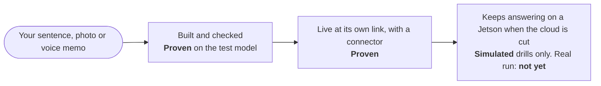

## Muse Privacy

Muse Privacy (`privacy/`) is part of Muse Muse: a connector that keeps private files away from the Muse app. A separate reader model does every step that touches the documents, and Muse plans with tags like [Student A]. In this submission the reader is Muse Glimmer 30B in the cloud, on invented data only.

- Muse Privacy's name pass, its labels on Muse's requests, and its answers and summaries all go to Muse Glimmer 30B in the cloud through OpenRouter.
- Glimmer is also the privacy router. It decides what happens to each result, within floors from the policy file that it can't loosen.
- On this setup, on Nov 2: 0 leaks of names or identifiers on 200 invented items, and nothing shared that should have waited or stayed. The router was right 71.5% of the time, with 101 approval requests, 50 of them needless ([report](privacy/eval/reports/glimmer_fresh_200_b_2026-11-02.md)).
- Earlier Glimmer runs: through OpenRouter on Oct 27, 0 leaks of names or identifiers on 100 invented items. Tuned, on a rented A100, it wrote answers and summaries with 0 leaks (80.5% and 81.0%). As the labeler, the tightener or the decider it scored far worse (41.0% to 64.0%).
- Glimmer on a device is the target, not a result: it has not run on a device for this.
- See [eval/](eval/README.md#muse-privacy) and [privacy/README.md](privacy/README.md).


*A recorded Muse Privacy run, step 1 of 5 of the grading scene: Muse called `run_private_task`, and no private values came back. Recorded, not live: a scene rehearsal on Nov 2, 2026, with Muse Glimmer 30B in the cloud through OpenRouter and invented records. Live site, www.musemuse.dev/private, Nov 4, 2026.*

### What's simulated

- The board in the outage drills, which run in each build's sandbox against a fake board and a blocked cloud.
- Every cold-room reading.
- Every teacher and record in Muse Privacy, which has no real users.
- The launch path of fine-tuning runs started by a script: they had a real GPU and judge, but did not start from the site.

### Offline Base's boards

- Offline Base also makes Base Drive, an offline AI kit on a flash drive, and runs a fleet of Jetson boards.
- Meta's SAM 3.1 runs on one of them (jetson-04) and was tuned on another (jetson-03).
- No app has kept answering on a board with its uplink pulled yet.
- Muse Privacy has not run on a board with a Meta model.

## What it does

1. **Muse.** On the Make page you drop in inspo and an optional note. Text alone works too. Three example cards (a receipt, a napkin sketch, a bakery menu board) attach a photo and fill the note in one click.
2. **Brief.** The brief model reads every reference (Muse Wonder 1.0, or Spark 1.3 Contributor while `BUILDS_ON_CONTRIBUTOR` is on, as on the live site for now; `env.briefModel` in `lib/env.ts`): images, video and PDFs directly, and voice memos after Muse Voice Transcribe 1.0 turns them into text. It writes a structured brief: the product, who it's for, the main flow, the Meta models it needs and why, honest limits, cost per use, and what it takes from the inspo and what it leaves out. It can also refuse.
3. **Build.** Muse Code runs headless in a Vercel Sandbox microVM, one per product, started from a warm snapshot. It writes a Next.js product from `template/`, guided by the template's `AGENTS.md`, one skill per Meta model and a manifest it must fill in. Muse Code runs on the build model: Spark 1.3 Contributor while `BUILDS_ON_CONTRIBUTOR` is on, as it is on the live site for now, and Muse Wonder 1.0 with it off (`env.buildModel` in `lib/env.ts`). Every product shares a Meta-family look, which the template's skills teach from public research ([docs/META_DESIGN_RESEARCH.md](docs/META_DESIGN_RESEARCH.md)). The build room shows the live log and a live preview.
4. **Check.** `npm run verify` runs typecheck and `next build`, starts the server and checks for console errors. Then come the Playwright smoke test Muse Code wrote, with real model calls, and a screen check that fails on sideways scroll, clipped text or a loading state left on screen. Last, the judge model (the same rule: Wonder, or Contributor while `BUILDS_ON_CONTRIBUTOR` is on) judges the screenshots against the brief and the inspo.
5. **Fix rounds.** A failure resumes the same Muse Code session with the errors and up to four of the judge's screenshots, for up to `MAX_FIX_ROUNDS` rounds (2 by default in `lib/env.ts`, 4 on the live site since Nov 3). A product that still fails ships as partial only when every mechanical check passed. Otherwise the build ends as failed, with Muse Code's notes.
6. **Demo video.** Demo Studio reruns the smoke test with a recorder that tracks every action, change on screen and wait, then edits it into a 1920×1080 MP4 and a poster: an intro card with the product's models, the app in a browser window with its live URL, a cursor and a camera that zooms in on typing and results, model waits sped up with a badge that says by how much, and captions below the window. See [docs/DEMO_STUDIO.md](docs/DEMO_STUDIO.md). The redacted Muse Code transcript is saved for the product page.
7. **Deploy.** The platform, never the sandbox, publishes the source as its own Vercel project, `musemuse-<slug>`. The product calls Meta only through this platform's gateway, with a product token scoped to its models and endpoints, a daily budget and rate limits.
8. **Connector.** The actions in the product's `musemuse.json` become MCP tools at `/api/mcp/<slug>`. Add that URL to the Muse app as a custom connector, or to Claude Code as an MCP server.


*Inside one build, with "Show details" open: the budget, what Muse Code changed and spent, and the goal's four pass conditions (`npm run verify` exits 0, a valid `musemuse.json`, `BUILD_NOTES.md`, a test for each requirement), all met. Live site, Nov 4, 2026.*

A refinement such as "add a dark mode" resumes the same session in the same sandbox, then checks and ships again. If its checks fail, the live version stays.

The showcase is a batch run, `npm run rebuild-all`, that rebuilds Meta's earlier demo videos on current Muse models from `catalog/meta-resources.json`. It started with the first six videos on Meta's Videos page, plus first demos for SAM 3.1, Muse Image, Voice Transcribe and Muse Wonder. On Nov 2, 2026 all 30 of Meta's videos were audited. The audit found the six rebuilt versions wrong or partly wrong. The catalog now feeds the Learn page (/learn), and every improved plan waits on the owner's spend decision (`autoBuild` false).

## Results from the Oct 27 test runs

These came first, on looser checks than today's. On Nov 3 a hands-on audit found the judge still too lenient, and the checks were made stricter.

- **24 of 24 builds passed their checks** in a local batch, at 3 to 9 minutes and about $0.30 to $1.80 in Meta credits each. The first 17 covered all 10 catalog rebuilds and every model: Spark, Muse Image, SAM 3.1, Voice and Wonder. Every product got a recorded MP4 demo, a Muse Code transcript and an MCP manifest with actions. Local runs stop before the deploy step, so none of the 24 was deployed: they have no live link and are not on the live site's Gallery.
- **Product quality, scored blind.** A judge-style review of the 24 products' screenshots averaged 5.5 out of 10. After a template polish (themes, shared parts, a screen check in each product's own tests, copy rules), an 11-build canary of the same muses scored 5.91, up from 5.14 for those 11, and all 11 passed their checks. A second polish round scored 5.50 and cost 64% more, so it was not merged.
- **Hidden Muse Code spend.** See [Holds up in production](#holds-up-in-production), item 5.
- **Fine-tuning.** See [the lab](#fine-tuning-lab-spark-teaches-glimmer) below.

## The UI

The platform is laid out like another tab in Meta's Model API dashboard. The layout was measured from screenshots of Meta's pages ([docs/UI_PATTERNS.md](docs/UI_PATTERNS.md)).

- **Sidebar** (since Nov 2). A "Start musing" button for the Make page, then four rows: Musings (your builds), Inspiration (Gallery and Meta demos, which is Learn), Fine-tuning (with Models as a tab) and Devices (Gadgets and Muse Privacy). Usage and Help sit at the bottom.
- **Make** follows Meta's Image playground: example cards, a composer that is the muse box, and a right panel that shows the build setup (model, builder, fix rounds, judge, demo video, publish, connector) as disabled controls.
- **Build room** follows the Chat playground. The muse is the user turn. The brief, Muse Code's log, the check results and the shipped result are assistant turns, each ending with a time, tokens and cost line. The right panel has a step rail (Brief, Provision, Build, Preview, Check, Record, Deploy), the Muse Code session id, fix rounds, running cost, links and the live preview.
- **Dashboard** leads with "Use your products in Muse": tabs for the Muse app, Claude Code and cURL, a tab per published product, and its connector in a copy box.
- **Usage** leads with "Meta tokens driven", stacked by products and building, then Spend (est.), Builds and a table per product.
- **Models** (`/models`, public) lists Meta's hosted models with what Muse Muse uses each for, the estimated price and 30 days of calls, then Muse Glimmer and the lab's tuned Glimmer models.
- **Gadgets** (`/gadgets`, public) is Muse Muse's own build option for boards and devices. It is not built with Meta's Muse Gadget SDK, and Muse Muse holds no Gadget SDK token ([docs/GADGETS.md](docs/GADGETS.md)).
- **Product pages** show the live product in a frame, the muse it came from, models, limits, the recorded demo, the connector URL and "How it was built".
- Light and dark themes. Below 760 px the sidebar becomes a top bar and the build panel stacks under the log.

It keeps its own two-sparkle mark, a "Concept" pill and the line "Not an official Meta product." Nobody pastes a Meta key anywhere.

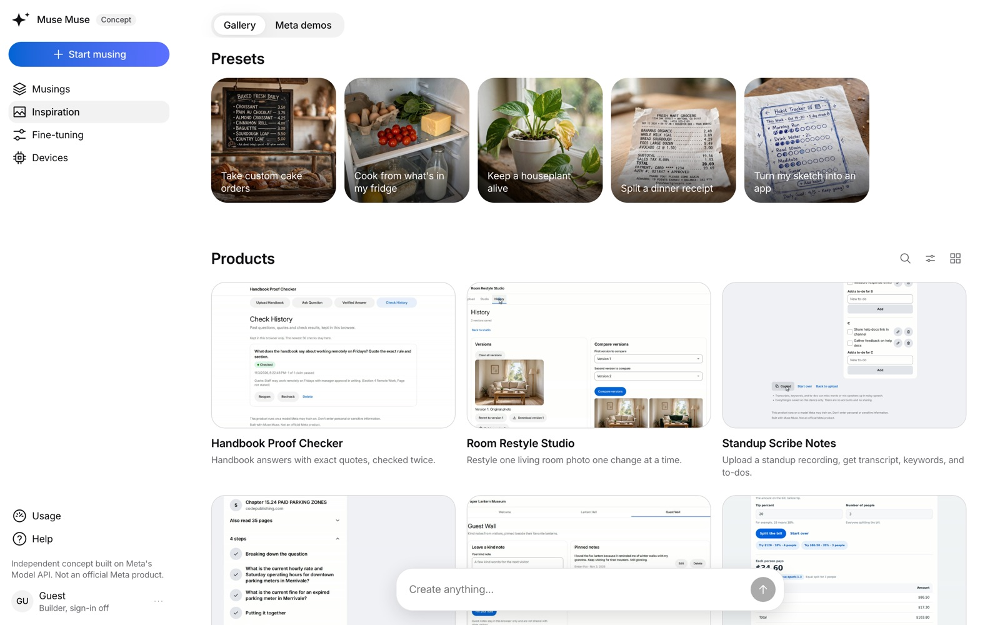

*The Inspiration page: preset photos to start from, and the products Muse Muse built. Live site, www.musemuse.dev/gallery, Nov 4, 2026.*

## How builds use Muse Code's own features

- **Headless exec with hardened flags.** Each run is `muse exec --json --yolo --session-id <uuid> --prompt-file <file> --model <build model> --reasoning-effort high --max-model-steps 200 --disable-web-tools`, plus `--image` for each inspo image. The build model is `muse-spark-1.3-contributor` while `BUILDS_ON_CONTRIBUTOR` is on, as on the live site for now; with it off it's `BUILD_MODEL` (`COMPLEX_BUILD_MODEL` for complex briefs), which defaults to `muse-wonder-1.0`. The runner adds `--disable-request-user-input` and `--no-foreign-personal-context` when `muse exec --help` lists them, so a run never waits for a person and never loads `~/.claude` rules or skills. `--yolo` turns off Muse Code's own sandbox, which can't run in the microVM. The disposable, firewalled VM is the boundary. The snapshot script fails unless `muse exec --help` lists every flag a build passes.
- **15 conflicting bundled skills disabled.** The builder snapshot turns all 15 off with `muse skills disable`, and the snapshot fails if any is still on (`DISABLED_BUNDLED_SKILLS` in `lib/sandbox/setup.ts`).
- **The template steers it.** `template/AGENTS.md` holds the rules. `template/.agents/skills/` has one skill per Meta model (reasoning, image, SAM, voice, Glimmer) plus product UI, Meta UI and verify skills.
- **Judge screenshots attached to fix rounds.** A fix round resumes the session with `--session-id` and attaches up to four of the judge's screenshots with `--image`. Each is under 2 MB, shrunk with ffmpeg in the sandbox if needed, and kept in a git-ignored folder that never deploys.
- **Reminder and subagent activity, shown and charged.** The build room shows each reminder Muse Code starts and each subagent it spawns. `run.usage` counts only the main agent, so after each run the platform reads the usage records in Muse Code's session logs, adds the reminder and subagent calls, drops the duplicates and charges them (`lib/sandbox/muse-log.ts`).
- **Transcripts.** `muse export --session <id> --redacted` becomes "How it was built" on the product page.

## Fine-tuning lab: Spark teaches Glimmer

Meta has no hosted fine-tuning, so the lab runs on the owner's Lambda Cloud GPUs.

1. **Write.** Muse Wonder writes a dataset for a task: varied user prompts in batches, then its own answers (Muse Spark 1.3 wrote the first run's dataset, below). It holds out 10% (8 to 40) as eval prompts with references.
2. **Train.** The `glimmer-lora` recipe runs a QLoRA fine-tune of Muse Glimmer 30B (Unsloth's 4-bit build) on one Lambda GPU. The Python venv and the 21 GB of weights stay on a Lambda filesystem in the region, so later jobs skip the install and the download.
3. **Judge.** Base and tuned Glimmer answer the held-out prompts. After the GPU is terminated, Muse Wonder scores each pair blind (Muse Spark 1.3 judged the first run), as A and B, with the order switched on every other item.
4. **Try it live.** An admin can serve a trained adapter on one GPU for 10 to 120 minutes (the `glimmer-serve` recipe). Meanwhile its public result page has a box where anyone types an app idea and sees base and tuned Glimmer answer it side by side, from the same GPU. The platform proxies each prompt over HTTPS pinned to the certificate the GPU reported, with a key derived from the job's token hash, and the GPU shuts down at the end like every other job.
5. **Publish to Hugging Face.** Once a run is judged, its adapter and its training data go to the Hub on their own: a model repo and a dataset repo, each with a card. The card opens with "Why this exists", the admin's reason and a story Muse Wonder writes from the run's records, then the method, the eval table, an example and the limits. The story may not state numbers; every count and score on a card comes from the records. The GPU uploads the adapter through presigned URLs the platform asks the Hub for, so the Hugging Face token never leaves the platform. Both repos start private and turn public only after the platform reads them back. The adapter is Apache 2.0 like its base model; the dataset is Spark's output, so it is published under Meta's Model API terms, not an open license. A `glimmer-publish` job uploads an adapter that already sits on the Lambda cache, such as run 2's.

By default both models train and answer under a one-line role prompt, such as "You are Muse Muse's brief writer.", instead of the teacher's full task prompt. That way the score measures what training taught.

Jobs are admin only. The Lambda key never leaves the platform. Each instance gets a one-time job token, and only its hash is stored. Each job has a time limit and a dollar limit, one GPU runs at a time, and a daily cap covers all jobs (see [Holds up in production](#holds-up-in-production), item 6).

Results are public and read-only at [/fine-tuning](https://www.musemuse.dev/fine-tuning): each judged job with its wins, average scores, GPU time and cost, and every held-out prompt with the writer model's reference, the base answer, the tuned answer and the verdict. The full spec is [docs/TRAINING.md](docs/TRAINING.md).

| Run | GPU | Time | Cost | Result |
|---|---|---|---|---|
| Smoke test | Lambda A10 | about 3 min | $0.06 | GPU, CUDA, disk and network checked |
| Dry run of the full loop | A100 | | $0.13 | Dataset paging, eval items, judging and upload checked, with stand-in answers |
| Dataset "Muse Muse brief writer" | none | | $1.51 | 400 examples written by Muse Spark 1.3: 360 to train on, 40 held out |
| First Glimmer 30B QLoRA run | A100 40 GB | 47 min | $1.59 | 120 steps, final loss 0.47. Base won 28 to 11, which exposed an eval bug |
| Second run, with the fix and the short prompt | A100 40 GB | 42 min | $1.39 | 120 steps, final loss 0.52. **Tuned won all 40 held-out prompts**, average score 8.88 against base 1.95 (judging $0.15) |

The eval bug: training put every answer on Glimmer's final channel, but the eval prompt let the model pick a channel, and the tuned model answered inside its reasoning channel instead. Eval prompts now continue on the final channel, as training does, with 1,024 new tokens. Before any paid generation, the job checks that every training example trains on its answer.

## Architecture


The real Meta key lives in two places only: the platform's server environment and the sandbox firewall rule that injects it. Other hosts are blocked from a sandbox, apart from npm, the platform and Vercel Blob uploads when a smoke test needs them. Published products never hold a Meta key.

## Layout

```text
app/                        Platform UI and API routes (Next.js App Router)
  page.tsx                  Make: example cards, the muse box and the build setup panel
  builds/                   Your builds
  b/[buildId]/              Build room
  p/[slug]/                 Product page
  gallery/                  Shipped products
  learn/                    Meta's lessons, Muse Muse's version of each and the plan (/rebuilds redirects here)
  dashboard/                Connectors, requests, tokens and spend
  usage/                    Meta tokens driven, spend and builds
  fine-tuning/              The lab: datasets, jobs and judged results
  how-it-works/             The pipeline in five steps
  sign-in/                  Email, personal password and access code
  api/inspirations/         Save inspo and start a build
  api/builds/[buildId]/     Events (SSE) and refinements
  api/rebuilds/             Start batch rebuilds
  api/admin/import-product/ Import a product built on a local run and publish it
  api/gateway/v1/[...path]/ Meta Model API proxy for products
  api/gateway/uploads/      Upload tickets for large files
  api/mcp/[slug]/           Muse app connector endpoint
  api/train/                Fine-tuning jobs, datasets, GPU callbacks
  api/lab/[id]/try/         The live demo: one idea to base and tuned Glimmer
  api/cron/                 Cleanup and the GPU sweep
components/                 Shell, composer, build room, charts, product and train views
lib/
  brief/                    Brief schema, writer, media handling and policy
  pipeline/                 Build workflow and steps
  sandbox/                  Firewall policy, Muse Code runner, session-log usage, snapshot setup
  gateway/                  Product gateway: tokens, limits, metering, uploads
  publish/                  Vercel deploys for products
  promote/                  Local products to the live site: the import bundle, its parser and publish workflow
  mcp/                      MCP server for product connectors
  train/                    Lambda client, training workflow, sweep, recipes, datasets, judge
  db/schema.ts              Postgres schema (Drizzle)
catalog/meta-models.json    Every Meta model, endpoint, limit and price we know of
catalog/meta-resources.json Meta's 30 lessons, each with its audit verdict and plan
drizzle/                    SQL migrations
docs/                       Design, spikes, UI patterns, training, build plan, submission, deploy
scripts/                    dev-local, migrate, make-builder-snapshot, rebuild-all, rerecord-demos, promote-local
privacy/                    Muse Privacy: its own Python and relay, run by the person, never part of the site
template/                   Starter repo Muse Code builds every product from
  AGENTS.md                 Rules Muse Code loads on its own
  .agents/skills/           One skill per Meta model, plus product UI and verify
  inspo/                    Where the user's references land for each build
  tests/                    Smoke test and the screen check
```

## Tests

```bash
npm run typecheck
npx tsx --test --experimental-test-module-mocks $(find lib components -name '*.test.ts')
npx tsx --test --experimental-test-module-mocks components/train/__tests__/*.test.tsx
npx tsx --test template/scripts/__tests__/*.test.mjs   # the template's own scripts and theme contrast
```

Nothing in the tests calls Meta, Vercel, Lambda or Neon, and none needs a key. The Node tests take about 3 minutes. The fine-tuning runner test also needs `python3`. CI runs the typecheck and these tests on every push to main and every pull request, with no secrets ([.github/workflows/ci.yml](.github/workflows/ci.yml)). On Nov 4 at this writing, CI on main ran 7,131 Node tests: 7,108 passed, 12 failed and 11 were skipped (a contrast check, two model-name guards, a database-access guard, the whole-build deadline and others; run 41883735964).

Muse Privacy has its own setup and tests in `privacy/`: `cd privacy && uv sync --locked && uv run pytest -q`. They need [uv](https://docs.astral.sh/uv/) (`brew install uv`, or the installer on astral.sh), which fetches Python 3.12 itself, and take about 3 minutes.

The outage drills and the drill bench need no key either: `npm run drill` and `npm run drill-bench` (see the [Judge path](#judge-path)).

## Status

**License:** Apache-2.0 for Offline Base's code ([LICENSE](LICENSE)); Meta's docs, model files and Meta's marks are not covered ([NOTICE](NOTICE)).

**Built from Oct 26 to Nov 4, 2026, for the Meta Global AI Developer Hackathon.** Before kickoff there was only a scaffold, committed exactly as received in `e3ba154` (71 files): design docs, the Meta model catalog, prompt drafts, the product template's rules and skills, types, the database schema, config, and route stubs that returned 501. All working code was written from Oct 26 on. To see everything added since, run `git diff --stat e3ba154 HEAD`.

An Oct 27 audit compared every scaffold file with the current tree. It found five small helpers from the scaffold still in use: `museExecArgs`, `metaClient`, `imagePart` and `videoPart`, `toDataUrl` and `glimmerClient`. They were rewritten the same day; `glimmerClient` became `glimmer()`, which also names the served model. Everything else that survives from the scaffold is types, schema, config, docs or template boilerplate.

Muse Privacy (`privacy/`) was started during the event in a separate Offline Base repo and merged here on Nov 1, 2026.

Hackathon codename: Muse is Meta's brand, so pick your own name before taking this further. See the Name section in [docs/DESIGN.md](docs/DESIGN.md#name).

### Before the event

The organizers asked that anything pre-existing be labeled (Discord, Nov 2). These existed before kickoff (12:24 PM ET, Oct 26) and are used, not submitted. None of them is in this repo:

- Offline Base's fleet of Jetson Orin Nano boards and its control software (a separate private repo, `jetson-infra`, created Sep 29, 2026), including how a board serves a model. The fleet tools on `/device` (#60) and the edge track's board steps talk to it.
- The models some boards ran before the event, made by other companies. They are not part of the submitted project, which is built to call only Meta's models (organizer ruling, Nov 2).
- Base Drive, Offline Base's offline AI kit on a flash drive (created June 2026). The `/offline` page describes it. Muse Muse's own USB export is a separate kit built this week, not a Base Drive.

**The site's mascot clips** in `public/muse/`, including the opening above, are the owner's own art, not something Muse Muse or a Meta model made. The first intro clips were made with an outside video tool and edited here ([build log, Nov 2, about 8:30 PM](docs/BUILD_LOG.md#nov-2-2026-about-830-pm-et-two-candidate-intros-for-opening-muse-muse-tg-sidebar-local-preview-only)).

**Third-party content in this repo:** Meta's docs, mirrored in `content/meta-docs/` as reference (added Oct 29), and the other items listed in [NOTICE](NOTICE).

Everything else in this repo, and its whole git history, was written from Oct 26 on, apart from the scaffold described above.

## Docs

- [eval/README.md](eval/README.md) collects every measurement with its source, failures first.
- [privacy/README.md](privacy/README.md) covers Muse Privacy. The two share no code: neither imports the other, it is left out of the site's deploys, and it adds no migrations.
- [docs/SUBMISSION.md](docs/SUBMISSION.md) has the submission write-up, the video script and the checklist.
- [docs/DEPLOY.md](docs/DEPLOY.md) covers deploying your own copy, preview databases, local-to-live promotion and Docker.
- [docs/DESIGN.md](docs/DESIGN.md) covers the architecture, pipeline, security, cost, demo and risks.
- [docs/SPIKES.md](docs/SPIKES.md) has what the day-one spikes measured about the Meta Model API, Muse Code and Vercel Sandbox. Code follows it where older docs disagree.
- [docs/UI_PATTERNS.md](docs/UI_PATTERNS.md) describes Meta's dashboard layout and how each page maps to it.
- [docs/TRAINING.md](docs/TRAINING.md) specifies the fine-tuning lab.
- [docs/META_CATALOG.md](docs/META_CATALOG.md) lists Meta's models, endpoints, limits and prices.
- [docs/PROMPTS.md](docs/PROMPTS.md) has drafts for the brief writer, builder, fix round, judge and refinement prompts.
- [docs/BUILD_PLAN.md](docs/BUILD_PLAN.md) has the rules check, day-one spikes, the Oct 26 to Nov 4 schedule and the test muses.

Muse Muse is not an official Meta product.
