# Build log

What actually happened in the Muse Muse build, in order: merges, reviews, fixes, spikes, measurements, spend, owner
decisions and agreements with other sessions. Times are Eastern (EDT, 24-hour) unless they say UTC. Add an entry for
every merge, review, fix, spike, measurement, spend and decision, and commit it. Screenshots go in
`docs/log/shots/<date>/`.

This file starts on Oct 31, 2026, with the "Muse Muse General" session. Earlier history:

- [SPIKES.md](SPIKES.md): spikes and measurements before Oct 31.
- [KNOWLEDGE_RUN_LOG.md](KNOWLEDGE_RUN_LOG.md): the Glimmer knowledge fine-tune (the fine-tune session's own record).
- `git log`: everything else.

The wave 3 session keeps its entries in `_plan/wave3-log.md` and `_plan/log-shots/` until tg-cap-int merges, then
moves them here.

## Now

Updated Oct 31, 2026, 4:55 PM EDT.

| What | State |
|---|---|
| origin/main (GitHub) | 5916c37, the PR #3 squash merge (14:42) |
| Production | Deployment created 14:42:13 from 5916c37, Ready. The one before: 14:34:55 from 4f7b73b. Rollback point in RELEASE.md: the 01:44 deploy of 6b68cbc |
| Production flags | All feature flags off per RELEASE.md (production env not re-read) |
| tuned-model-options | d8ffec4 (same as tg-wave2-merge): wave 2 merged, fast-forwarded 16:47. 109 commits ahead of origin/main. Not pushed |
| release-candidate | 4f7b73b (on main) |
| Local main (~/muse-muse) | 28c34c6, same as origin/knowledge (the fine-tune session's run log, 16:50). Not on origin/main; needs a new PR |
| Migrations | d8ffec4 ends at 0015. Reserved: 0016 code_sessions and 0017 decide (General), 0018 to 0026 (wave 3), 0027 replications (General). They reach main, previews and production in number order |
| AWS device lab | Mac host running ($15.60 a day). Windows box stopped |

General's branches:

| Branch | Head | What |
|---|---|---|
| tg-decide | ca953be | Decision models. Build of units D0 to D2 running |
| tg-offline | 6eb0d2f | OFFLINE.md (dd1602f) and OFFLINE_HARNESS.md |
| tg-replicate | 34af886 | Paper replication design and cloud check |
| tg-3d | 7f826bb | 3D spike |
| tg-ui-brand | 91c761c | meta.ai look and muse-app-ui skill. Two-build trial running |
| tg-musecode | 23525cb | Muse Code sessions spike |
| tg-testmodel | b14ce0f | TEST_MODEL, already in tuned-model-options |

Wave 3 (another session): tg-cap-contract 6dc9106, tg-cap-engine 07490eb (migration 0019_engine), tg-cap-drive and
tg-review-drive 23a62d3. It plans tg-cap-int from d8ffec4.

Running:

- Decision models build, units D0 to D2.
- UI brand trial, second build.
- Fine-tune session: its final model (stage-b-r30) finished training at 16:39. Its tests answer about 17:10. The IQ1_S
  file details come to General when they pass.

Moved after 4:55 PM (git reflogs, checked at 17:41). Not covered below unless an entry says so:

- Local main and origin/knowledge (the fine-tune session's run log): da34f9e (17:02), then 263c291 (17:34).
- tg-decide: 96db7e7 (16:57, D0 decision contract), 9546d8d (17:06, D1 task format), bd09bb7 (17:27, D2 scoring,
  an amend of 4dab493). Head bd09bb7.
- tg-ui-brand: bc52cde and 0f40b15 (17:09, muse-app-ui), 60b062c (17:12, "Trial builds of the muse-app look: two live
  on Contributor, and what they found"), af3b082 (17:22, local test builds' metaClient follows TEST_MODEL too),
  59c7439 (17:27, merge of tuned-model-options d8ffec4), then fcc3cfe, 6e8be8e, 029064a, a75281f and efffcf9 (17:28
  to 17:37). Head efffcf9.
- tg-cap-engine (wave 3): ffb7eea (16:59), 7dde1f3 (17:37).
- tg-cap-drive (wave 3): e4336ae (17:07, merged d8ffec4), then 8 commits from 17:18 to 17:29. Head ba4c8c5.
- Not moved: origin/main, tuned-model-options, release-candidate, tg-offline, tg-replicate, tg-3d, tg-musecode,
  tg-testmodel, tg-cap-contract, tg-review-drive. tg-cap-int does not exist yet.

Open owner decisions:

1. Rotate the values that `pgrep -fl` or a process listing printed into transcripts: MODEL_API_KEY, VERCEL_OIDC_TOKEN,
   GATEWAY_TOKEN_PEPPER, a Vercel development OIDC token, a Claude Code messaging token.
2. Renew MODEL_API_KEY in Vercel Development.
3. Give Preview its own database. Preview still shares Production's.
4. The higher reminder and accounting costs.
5. Board env: keep DEVICE_MCP_* out of Production, put AUTOMATION_SECRET on board routes, remove the device-tools
   Preview env.
6. The Get it page's reads with flags off, and plain-string target ids.
7. Composio retention, lab passwordless sudo, the Xcode tarball, and teardown after Nov 4.
8. Packager: production-android rebuild, shell release, and the unset APK keystore (builds carry a debug key).
9. Muse Code visitors in products, gated on reading Meta terms 1, 3.1, 6.2 and 10.1(i).
10. Decision models: Lambda or Fireworks, the Nov 3 run (about $0.83, cap $5), a serving window, and Wonder-written
    examples (which stay off).
11. Offline: which house machine (the laptop must not run Glimmer, and IQ1_S needs a 16 GB Mac), plain http to the
    fleet, and a fleet API key.
12. Replication: off in production, admins only, $10 ceiling.
13. Laptop disk near the 8 GB line.

## Spend on Oct 31

General session:

| Figure | What it was for | Record |
|---|---|---|
| $19.83 of a $25 cap | Serve test, 02:48 to 03:58: Meta $19.38, Sandbox $0.45 | docs/spikes/serve-2026-10-31/spend.md |
| about $5.93 | Wave 2 units, agent-reported, Meta and Sandbox mixed: vr $2.45 (includes the $2.28 real VR build), packager $1.00 + $0.10, brief $0.6125 + $0.1125, agentkit $0.21 + $0.60, labboxes $0.31 + $0.06, outputs $0.26 + $0.135, tools $0.058 + $0.012, shells2 $0.0138, others $0 | _plan/wave2-results.json |
| $0.052931 | Muse Code sessions spike, on Contributor | tg-musecode spike |
| $0.006433 | Replication spike: Muse Code on Contributor | docs/spikes/replication-2026-10-31/README.md (tg-replicate) |
| about $0.106 (worst case $0.195) | Replication spike: one sandbox | same |
| $0 Meta, at most $0.195 Sandbox | 3D spike, 6 sandboxes | docs/spikes/3d-2026-10-31/cost-ledger.jsonl (tg-3d) |
| at most $0.51 of a $3 cap | S1 VR spike, 6 sandboxes | docs/spikes/xr-2026-10-31/cost-ledger.jsonl |
| about $0.01 (estimate) | Release review: one paid call through a gallery product (an image tool) | release review |
| about $0.03 and about $0.02 | Release review sandbox; release fix sandbox build | release review and fix |
| $0.0435 and $0.0542 Meta, plus about $0.11 Sandbox | UI brand trial on Contributor: build A (the retry that went live at 16:48) and build B (finished after 4:55 PM); the Sandbox figure covers the whole trial | UI trial journal; 60b062c |
| about $1.25 worst case of a $2 cap, plus about $0.25 a month | Packager, including review and fixes; a kept snapshot | docs/spikes/packager-2026-10-31/README.md |
| $0.058227 of a $1 cap | Composio spike | docs/spikes/composio-2026-10-31/README.md |
| $0.65 an hour, 24 h minimum | AWS Mac host (mac2.metal) since 02:01. About $8.50 by 15:00, $15.60 a day, about $75 by Nov 5 01:00 UTC | NATIVE_LAB.md (tg-labboxes) |
| $0.44 | AWS Windows lab box, 3.99 h | NATIVE_LAB.md |
| under $5 through Nov 4 | AWS EBS and S3 (estimate) | NATIVE_LAB.md |
| $150 a month and $40 a month | AWS budgets musemuse-lab and musemuse-device-farm (limits, not spend) | AWS budgets |

- Lambda: no General spend found. Decision model costs are estimates only.
- Device Farm: no General spend found.
- Rough sum of the Meta, Sandbox and Composio lines above, using the upper figure where only "at most" is known and
  leaving out the packager line (it may count the same runs as wave 2) and AWS: about $26.96. Not an invoice.

Other sessions, for reference:

- Wave 3: $0.36 on 8 one-shot builds (`_plan/wave3-log.md`).
- Fine-tune session: train-1 at $340 by 11:34; about $170 of idle billing in its 04:52 to 11:30 gap; about $9 idle from
  13:52 to 14:17. Limits: $2,500 Lambda, $3,500 AWS. Its Device Farm phone test ran under a $40 cap; its log gives no
  dollar figure ([KNOWLEDGE_RUN_LOG.md](KNOWLEDGE_RUN_LOG.md)).

## Oct 31, 2026

### 00:06 Muse Code at full strength: reviews and fixes of engine, room and control

Units built from 23:19 on Oct 30: mf-engine (session bridge over muse serve), mf-room (live build room), mf-control
(owner Stop and steer).
Reviews 00:06 to 01:05: room fine with flags off. Control and engine not ready (engine: not ready to turn on
MUSE_ENGINE=serve).
Fixes to 01:48, for example 4b84cb3 (control, 00:49), a707062 (room, 00:50), d98cde8, f25015a, 660f39e and a3b0832
(engine, 01:33 to 01:47).
All of it stays behind MUSE_ENGINE and MUSE_FULL.

### 00:18 Promote: copy products built locally onto the live site

3fbfbea built the import route at 00:18. Review 00:19 to 00:39: one high finding.
The fixer (00:39 to 01:04) fixed all three findings but could not commit, because plan mode was on.
The fixes landed as 0c102bc at 01:32. mf-promote merged into tuned-model-options as 0e27ba7 at 01:32.

### 00:38 Research and plans for new targets: native apps, VR, glasses and agent tools

Five researchers 00:38 to 01:08 (platform, mobile, devices, desktop, precedents).
Findings: Muse Muse builds web apps only today. A Linux microVM can build Android but not iOS; iOS always needs a Mac.
Explore agents 01:04 to 01:19. Three Plan agents 01:17 to 01:56: targets foundation and native lane; agent products and
tool gateway; VR and Meta glasses.
Plans written to native-lane.md, agent-tools.md and vr-glasses.md by 02:38.

### 00:52 Muse app look (ui-muse-app): build, reviews and fixes

Build 00:00 to 00:52: 12d43ba tokens, ed9f62e chat kit, dca8797 composer and Make page, 7a1f07d docs assistant.
Code review 00:52 to 01:10: no blockers, 3 medium, 5 low.
The visual review was stopped by plan mode at about 01:16, after one live capture.
Fix passes 01:16 to 02:39. Branch head b8b60f8 at 02:40.

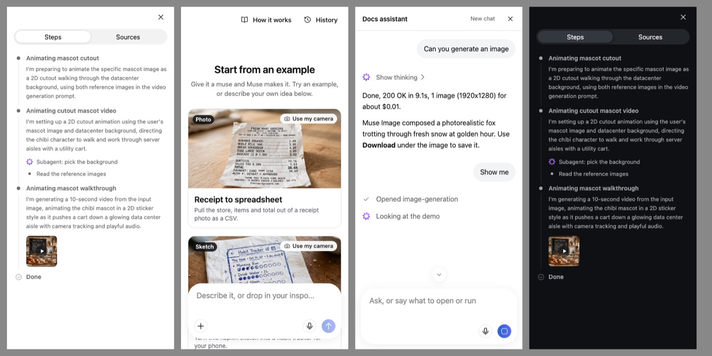

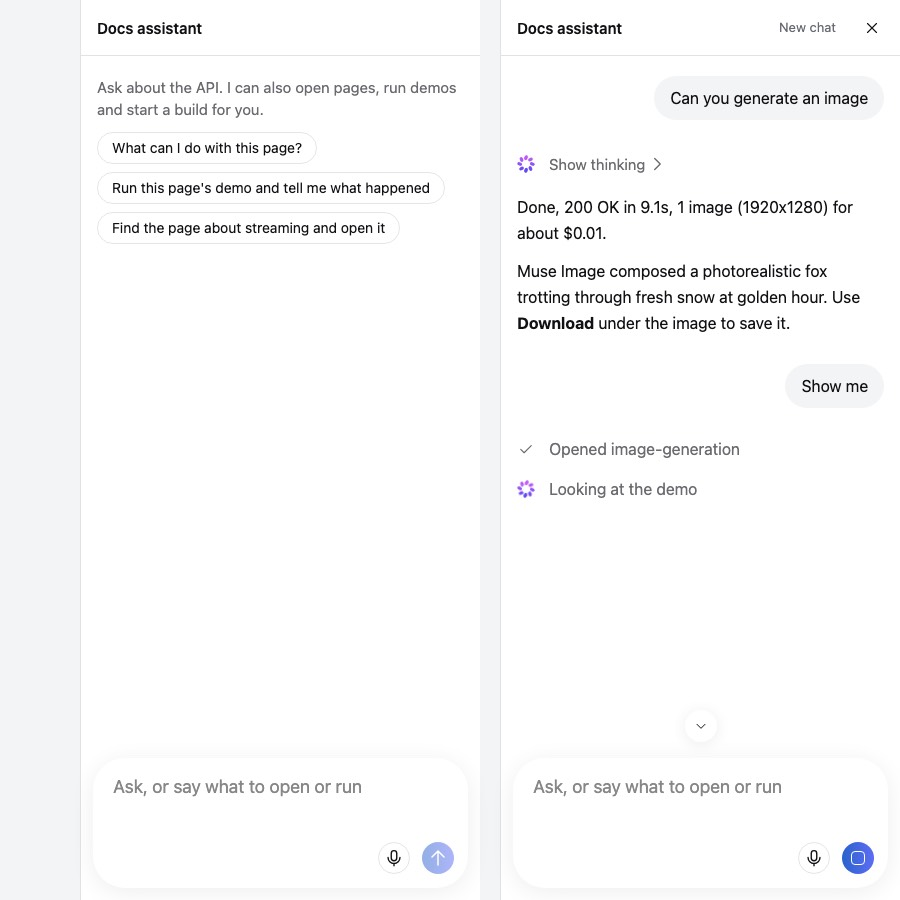

### 01:34 Two production deploys from main (promote)

0e27ba7 (Merge mf-promote) pushed to origin/main at 01:34. Production deployment created 01:34:46, Ready.
6b68cbc (Promote: upload through presigned URLs) pushed at 01:43. Production deployment created 01:44:00, Ready.
RELEASE.md later named the 01:44 deployment (6b68cbc) as the rollback point.
aa4d171 and 4dd9b71 (How it works rewrite, 01:47 and 01:50) stayed local until 14:34.

### 01:50 (about) 12 locally built products imported onto the live site

The promote import reported 12 imported, 0 already there, 0 skipped, 0 failed (batches of 2, 9 and 1).
Each has its musemuse-*.vercel.app address, for example cat-hero-studio, focus-cycle-timer-3 and silly-doodle-pages.
The products use made-up content.

### 01:51 Muse Code at full strength integrated and merged, flags off

Integrate workflow 01:50 to 02:44: 4f50cdc (mf-engine, 01:51), 7e869ce (mf-room, 01:52), 757f5e9 (mf-control, 01:55).
Review: merge sound; fix four medium findings before any serve or MUSE_FULL test build.
Fixes include b24d775, 83cb317 and 5d533a1. mf-integrate head d38dda7 at 02:43.
Merged into tuned-model-options as 029a9e0 at 02:44, then ui-muse-app as f74090a at 02:44.

### 02:00 Wave 1 of the new targets starts (S1 VR spike, shells, gateway, glasses, lab)

First launch 02:00. Its five agents stopped at about 02:16; the wave relaunched at 02:21. Builds, reviews and fixes ran
until 04:10.
Shells: 1 Android and 7 iOS EAS builds on the free plan. `eas update` for the production shell was denied by the auto
mode classifier and not worked around.
Reviews: shells 2 high (fixed); glasses 2 high, 7 medium (fixed); lab "agent cannot start on a real box" (fixed);
gateway no high.
Tests after fixes: lab 259/259, gateway lib 1,672 pass 0 fail, shells 141 pass.

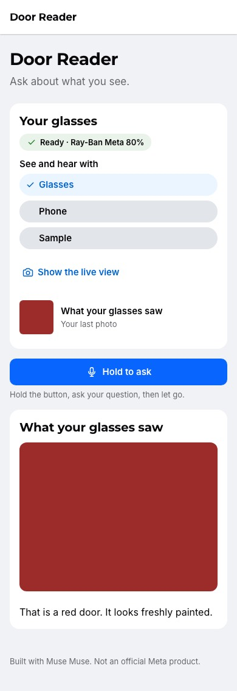

### 02:01 AWS device lab boxes and budgets created

A dedicated mac2.metal Mac host and a t3.large Windows box were set up at about 02:01 to 02:02.
AWS budgets: musemuse-lab $150 a month, musemuse-device-farm $40 a month.
The Mac host bills $0.65 an hour from 06:01 UTC (02:01 EDT), with a 24 h minimum.
Xcode 26.6 tarball (2.7 GiB) uploaded 02:21 to 02:42; Xcode on the Mac by 02:46.
Lab Mac and Windows setup runs reported Success at 04:37.

### 02:09 Composio spike and tool catalog

02:09 to 02:37. Composio Instant works on this org, and public tools can run on it.
Spend $0.058227 of a $1 cap, matching Composio's usage summary.
tg-composio a27bcf1 (02:37), merged into tuned-model-options as 723460f (02:47).

### 02:12 (about) S1 spike: VR inside a Vercel Sandbox passes

Six sandboxes, about 02:12 to 03:20 (ledger entries end 06:16 to 07:20 UTC), 2,456 s in all.
Verdict: pass with one condition. The sandbox can render, script, check and film WebXR with no GPU on React Three Fiber
(three 0.184.0, SwiftShader). The budget of 100 draw calls and 100k triangles misses 15 fps on slower hosts.
At most $0.51 of a $3 cap. Commit cf3f1ce at 03:22.

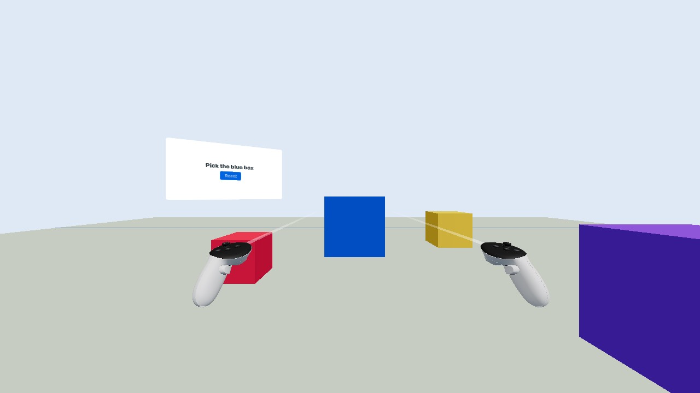

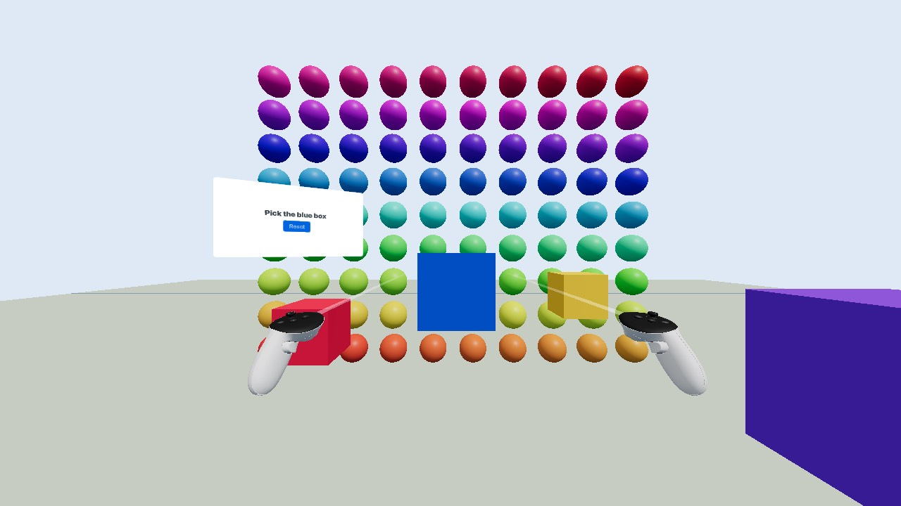

### 02:48 Contract unit and build room look

Contract (tg-contract): targets, flags, migrations 0013 to 0015, the native event and the Get it panel, all off.
Built 02:48 to 03:11. Review 03:11 to 03:22: safe with flags off and for migrations, 2 medium. Fixed by 03:29 (4b493ee).
Build room look (ui-build-room): built 02:48 to 03:24. Review: 1 high (a CSS removal broke the Make page, product
page and job room), 5 medium, 5 low. All 11 fixed by 03:56 (691e3c5).

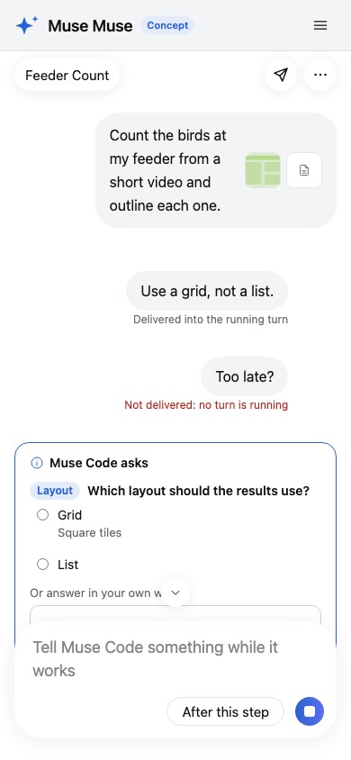

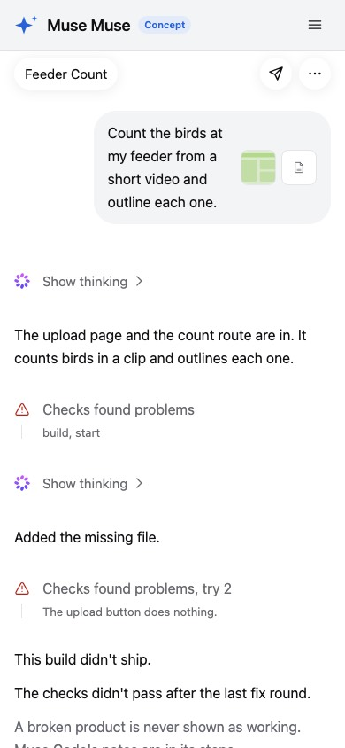

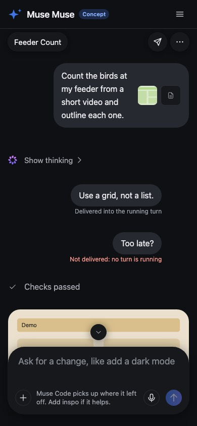

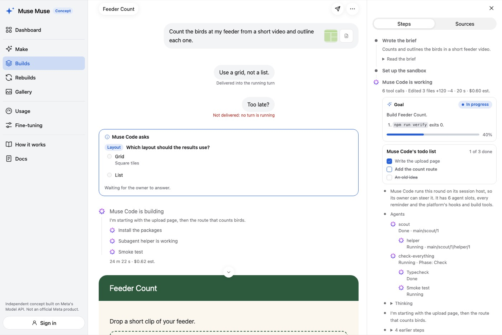

### 02:48 Serve test: real Muse Code builds at full strength on Wonder

02:48 to 03:58, on real Vercel Sandboxes with real Meta calls.
Call: serve plus MUSE_FULL works, but do not make it the default yet. On the same muse it cost 2.4 times as much and
took 1.8 times as long as exec.
The scope reminder ran 173 times and delivered 0 reminders.
Spend $19.83 of $25 (Meta $19.38, Sandbox $0.45). Write-up 725fd28 at 03:57.

### 03:59 Contract, build room and serve test merged; scope reminder off

Merged into tuned-model-options at 03:59: tg-contract (4ab3803), ui-build-room (dbdda95), tg-serve-test (1a016d2).
04:01: 6268be3 keeps the scope reminder off (173 runs, nothing delivered).

### 04:11 Wave 1 merged into tuned-model-options

tg-shells 60b05be, tg-lab e5b6a93, tg-gateway 0603649, tg-glasses e9aeeac, tg-s1-spike 2b510e5. Not pushed.

### 04:21 Unanchored .vercelignore line dropped lib/native from every deployment

3e223ea (Keep native/ out of the Vercel deployment) added a bare `native` line. It also matched lib/native, which
lib/env.ts imports, so every Vercel build from that tree would fail before migrate.
Found by the brief review (12:14 to 12:31) as high finding 1. Fixed on tg-brief as 710d889 (12:43), cherry-picked to
tg-labroutes as 526d90d (13:27), and fixed on release-candidate as d0f4d3c (14:18, now `/native`).
The release review called it the one blocker. It never reached origin/main before the fix, so production was not
broken.

### 04:24 Wave 2 first launch stops; no General activity until about 12:00

Ten wave 2 build agents started at 04:24. All stopped 04:54 to 04:55 with no results.
Their commits from 04:32 to 04:52 (for example 1a01d0b, 887fa48, 869a536, d3888f1, 43c6d5a, 644677a) were kept by the
relaunch.
EAS builds glasses-ios-sim, lab-ios-sim and lab-android finished at 04:54.
No General commits from 04:52 until 12:08 (the commits at 11:39 to 12:04 are the fine-tune session's run log). The
plan folder `~/mm-wt/_plan` was created at 12:02.

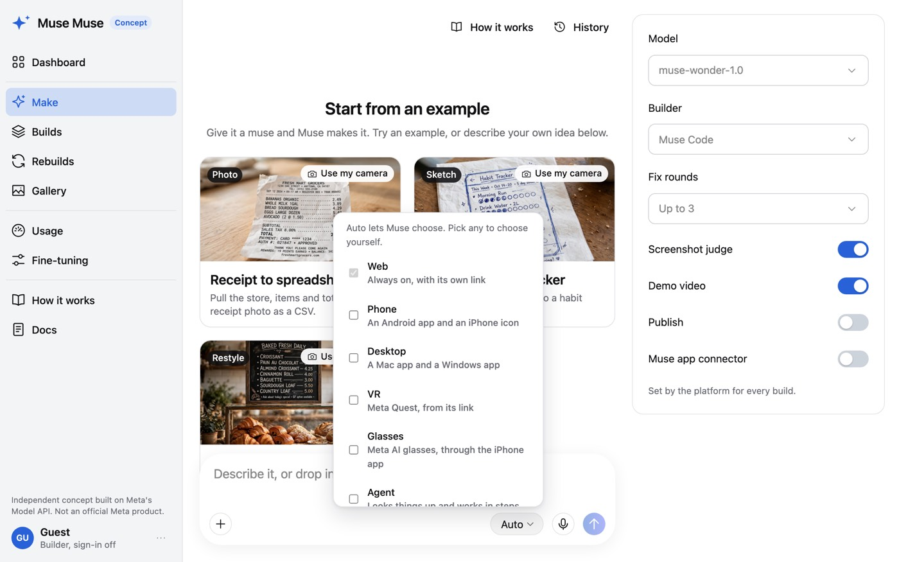

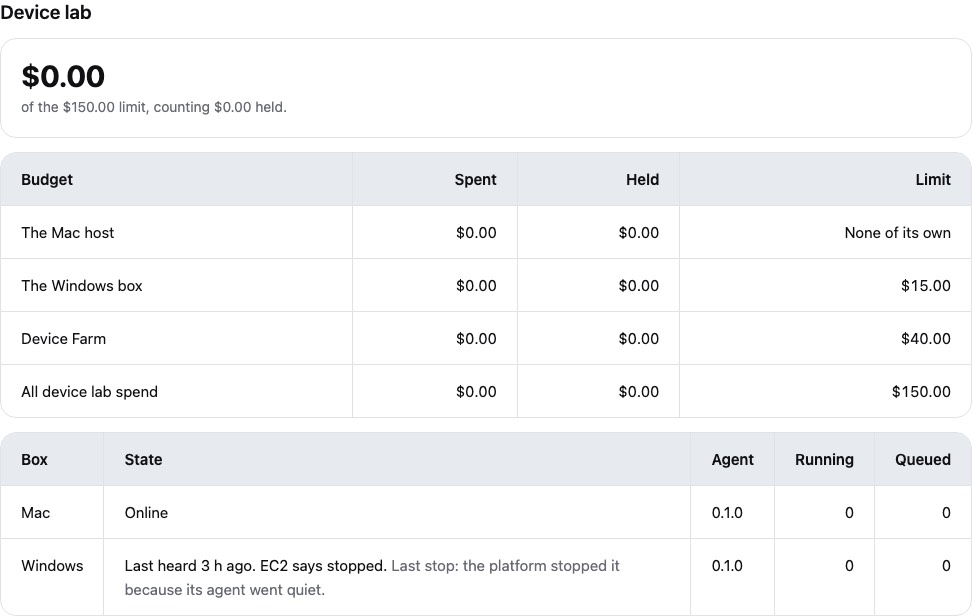

### 12:06 Wave 2 relaunched: ten units built, reviewed and fixed

12:06 to 15:35. Units: tools, agentkit, brief, vr, packager, labroutes, getit, shells2, labboxes, outputs. Each was
built, reviewed and fixed.
Every review asked for fixes first. Every fixer reports all findings checked and fixed, for example agentkit 19 of 19,
tools 11 of 11, outputs 14 of 15 in code plus merge steps.
VR: a real VR product went through the normal pipeline and passed for $2.28.
Packager: all three downloads in 29 to 33 s in a real sandbox.
Agent-reported spendUsd across the units: about $5.93. Results saved to `_plan/wave2-results.json` at 15:37.

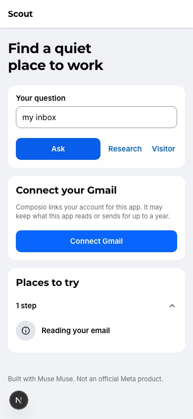

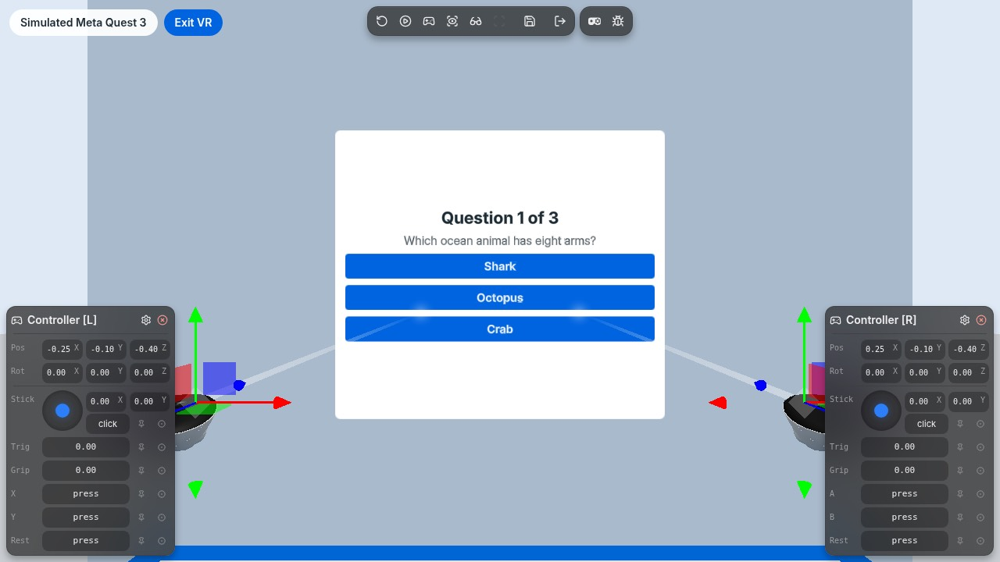

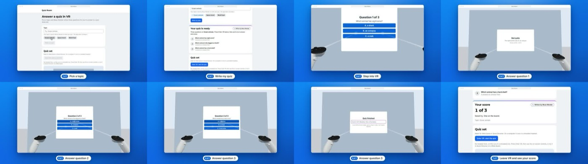

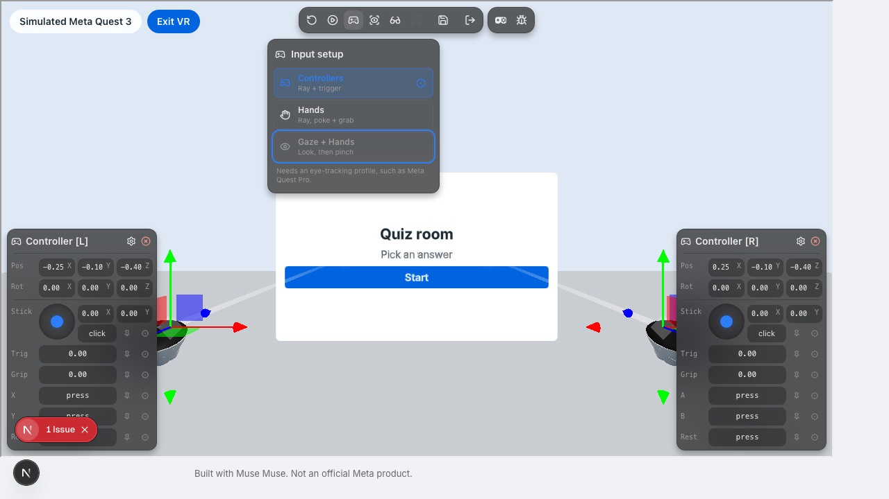

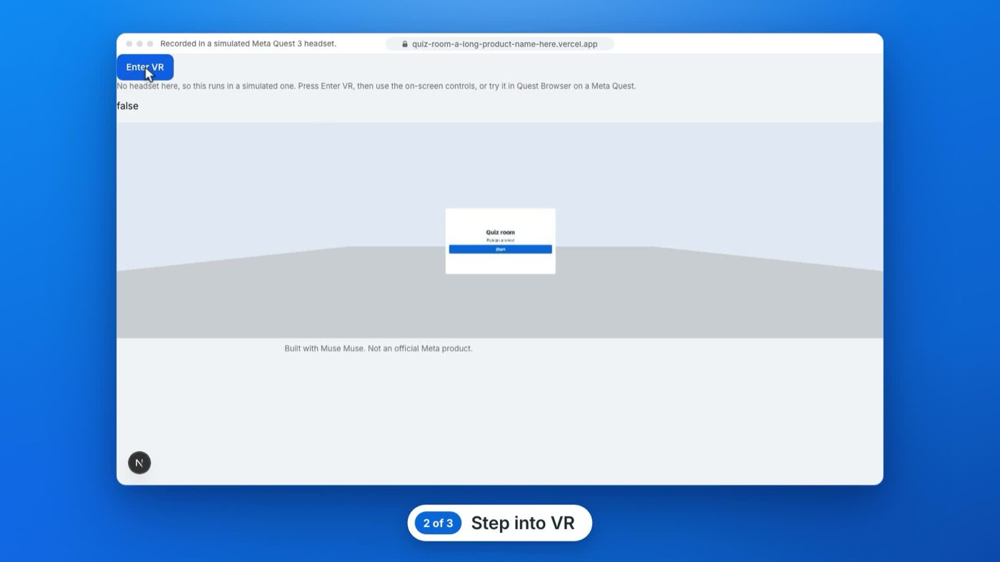

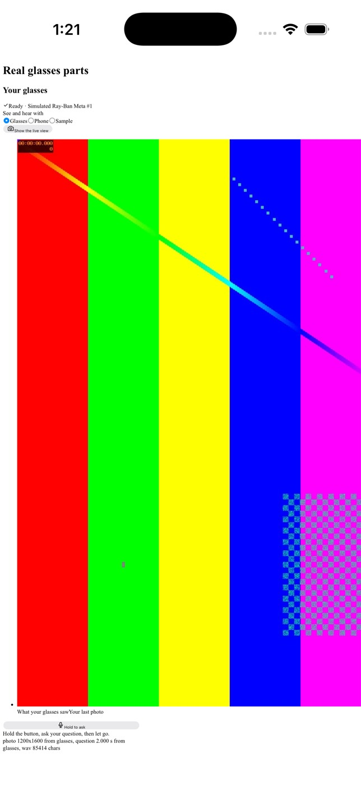

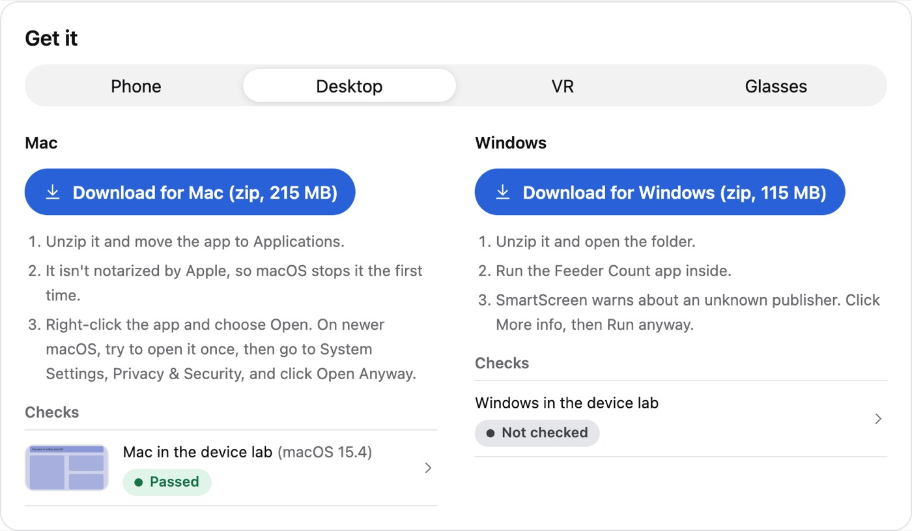

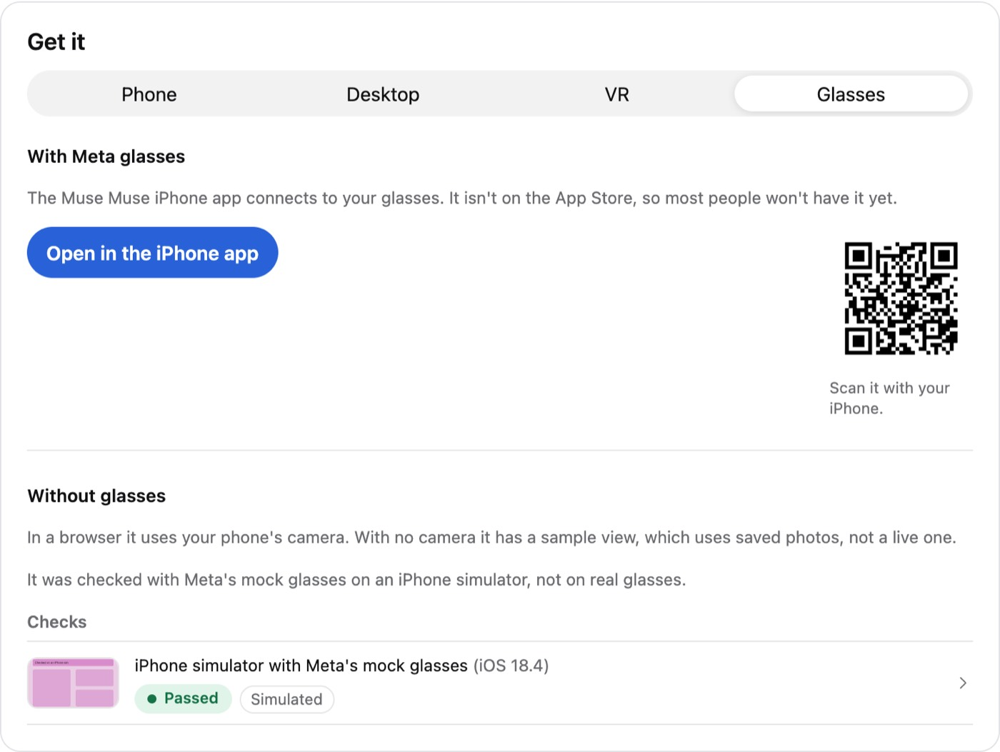

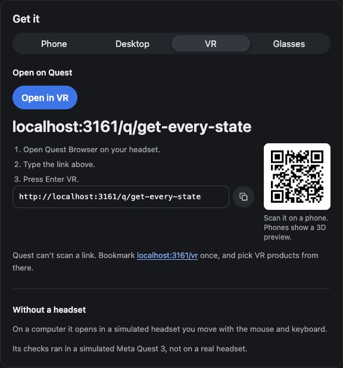

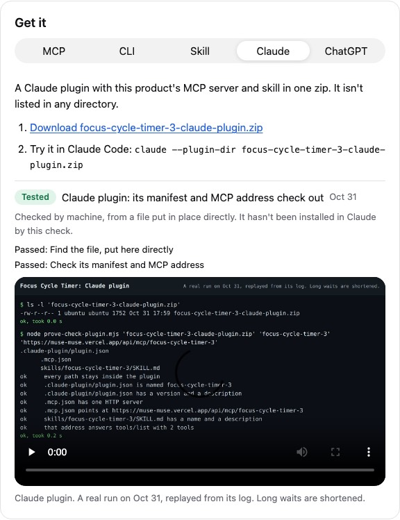

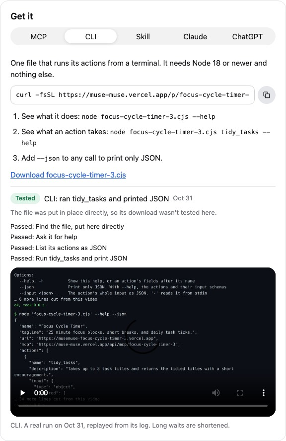

### 12:14 (about) A reviewer's `pgrep -fl` printed a dev server's environment

Between 12:14 and 12:31 the brief reviewer ran `pgrep -fl`. It printed the full environment of the tg-vr dev server
(port 3131), including MODEL_API_KEY, VERCEL_OIDC_TOKEN and GATEWAY_TOKEN_PEPPER.
The agent did not use or repeat the values. The owner was asked whether to rotate them; no source shows a decision.
Values are not recorded here.

### 13:36 Hussam's device-tools (PR #2) merged into the release candidate

origin/device-tools d9cb9a2 (fine-tuning on a Jetson, Wonder using a board's tools) merged as 55d52e2 at 13:36 on
release-candidate in `~/mm-wt/release`. Off until the board env is set.

### 13:38 Release review: one blocker, board risks, 15 fixes

Device review 13:38 to 13:49: merging the board code exposes nothing by itself. But DEVICE_MCP_* plus GADGETS_ENABLED in
production would give any guest-built live product the real camera and mic (high).
Release review 13:49 to 14:12: not ready at 55d52e2 (the .vercelignore blocker). Preview shares Production's database.
One paid call through a gallery product (make_coloring_page) came back after 14.3 s as an MCP error saying the reply
was over 1 MB. No image came back, so the review's view that production's MODEL_API_KEY works is an inference.
Fix 14:12 to 14:33: 15 commits, release-candidate 1e1caf8. Unit 3,564 tests (3,556 pass, 0 fail, 8 skipped), template
169/169, board 76 OK, tsc 0, sandbox build exit 0 for about $0.02.
Checklist RELEASE.md written 14:32.

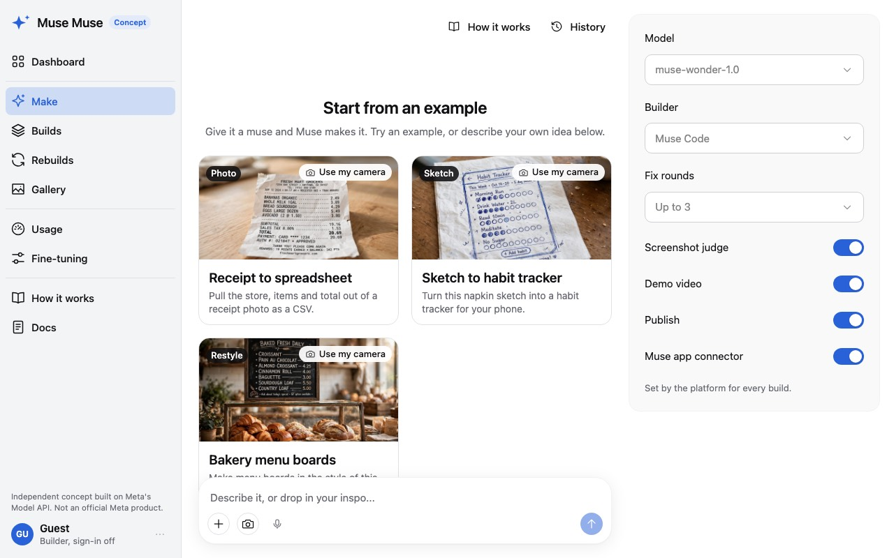

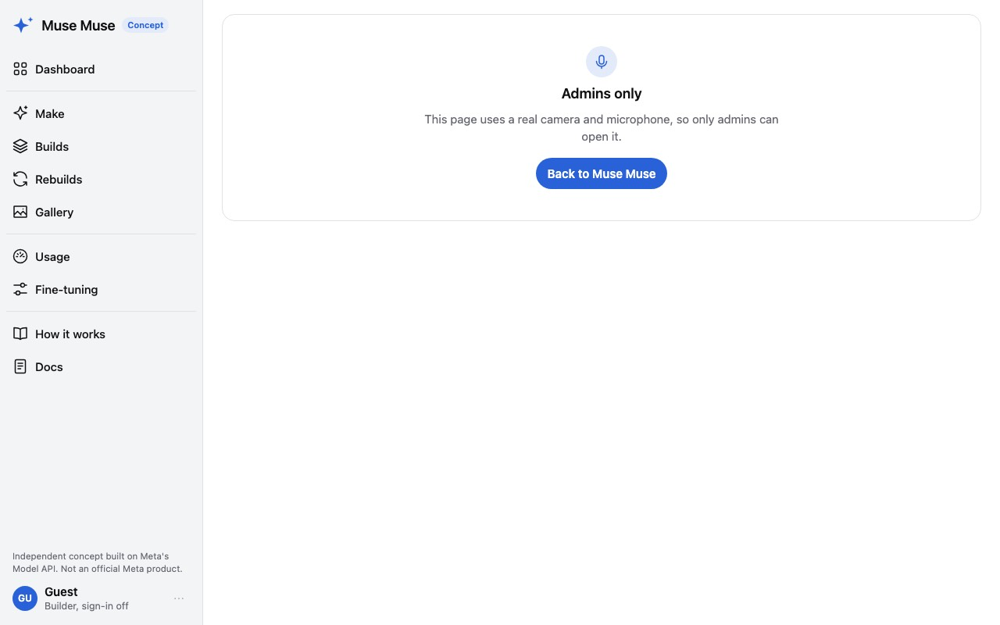

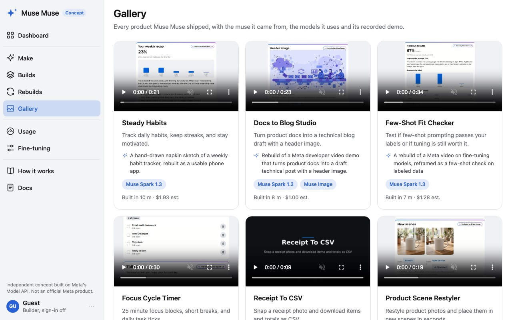

### 13:55 (about) Owner: products should be able to use Muse Code inside the build

Owner, as relayed: "I want projects to be able to build something that uses muse code within the build". This replaced
the earlier call to leave it out of the Nov 4 scope.
Design `_plan/muse-code-products.md` (created 14:02): new target muse_code behind MUSE_CODE_ENABLED, sessions through
`{GATEWAY_URL}/code/sessions`, $1.00 and 15 minutes per session, visitors off.
Migration 0016_code_sessions reserved for it.

### 13:58 (about) Owner: tests and examples on Contributor, live products on Wonder (TEST_MODEL)

Tests, build sessions and examples run on muse-spark-1.3-contributor with made-up data. Live products run on Muse Wonder.
tg-testmodel worktree at 14:00. b14ce0f (Add TEST_MODEL) at 14:02, fast-forwarded into tuned-model-options at 14:02.
Later: 4120b77 (14:40, tuned-model-options) turns Muse Code's reminders off for test builds. 712424e (15:28,
tg-ui-brand) makes local test builds' product calls follow TEST_MODEL.

### 14:00 Muse Code sessions spike: blocked, then measured

A 13:56 attempt ended at 13:59 with no result.
14:00 to 14:04: blocked, because the VERCEL_OIDC_TOKEN in muse-muse-builds `.env.local` had expired on Oct 29 01:05 UTC
(392fd2f).
14:04 to 14:08: a helper read Meta's terms on end-user access.
14:09 to 14:40: a custom endpoint works (auth bearer pin required, telemetry off). First session event 4.21 to 7.89 s
over 3 runs. A mailbox stop with a tool running closed the bridge in 1.94 s. Small tasks $0.003 to $0.006. Total $0.052931 on Contributor. Commit 23525cb.
Findings: the session token is readable in the VM, and an agent can copy the Muse Code binary into its workspace.

### 14:13 Owner said yes to the Xcode and Android SDK licenses; licenses accepted on the AWS Mac

Owner, as relayed: "YES YOU CAN".
At 14:13:51 (18:13:51 UTC) General ran `setup/mac-finish.sh` with MUSE_LAB_ACCEPT_LICENSES=1 over SSM. Xcode's license
shows accepted at 14:15.
The command took 13 minutes and exited 1, because all three phone checks after it failed: android_emu install_failed
(adb wants a .apk suffix), ios_sim blank screen, glasses_sim app did not open.
The Android check left no image. Its log shows install_failed at 14:25 (18:25 UTC).

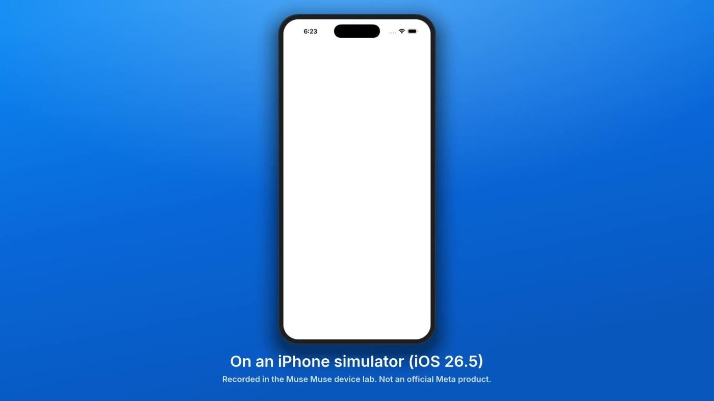

### 14:25 (about) Owner: make the UI closer to meta.ai, and make skill files builds can use

The owner pasted a Gemini brand spec. It was saved word for word at 14:26 (`_plan/BRAND-source.md`; later dd46cf5 on
tg-ui-brand, 15:26).
The ui-brand worktree was created at 14:27 and the workflow started at 14:28.

### 14:28 meta.ai look measured and applied to the platform; muse-app-ui skill

Measure 14:28 to 14:47: live meta.ai, signed out. docs/BRAND.md (47848ca, 14:46).
Platform 14:47 to 15:11: Inter vendored under the OFL, white theme, Make page laid out like meta.ai (adf9bb1, c7b20bc,
7b3c4cd, 839018d). No sideways scroll on 12 screens at 1280 and 390, light and dark.
Skills 15:11 to 15:45: muse-app-ui overlay behind MUSE_APP_LOOK (off). Flags-off goldens byte-identical.
Review 15:45 to 16:03: approve after a short fix pass.
Fix 16:03 to 16:28: 12 findings fixed in 9 commits, head 91c761c. Full suite 3,013 tests (3,005 pass, 0 fail, 8
skipped), components 522/522.

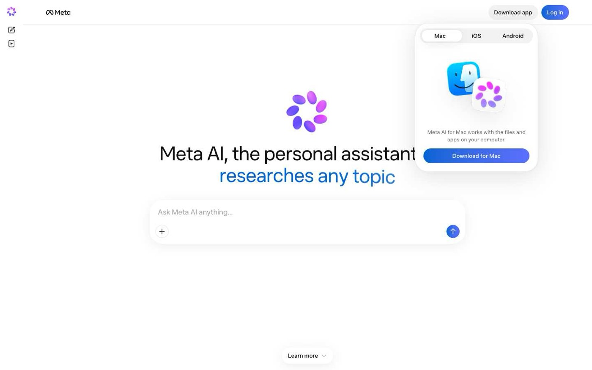

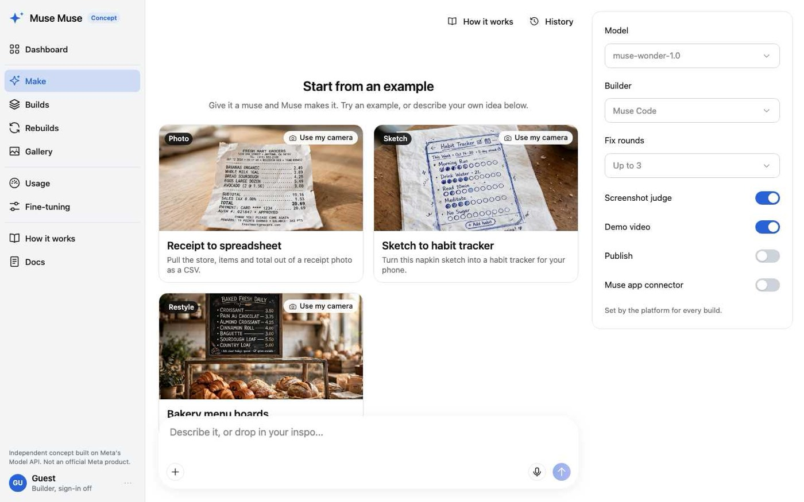

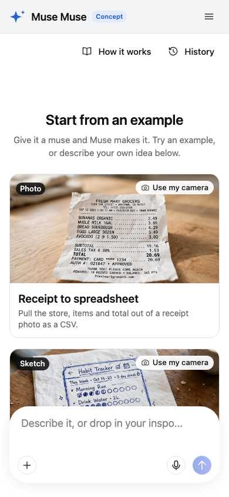

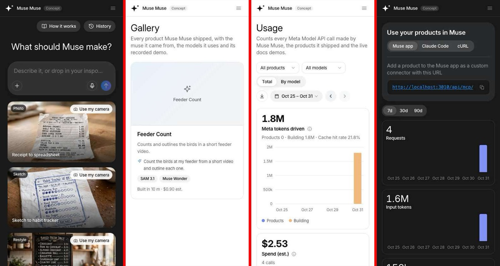

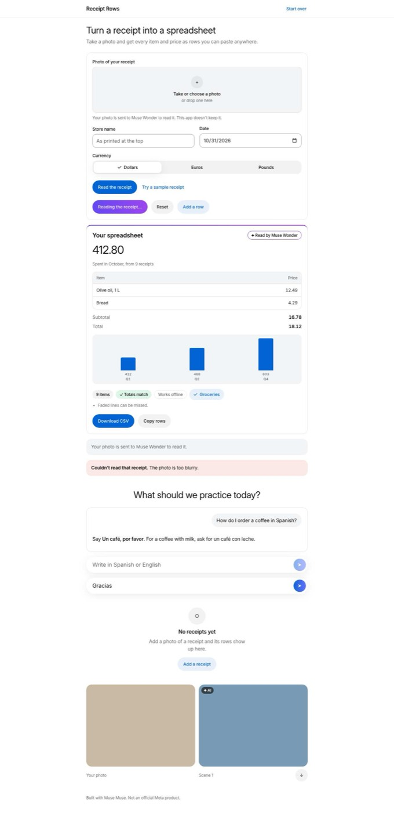

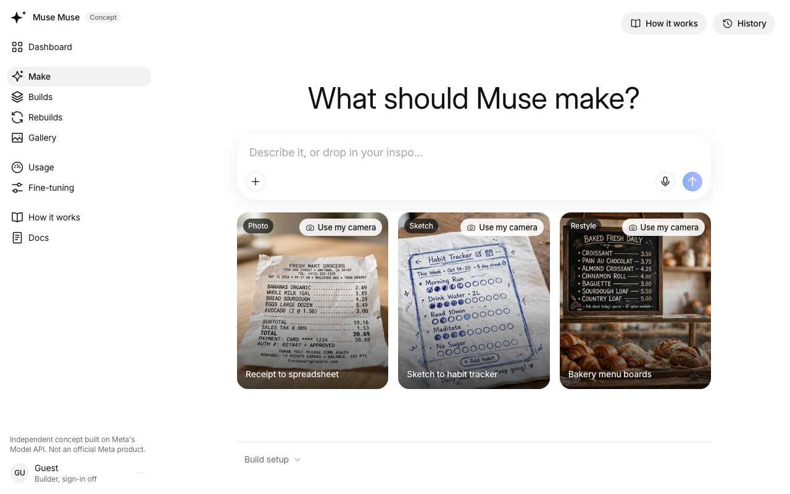

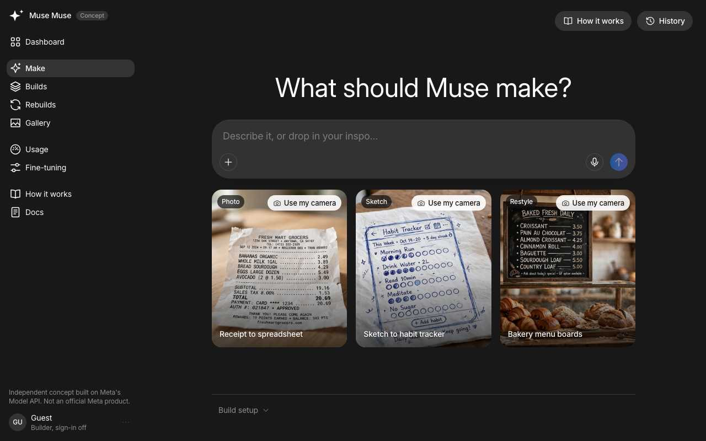

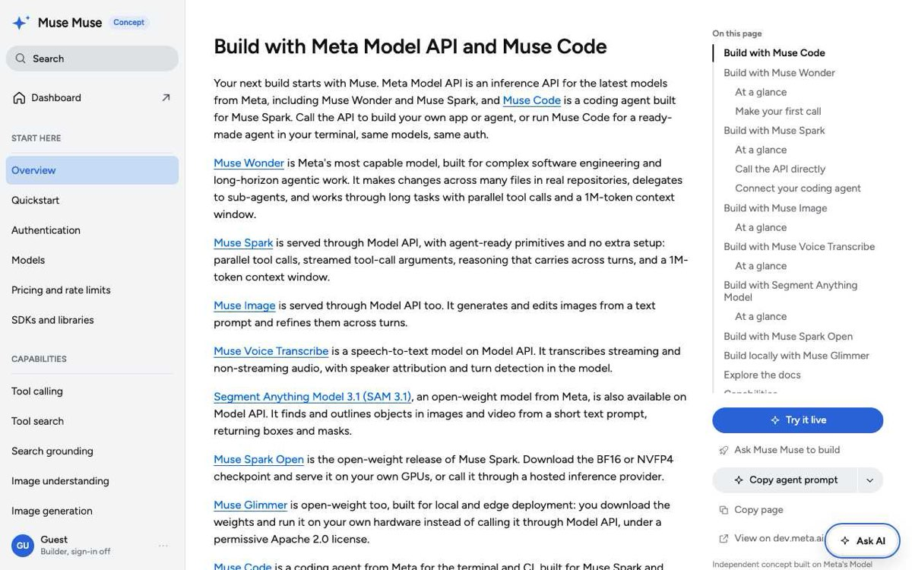

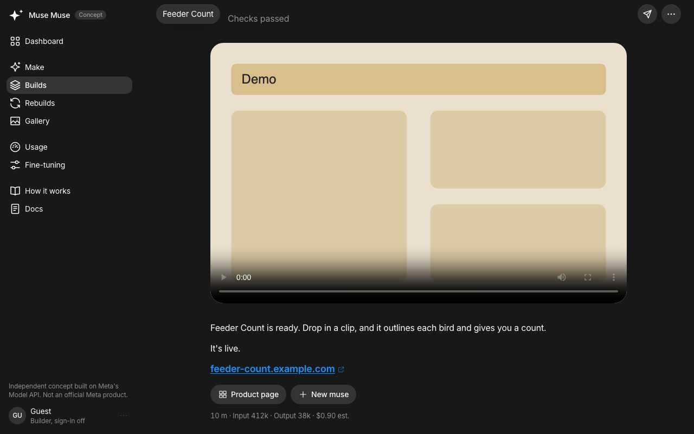

### 14:30 (about) Two more process listings printed a dev server's environment

In the measure stage (14:28 to 14:47) a `pgrep -fl` printed another session's next dev environment on port 3001,
including a short-lived VERCEL_OIDC_TOKEN and a CLAUDE_CODE_MESSAGING_TOKEN.
In the UI fix stage (16:03 to 16:28) a process listing printed the same server's environment again (a Vercel OIDC
development token and a Claude Code messaging token).
The agents wrote neither to any file. Values are not recorded here.

### 14:34 Release pushed to main and deployed to production

`git push origin release-candidate:main` as a fast-forward: origin/main moved to 4f7b73b at 14:34, with the
private-files copy fix taken (decision 1).
GitHub shows PR #2 merged at 14:34:52.
Production deployment created 14:34:55 from 4f7b73b: 247 ignored files removed, migrate step "up to date in 396 ms",
Ready in about 2 minutes.
The tree carries migrations 0012 to 0015. The log line does not say which ones it applied.

### 14:35 Release merged back into tuned-model-options

release-candidate merged into tuned-model-options as ded4119 at 14:35, so the 15 release fixes (including the
.vercelignore fix) are not lost in a later release. 4120b77 followed at 14:40.

### 14:42 PR #3 (knowledge run) squash-merged; second production deploy

Owner instruction, as relayed: keep the Lambda addresses, SSH key path and training notes in PR #3, push to main, fix
the push, merge PR #3.
LittleBit was removed from the branch at 13:43 (4a758f1). PR #3 (opened 13:38) was squash-merged at 14:42:10 as 5916c37
on origin/main.
Production deployment created 14:42:13, built in 21 s, migrate "up to date in 99 ms".
Checks: / 200, /gallery 200, /how-it-works 200, /device 200, /docs/overview 200, /api/device 403.
Later pushes to the knowledge branch do not reach main without a new PR.

### 14:45 (about) Lab Mac shared with the fine-tune session

Per the fine-tune session's log: the lab host is kept through Nov 4 per Muse Muse General. The fine-tune session's Mac
test helper runs only when no simulator is up, in its own folder, and installs nothing.
The owner signed in to base-test and approved the phone test on Device Farm (cap $40) at about 14:45.

### 15:00 (about) Read-only hackathon review of Muse Muse and Muse Privacy

Written to `_plan/HACKATHON_REVIEW.md` at 15:18, covering about 15:00 to 15:20.
Verdict: would not win today. It read origin/main 5916c37 as the judges' branch. It found both GitHub repos private
(404 signed out), the demo video still a placeholder, and the startup track rule (an active employee) unmet.
Which session ran it is not shown.

### 15:05 Laptop disk near the 8 GB stop line

df at 15:05: 7.8 GiB free on the Data volume (100% used). It was 13 GB free at 13:29.
Agents reported 9 GB (about 14:04 and 14:19), about 8.5 GB (about 14:56, which made the outputs fixer skip a dev server
render), 10 GB (15:35) and 9.7 GB (16:16).

### 15:28 Device lab: four kinds pass on the real AWS boxes

Lab fixes 14:36 to 15:35: ios_sim, android_emu, desktop_mac and desktop_windows pass on the real boxes, with framed
1920x1080 clips. glasses_sim opens and loads but still fails at the mock glasses' connect (no_eligible_device).
An ios_sim check at 15:28 opened in 1.7 s on iOS 26.5.
The Windows box stopped itself at 15:15 after 20 idle minutes. It then ran once more for release 0.1.1-50123fa
(committed 15:20) and was stopped from the laptop at about 15:24.
tg-labboxes head 176c867 at 15:29.

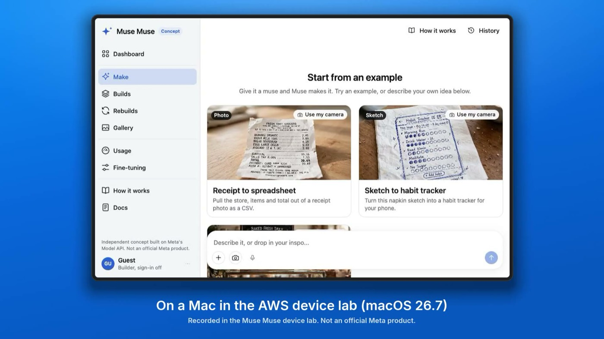

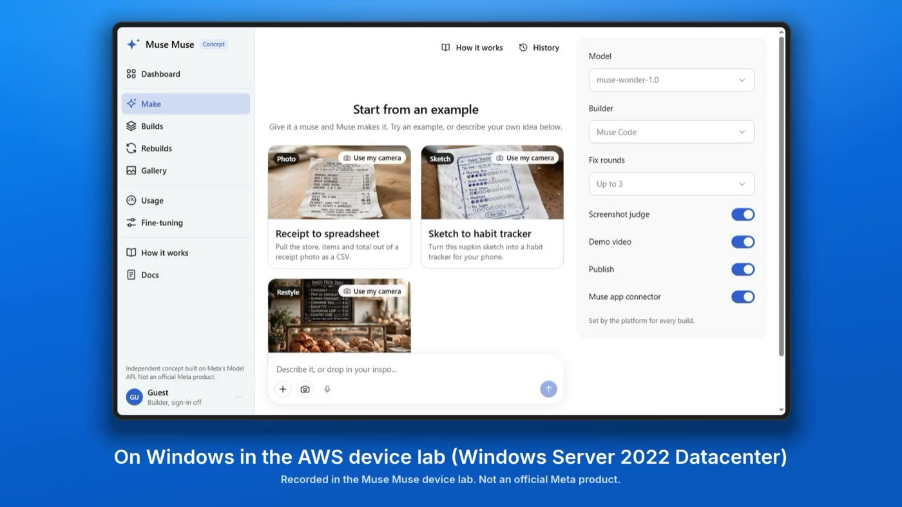

### 15:30 (about) Split of work and migration numbers with the wave 3 session

Wave 3 is another session (owner ask about 15:15: build nearly every capability, plus export a fine-tuned model to a USB
drive on a Jetson).
Agreed with General: 0016 is General's code_sessions, 0017 General's decision models, and wave 3 takes 0018 to 0026.
Later, 0027 was reserved for General's replications.
General owns Muse Code sessions, 3D, decision models, offline and paper replication. Wave 3's /exec imports General's
`lib/sandbox/session.ts`.
At most 4 heavy agents across both sessions. Wave 3 does not edit tg-ui-brand's files until it merges.

### 15:31 Fine-tune session's helper edited the lab Mac's SSM agent log

15:31 to 15:33: following a bad instruction to delete presigned URLs from logs, the fine-tune session's Mac test helper
overwrote 7 copies of its own presigned URL query in the AWS lab Mac's SSM agent log, and deleted 2 SSM agent folders
for its own command.
It was flagged as audit-log tampering. That session stopped the edits, withdrew the instruction and told General.
AWS-side SSM history and CloudTrail were untouched. Recorded in its run log as 6380106 (15:34).

### 15:35 origin/main (with PR #3) merged into tuned-model-options

Merge commit 7b65bbe at 15:35. This was the base for the wave 2 merge.

### 15:35 (about) Owner: Glimmer decision models, built and fine-tuned inside Muse Muse, Scion as reference

Owner, as relayed: "I'd also want to be able to fine tune and create muse glimmer into a decision model from within
muse muse".
Copies of Scion (sinanuozdemir/ai-experiments) were saved to the scratchpad at 15:35. The repo has no license, so ideas
only and fresh code. The decide worktree was created at 15:34.

### 15:37 Wave 2 merged on tg-wave2-merge

Merge stage 15:37 to 16:16. Merges 15:39 to 15:59: 09f7352 tools, e217d52 agentkit, 97c49fc brief, 0bfe51a outputs,
7e71740 getit, 82f6dcd vr, 0748084 labroutes, 1990ac8 packager, 4013cc0 shells2, 4ab07de labboxes. Then 431dba6,
7f484f4 and 5c4f769.
Checks on 5c4f769: 4,322 tests (4,314 pass, 0 fail, 8 skipped), template 360/360, native/lab 318/318, shell-mobile
126/126, shell-desktop 45/45, packager 70/70, tsc 0, workflow compile 162 steps in 7 workflows.
.vercelignore drops 0 of 45 lib/native files. drizzle ends at 0015.

### 15:38 Decision models design (docs/DECISION_MODELS.md)

15:38 to 16:05, 883 lines, committed d00fb7a on tg-decide (docs only, no training, no paid calls).
Format {state, question, options} with lettered options. Reasoning off. Confidence from logprobs with temperature
scaling. The prompt is sent twice. A "none" option on about 15% of rows.
Estimates: a 4-label, 400-row model about 25 min on an A100, about $0.83. Muse Decide v0 about $4.83 on an H100.
Lambda by default; Fireworks only after one export test passes. Units D0 to D9.

### 15:38 (about) Owner: 3D models and renderers such as Blender

Owner, as relayed: "Muse muse should be able to use 3d models and renderers to use things like blender and more."
General owns it on tg-3d (design `_plan/3d.md`, 15:40).
A CC0 asset manifest v1 went to wave 3: GLB at most 5 MB and 50k triangles, CC0-1.0 only, sha256 per file.

### 15:40 3D spike: Blender 5.2.3 LTS runs headless in a build sandbox

15:40 to 16:19, 6 sandboxes. Blender 5.2.3 LTS installs in about 20 s, with sha256 checked.
Renders at 640x480 on 4 vCPUs: Cycles CPU 32 samples 4.1 s, Workbench 1.1 to 1.4 s, Eevee 5.4 to 7.6 s warm (15.8 to
20.0 s cold), 24-frame Cycles turntable at 16 samples 62 s.
GLB export, and three.js plus gltf-transform, work under the locked firewall.
Muse Code driving Blender was not run (Meta 401 on the Vercel development key).
Sandbox at most $0.195, Meta $0. Blender adds about 1.24 GB to the snapshot. Commit 7f826bb at 16:18.

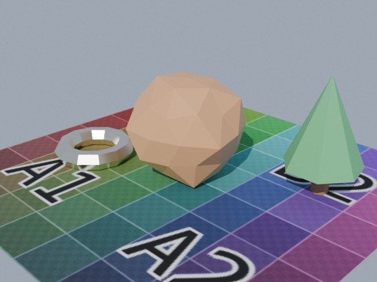

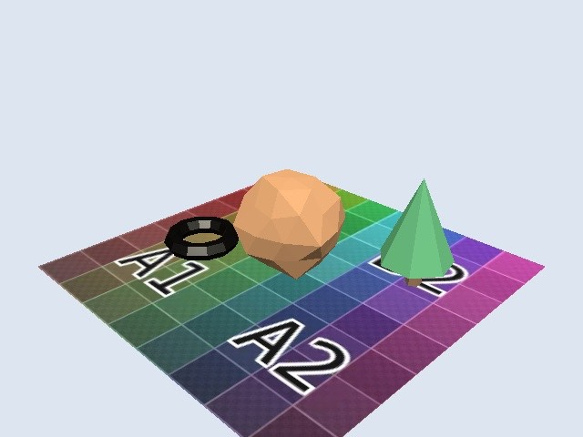

### 15:45 (about) Owner: offline mode

Offline mode, as relayed: a house machine, block products, inference on the same machine or a LAN device, records stay
local.
The offline worktree was created and the design started at 15:48.

### 15:48 Offline mode design (docs/OFFLINE.md)

15:48 to 16:06, committed dd1602f on tg-offline (docs only).
A block product is one JSON config rendered by one runtime: no generated code, no sandbox. OFFLINE=1, PGlite, records
never sync.
Endpoints share one devices table, which wave 3's unit 13 builds as 0026 in offline's shape.
Fleet on Oct 31: 8 machines enrolled, 3 online, none running a Meta model.
Offline stays a demo branch until after Nov 4.

### 16:00 (about) Stale MODEL_API_KEY in the Vercel Development environment

16:00: the 3D spike got 401 invalid_api_key from Meta with the key from a Vercel development env pull. Its README says
the working key is in `.env.local`.
16:36: the UI trial's first build failed at the brief step with 401 Unauthorized.
16:37: the trial compared the two keys by length and equality only (no values printed): same length, not equal. It
restarted on the local key, which it only read.
The 16:38 build passed.
Fix pending: renew MODEL_API_KEY in Vercel Development.

### 16:05 (about) Owner: an offline harness like a leaner Muse Code

Owner, as relayed: "I would want the offline mode to be able to have an offline harness thats like a leaner muse code
too."
Plan note `_plan/offline-harness.md`. The design workflow started at 16:07.

### 16:07 Offline harness design (docs/OFFLINE_HARNESS.md)

16:07 to 16:26, 734 lines, committed 6eb0d2f on tg-offline (16:25).
It picks our own lean harness ("the helper"), with a narrow tool set and no shell tool.
Muse Code against a local endpoint becomes an owner-only experiment after Nov 4, and never ships in a kit or on a
drive (Meta terms 3.1).

### 16:16 Wave 2 merge review PASS; fixes to d8ffec4

Review 16:16 to 16:33: PASS, nothing lost in the merge. Only notes and owner decisions left.
Fix 16:33 to 16:45: fa7678c (16:36) and d8ffec4 (16:37).
Checks on d8ffec4: root suite 4,321 tests (4,313 pass, 0 fail, 8 skipped), template 360/360, native/lab 318/318,
shell-mobile 126/126, packager 70/70, tsc 0. Goldens unchanged.

### 16:20 (about) Owner: local version runs 1-bit Glimmer; Jetson and edge left to Hussam

Owner, as relayed: "we will run the one bit qunatized" and "the jetson work is in the air, leave that to hussam for
later but we will have a local and edge version".
So the house machine runs IQ1_S Muse Glimmer (about 6.5 GB) with llama-server, reasoning off and an eot stop. No
Jetson or fleet endpoint in the Nov 4 demo.
Which machine is still open, since the owner's laptop must not run Glimmer.

### 16:25 (about) Owner: paper replication

Owner, as relayed: "muse muse should be able to get a research paper and replicate it, like if theres a research paper
on continual learning or something".
The replicate worktree was created at 16:28 and the design started at 16:29.

### 16:26 (about) Lab cleared a window for the fine-tune session's Mac test

At 16:26 the fine-tune session reported its helper had loaded no model in 85 minutes, because the lab's headless Android
emulator (up since about 14:24) and an iOS simulator (since about 15:28) stayed up.
It asked General for a 20-minute idle window. The test ran 16:33 to 16:48 in a 40-minute window the lab cleared.
Lab gate note: CoreSimulator daemons stay up with no device booted, so a "Mac is busy" check should count only the
named processes.

### 16:28 UI brand trial: new snapshot and a live test build

Trial stage started 16:28.
New builder snapshot 16:34 to 16:35: Muse Code 1.4.14, 24 overlay files, 2,060 MB, 64.6 s.
Build A failed at the brief step at 16:36 (401). The retry ran 16:38 to 16:48 and went live in 598 s, cost $0.043, 0
fix rounds.
Screenshots of the old and new look (1280 and 390 px) saved 16:50 to 16:55. The stage was still running at 16:56.
After this log's cutoff, build B (Fridge Chat Chef) went live after 1 fix round in 762 s for $0.0542. 60b062c (17:12)
puts the trial at $0.10 of Meta spend, all on Contributor, and about $0.11 of sandbox time.

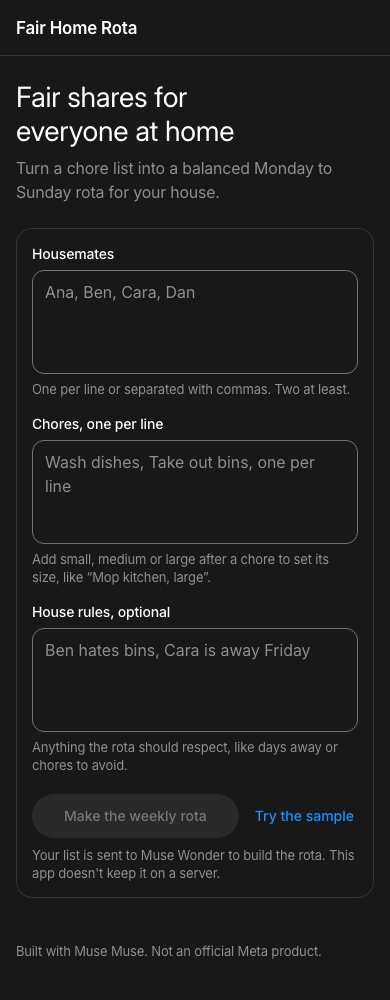

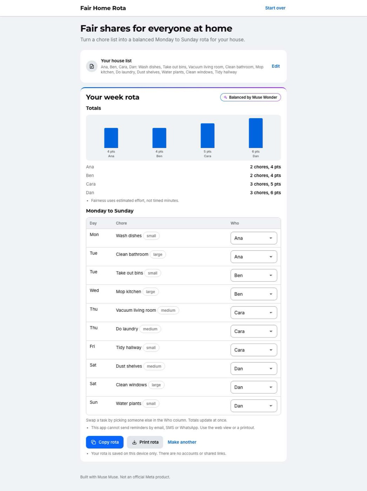

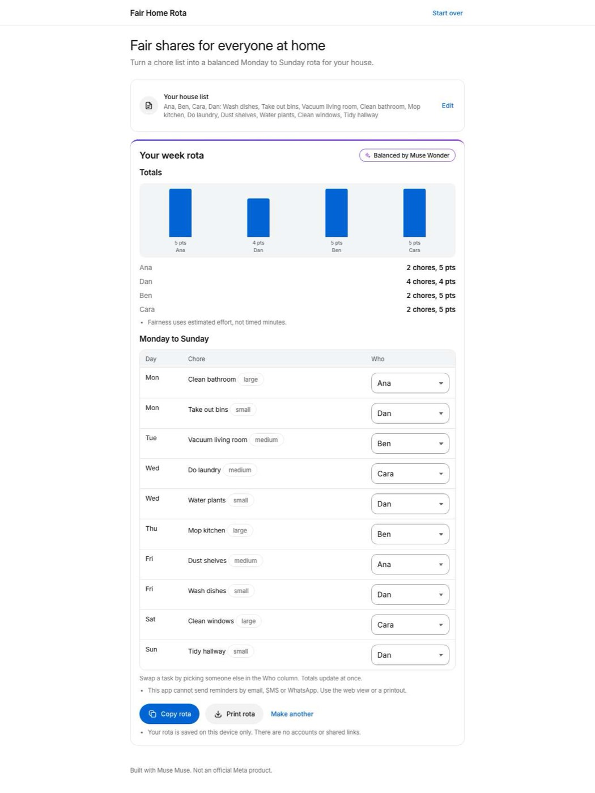

### 16:29 Paper replication design and cloud check

16:29 to 16:53. One sandbox, 250 s: setup 18 s, then Split MNIST (fine-tuning vs EWC vs replay, 2 scenarios, 3 seeds)
in under 100 s with egress closed.
Muse Code implemented a made-up method from one paragraph in 42.5 s for $0.006433 on Contributor.
Sandbox about $0.106 (worst case $0.195).
Three design changes came out of it: Muse Code took one reading of an ambiguous step without saying so; its test did
not import the code it shipped; the thread count changed a chosen hyperparameter.
Committed 34af886 at 16:52. Wants migration 0027. Units R0 to R11, about 39 h.

### 16:33 1-bit Glimmer measured on the AWS Mac (by the fine-tune session)

16:33 to 16:48: stage 2 IQ1_S on the M1 16 GB Mac, llama.cpp b11970, `-c 4096 -np 1`, reasoning-off template.
Metal: 4.2 tok/s generation, 25 tok/s prompt (pp512 35.9, tg64 4.29), warm load 2 s, peak RSS 6.88 GB.
50/50 calls HTTP 200 and stopped on their own. Plain questions 8/10, old facts 40/40. No swap, thermal Nominal.
CPU only: 2.3 tok/s, 7.69 GB.
What it means: a 200-token reply takes about 50 s and a short field about 15 to 25 s. So prompts stay short, replies
stay small, and the product says up front that it is slow.

### 16:45 (about) Migrations reach main and production in number order

drizzle 0.45.4 applies only journal entries newer than the newest applied one, so a skipped 0016 or 0017 would never
apply.
Agreed: migrations reach main, previews (which share production's database) and production in number order. Wave 3
tells General before any 0018 or higher goes to main or a preview, and General lands 0016 and 0017 first.
Wave 3 runs 2 heavy agents at a time, leaving General 2.

### 16:47 Wave 2 lands on tuned-model-options (d8ffec4)

After the wave 3 session said go, tuned-model-options fast-forwarded from 7b65bbe to d8ffec4 (reflog 16:47; the
session lead reported about 16:50). Not pushed.
Wave 3 builds tg-cap-int from d8ffec4.

### 16:48 Decision models build starts on the merged base

tg-decide was rebased onto d8ffec4 as ca953be (committed 16:48).
The build workflow started at 16:49. Its agents cover units D0 to D2: a d0-d1 build, then d2, then a review and a fix
of D0 to D2. D0 (the decision contract in lib/decide/types.ts) landed as 96db7e7 at 16:57, just after this log's
cutoff. Later commits are in the moved list under Now.

### 16:55 (about) Owner: log everything, with screenshots

Owner, as relayed: "Make sure youre logging everything, pulling ss if possible as well."
Timeline and screenshot gathering started at 16:55. This file is the result.
Wave 3 keeps its own entries in `_plan/wave3-log.md` and `_plan/log-shots/` until tg-cap-int merges, then moves them
into this file.

### Screenshots from the day

#### Local site, fresh capture at 17:05

Captured with Playwright at 390x844 from a local dev server (port 3001), GET requests only. Port 3001 is where the
14:30 entry found another session's dev server. These are not release review shots. Desktop captures were dropped
because the sidebar showed a real account.

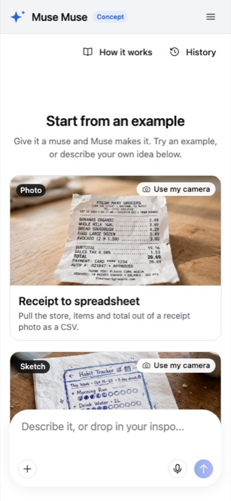

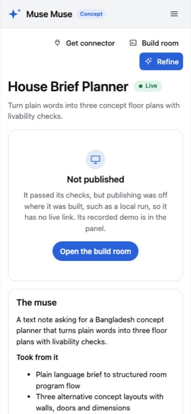

## After 4:55 PM

### 17:00 (about) Agreements with the wave 3 session

- Migration 0027_replications is reserved for General (journal `when` 1793432210646). It lands only after wave 3's 0018
  to 0026 reach main, or is renumbered then.
- Wave 3's unit 4 adds MNIST and Fashion-MNIST to its dataset registry, from sha256, size, source URL and license that
  General verifies at the source.
- Wave 3 logs in `_plan/wave3-log.md` and `_plan/log-shots/` until tg-cap-int merges, then moves its entries here.

### 17:05 (about) UI brand trial finished: both builds live on Contributor

- Build A (chore rota): live with no fix rounds, 598 s, $0.0435. Build B (fridge recipe helper): live after 1 fix round
  (one action failed its first check; the fix added a retry), 762 s, $0.0542. Judge passed both. Recorded Meta spend
  $0.0976, all on muse-spark-1.3-contributor; sandbox about $0.11 at list prices. The test snapshot and both product
  sandboxes were deleted after.
- Both read the muse-app-ui skill and used its tokens and parts: no raw colors, Inter only, #0064d4 pill buttons,
  hairline cards, purple marks on AI results, the glass composer. No sideways scroll at 390, no em dashes, no Meta names
  or marks.
- Skill fixes from what the trial showed: bc52cde (composer placeholder 30 characters or fewer, since 35 wrapped at
  390 px) and 0f40b15 (spacing tokens in JSX, and the sparkle on every tinted AI button, stated in SKILL.md). Write-up
  60b062c, `docs/spikes/ui-brand-2026-10-31/README.md` on tg-ui-brand.
- Found: on a local test build, a product calling `metaClient` directly with muse-wonder-1.0 still ran Muse Wonder
  (only `respondJson` swapped to TEST_MODEL), about 5 to 10 small unrecorded calls in build B. Through the gateway these
  were already swapped. The build room's live preview under `next dev` doesn't take clicks through the sandbox's public
  address (`next start` works).

### 17:10 meta.ai look: TEST_MODEL fix and merge with wave 2 (wf_801146c9-84c, running)

- af3b082 (17:22): on local test builds `metaClient` swaps an exact muse-wonder-1.0 request body for TEST_MODEL, like
  `respondJson`. Nothing changes without TEST_MODEL or through the gateway.
- 59c7439 (17:27): merge of tuned-model-options (d8ffec4) into tg-ui-brand. Six conflicts, all in build pipeline files
  (render.ts, judge.ts, build-steps.ts, prompts/judge.ts, builder.ts, setup.ts). Fallout fixes fcc3cfe, 6e8be8e, 029064a,
  a75281f (a test build's agent turns follow TEST_MODEL too) and efffcf9 (the look and the targets share one overlay
  folder). Review and fix stages still running.

### 17:44 Decision models D0 to D2 built and reviewed (wf_b0421939-e3e)

- 96db7e7 D0 (16:57): the decision contract in `lib/decide/types.ts`. 9546d8d D1 (17:06): the task format, Glimmer
  prompt and word-overlap stand-in in `lib/decide/format.ts`. bd09bb7 D2 (17:26): deterministic scoring in
  `lib/train/logic.ts`. 29b00c2 (17:44): a review fix. The workflow's fix stage is still running.
- Next: D3 onward (database, GPU code, pages, serving) start when it reports. The one real GPU run waits for the owner.

### 17:46 This log committed

- 59 entries for Oct 31 and 47 screenshots, drafted from git, plan files and workflow results, then checked by a separate
  agent against every source (2 factual errors and 12 smaller ones fixed). Screenshots showing any email address, even a
  placeholder one, were left out. `docs/log/` is in `.vercelignore`, so screenshots never ship in a deployment.

### 17:54 Decision models D0 to D2 finished; D3 to D9 started

- Review fixes on tg-decide, all five findings held up: 29b00c2 (taskProblem measures the text as given), ef2b987
  (scoring refuses numbers that can't be log-probabilities, so the gateway answers 502 rather than a confident-looking
  pick), 84ec618 (training renderings take the eval groups' shapes above 4 labels), 1d4b7cb (decide.json carries its
  groups and the rendering rules, checked by a test that reads only the file), d842328 (the temperature fit uses its own
  golden-section helper; the reviewer had flagged its loop's shape as close to Scion's unlicensed code).
- Checks at d842328: tsc exit 0; lib/decide and the light lib/train tests 389 pass, 0 fail.
- Tokenizer facts confirmed against Glimmer's tokenizer.json at cec94fcf: A to Z are single tokens bare and space-led,
  639 of 676 two-letter pairs are single tokens, and the TypeScript prompt equals the real chat template's output byte
  for byte (jinja2 fixture). New finding: encoding with special tokens adds <|begin_of_text|> by itself, so prompt text
  sent to a backend leaves it out.
- 17:54: D3 to D7 and D9 started in sequence (wf_50b3b2f5-c82): datasets and migration 0017, GPU decide mode, after-run
  scoring, pages, serving and docs. D8, the real GPU run (about $0.83, capped at $5), waits for the owner.
- Wave 3 confirmed none of its current units touch lib/train; its unit 11 will import DecideBackend and the /decide
  route rather than edit them.

### 18:16 Owner asked to run the current state locally

- Worktree ~/mm-wt/local-run (branch local-run): the meta.ai look branch plus wave 2 plus the build log, served by
  `next dev --webpack` on port 3020. Database: a copy of the local site's `.data/pglite-docs-2` (the older
  `pglite-docs` folder and a 02:22 backup of it both abort in PGlite, so they are unusable). Product files linked.
- Flags on locally only: MUSE_APP_LOOK, NATIVE_TARGETS=phone,desktop, VR_ENABLED, GLASSES_ENABLED, AGENTS_ENABLED,
  PRODUCT_OUTPUTS, PROVE_IT, with DAILY_SPEND_CAP_USD=3. Off: NATIVE_LAB, NATIVE_DEVICE_FARM, personal tools, nightly
  Prove it. Home, gallery, How it works, usage, fine-tuning, builds and a product page answered 200 with no errors.

### 18:23 Decision models D3: datasets and migration 0017

- 2dec882 on tg-decide: decision datasets (CSV or JSONL, the test split held out first), migration 0017_decision_datasets
  and the GPU's decision pages. D4 (the GPU decide mode, tested against fake torch, no spend) started next.

### 18:34 Owner: fine-tuning across several Jetsons, on Meta research

- The owner shared Meta's "Applied Federated Learning: Architectural Design for Robust and Efficient Learning in Privacy
  Aware Settings" (Stojkovic et al., arXiv 2206.00807) and asked whether it helps train across multiple Jetsons; they
  want fine-tuning jobs across several Jetsons at once, built on Meta research.
- Design workflow wf_cd4fca5d-d81 on tg-fleet-train: verify the Meta papers and tools and their licenses (Papaya,
  FedBuff, federated analytics, Opacus, FLSim, small Meta models for 8 GB boards), read muse-device's single-board
  training and the fleet control plane read-only, simulate federated fine-tuning in one cloud sandbox (cap about $1, no
  Meta calls), write docs/FLEET_TRAINING.md, then an independent check. No board is touched; the board side is
  Hussam's.

### 18:35 (about) Disk below 6 GB

- Free space fell to 4.0 GB, with swap at 5.5 of 6 GB: three dev servers, browsers, agents, and Muse Privacy's two
  local llama-servers (LFM3-VL-2B and an embedding model, not Glimmer). Deleted about 0.7 GB of finished scratch whose
  results are already in the plan files and this log; 5.4 GB free after. New alert at 3 GB.

### 18:46 meta.ai look landed on tuned-model-options (4c412a3)

- Final fix pass on tg-ui-brand (wf_801146c9-84c), all review findings checked: one script installs every overlay
  (786e675); the look's skill file comes back before every verify and demo (eee71af); a phone or desktop product with
  the look gets its manifest and icon in the look's colors (428616f); a local run warns when its snapshot's template is
  older than the checkout (2763f85); native route tests leave no empty folders (49755ce); fixture data for the
  screenshots (6d554fd). Rejected with reasons: recoloring the VR panels (uikit draws them in 3D, and the blue is
  already close), and changing wave 2's shell-mobile tests.
- Checks at 6d554fd: 4,752 tests pass, 0 fail, 8 skipped (live gateway tests that need a key); template tests 397/397;
  tsc exit 0; workflow compile exit 0; flags-off goldens unchanged.
- 4c412a3 merges tg-ui-brand into tuned-model-options with no conflicts, after the wave 3 session said go; tsc exit 0
  and the vercelignore, flags-off, look and test-model tests pass 25/25 after the merge. The hold on UI files for wave 3
  is lifted. Not pushed to main.
- Live builds get the look, the merged overlays and the metaClient TEST_MODEL fix only from the next builder snapshot.
- Screenshots of the merged platform (local site, guest view). The build room and Get it shots use test fixture data:
  the device check results in them are made up for the page tests, not real runs.

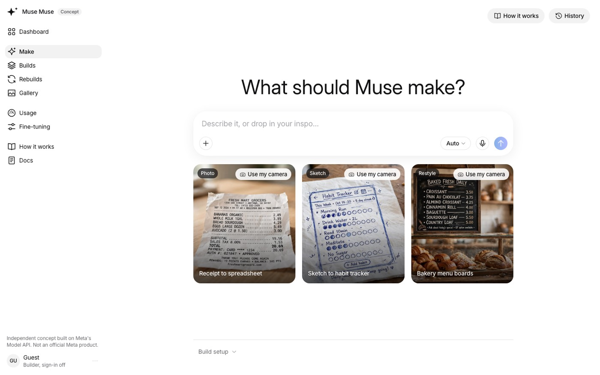

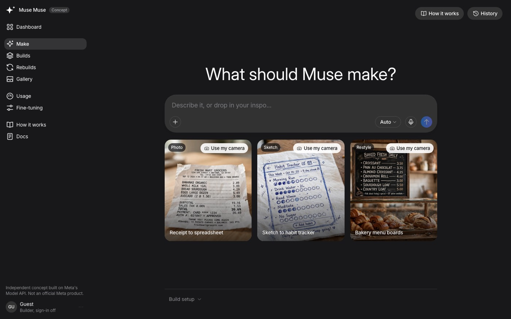

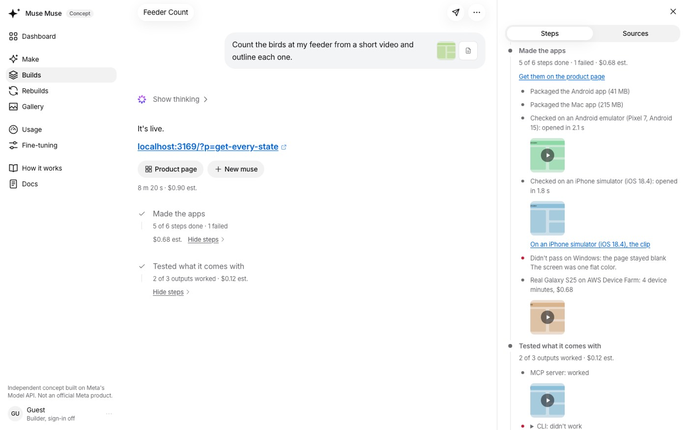

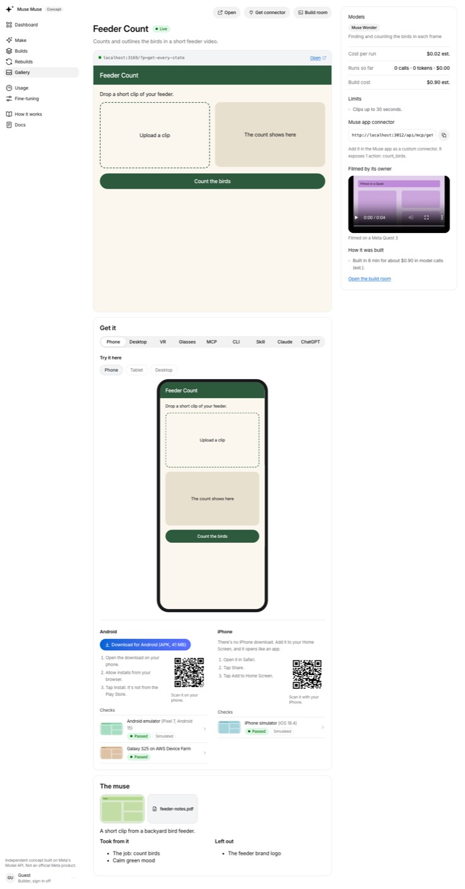

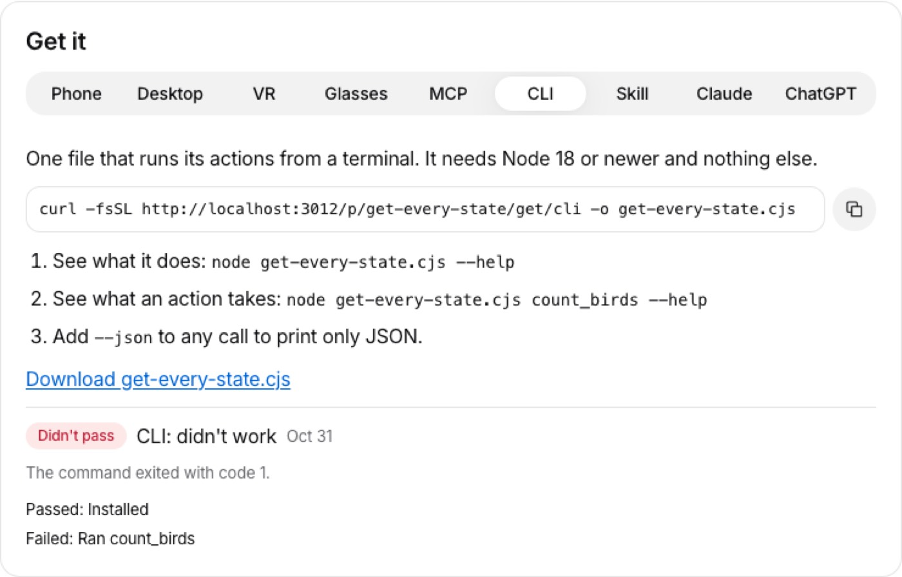

### 18:49 Test builder snapshot with the TEST_MODEL fix

- The wave 3 session's engine unit found two things. A local test build can't reach the gateway, because the build
  sandbox can't call a localhost platform, so capability checks that go through the gateway can't be proven on the local
  site. That covers wave 3's data, connectors, jobs, code and gpu units, and General's /decide route and Muse Code
  sessions. Also, its local smoke tests' product calls went straight to Meta on Muse Wonder, about $1 to $2.
- Both sessions recommend a Preview with its own database (owner decision 3 above) to prove gateway paths. A tunnel to
  the local site stays off.
- Made a test-only builder snapshot from tuned-model-options 566fa98: snap_2y1WMExjxKPxiDyPtcPvFcMtdU20, template
  hash a2d8df174adc, 1,970 MB, 76.5 s, about $0.01. Its checks passed: pristine platform files, 65 overlay files
  including muse-app, 15 bundled Muse Code skills off, Muse Code 1.4.14. Products built from it get metaClient's
  TEST_MODEL swap. It is used only as a per-command override for local test builds, never in .env.local or Vercel;
  production keeps its snapshot until the Nov 2 one.
- The local site on port 3020 was restarted with that override and merged up to 566fa98; home and gallery answer 200.

### 18:52 (about) Owner: previews may get their own database

- Owner: "preview can get its own db or share idc". General chose its own database, which both sessions recommended.
- The Neon integration (neon-celeste-lantern, Vercel-managed) offers per-preview branching only at connect time, per
  Neon's docs, and the documented way to change it removes the project connection, so it is not used on a live project.
- Instead: tg-preview-db (wf_7d431c55-cdd, started 18:54) adds one database-URL helper. On a Vercel preview it uses
  PREVIEW_DATABASE_URL; without it a preview skips migrations and runs with no database; it refuses when the preview URL
  equals production's. The owner then creates a Neon branch "preview" and sets PREVIEW_DATABASE_URL for Preview only.
  Until both are in, no preview deploys of branches with migrations.

### 19:02 Glimmer sampling: Meta's docs say not to decode greedily

- The fine-tune session corrected its serving notes: Meta's Glimmer docs give temperature 1.0, top_p 0.95, top_k 64,
  say greedy decoding gives flat, repetitive answers, and say to stop on <|end_of_text|> and <|eot|>, never <|eom|>. Its
  earlier numbers (including the AWS Mac's 4.2 tok/s) were measured greedy, so they hold as comparisons only.
- Offline mode's plan now defaults to Meta's sampling and checks JSON output both ways before freezing. Decision models
  are unaffected (they read letter log-probabilities from one forward pass).
- Found in published code: the lab's GGUF cards and Ollama settings (lib/train/hub-cards.ts, recipes/quantize.ts) say
  temperature 0, and tuned models' stops include <|eom|>. That code came with the vibe-tuning commit d72f9f3 (Oct 28),
  not the knowledge run. Agreed with the fine-tune session: cards recommend Meta's sampling and say the eval was greedy;
  the <|eom|> and <|start|> stops stay only for final-channel (trainChannel 0) models, with a sentence why; the eval
  stays greedy. General changes the code after tg-decide lands; rewriting cards already on Hugging Face waits for the
  owner.

### 19:06 Decision models D4 and the preview database code committed

- 02b1b32 on tg-decide (19:06): decide mode on the GPU, ctx.decide in the runner, the decide callbacks and the run
  estimate. Tested against fake torch, no spend. D5 (scoring after a run) started next.
- b2abc15 on tg-preview-db (19:04): previews use PREVIEW_DATABASE_URL or no database, never production's. Its
  independent review started next; wave 3's gateway-address and bypass pieces get folded in after it.
- The multi-Jetson simulation has written its scripts (tabular and LoRA federated runs) and is running in the cloud.

### 19:13 Owner: align fine-tuning with Meta's Glimmer docs, and run on Lambda, Fireworks, Baseten or Modal

- Owner asked that fine-tuning be at least roughly aligned with Meta's Glimmer pages on post-training, quantization,
  deploy and hardware platforms, and ready to run on Lambda, Fireworks, Baseten or Modal.
- Pass 1 now (wf_a24c3785-97a, branch tg-train-align, read-only, no spend): read Meta's four pages, our lib/train code,
  and each provider's current Glimmer support and prices; write docs/GLIMMER_ALIGNMENT.md (one row per Meta
  recommendation: aligned, partly or not, with the fix) and docs/TRAIN_BACKENDS.md (one backend seam, what each provider
  needs, a cheap smoke test each); independent check.
- Pass 2 after tg-decide lands (it is editing lib/train): build the fixes and the backends. Real provider runs wait for
  the owner's OK.

### 19:19 Disk below 3 GB; local site stopped

- Free space fell to 2.9 GB, swap 5.9 of 7 GB. The fine-tune session had pulled the stage-b-r30b adapter (1.71 GB) onto
  this laptop by 19:15:58; the rsync General saw was its upload from the laptop to writer-1, which only read. Asked it
  to keep large files off the laptop.
- 19:20: the fine-tune session killed the upload, checked the copy's sha256 against train-1, deleted the local folder
  (about 1.6 GB back), and changed run_handoff.sh to pipe train-1 to writer-1 with nothing written on the laptop.
  stage-b-r30b is its final model; its IQ1_S is due about 20:15, scored by about 21:30.
- Stopped General's local site on port 3020 and deleted its build cache (about 0.5 GB). Its database copy stays, so it
  can be restarted. 3.6 GB free after. Next alert at 2 GB.

### 19:25 Owner: push the work to GitHub, with previews off

- Owner chose to push with Vercel previews off until the preview database exists, since previews still share
  production's database and tg-decide carries migration 0017.
- vercel.json now has git.deploymentEnabled {"main": true, "*": false, "**": false}: only main deploys from git (Vercel's
  rule: a branch deploys if any matching rule is true). Turn branches back on once PREVIEW_DATABASE_URL is set.
- tuned-model-options goes to GitHub as a branch. Branches made before this rule (and branches still being built) go
  up as backup refs, refs/backup/<branch>, which Vercel does not build; each shows as a normal branch once it lands on
  tuned-model-options. Pushes repeat after each landing.
- The fine-tune session also freed space: five older 1.7 GB adapter copies deleted after matching their S3 copies; 13 GB
  free.

### 19:29 Work pushed to GitHub

- tuned-model-options pushed as a branch (a5c82b5; Offline-Base/muse-muse). Checked: Vercel made no deployment for it,
  so the main-only rule in the pushed vercel.json is honored. The recent previews are all from the fine-tune session's
  `knowledge` branch (run logs, no migrations).
- Backup refs, which Vercel never builds: refs/backup/tg-decide (02b1b32), tg-preview-db (a66be04), tg-3d (7f826bb),
  tg-musecode (23525cb), tg-offline (6eb0d2f), tg-replicate (34af886). A key-pattern scan ran first; its only hits were
  made-up test values.
- From now on General pushes after each landing with `_plan/push.sh` (scan, then tuned-model-options as a branch and
  General's other branches as backup refs; wave 3's branches are left to that session).

### 19:35 Owner: commit to main and deploy; shipped to production

- Owner: "commit what you have rn to main and deploy". Shipped tuned-model-options at 6f311e5: a fast-forward of 159
  commits from 5916c37 (wave 2, the meta.ai look and the muse-app-ui skill behind MUSE_APP_LOOK, the TEST_MODEL fix for
  metaClient and the agent kit, the build log, and the main-only deploy rule). Work still being built (decision models,
  the preview database, multi-Jetson, the Glimmer alignment) stays out.
- Checks first: no migrations beyond 0015 (already on production); typecheck clean; full root suite 4,361 tests, 4,353
  pass, 0 fail, 8 skipped (live gateway tests that need a key); production already runs sub-daily crons, so the two new
  ones fit the plan.
- Production deployment dpl_DBQAd4HcEcX5aj4dpCcNzDsjEfXw (muse-muse-dzahxq4km), created 19:35:41, Ready by 19:37: .vercelignore removed 334 files
  (including docs/log), `migrate: up to date in 95 ms`, build about 1 minute. Live checks on muse-muse.vercel.app: home
  (the new "What should Muse make?" page), gallery, How it works, usage and /p/dinner-split-helper answer 200; /docs
  redirects and resolves to 200.
- Every new feature flag is off on production (not re-read), so builds and products behave as before; the platform's
  new look is the visible change. Rollback: the previous production deployment dpl_Dk5fxBe6VsmuGRnouyAcf82p4nYV
  (5916c37).

### 19:39 Preview database code reviewed; wave 3's pieces being folded in

- tg-preview-db (wf_7d431c55-cdd): one helper, lib/db/url.ts, decides the database. A preview uses PREVIEW_DATABASE_URL
  or none, never production's; migrate skips on a preview without it and refuses a URL that is production's database
  (matched by Neon endpoint id and database name). The review's 8 findings all held up; fixes: previews never publish
  products (a publish could have overwritten a live product), previews take no Stripe payments and refund nothing (the
  fix found a refund path the review missed), drizzle.config gets an unresolvable address on such previews, and a
  guard test keeps every database variable read inside lib/db/url.ts. Full suite 4,400 tests, 4,392 pass, 0 fail.
- Owner steps changed: an EMPTY database named "preview" on a Neon branch "preview", because copied production rows point
  at live Vercel projects, sandboxes and real payments.
- Now (wf_6ef8e23b-ff9): cherry-pick wave 3's 0a75160 (the sandbox firewall adds the protection-bypass header for the
  platform host only) and port 9e09de8's preview platform URL and bypass-secret getter, then a review focused on the
  secret never reaching a sandbox, log or other host.

### 19:44 Owner: anyone should be able to fine-tune

- Today the lab is admin-only to start datasets and jobs; production runs in guest mode, so "anyone" means any visitor,
  and every job rents a Lambda GPU on the owner's account.
- Plan: build it behind a PUBLIC_TRAINING switch (off means exactly today's behavior), with a visitor identity without
  sign-in, per-visitor and site-wide limits, a queue for the one GPU slot, the visitor's own job pages, the policy check
  on dataset tasks, and no automatic publishing of visitors' models to the owner's Hugging Face account. Design running
  now (branch tg-open-train); the build starts when a heavy slot frees.
- The fine-tune session's final model is stage-b-r30b (picked 19:14): BF16, greedy, 29.0% of 2,500 2026 facts (base 18.4%
  at Q4), admits not knowing 86% (base 15%), makes something up 12% (base 74%). Its Q4_K_M is on writer-1 (16.9 GB); the
  1-bit IQ1_S is due about 20:25, scored about 21:05. Nothing goes through the laptop.
  **Corrected 20:33 (the fine-tune session):** the 86% and 12% came from the 120-question dev set, which overstates
  honesty because its training rows came from the same writer. Held-out numbers (190-question honesty test, BF16, greedy,
  blind hand audit by two graders): r30b honest 44.7% (95% interval 38 to 52), made up 55.3%; after-cutoff questions 67%
  honest, unknowables 67%, false premises 20%. Base: honest 26.3% (21 to 33), made up 70%; after-cutoff 24%, unknowables
  43%, false premises 22%. Paired on the same questions r30b beats base, p = 0.0001. In plain words: much better than
  base at saying a question is after its cutoff or unknowable, no better at catching false premises (it still goes along
  with about 80% of them). No page or card in this repo quoted 86%.

### 19:46 Owner: Gadgets and Models tabs in the sidebar

- Building on tg-nav-tabs (wf_5e1ee206-43e): two sidebar rows and icons, and two public read-only pages.
  /models: Meta's hosted models from the brief writer's catalog with the gateway's prices, Muse Glimmer, and the lab's
  tuned models from Lab results. /gadgets: what a gadget is, whether gadgets are on and a board is configured (status
  words only, never its address or token, no live call on load), gallery products using one, a link to /device for
  admins, and a note that connecting your own board is coming (wave 3's hardware unit). Review, fix, full suite and
  screenshots follow.

### 19:58 Owner: a plan card with the Muse mascot in the build room

- The owner sent a screenshot and three images from Downloads (muse present.png, muse building.png and muse privacy or
  checker image.png, made 19:51 to 19:56): the mascot on the left of the chat and a short plan summary on the right.
  Present while the plan is shown, building while Muse Code works, the shield pair when the build is done and live.
- Building on tg-plan-card (wf_352ae383-888): web-sized copies under public/muse/, a PlanCard in the chat (name, tagline,
  who it's for, how it works; the full brief stays under Read the brief), state-driven image with no layout jump, dark
  mode and phone layouts, tests, review, and screenshots of every state.
- Wave 3 agreed two marked slots for the new pages: /gadgets (its hardware unit's board list) and /models (its gpu unit's
  owner-tuned models), each behind wave 3's own flag.

### 20:06 Preview database landed on tuned-model-options (381935f)

- Combined with wave 3's pieces (wf_6ef8e23b-ff9): 0a75160 cherry-picked (the build firewall adds the protection-bypass
  header for the platform host only), and from 9e09de8 the preview platform URL (https://VERCEL_BRANCH_URL, else
  VERCEL_URL, only on a preview with its own database) and the bypass secret.
- The review found two ways sandbox code could misuse the bypass (domain fronting with another Host, and asking Vercel
  for a bypass cookie). Fixed in 55e5783 (Host pinned to the platform's host; the cookie request refused with 403 in any
  spelling) and f35d3bb (the secret comes with its host and goes nowhere else). Full suite at 15af04c: 4,418 tests, 4,410
  pass, 0 fail. Not yet tested on live Vercel: the README has a one-time check for after the owner's steps.
- Found and queued: the older Meta-key firewall transform for api.meta.ai doesn't pin Host either (live today); fix with
  one test build, shipped on its own.
- After the merge: tsc exit 0; db, preview-bypass, vercelignore, policy and flags-off tests 82/82. Pushed to the
  tuned-model-options branch only (no deploy; main unchanged).
- Owner steps (README, Preview database): Neon branch "preview" with an empty database "preview"; PREVIEW_DATABASE_URL
  for Preview; Protection Bypass for Automation. Then vercel.json's main-only rule can let previews build again.

### 20:08 Glimmer alignment with Meta's docs, and training providers: designs done

- tg-train-align 429c659 (wf_a24c3785-97a): docs/GLIMMER_ALIGNMENT.md (48 rows against Meta's post-training,
  quantization, deploy and hardware pages, each with our file:line, a status and a fix) and docs/TRAIN_BACKENDS.md (a
  TrainBackend seam plus Lambda, Modal, Baseten and Fireworks). An independent check found 20 problems (5 that changed a
  plan: Modal GPU Sandboxes can be preempted, trainChannel 1 isn't built yet, the next free migration is 0028, the GPU
  order, Modal's 3x CPU and memory rate); all 20 fixed.
- Findings: the core recipe sits inside Meta's ranges (QLoRA on attention and MLP, LR 2e-4, rank 16, answer-only loss,
  Meta's template, bf16 merge, llama.cpp). Three gaps: training on final answers only can suppress reasoning (Meta warns;
  the knowledge run measured it), cards say temperature 0 (Meta says don't decode greedily), and final-channel models use
  extra stops and a custom template. Fixed defaults should base steps on dataset size (1 to 2 epochs).
- Providers: Lambda is the only live one for Nov 4. Modal can run our recipe unchanged in a GPU Sandbox (about $2.10/h
  for an A100, plus CPU and memory), with a relaunch for preemption; Baseten runs it on H100 or H200 (about $6.50/h);
  Fireworks can't run our recipe and its terms rule out model-written datasets. Smoke tests: Modal about $2.30, Baseten
  about $1.10, Fireworks export test $2.50 to $4.50 (none run).

### 20:24 Owner: fine-tuning as simple as a build; builds that train, use gadgets and run tuned Glimmer

- The owner: a new fine-tuning job should look and work about as simply as a regular Muse Muse build, and Muse Muse
  itself should be able to start a fine-tuning job, connect to gadgets, and run a hosted Muse Glimmer (the one being
  fine-tuned) in what it builds.
- Overlaps: wave 3's unit 11 (gpu: a shared Glimmer endpoint behind the gateway, per-product training after ship), unit
  13 (hardware: board tools and registry), the anyone-can-fine-tune design (_plan/open-train.md), tg-train-align's
  providers, and tg-decide's decision models. A read-only design pass reconciles them before any build; the split with
  wave 3 gets agreed first.
- Wave 3 (20:27): unit 11's train trigger and Glimmer request shape are on hold, unbuilt, written only in its
  docs/CAPABILITIES.md section 17 (`{GATEWAY_URL}/glimmer/v1/chat/completions` in OpenAI's shape, demo windows,
  `POST /api/products/<slug>/train`, migration 0025). Its gpu unit starts around 4 AM and builds on General's contract
  if it's in wave3.md by then. Open question: who serves a tuned model outside a demo window.

### 20:31 Gadgets and Models tabs landed on tuned-model-options (aee5943)

- wf_5e1ee206-43e built tg-nav-tabs: sidebar rows Usage, Models, Fine-tuning, Gadgets (cube and chip icons; /device
  lights Gadgets, /devices lights nothing), /models (Meta's hosted models with uses, prices and 30-day call counts;
  Glimmer; the lab's tuned models, linking only what's public; where each kind runs) and /gadgets (what a gadget is, the
  three tools, status words only, products using one, the admins' /device link). Review: 1 medium, 6 low, all fixed but
  an optional SQL filter (a claim of a board that wasn't set up; promises nothing backs; tests for the new count and a
  database that doesn't answer; docs; the kit's StatusPill; a log line on every visit). A 390 px sideways scroll on
  /models, found in its screenshots, was fixed too. Full suite at 0578b07: 4,458 tests, 4,450 pass, 0 fail, 8 skipped.
- General then added (c0c6b52) the owner's three pictures on /gadgets, under "Boards on hand": Jetson Orin Nano 8 GB
  (6), Raspberry Pi 5 (2), Coral board (2), each shown as given (no tile, no cutout), with facts from PLATFORM_PLAN.md
  and HANDOFF_HUSSAM.md and no addresses or live status. Also wave 3's two marked slots: components/gadgets/BoardsSlot.tsx
  (unit 13) and components/models/OwnModelsSlot.tsx (unit 11, renders nothing today). After the merge: tsc exit 0, the
  related tests 112/112.
- Checked on the local site (port 3020): no sideways scroll at a true 390 px viewport, dark mode shows the pictures'
  white backgrounds as rounded blocks. Desktop shots are cropped above the account chip.
  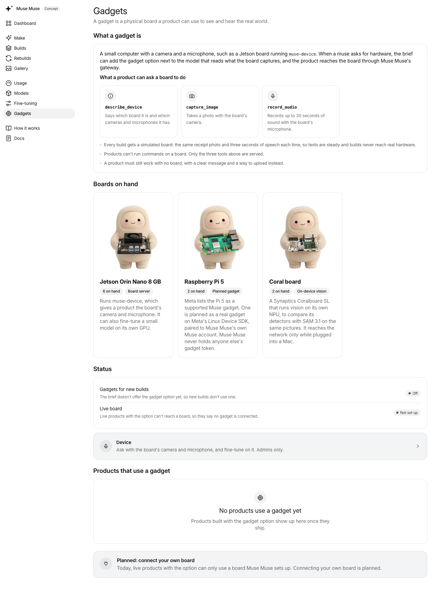
  
  
  

### 20:33 r30b's 1-bit file is ready; the owner wants the dataset and models open-sourced

- From the fine-tune session: r30b IQ1_S on writer-1 (glimmer-stage-b-r30b-IQ1_S.gguf, 6,526,418,912 bytes, sha256
  6fbd323c...a7e561), scored about 21:05. r30b Q4_K_M: 28.8% of the 2,500 2026 facts, old facts 40/40, 49 tok/s on an A100.
  Offline mode uses the IQ1_S once it's scored (on the AWS Mac, never the owner's laptop).
- The owner asked that session to open-source the dataset and models: Hugging Face under the OfflineBase account,
  private first, public after the license and personal-data reviews; code later. It will tell General before anything
  goes public, so /models can link to it then. Hub cards stay that session's, with the owner's OK for anything public.

### 20:44 Plan card landed on tuned-model-options (7e4a8ef), with no grey tile

- wf_352ae383-888 built tg-plan-card: the mascot at the left of the chat (present while the plan is new, building while
  Muse Code works, the shield pair once live or partial; back to present on failed or stopped; no card for a declined
  brief or a change to a product), the plan's name, tagline, who it's for and how it works at the right, and "Read the
  full brief" opening the Steps panel at the brief. Review: 1 medium (hard-coded stage colors), 4 low or nits, all fixed;
  placement under the current step kept, as in the owner's screenshot. Full suite at 62d8b8d: 4,383 tests, 4,375 pass, 0
  fail.
- Then the owner's "no grey tile" (c2bf120): no stage color, border or blend behind the mascot; the pictures as given,
  with rounded corners. The --media-stage token that only the stage used is removed. After the merge: tsc exit 0, build
  room, plan card, nav, gadgets and models tests 156/156. Checked on the local site:
  

### 20:45 Fine-tune like a build: design done

- Read-only design (_plan/train-like-build.md; contract pasted into wave 3's plan). A new fine-tune starts from one box
  ("What should your model do?"), optional examples as a file, then a plan card with the mascot and one Start, then a room
  with steps: writing examples, checking, training on a GPU, scoring base against tuned, ready, try it live, publish.
  Settings move under Advanced. No migration: the run is the dataset row, and a tuneRun workflow drives it.
- Builds: once a build that picked Muse Glimmer is live, its room offers "Its own model" (plan it, one click by the
  owner, never automatic; Live never waits). The product keeps answering with Muse Wonder until its own model passes the
  eval and a serving window is open.
- Hosted tuned Glimmer: products call wave 3's gateway route; General supplies the chat backend on the demo GPU with
  Meta's sampling (1.0, 0.95, 64; never stop on <|eom|> except final-only adapters). Outside a window nobody serves it.
- Gadgets: Glimmer 30B doesn't fit an 8 GB Jetson; the room says so and points admins to training a small model on the
  board. Estimates: about $11.80 a run at most (examples $3.10 to $6.80 on Wonder, unmeasured; GPU up to $5). Test budget
  proposed: $8. Units U1, U2, U4, U5 start now; launching jobs and the chat route wait for tg-decide's D7.

### 20:48 Meta's Muse Gadget SDK read

- Owner: "see if anything here is valuable ... we are cool custom building too". Notes in _plan/gadget-sdk.md. Gadgets
  pair to one person's Muse account with that person's SDK token (personal, non-commercial, at most 50 devices, no
  promotions or rewards, other distribution needs Meta's written permission). The Linux SDK takes custom commands from
  JSON files in /etc/musegadget/commands.d, and a device can post text and pictures into its owner's Muse chat.
- Useful: the owner's Pi 5 as a real gadget (already planned); a new "Muse gadget commands" product output so a person's
  own gadget can use a Muse Muse product; muse-device boards as gadgets (Hussam's call); ESP32 custom hardware with
  browser flashing after Nov 4. Muse Muse still never holds anyone's gadget token.

### 20:51 Fine-tune like a build: first units building (tg-tune, wf_e1fcae3d-58a)

- The composer (/fine-tuning/new), the plan route with a signed plan token, the run room (/fine-tuning/runs/<id>) with
  steps and the mascot, PlanCard generalized to PlanView, the eval verdict and "Where it runs", behind TUNE_COMPOSER (off
  means nothing changes). Admins only until the visitor work lands. When a run's examples are ready, the room hands off
  to the existing training form until launching is automated after tg-decide's D7. No Meta calls, no spend; review, fix
  and screenshots follow.

### 21:15 Owner answers: demo windows, $8 tests, visitors from day one, gadget commands

- Hosted tuned Glimmer for products: demo windows only (off by default; one 30-minute window Nov 3 for filming plus any
  an admin opens; $15 a day cap). Outside a window products answer with Muse Wonder and say so.
- Test budget for this work: up to $8.
- Visitors can fine-tune from day one: 1 run a day each, 60 minutes or $4 per run, a $15 daily total, nothing published
  without an admin. They train on the lab's ready datasets or their own rows, not on Wonder-written data (Meta terms
  10.1(ix), not asked, so it stays off). Being squared with wave 3's sign-in rule (GPU work needs a signed-in builder).
- Build the "Muse gadget commands" output now (queued for the next free heavy slot).
- Wave 3 notes: its 0018 and 0019 drizzle snapshot files share names with General's 0016 and 0017 (renumber on their side
  when General's land). Local test builds can't get a Vercel OIDC token here, so the preview database steps are the only
  path to test builds for everyone. That's also why a local build stops at "Could not get credentials from OIDC context".

### 21:23 r30b is a Derivative of Muse Spark Open: license duties

- From the fine-tune session's license review: r30b is a "Derivative" under the Muse Model License (Muse Spark Open wrote
  part of its stage 1 data), and the owner is adding non-commercial terms (some stage 1 rows came from NC-licensed papers).
  Models go to Hugging Face as OfflineBase/Glimmer-30B-2026-Knowledge and -GGUF, private until review.
- Duties wherever r30b files are used or shipped: "Built with Muse Spark Open" shown prominently; the Muse Model License,
  its Usage Policy, Meta's Apache 2.0 LICENSE with a modified-weights notice and the NC terms with the files; 18+; outputs
  never presented as human-written; users told it makes up answers and goes along with false premises.
- In Muse Muse: no page or code ships r30b today. Applies to offline mode when it uses r30b's 1-bit file, to /models if
  r30b links are added, and to wave 3's drive export (which names r30b; asked to add the files and a test). Lab-tuned
  adapters from lib/train aren't affected.

### 21:28 Owner: r30b's 1-bit file is the default for the drive export and offline mode

- The training session confirmed stage 2's 1-bit file is also a Derivative of Muse Spark Open (it trained on stage 1's
  adapter and data) and made things up 94% of the time on the held-out honesty test (r30b 55%, base 70%). The drive
  export defaulted to it. The owner chose r30b IQ1_S (6.53 GB) as the default; wave 3 is switching unit 12's default and
  fails closed on any knowledge-run file without the license files, which the training session is putting next to each
  model in S3.

### 21:29 Owner drops the non-commercial terms for the knowledge-run models

- Now Apache 2.0 for our modifications ("free reign license"); no non-commercial file. The Muse Model License conditions
  still apply to r30b and stage 2: ship MUSE_MODEL_LICENSE.md and USAGE_POLICY.md, "Built with Muse Spark Open", the Usage
  Policy (18+, never presented as human-written), and its $20M API clause. Files in S3: LICENSE, MUSE_MODEL_LICENSE.md,
  USAGE_POLICY.md, NOTICE. Wave 3 told.

### 21:36 Wave 3: r30b's license duties in the drive export (tg-cap-int e556f68)

- Defaults to r30b IQ1_S only; stage 2 or any other file must be named in full with its own honesty numbers. Any
  knowledge-run file (r30b, stage-b, stage 2, knowledge) is refused without the duties. The drive carries
  MUSE_MODEL_LICENSE.md, the Usage Policy and NOTICE from the model's own S3 folder (sha256-checked, never held by the
  code), "Built with Muse Spark Open" in every title, a "Use it safely" section (18+, never presented as human-written,
  made-up answers, false premises, read the license before offering it as a service), and the Derivative line in
  CHANGES.md. Lab adapters unaffected. Wave 3's checks: 4,085 tests, 4,077 pass, 0 fail; template 455/455; tsc clean.
  The export works once the training session's license files are in S3; no code change needed.

### 21:51 Decision models landed on tuned-model-options (88ac98e, 94324ca)

- wf_50b3b2f5-c82 built D3 to D7 and D9 on tg-decide: decision datasets (a person's labeled rows, CSV or JSONL, split
  once with the test rows held out and near-duplicates kept together; migration 0017), decide mode on the GPU,
  deterministic scoring in place of judging, the decision pages and results, models served at /decide with a Try it live
  box, {GATEWAY_URL}/decide and the template's decide(), and the docs. The review found 11 issues; 10 fixed (among them
  the calibration sentence now says only what the records hold, the gateway's rate limits run before any lookup, a
  gateway timeout frees the GPU slot), 1 rejected with reasons. D8, the real GPU runs (dry run, a $0.70 score-only run,
  one real run), waits for the owner.
- Landing: globals.css conflict resolved (both sides' blocks kept). 0016 (code_sessions, never built) is retired for good,
  since 0017 landed first and the migrator would skip a later 0016. The schema marker for 0017 added; the decide fixture
  added to the preview database guard's allowed list (it takes only a local PGlite folder). Full suite after landing:
  4,754 tests, 4,746 pass, 0 fail, 8 skipped (live Meta tests). Pushed to the branch only.

### 21:49 Owner: every new fine-tune trains on r30b

- "Switch outright to r30b": plain Glimmer is no longer offered as a base. The training session is making a 4-bit copy
  (OfflineBase/Glimmer-30B-2026-Knowledge-unsloth-bnb-4bit) and publishing the repos tonight, public, no token needed.
  The recipe switches once that repo is public and one dry run passes on it (about 1 AM). Every r30b-based lab model is
  a Derivative of Muse Spark Open, so its cards and pages get "Built with Muse Spark Open" and the Usage Policy points.

### 22:05 Fine-tune like a build, stage 1, landed on tuned-model-options (0a3ec6d)

- wf_e1fcae3d-58a built /fine-tuning/new (one box "What should your model do?", a CSV, JSONL or pasted examples, a
  Training setup fold), the plan route (one Muse Wonder call, a signed plan token good for 2 hours, 20 plans an hour per
  caller), the run room at /fine-tuning/runs/<id> (the chat kit's steps, the mascot by stage, the verdict, eval results,
  Where it runs), PlanCard generalized to PlanView, evalVerdict, and Composer and SetupPanel optional props. Behind
  TUNE_COMPOSER, admins only; with the flag off, 11 renders match fingerprints taken before the shared edits.
- Review: 2 medium, 4 low, all fixed. The handoff to the existing form would have published to Hugging Face despite the
  plan's "publish off" (the room now says so; stage 2's automatic launch passes publish 0); a 64 KB body limit refused
  normal example files; at least 40 examples; a run whose judging never finished no longer shows "Scored."
- Landing: the flag-off fingerprints for /fine-tuning (admin and guest) re-recorded, since the decision models changed
  that page after they were taken. Full suite on the merge: 4,852 tests, 4,843 pass, 1 fail (that fingerprint), then the
  tune tests 47/47 after re-recording. tsc clean.
  
  
  
- Local site restarted (22:00) with the decision models and the composer merged and a 3 GB memory cap: the old dev
  server had grown to about 7.7 GB, mostly swapped (flagged by another session).

### 22:16 r30b's 16-bit weights public; same tensors as base Glimmer (checked)

- From the fine-tune session: OfflineBase/Glimmer-30B-2026-Knowledge (merged 16-bit, c06e38cc), -GGUF (3d3c48cd) and
  -LoRA (de38afa9) are public and ungated, with the 13 shard sha256s (_plan/r30b-base.md). The 4-bit training copy is
  in its load and LoRA checks.
- General checked the merged repo by reading only each shard's header: 1,436 tensors, and the names-and-shapes digest
  equals quantize.ts's BASE_TENSORS_SHA256 (526660e0...) exactly, so the recipe's merge checks hold on r30b unchanged.
- Plan once the 4-bit repo is public: switch MODEL on a branch, one dry run (about $0.13), one real run on an existing
  made-up dataset (about $1.60 to $2.10), inside the owner's $8 test budget. General launches them.
### 22:16 Muse gadget commands output built on tg-gadget-out (ca384e2, 2e6bff8, 041ee67, docs in the next commit)

- The owner's Oct 31 OK (`_plan/gadget-sdk.md`, item 2): a sixth product output, a zip at `/p/<slug>/get/gadget` with one
  `/etc/musegadget/commands.d` file per public action for the person's own Muse gadget (Meta's Linux Gadget SDK), a new
  small runner (stdin JSON in, POST to the live action, one JSON object out, the reason as one stderr line), install.sh
  and uninstall.sh (root-owned, 0644/0755, refuse without sudo, never touch the SDK token, restart `musegadget`) and a
  README with the data flow and Meta's terms. A new runner instead of the CLI: the gadget's stdin and stderr contract
  differs from a terminal's, and a file root runs then holds no manifest text. A Muse gadget tab behind
  `PRODUCT_OUTPUTS`, the native downloads' rate limits, and a Prove it check by machine with no gadget (SDK rules, bash
  -n, a dry run under a made-up root, then the runner against the live product with the CLI's budget rule).
- Facts taken from the SDK's README and its command loader (read only, nothing copied): name pattern
  `[a-z][a-z0-9_]*(\.[a-z][a-z0-9_]*)+` up to 64 characters, `timeout_ms` 1 to 600,000, 5 s added at registration, 64 KiB a
  file, unknown keys refused, each parameter exactly `{type, description}`, 96 KiB of output kept.
- Not done: no real gadget, pairing or token was used, and nothing was installed on a device. Manifests have no
  `timeoutMs` today, so every command waits the SDK's default 30 s; a slower action will time out on a gadget. Not
  pushed or deployed.
- Checks: tsc clean; outputs, product, native, prove, MCP and sandbox tests 847 of 847 pass.

### 22:35 Muse gadget output: review fixes on tg-gadget-out (4a05250, 9ad43e4)

- Review verdict: approve with minor fixes. Fixed: prefixes are now one-to-one (`system` and `mm-system` shared
  `mm_system`, so one pack could replace another's runner and delete its commands); a changed prefix is now
  `mm_<slug, cut>_<hash of the slug>`, and plain ones never start with `mm_`. install.sh and uninstall.sh keep the slug
  in `pack.txt` and refuse another product's pack, and install.sh refuses a commands folder root doesn't own.
- Prove it now checks the sample as the SDK checks a call (required fields, JSON types, an optional null left out)
  before running the runner, fails the pack when the product took an input the gadget would refuse, and waits at most
  130 s for the gadget call. The Get it tab says Node 18+ is needed, recommends `--run-as`, says commands stop after
  30 s, and words Meta's terms as the token's personal, non-commercial use with a link. Code comments cite the SDK's
  README and its command loader.
- Kept as is: the 30 s default when a manifest has no `timeoutMs`, as the task set it; raising it to the CLI's 120 s or
  adding `timeoutMs` to the manifest schema is the owner's call.
- Checks: tsc clean; the whole root suite (282 files) 4,798 tests, 4,790 pass, 0 fail, 8 skipped (no MODEL_API_KEY).
  Screenshots of the Get it panel's Muse gadget tab at 1440 light and dark and 390 light, from a local PGlite product
  with two public actions and one owner action (left out of the pack). Not pushed or deployed.

### 22:43 Muse gadget commands output landed on tuned-model-options

- Merged tg-gadget-out (wf_0a28bc2a-87e). Each shipped product gets <slug>-muse-gadget.zip at /p/<slug>/get/gadget and a
  "Muse gadget" tab in Get it, behind PRODUCT_OUTPUTS: one command file per public action for Meta's Linux Gadget SDK,
  a small runner that POSTs to the live product, guarded install and uninstall scripts, and a README on the person's own
  SDK, account and token and Meta's terms. Prove it checks the pack by machine (the SDK's rules, a dry install, the
  runner on a sample input). Never run on a real gadget; Muse Muse never holds a gadget token.
- Open for the owner: commands stop after 30 s (the SDK's default) while the CLI waits 120 s, so an action that takes 30
  to 120 s works from the CLI but times out on a gadget.
- Full suite after the merge: 4,896 tests, 4,888 pass, 0 fail, 8 skipped (live Meta tests). tsc clean. Pushed to
  the branch only.
  

### 23:03 Shipped to production: main 2146ae0 (owner: "commit all of that to main and deploy")

- main fast-forwarded 6f311e5 to 2146ae0 (110 commits): Gadgets and Models tabs, the plan card, decision models with
  migration 0017 (three columns with defaults on training_datasets), fine-tune like a build stage 1, the Muse gadget
  output, and the build log. Key scan of the diff: clean. Every new capability is behind a flag that's off in
  production, so visitors see the new sidebar rows and pages; /fine-tuning/new answers 404 until TUNE_COMPOSER is on.
- Deployment dpl_GqDHvz4yTdTygbcScSfNenNT6Rdk, Ready (the build ran the migration). Rollback: dpl_DBQAd4HcEcX5aj4dpCcNzDsjEfXw
  (6f311e5). Smoke check on musemuse.dev: /, /models, /gadgets (Boards on hand with the pictures), /fine-tuning, /gallery,
  /how-it-works 200; /fine-tuning/new 404 as intended.
- Found: the fine-tune session's `knowledge` branch builds Vercel previews on each push (22:54, 23:01), since it lacks
  the main-only rule. Asked that session to add it; General doesn't push to `knowledge`.

### 23:04 knowledge branch no longer builds previews

- The fine-tune session added the main-only rule to `knowledge` (7a55cf2). The two previews it built (22:54, 23:01) ran
  migrate against the Preview environment's database and found nothing to apply ("migrate: up to date"; knowledge holds
  0000 to 0008 only). They stay behind Vercel's preview protection.

### 23:06 Owner: every live build uses the muse-app look; new builder snapshot made

- Owner: "all live builds should use that skill" (muse-app-ui, the template/targets/muse-app overlay behind
  MUSE_APP_LOOK). New snapshot from main 2146ae0: snap_SB9bO91OjbBU4n3Amdabfo8iY0CY (2,078 MB, template hash
  fe8058aa261c, Muse Code 1.4.14; the 65 overlay files including muse-app checked against template/targets; pristine
  verify files match). 81.5 s of sandbox time.
- Left for the owner in Vercel (production): BUILDER_SNAPSHOT_ID to the new id and MUSE_APP_LOOK=1, then a redeploy.
  Then one canary build on the live site. Once a muse-app product exists, MUSE_APP_LOOK stays on (BRAND.md).

### 23:24 Production redeployed with the muse-app look on; visitor training core landed

- Owner set the two variables through General ("you do these"): BUILDER_SNAPSHOT_ID = snap_SB9bO91OjbBU4n3Amdabfo8iY0CY and
  MUSE_APP_LOOK = 1 in production, then allowed the redeploy: A779wkpbtUZrQZCxkX4dNCa9LRjP, Ready in 2 minutes, same code
  as 2146ae0. musemuse.dev /, /models, /gadgets, /fine-tuning 200. Every new live build now gets the muse-app overlay and
  its muse-app-ui skill. A canary build on the live site is the owner's call (it becomes a real gallery product).
- tg-open-train2 merged (1308c58), new files only plus flags and one sign-in guard line: the signed mm_trainer cookie
  (3 new a day per IP, a hidden users row, adoption into a signed-in account), visitor limits reserved before work (1 run
  and 1 dry run a day, 60 min, $4, 120 steps, one visitor GPU at a time, $15 a day in all; Wonder-written data refused for
  visitors whatever PUBLIC_DATASETS says), checkTrainingTask and a PII scan (visitors only), and trainCaller. All behind
  PUBLIC_TRAINING (off): flag off gives exactly today's callers. Review: 2 medium (the one-GPU limit was a check, not a
  reservation; adoption trusted a bare id), 7 low, 2 info; fixed or answered. Branch full suite 4,976 tests, 4,968 pass,
  0 fail. After the merge: tsc clean, related tests 172/172. Wiring into the routes and pages comes after stage 2 lands.
- Owner should know: a banned user without a session cookie can still train as an ordinary cookie visitor under the
  per-IP caps (comes with training without sign-in).

### 23:28 Owner: a picture made for each plan, text wrapping under it, the full plan in the card

- The owner tried a live build ("Rate Change Tutor", a rate-of-change math tutor) and asked for the plan card's mascot
  to be a Muse image made for the request, the text to wrap beside and then under it, and the full plan written out.
- Building on tg-plan-art (wf_c5dd441e-bba): after the brief, one Muse Image edit call ($0.01) turns the owner's mascot
  picture into one that fits the request; stored and metered like other platform media, time-boxed, never delaying or
  failing a build, with the stock mascot as the fallback (flag PLAN_ART, off until checked). The card floats the picture
  with the text flowing beside and under it, and writes out the whole brief in place of the summary. Up to 10 real Muse
  Image calls ($0.10) to tune the prompt.

### 23:43 Fine-tune like a build, stage 2, landed (7b6b139); r30b switch building

- wf_7f660dc4-230 on tg-tune2: launchJob (the jobs route's checks moved to lib/train/launch.ts, route replies unchanged,
  79/79 route tests), the tuneRun workflow (a started run trains itself once its examples are ready, publish 0, retrying
  every 5 minutes for up to 2 hours while no GPU is free or a cap is hit, with the reason shown), Start training and a
  stop route, Advanced training steps, the New button on /fine-tuning, the build room's "Its own model" row
  (TUNE_FROM_BUILDS; one click by the owner, one run a product a day), and the hosted Glimmer chat backend:
  lib/train/glimmer-serving.ts (Meta's sampling 1.0, 0.95, 64 on every request; ends on Meta's two ids; never <|eom|>
  except trainChannel 0 adapters, server side) and /v1/chat/completions on the serve job. Not run on a real GPU yet.
- Review: 1 medium (a run stuck for good once a job failed before launching), 6 low, 1 info; fixed except the info. After
  the merge: tsc clean, full suite 5,045 tests, 5,037 pass, 0 fail, 8 skipped.
  
  
- The fine-tune session's 4-bit r30b copy is public and verified (OfflineBase/Glimmer-30B-2026-Knowledge-unsloth-bnb-4bit
  @ 6f12bf52: drop-in for Unsloth's, two training steps on the recipe's own versions). The switch is building on tg-r30b
  (wf_e569a503-ff8): MODEL and the merge base, the Muse Spark Open duties on every new lab model, wording.

### 23:50 Owner: choose the base, a Spark helper, finish the build

- "you have my full ok. I want people to be able to choose from fine tuning the updated muse glimmer or the original or
  one of the llama models, i also want them to be able to use muse spark to help them with that. Also i need you to
  finish the rest of the build". Answers: the helper runs on Muse Spark 1.3 (an exception to tonight's rule, for this
  helper only); the Llama option is Llama 3.2 3B Instruct. r30b stays the default base.
- The deploy of stage 2 and the visitor core (push to main) was refused by the permission check; it waits for the owner
  to allow it. The queue for the rest is in _plan/finish.md.

### 23:54 Decision models D8 started on production (made-up data)

- With the owner's full OK: a made-up 4-label decision dataset (a shop's support inbox: Billing, Shipping, Returns,
  Account; 400 rows read, 390 kept, 10 near-duplicates merged) and the dry run job 3aa04a3a on an A100 SXM4 (max 45
  minutes, $2). Then a score-only run (about $0.70) and one real run (about $0.83, max $5), then a 10-minute window.

## Nov 1

### 00:08 Decision models D8: score-only passed, real run started

- Score-only job cd3c5cb3 on the made-up shop inbox (390 rows) succeeded for $0.2985, under the $0.70 estimate.
- The one real decide run, f6761680, is queued (estimate about $0.83, cap $5). A 10-minute serving window follows it.

### 00:06 Muse Code in products handed back to wave 3

Wave 3 builds it on its code cap (tg-cap-musecode, migration 0028_code_sessions at idx 28, behind MUSE_CODE_ENABLED and
MUSE_CODE_VISITORS, both off). Nothing from the spike was kept past 23525cb. Its secret scan (the literal values of the
platform keys, read in memory, never printed) carries over to session logs and transcripts. Wave 3 paused it while two of
mine ran. I told them at 00:09 they could resume, once plan-art finished.

### 00:15 Owner: builds follow the UI guidelines unless the person asks otherwise (tg-own-look, e34e429, 01f3680)

With MUSE_APP_LOOK on, the brief writer fills a new `askedLook` field only from the person's own words. The build prompt
then sets that look through the muse-app tokens and keeps the rest of the muse-app-ui skill, and the judge expects it.
A screenshot alone, or a real product's look, never counts as an ask. The brief writer's look line now describes the
muse-app look instead of the old Montserrat one. With no ask, or the flag off, every prompt and schema is unchanged. See
docs/BRAND.md, "Unless the person asks". Tests: 106 across the brief, judge and look files.

### 00:16 Plan card picture landed (tg-plan-art, d32021f)

- One Muse Image picture of the mascot per build, made beside the build. It falls back to the stock mascot on failure,
  refusal or timeout. Metered as platform spend, behind PLAN_ART (off, now in .env.example).
- The text wraps beside and under the picture at 520 px of column or wider, and the full plan is written out in the
  card.
- Review fixes: a shipped build waits at most 15 s for the picture and a failed one not at all; a picture that fails to
  load falls back to the stock mascot; the event stream drops plan pictures with the flag off; the Models heading
  starts under the picture.
- The fine-tune room's card is unchanged. Its two tests now compare against the new card, and the build room and plan
  card fingerprints were re-recorded (only those entries moved).
- The workflow's screenshots use a hand-made stand-in picture.
- Full suite on the merged branch: 5096 tests, 5088 pass, 0 fail, 8 skipped; tsc clean.

### 00:20 Plan card pictures: three real Muse Image calls

The branch's own prompt and request body, sent to /v1/images/edits with the mascot as the reference, for three made-up
briefs (a math tutor, a bakery order sheet, a plant care coach). All three returned a 1024x1280 JPEG in 9.7 to 13.8 s,
about $0.03 in all. The mascot stays the same plush character and holds a prop that fits each request, on white.
PLAN_ART stays off until the owner wants it on. 

### 00:22 Deployed to production (main 5a5d057)

Owner: "push to main, you have full permission". 64 commits, no key-like strings, no new migrations: fine-tune stage 2,
the visitor core, the plan card, builds following the UI guidelines unless asked. Vercel shows Ready on
www.musemuse.dev. All new flags stay off.

### 00:32 Decision models D8: the real run succeeded

Real run f6761680 succeeded for $0.4975, under the $0.83 estimate. The 10-minute serving window is still to do.

### 00:43 Make page: Meta AI-style starters under the composer (tg-starters, b34ea82)

Owner, with two Meta AI screenshots: "rather than the 3 examples offered, make it more similar to the meta ai ui
underneath". Now category pills (Discover, For school, For work, From a photo) over a 3x2 grid of icon and label ideas
or a strip of five photos. An idea fills the composer and never sends. Two new photos (fridge, plant) came from Muse
Image, about $0.02. The cards lose their tag and camera button; the + menu still has Take a photo. Checked in a browser:
no sideways page scroll at 390 px, an idea fills the note, arrow keys move the tabs. Full suite: 5107 tests, 5099 pass,
0 fail, 8 skipped; tsc clean. Not deployed yet: the push to main needs the owner's OK. Shots:
docs/log/shots/2026-11-01/starters-*.png.

### 00:59 r30b switch landed on tuned-model-options (eedcef7), not deployed

New fine-tunes train on r30b, and every lab model trained on it carries the Muse Model License duties (one rule,
isSparkOpenDerivative). Four merge conflicts with stage 2: the jobs route's two r30b changes moved into lib/train/launch.ts,
and two tests were updated for the other branch's work. Full suite: 5138 tests, 5130 pass, 0 fail, 8 skipped; tsc and the
workflow compile check clean. Review fixes include the first local files merge, which would have failed after paying for
GPU time (Unsloth's mapper doesn't know the repo). That fix was read from the installed Unsloth 2026.8.16, not the pinned
2026.10.9, so only a real glimmer-quantize job proves it. Still to do after a deploy: the r30b dry run (about $0.13) and
one real run (about $2). Wave 3 told.

### 01:05 main at e7b8d8e deployed

Starters under the composer, the r30b base, the plan card code (PLAN_ART off) and the asked-for look went live on
www.musemuse.dev, after the owner's "push". The live page shows `.starter-pill`.

### 03:16 Owner rows leak on wave 3's branch: fix ready, not merged

Wave 3 reported, from a code read, that an admin could publish a "train on my data" adapter by launching glimmer-publish
directly. Read and confirmed for chat-mode owner rows on tg-cap-int and tg-cap-gpu; decision-mode jobs were already
refused. It isn't on main, since the check came in with ad3dabf. An adapter job on a product's dataset with publish not 0
could auto-publish the same way. Nothing was run against the Hub.

Fix: 609026e on tg-owner-rows-publish, cut from tg-cap-int at 0fb6119. One check (ownerRowsProblem) now gates Publish,
launch, the runner's upload plan and the publishing claim. tsc clean; 1,091 of 1,091 pass across lib/train, lib/caps/gpu
and the other suites that mock the store. Full root suite and next build not run. Removing the launch, upload plan or
claim gate each fails the new test. Wave 3 was asked to cherry-pick it before tg-cap-int merges, and told r30b is on main.

### Wave 3 sync on tg-cap-sync2

Not merged into tg-cap-int; the coordinator does that. Merged tuned-model-options e7b8d8e
(14aa5b1) and tg-cap-musecode e29cebf (926aa16). 0028_code_sessions stays at idx 28, with its snapshot rebuilt on this
branch's 0024 plus its one table. General's r30b drive handling moved into wave 3's split: lib/drive/layout.ts and
lib/drive/plan.ts. Fix (01e2e5c): a lab model trained on r30b now exports as a Derivative of Muse Spark Open, license and
NOTICE inline, no measured numbers. Measured: 5,049 .test.ts (5,041 pass, 8 skipped, 0 failed), 748 .test.tsx (all pass),
597 template (595 pass, 2 skipped), 141 muse-device (5 skipped, 0 failed), tsc clean. An old lab model's plan and a board
Qwen plan hash the same under the code at 48b2cfe and now, on one stand-in kit. No real drive was written.

### 09:28 Wave 3 merged locally for main, flags off, not pushed yet

The owner asked to commit all the latest changes to main. tg-cap-int (253 commits, with the owner-rows fix) merged into
tuned-model-options with one build log conflict, both sides kept; the tree differs from its checked head only in this log.
Wave 3's checks at 4dbce8c: 0 failures, next build exit 0, local with flags off; only docs came after. No real test build has
run on it. A deploy would run migrations 0018 to 0027 on production; none has a drop, rename or truncate. Local main's 98
unpushed knowledge run commits are left out: that branch is 553 behind origin/main. The push to main was denied by the
permission check as a production deploy, so it waits for the owner.

### 09:42 PR #4 open for main, not merged

After the push to main was denied, the owner asked for a PR with all the latest. tuned-model-options went up at e0b59d8 (no
deploy: main-only rule) and Offline-Base/muse-muse#4 is open against main. Full-range key scan: two matches, both made-up
test values. Every CAP_READY line is false at this head. Merging deploys it and runs migrations 0018 to 0027.

### 09:44 PR #4 merged by the Ethan-Castro login, deployed

Squash commit 6265a5cc on main, per GitHub. Not done by this session, and it can't tell whether the owner or another session
on that login did it. Wave 3 reports production Ready and every CAP_READY false; it inferred migrations 0018 to 0027 from the
passing build and hasn't queried the database. main's tree equals aa25ca0, the head of the PR.

### 11:17 Muse Privacy merged in as privacy/, on tg-privacy-main, not on main

The owner asked to merge the two, with neither hurt. git subtree from muse-privacy origin/main at 5c458b3, with its 135 commits
of history; ~/muse-privacy and the live device weren't touched. No imports either way (test), no migrations, left out of
Vercel uploads, tsconfig and function traces. CI is .github/workflows/privacy.yml, only when privacy/ changes.

Found by checking: next build with no exclude traced all 886 privacy files into the functions locally, largest 113 MB against
83 MB. outputFileTracingExcludes fixed it: 0 files, 83 MB. Vercel's own build not run. Two earlier builds failed from my setup
(--webpack, then a symlinked node_modules), not the merge.

Checks: root suite 6359 tests, 6351 pass, 0 fail, 8 skipped, tsc clean, both on the same code before the tracing exclude; after
it, tsc, the boundary tests and next build pass. privacy: pytest 3894 pass, 12 skipped, 15 xfailed; ruff clean; relay 58 of 58
before the docs and exclude commits; manifest check and a test bundle fine. Privacy's stricter history scan: nothing found in its
own history. Over Muse Muse's history it flagged 8 token and key lines, all fake test values, plus 793 IP, host and user name lines
(the known scrub before the repo goes public, not reviewed one by one).

### 11:31 /private built: Muse Privacy on the site

The owner said to put it on the site. A sidebar page, not behind a flag: what it does, a click-through replay of the Oct 31
scene rehearsal labeled recorded, the measured numbers, who it's for, what isn't done, and how to run it. It reads nothing from
privacy/. A test checks all 18 replay steps and the numbers against their reports. No repo link until the repo is public, and
no company name on the page, since the no-Offline-Base rule hasn't been lifted. Checks: root suite 6363 tests, 6355 pass, 0 fail,
8 skipped; tsc clean; next build exit 0 with privacy/ present and with it moved away, which is what Vercel sees. No sideways
scroll at 1440 or 390, no console errors. Shots: docs/log/shots/2026-11-01/private-*.png.

### 12:19 Sidebar History, and Gallery, Media and Demos in the Muse app's layouts, on tg-history, not pushed

The owner sent Meta's sidebar, Artifacts, Media, Vibes and Scheduled screens. History lists builds on the left; a guest sees only what their browser opened, since guests share one account. Gallery has Presets and Products; Media has Presets and Creations; Demos is the video wall. Left out with nothing real behind them: Favorites, likes, the model pill, voice, and Scheduled while jobs is off. Checks: 6377 tests, 6369 pass, 0 fail, 8 skipped; tsc clean; next build exit 0. Browser on made-up products: search, filters, presets and the floating box fill Make; no sideways scroll at 390; no page errors. The Media shot predates the fixed preset titles. PR #5 was squash-merged, so privacy's 135 commits aren't in main's history; tg-privacy-main on GitHub still has them.

### 12:28 Fine-tuning: 100 tests, and Contributor as an opt-in dataset writer, on tg-history, not pushed

The owner asked for 100 tests, 1,000 generated examples, and Spark Contributor if permissible. 1,000 examples was already the limit, though never confirmed with a real run in this log. Tests: holdout cap 40 to 100, so 1,000 examples hold out 100; job, recipe and runner caps 60 to 120, which would otherwise have cut it silently. Contributor: Meta's terms 6.2 as read in the Oct 28 review bar sensitive, confidential or personal information and Meta may train on it, so it needs TRAIN_CONTRIBUTOR_WRITER=1 (off), an admin, and a made-up statement; judging stays on Wonder. Estimate for 1,000 examples by the page's formula: $15.40 to $33.80 on Wonder, about $0.17 to $0.36 on Contributor, at a Contributor price the catalog lists from 1.2 and marks to verify. Not a legal opinion; 10.1(ix) on training competing models applies to any writer. Checks: 6378 tests, 6370 pass, 0 fail, 8 skipped; tsc clean. No real run: a 100-test run's GPU time is unmeasured, and the 20-minute overhead was set for 40 tests.

- Auto upload built on tg-v-hub behind TUNE_AUTO_PUBLISH (off). An admin's tune run uploads through the existing Hub path once judged, private until HF_PUBLIC is set to public. A task quoting a person's rows is now refused for manual Publish too, using the fold heading rather than the planned has_person_rows column, so no migration. A Contributor dataset's repo stays private. Tests: auto-publish.test.ts and hub-flow.test.ts passed, with the Hub faked. tsc, a real upload and the screens were not run.
- Merged tg-v-code, tg-v-edit, tg-v-hub and tg-v-modelv into tg-versions (Nov 1, not pushed or deployed). Conflicts: the product page's buttons, and two new flags in lib/env.ts. tsc clean once on the merge, before the review's fixes; 24 of 24 new tests passed. Review of the diff against tg-history fixed: the /builds caption calling the shared guest account's builds "Your builds", raw codes such as daily_limit shown by Restore, the Code page's h1 using a class with no rule, and Hugging Face tokens with digits missing the secret check. Not run: full suite, next build, a browser, a real restore, a real upload, migration 0028.

### 13:01 Code private by default, auto upload switched on, PR for tg-versions

The owner chose private code with a per-owner Make public, TUNE_AUTO_PUBLISH on and HF_PUBLIC unset. The switch is set on production, but HF_TOKEN and HF_NAMESPACE aren't listed there by name, so uploads stay off until they are. next build exit 0 with privacy/ moved away; no real run of the migration, restore or upload.

### 13:04 Nine cookbook skills and small gaps, on tg-agent-cookbook, not pushed

Nine skills in `lib/recipes/skills/`, behind RECIPES_ENABLED: api, agent patterns, code sessions, visual reports, games, image, voice, SAM media, simulated loops. Nothing has run in a real build, so every skill is unproven until the owner's test build.

- Helpers: `sticker.ts`, `webp-anim.ts`, `gif.ts` and `captions.ts` from the docs media demos, and `cu-sim.ts` from the docs computer-use demo, without its docs-only `minesShell` re-export.
- Decision: computer use defaults to function tools on Muse Wonder. Our docs record Wonder answering 400 `Unsupported tool type 'computer'`, so the native tool gets one try on TEST_MODEL.
- Decision: the speaker-label correction in `lib/prompts/catalog.ts` has no flag, as planned, so golden changed. Without RECIPES_ENABLED, the template's `transcribeFile` still can't send a mode.
- Fix: `asrAudioMaxBytes` goes from 60 MB to 32 MB, which narrows what a product may send through audioUrl, and lowers the reservation for such a call from about $0.09 to about $0.05. `estimate.test.ts` updated.
- No change: the long-context lift. `liveTokenDailyBudgetFor` already lifts a budget by the brief's estimate, up to $10.
- Not done: goal and effort on POST /code/sessions. `lib/caps/**` belongs to wave 3, and the item has no value until the code cap is proven.

### Nov 1 Recipes merged into tg-agent-builds and reviewed, not pushed

Merged tg-agent-legal and tg-agent-cookbook onto origin/main eaeeb848. Review fixes: the case skill used the unlicensed workshop's nine tool names, two status names, its SAM prompt and one 14-word sentence, all replaced with our own; five skills told builds to name muse-spark-1.3-contributor, which a token refuses, so they now name muse-wonder-1.0 and let the test build swap it; the case test could not have read the token its seal needed, so seal functions take the key as an argument; the memo and anything copied from it now carry "Made-up case. Not legal advice."; the simulated loops skill now stops at about 200 s like the case skill. Reversed two decisions above, since both changed behaviour with every flag off: the speaker-label wording now shows only while recipe-voice can be picked, because the template's helper can't send a mode, and asrAudioMaxBytes is back to 60 MB, goldens unchanged from main. Recommendation for later, after one real call: 32 MB matches the cookbook's one-shot limit. Not run: full suite, next build, browser, any real build or model call.

### 13:01 Recipes plumbing, RECIPES_ENABLED off, on tg-agent-legal, not pushed

First step of the plan to build the legal agent workshop and the cookbook. `lib/recipes/`: a registry, skills in `lib/recipes/skills/`, `lib/recipes/generated.json` from `scripts/recipes-gen.mjs`, so skills reach a build through extraFilesFor with no snapshot. Stored brief field `recipes`; the writer's schema gets it only while recipes are available, so the flags-off schema stays the same object. Decision: a pick whose flag went off counts as never picked, so the skill, the prompt lines and the marker go away together. Checks: the new test file and flags-off.test.ts, 11 pass. No real build yet.

### 13:20 Long-run tier and the case agent recipe, AGENT_LONG_RUNS off, on tg-agent-legal, not pushed

Spend decision: a long-run product's live token gets AGENT_LONG_DAILY_USD (default $25) in place of the normal $10 ceiling, since one full run is estimated at $5 to $12, unmeasured. New run limit: 80 turns, 120 built-in tool calls, $15, through the `agent-long` marker, checked before the agent marker. Those counters reset hourly, so the product also stops itself at $12 a run. Decisions on reading the code: the product code always names muse-wonder-1.0, since only the gateway may swap in TEST_MODEL and a build token doesn't allow Contributor by name; the generator script makes no model calls, since scripts and tests can't read `.env.local`; page text stays exact because pages are rendered from HTML, and the two signature images come from the brief's image fixtures, which the platform draws; the sealed record stays under 1 MB because of the 4.5 MB request limit. Not proven by a real build; only reading and unit tests so far.

## Gaps

What this record doesn't confirm:

- Exact times of the owner's asks are not in any file. Each is placed by when its plan file, worktree or workflow
  started.
- What "fix the push" for PR #3 refers to. No source shows a failed or corrected push; git shows only the 14:34
  fast-forward and the 14:42 squash merge.
- When the owner supplied the working Meta key. By 16:19 the 3D spike said the working key was in `.env.local`, and at
  16:37 the UI trial compared keys by length and equality only.
- Why the ten wave 2 agents stopped at 04:54 to 04:55, and why General shows no activity until about 12:00. The
  fine-tune session's log reports its own driver died at 04:52, but nothing confirms the same cause for General.
- Whether the 14:34 production deploy applied migrations 0012 to 0015. The migrate script prints "up to date" either
  way, and no database read was done.
- Whether the RELEASE.md hand checks ran after the deploy: SAM with safety_identifier on object-count-studio, one real
  flags-off build of about $2, and the phone-width build room.
- Owner decisions on RELEASE.md items 2 to 8 (costs, Preview database, board env, AUTOMATION_SECRET, device-tools env).
  wave3.md still says previews share production's database.
- Whether any of the values printed by `pgrep -fl` or process listings were rotated.
- Which session wrote `_plan/HACKATHON_REVIEW.md` (about 15:00 to 15:20). No General agent or workflow matches that
  window.
- Time mismatch on the migration order agreement: decision-models.md says about 17:05 and replication.md about 17:00,
  but their file times are 16:50 and 16:56.
- Who switched on plan mode at about 01:04 to 01:16 (it stopped the visual review and the promote fixer's commit), and
  what owner ask started the 00:38 targets research.
- Why the 13:56 Muse Code spike attempt ended in 3 minutes with no result.
- Who committed 4120b77 (14:40). Only the wave 3 session's log lists it.
- The UI trial's full write-up. Only 60b062c's commit message (17:12) and the workflow journal's results table were
  read; the write-up's findings and old-against-new comparison were not.
- The decision models build's outcome. D0 to D2 were committed by 17:27, a review of D0 to D2 started at 17:28 and a
  fix at 17:39 (workflow agent times). Their results were not read for this log.
- No total of the Vercel Sandbox bill for Oct 31. All Sandbox figures are worst-case ledgers or agent estimates, not
  invoices.
- Lambda and AWS totals for Oct 31 from the fine-tune session are partial snapshots, not a day total.

## Nov 1: Any Meta base (TUNE_ANY_BASE, off), branch tg-tune-any-base

- Admins can pick Llama 3.1, 3.2, 3.3, 4 Scout or a Glimmer build in Advanced and the full job form, or paste a repo id. Allowlist, 40-hex pin, architecture, license, size and gated access are checked on the server at the picker, Start and launch.
- HF_TOKEN stays on the platform: a gated base's GPU gets short-lived links from POST /api/train/jobs/{id}/base-files.
- Nothing on Llama has run on a GPU. Checked only: bases.test.ts and base.test.ts (26 pass), the recipe compiles and its family switch was exercised in Python. No tsc, no build, no browser.
- Found: the Hub renamed r30b's repos to OfflineBase/Muse-Glimmer-30B-2026-Knowledge*; the old names redirect. isR30bRepo now takes both.

## Nov 1: data research for fine-tunes (branch tg-tune-research, unmerged)

- Built `TUNE_RESEARCH` (off): durable workflow on Muse Wonder with Meta's web_search only, a report whose sources can only point at the search's own links, picks as writer notes, and import of license-clear rows with the PII scan. Docs: TRAINING.md "Data research".
- Decision: migration 0029 (additive), since a report needs a durable row. Any personal data the scan finds refuses the whole source, the strict reading of "sources with personal data are not importable".
- Measured: only the rule tests (lib/train/research/__tests__/research.test.ts). No call to Meta or a real source has run, so the cost estimate is unmeasured.

## Nov 1: both merged into tg-tune-bases, reviewed

- Merged tg-tune-any-base and tg-tune-research. Only BUILD_LOG.md conflicted. Migration 0029 is the research one, and the only one.
- Fixes from the review:
  - A gated base's small files redirect within the Hub (read for real on a public repo: 307 to /api/resolve-cache), so the GPU would have got links that need the token. They now go inline.
  - keepDatasetPrivate had started matching Muse Decide's public mix too, which changed behavior with the flags off. It now skips decision datasets.
  - Llama model repos were still created tagged apache-2.0 in the publish preflight and the hub route.
  - A Llama card's template story said Muse Glimmer 30B, and the story's model is told about a 30B Glimmer. Llama cards now use the template, naming the repo.
  - A Glimmer build that isn't r30b must say apache-2.0 on the Hub, or the plain duties could be wrong.
  - The plan promised Try it live on bases that serving refuses.
  - A run's room said "never run" of plain Glimmer.
  - A card's revision now falls back to the job's pin, not Glimmer's.
  - A run sent with no steps is refused up front if the default doesn't fit its base, before examples are paid for.
  - grounding is out of the dataset head and every view.
  - TUNE_RESEARCH added to .env.example.
- Run: tsc, and the rule test files for research, bases, base, auto-publish, datasets and hub-cards. Not run: the full suite, next build, a browser, any call to Meta, Lambda or a GPU. Read from the Hub's public API only.
- Not proven: no Llama path has run on a GPU, no research run has called Meta, costs are estimates.

## Nov 1: verified agent recipe, VERIFY_AGENTS off (branch tg-verify-recipe, unmerged)

- New `recipe-verified-agent`, for an agent whose answer someone acts on. It reaches a build through `extraFilesFor`, with no snapshot. Ideas only from Meta's Agents 102 session: the workshop has no license, and no code, text or tool names came from it.
- The gate: code checks each quote and signs a receipt, a separate model call reviews claims and quotes and signs the draft, and a `superRefine` on `output` refuses anything without valid receipts. `needs_person` needs a read receipt for every source.
- Checked before building, by reading `run.ts` and one local schema probe: `superRefine` on a union converts under `toStrictSchema`. The kit allows only one refused submit, and a second ends the run as failed `no_answer`. So `review_draft` runs the code checks first, where refusals don't use up that retry. `LocalToolContext` has the request but no run id, so the review call isn't counted in the run's limits, and receipts aren't tied to a run. Search and page reader text never reaches a local tool, so web text can't be quote-checked.
- Decision: offered only with `AGENTS_ENABLED` as well as `RECIPES_ENABLED` and `VERIFY_AGENTS`, since it builds on the agent kit.
- Run: `verified-agent`, `skills`, `recipes` and `flags-off` test files, 27 pass, and tsc filtered to these files. Not run: the full suite, next build, a browser, any Meta call. No product has been built with it yet.
## Nov 1: VERIFY_AGENTS platform part (branch tg-verify-platform, unmerged)

- Built, flag off: the "What was checked" panel from the build's events, code's results and agent rules for the judge, and an `agent_claims` Prove it item that grades the reply of a call the run already makes, so it adds no spend.
- Decision: the recipe's claims block isn't graded. Part A has no commit and no test build has proven its reply shape, so a reply with `claims` reads "weren't graded" and never passes. The quote-in-file check and `prove-check-agent.mjs` wait for that proof. Part A's gate said part B should wait too. The panel and the kit-shape tier don't read that shape, so they went ahead. Today no reply can reach a passing state.
- Decision: the gateway comparison is dropped. Usage rows record `tools/execute` with no tool name and no run.
- Found: the page already loads a build's verify, judge and prove events, and a refinement's build has its own, so no query changed. `condenseProveEvents` keeps only the newest run, so the panel splits ship and nightly first.
- Run: tsc and the rule test files named in the commit. Not run: the full suite, next build, a browser, any real Prove it run, Meta or a sandbox.

## Nov 1: verification merged on tg-verify, VERIFY_AGENTS off (unmerged to main)

- Merged `tg-verify-recipe` and `tg-verify-platform` onto `origin/main`. The only conflict was this log, both entries kept.
- Fixed, found in review:
  - The merge left two `verifyAgents` getters in `lib/env.ts`. Now one.
  - The agent target was only a writer rule, so a model could pick the recipe without the kit. `pickedRecipes` now treats that as never picked, in code.
  - `reviewProblems` read only the first verdict entry for a claim, so a later refusal could be missed. Any refusal for a claim now refuses it.
  - Prove it looked for `claims` at the top of the reply, but the kit puts the recipe's answer under `answer`. A verified product would have read "no claims to check". It now reads "weren't graded". It still never passes.
  - The skill now says to size `limits`, since the kit's defaults of 6 turns and 8 calls are tight for several sources or items.
- Reviewed with no change: 8-word overlap scan against the workshop (no hits in new files; the 2 hits are in other recipes in `generated.json`, a repo URL and a fetch header line), em dashes in added copy (none), secret patterns in the diff (none), a judge that can't run (recorded as not passed, so the panel can't show it as passed), guards with the flag off (read, and covered by the tests below where noted).
- Run: tsc once in full plus once after a type fix. Tests: `verified-agent`, `skills`, `recipes`, `flags-off`, `checked`, `assets-source`, 42 pass, then `verified-agent` again after the type fix, 9 pass. `recipes-gen --check` passes. tsc reports 70 lines, none in touched files, all in docs, markdown and composio files, mostly modules missing from the symlinked `node_modules`.
- Not run: the full suite, `prove.test.ts`, the prove-steps and build-steps scenario tests, next build, a browser, a real Prove it, Meta, a sandbox. No product has been built with the recipe, and the panel has never been rendered.
- Still waiting on a test build: real claims grading and the quote-in-file check.

## Nov 1: shared test site on port 3023 (branch tg-prove, unmerged)

- Set up worktree `~/mm-wt/prove` from `tg-verify` 9bedcc2. The local site answers on `localhost:3023`: `/`, `/fine-tuning/new`, `/gadgets` and `/models` all 200. Database `pglite:.data/prove`. Spend $0.
- Builder snapshot: `snap_SB9bO91OjbBU4n3Amdabfo8iY0CY` as a local override, not `snap_2y1WMExjxKPxiDyPtcPvFcMtdU20`. Both exist on Vercel (status created). SB9b is from 2146ae0 and the only template change since 566fa98 is `lib/meta/decide.ts` and its test. So it has everything the other has, with the agent, vr, glasses and muse-app overlays. Read from the build log and git, not by opening a sandbox.
- Gaps: `lib/sandbox/snapshots.json` is `{}`, so neither snapshot is listed. Neither has `template/caps` or the newer `verify.mjs`, because both are older than wave 3. A local build copies those from the checkout; the live site could not.
- Every `CAP_READY` line is false on this head, so no capability is served whatever its flag says. Set anyway: `MUSE_CODE_ENABLED`, `CODE_ENABLED`, `NATIVE_EXTENSION`. They do nothing until the lines change. CAP_READY was not changed here.
- `NATIVE_TARGETS` keeps only phone and desktop; vr, glasses and agent use their own switches, which are on.
- Ran once: `lib/outputs/__tests__/prove.test.ts`, `lib/pipeline/__tests__/prove-steps.test.ts`, `prove.scenario.test.ts`, `build-steps.scenario.test.ts`. 133 tests, 133 passed, 0 failed. These were the ones `tg-verify` left unrun. They use fakes: no real Prove it run, no build, no Meta and no sandbox.

## Nov 1: Run it on a hosted GPU, HOST_TUNED off (branch tg-host-tuned, unmerged)

- Built from `tg-prove` at 62e9eb0, in `~/mm-wt/host-tuned`: the Run it section on `/models/{id}`, adapters for Fireworks, Modal, Baseten and Lambda (`lib/train/host`), a chat box, `POST /api/gateway/hosted/v1/chat/completions`, `/api/cron/host-sweep`, migration `0030_host_tuned`.
- Decision (owner): the platform deploys and pays, replacing the bring-your-own-account plan, and Lambda is a fourth option. This is the owner's exception to the no-Fireworks rule, for this feature only.
- Decision: an endpoint reserves what its allowed time would cost, and that time is cut to fit what's left of the budget, so it can't outspend its reservation. A $8/h Fireworks run gets 187 minutes under $25. Rolling top-ups would hold less money, but a missed top-up would then be a way to overspend.
- Decision: Modal and Baseten deploy with their CLIs in a short-lived Vercel Sandbox, since neither has a usable deploy path from a server function. Keys are passed only as that command's env, and output is scrubbed.
- Decision: Fireworks refuses r30b adapters and regex target modules. Modal and Baseten refuse a plain Glimmer adapter, which has no pinned full-weights commit. Lambda stays r30b only, by `adapterProblem`.
- Decision: the chat box is shown only to someone allowed to deploy, since each question can wake a paid GPU and resets the idle clock.
- Run: `lib/train/host/__tests__` limits 21, adapters 27, service 31, all pass on fakes. `tsc` filtered to touched paths, clean. `lib/db/__tests__/migrations.test.ts` and `migration-order.test.ts`: 32 pass, 2 fail. Both failures stop at 0028 and 0029, which that test doesn't list, and neither names `0030_host_tuned`. They weren't compared against a clean `tg-prove`.
- Not run: any provider, GPU, paid call, sandbox, Hugging Face call, the page in a browser (so no screenshot), the routes, the migration against a real site, the full suite, next build. Spend $0.

## Nov 1: Run it, independent review and fixes (branch tg-host-tuned, unmerged)

Read the diff against `tg-prove`, the providers' current docs, Baseten's API spec, and the Modal 1.6.3 and Truss 0.18.37 CLI source (wheels unpacked, not run). Spend $0.

Money and access:
- Fixed: a stop during a deploy could find nothing by name, close the row and free the money while the deploy went on to create the resource. On Lambda nothing would then track that job. Now it holds, and the deploy stops it on return.
- Fixed: a deploy that died left its row "starting" for 45 minutes. Now 6.
- Fixed: Modal's `app stop` exits 1 for an app that's gone or already stopped, so such a row stayed `stopping` forever: money held, a slot taken, a paid sandbox every 5 minutes. Those now count as done.
- Fixed: a Lambda start refused with `demo_running` went on to stop by adapter, which found and stopped the running demo's job, then settled at that job's cost. Now only this feature's own job, by title and time.
- Fixed: Fireworks' DELETE had no `ignoreChecks`, which its docs say a deployment in use needs, so a busy one could go on billing.
- Fixed: two starts either side of the deploy lock's minute could both spend the same money. Each rechecks after writing its row.
- Fixed: the orphan check could stop a deploy that began during the same sweep (the builder's known gap), and one failed orphan stop skipped the rest.
- Fixed: `OPEN_ACCESS=admin`'s stand-in admin could deploy. With `HOST_TUNED_OPEN`, anyone signed in could deploy, stop or chat with anyone's model. Both refused now.
- Fixed: a failed read of the view after a deploy lost the only copy of the owner token.

Calls that wouldn't have worked or served the wrong model:
- Fixed: Fireworks chat named `accounts/.../deployments/...`. Its docs for a live-merge deployment name the model, `accounts/.../models/...`. Rank floor of 4 and the `embed_tokens` refusal added from its limits page.
- Fixed: every adapter so far is trainChannel 0, judged on a final channel the prompt opens. Modal and Baseten would have run it under Meta's stock template, as a model nobody judged. They now use `TUNED_TEMPLATE` and the lab's stops. Fireworks can't be given a template, so it refuses them. Decision: this leaves Fireworks with no current model, which it already effectively had.
- Fixed: vLLM 0.29 replaced by 0.32, the version the knowledge run served Glimmer on, with its `--max-model-len 8192`, memory and `--reasoning-parser muse_glimmer` flags. Without a length limit Glimmer's full context would be reserved.
- Fixed: CLIs now install pinned in a venv, Modal's output is read at 400 columns (it wraps at 80, which can split the address), and the sandbox uses the SDK's documented `allow` list instead of a cast.
- Fixed: a reasoning answer's default limit was the final channel's 1,024 tokens, and one cut off mid-thought was reported as a failure.
- Checked and left: `truss push --promote --non-interactive --remote`, `modal deploy --name`, `modal app stop -y`, `@app.server` options, Baseten's Bearer auth, its status names and secret upsert, Fireworks' `deploymentShape: "default"`, GET `validateUpload` and upload headers.

Licenses and keys:
- Fixed: API replies carried a license note only for Muse Spark Open derivatives. Llama's line now goes too.
- Added: optional `HOST_HF_TOKEN`, since Modal and Baseten are handed this token and the platform's may have write access.

Run: `lib/train/host/__tests__` limits 23, adapters 34, service 38, all pass on fakes. `tsc` filtered to touched paths, clean. `lib/db/__tests__/migrations.test.ts` wasn't rerun, since the schema didn't change here: it doesn't list 0028 or 0029 on this branch, which is why it failed before.

Not run: any provider, GPU, paid call, sandbox, CLI, Hugging Face call, the page in a browser (so no screenshot), the routes, the migration on a real site, the full suite, next build.
## Nov 1: what it can build, one test build each, on the shared test site (branch tg-prove, unmerged)

All on localhost:3023, TEST_MODEL, made-up data. Costs are what each build's log recorded; sandbox time isn't in them. Publishing is off on a local run, so no product has a live link.

- Agent, build 42f3ac39 (tide-scout): live, 3 fix rounds, $0.044. Real Meta web search with sources in the answer. The judge caught raw citation ids in the answer on round 1, and Muse Code fixed it in the product, not the kit. The brief writer has no GitHub tool, so it made a labelled demo action.
- Composio: not reachable from a product on a local run. Called instead through the real tools route on a scratch database: a build token got the canned result, a live token got real SERPAPI_SCHOLAR_SEARCH results, estimate $0.025.
- VR, build 06fdb184 (orbit-sorter): live, no fix round, $0.043. Emulated Quest, smoke 7 passed. Shots looked at: not blank, Score 0 of 3 with three colors, then Score 3 of 3 with all three planets blue after select.
- Phone and desktop, build 28d38b03 (pantry-tally): live, no fix round, $0.032.
- Found: nothing called the packager or wrote native_artifacts, so Get it could never offer a download. Added lib/native/package-run.ts, a step after register (only with PACKAGER_SNAPSHOT_ID and a live link) and POST /api/admin/native/package. Decision: used the Oct 31 snapshot snap_VcblDXLuhpigJ8ZeukmR38j2PupJ, set in .prove-site.sh and this worktree's .env.local.
- Packager, run 179bf577 from the admin route, pointed at the build's preview URL: android 38.5 MB (debug key), mac 224 MB, windows 158 MB. Get it lists all three. /p/pantry-tally/get/<kind> answered 302, and each download matched its sha256. Name and URL are inside the packages. Not run: the step in the workflow, since a local run has no live link; installing or opening any package.
- Glasses, build 07844582 (shelf-whisper): live, no fix round, $0.034. Fake bridge, smoke 4 passed, shot shows Ready, Ray-Ban Meta 80% with the captured photo and the answer. Real glasses and the iPhone app not run.
- Extension, build 276b90da (margin-note): live, no fix round, $0.030. Set CAP_READY.extension true on tg-prove only, for this test. Caps check: manifest, loaded (real Chromium, service worker started), popup, action all passed. Not run: the zip and /get/extension, which come after deploy (404 here, no Extension tab).
- Gadget, build 8cc4e054 (receipt-eye): live, $0.045, but never reached the simulated board. The build firewall answered 403 on /gadget, and Muse Code took that as no board. A pass that proves little.
- Fix: lib/sandbox/local-gadget.ts gives a local run's gadget product the simulated board's replies (a test holds them equal) and a test header for the gateway's gadget_offline answer.
- Gadget retry, build 711530d6 (receipt-eye-two): live, no fix round, $0.051. Smoke 5 passed. Board connected, took the simulated receipt photo, read Fresh Mart Grocers $20.69. Offline: Board not connected, Take photo off, upload read Bright Corner Mart $12.34.
- Gateway check on a scratch database with the real route and the template's real client: build token got the simulated photo and WAV, live token with no board got 503 gadget_offline and isGadgetOffline true, a token without the option got 403 gadget_not_allowed. A real board not run.
- Tests: package-run 4 pass, local-gadget 3 pass. tsc shows nothing in the touched files. workflow.scenario can't load here: 57 cancelled on the workflow package's FatalError export, and the same load error shows on tg-verify without these changes.
- Spend: $0.28 Meta as recorded, about $0.03 Composio by estimate, sandbox time unmeasured.

## Nov 1: a real fine-tune on a rented GPU, through the test harness (branch tg-prove, unmerged)

scripts/dev/tune-harness.ts, on a Lambda gpu_1x_a10 named prove-tune-1, us-east-1, $1.29 an hour. The site has no public address, so POST /api/train/jobs answers platform_not_public and the harness replaces launch and callbacks. Made-up data only.

- Dataset: Zubrelian moss guide, an invented hobby, 900 train and 100 kept-aside rows, $0.22 on muse-spark-1.3-contributor. No kept-aside prompt appears in the training rows.
- Base model: unsloth/Llama-3.2-3B-Instruct-bnb-4bit (revision bb1d317a), a small picked base, not Muse Glimmer. So this proves the recipe's flow and scoring, not Glimmer's size, time, cost or quality.
- Run: job e1b00ffa, LoRA r=16, 450 steps. 20:02:34Z to 20:20 UTC, about 18 minutes: base answers 414 s, training 404 s. Loss 3.49 at the start, 1.53 at the end. Peak VRAM 3.61 GB. No unfinished answers. Adapter 92.6 MB.
- Judge: ingested through the harness into a PGlite copy, not .data/prove. Muse Wonder judged 100 of 100 blind, $1.54.
- Verdict: passed. Tuned won 95 of 100, base 5, 0 ties. Average score 6.67 tuned, 2.55 base. Copy's job id 544ae82e.
- Checked by hand: no tuned answer is copied verbatim from training, none are repeated, none are empty. Average length 140 words tuned, 231 base, 138 reference. Tuned takes on the diagnosis, steps and Dusk note shape and the invented words; base writes generic gardening advice. Tuned's facts still often differ from the reference (a different diagnosis on the two read), which fits 6.67 and not higher. The domain is invented, so base starts knowing nothing, which makes this an easy test.
- Spend: GPU $1.80 at most for the whole rental, 18:59:36Z to terminated by 20:23Z, about 84 minutes, of which this run was about $0.39. Judge $1.54.
- Terminated through the Lambda API at 20:21Z, before judging, once the copied files' hashes matched, since judging needs no GPU. The instance list shows none left.
- Not proven: launch, callbacks over https, the workflow, the sweep, Hub upload (publish 0, adapter_uploaded no), a real Glimmer run. The harness also marks every ingested job succeeded, whatever the GPU reported, so read the events for a failure; this run had none.
- Results outside the repo, in the session scratchpad, so they go when it is cleared: run2-out (events, logs, adapter), run2-verdict.json.

## Nov 1: real RL, tuning loop, GGUF and a first Glimmer tune on rented GPUs (branch tg-gpu-fixes)

All through scripts/dev/tune-harness.ts on a PGlite copy, so training, cost and scores are real, and launch, callbacks over https, the workflow, the sweep and the Hub are still not proven. Made-up data only (Zubrelian moss guide, an invented hobby, written on the test model; round examples on Muse Wonder). Judge: Muse Wonder, blind.

- GPUs: gpu_1x_h100_sxm5 in us-south-2, $4.29 an hour, 20:49:57Z to 21:33:20Z, about $3.10 (Glimmer, RL). gpu_1x_a10 in us-east-1, $1.29 an hour, 20:50:00Z to 21:39:19Z, about $1.06 (loop, GGUF). Both terminated. GPU total about $4.16 against a $46 limit.
- Meta: writers $1.42 and $1.36, judges $1.49, $1.49 and $0.52, total about $6.29.
- RL dry run: job 41e19483, passed in seconds. Real, rl-grpo on r30b, 15 steps, 4453f6f4: base 27 of 40, tuned 16 of 40, reward curve 0.73, 0.93, 0.93, 12 minutes with the 22 GB download. r30b wasn't too big: 24 GB of GPU memory on the H100, about 6 minutes for the 15 steps.
- Bug: that score was wrong. A new process loading the same saved adapter scored 40 of 40 greedy and 38 of 40 sampled (base 27 and 33). Reloading only the model, 4fc6b703, still scored 15. Reloading the tokenizer too, b5d05d97: base 27, tuned 40, no stray channel text, every answer tagged, reward curve 0.75, 0.84, 0.83. Fixed in lib/train/recipes/rl.ts. A single prompt tokenized the same before and after training, so batch padding is the likely cause, not proven. Base answers are often a bare tag and tuned ones show their steps. This is 15 steps on easy arithmetic.
- Tuning loop, source e1b00ffa (judged 544ae82e), loop a56febc8, target 9, 2 rounds, 100 examples a round, Llama 3.2 3B on the A10. Overall score tuned, then sealed half: source 6.67, 6.50. Round 1, job 2c12d50b, judged f556993b: 6.67, 6.48, won 96 of 100. Round 2, job 081934e6, judged 0fdddc84: 6.54, 6.38, won 93 of 100. Base stayed 2.50 to 2.55. So no improvement, within the judge's noise. Stopped on round_limit. Each round took about 18 to 20 minutes on the GPU. The source sits at the 900 training row limit, so each round swapped out 100 old rows (700 source rows left by round 2) rather than growing. Writing asked for 100 and gave 90 training rows plus 10 kept-aside rows that joined training.
- Harness only: loopWriterStep answered cap on both rounds because the source job's 90 minute limit is under the estimate for an unlisted GPU (the A10 counts as the slowest, and took 18 minutes). The harness carried on. loopNextStep's real start(makeDataset) still hasn't run.
- GGUF: e1b00ffa's adapter (judged 6.67) merged into unsloth/Llama-3.2-3B-Instruct, llama.cpp convert then Q4_K_M, 102 s after the llama.cpp build. 2,019,377,312 bytes, sha256 19f17967...beadd2, published nowhere. llama-cli on the A10 answered in the guide's shape at 168.8 tokens a second. Copied to the worktree's .data/gguf, unrun on the laptop.
- Emulator test needs: gguf_emu takes a public Hub file (repo, commit, name, sha256, bytes) and sends no token, so this file has to be uploaded by a person, or the kind has to accept another source. It fits mm_pixel (4 GB RAM, 8 GB disk) on paper, not tested there. The box must have run setup/llama-android.sh.
- Glimmer: r30b at 6f12bf52, first real run. H100 SXM5, job 1898e46c, judged ef05cf55, 120 steps, 900 training rows, first 40 kept-aside prompts, 21:06:22Z to 21:32:22Z. Base answers 319 s, training 971 s (8.1 s a step, but two RL runs shared the GPU for much of it, so that isn't a clean rate and the table's 5 s stays unconfirmed), loss 1.37 at the end, peak 22.44 GB, adapter 393 MB. About $1.86 of GPU for this job.
- Glimmer verdict: passed. Tuned won 40 of 40, average 7.93 tuned, 2.5 base, judge $0.52. Checked: no answer copied from training, none empty, all different, no channel text, 134 words tuned, 128 base, 139 reference. Tuned takes on the guide's shape and invented words, and its details still differ from the reference. The domain is invented, so base starts knowing nothing, which makes this an easy test. 40 prompts, 120 steps, not a full run. No quantize, no Hub, and no live demo.
- Harness fixes: it took recipes other than glimmer-lora, shorter data and loop rounds, and it no longer marks a job succeeded when the GPU reported a failure or nothing. Results outside the repo in the session scratchpad and the worktree's .data/gpu-run.
- Tests: lib/train/__tests__/rl.test.ts 16 pass.

## Nov 1: device lab checks, direct, not through the queue (branch tg-lab-fixes)

### 20:47Z to 21:20Z All five kinds on the real boxes, and Device Farm

Direct runs with native/lab/tools/check.mjs and its local stand-in, from origin/main 0674a863 lab code unpacked next to the box's release. Not through the queue: the claim route answers 404 on the live site. Target: https://musemuse-dinner-split-helper.vercel.app/. Clips are in s3://muse-knowledge-<account id>/lab/checks/direct-1101-2047/.

| Kind | Result | Evidence |
|---|---|---|
| desktop_mac | Passed, opened in 0.5 s | macOS 26.7, checks ok, clip |
| android_emu | Passed, opened in 1.1 s | Pixel 7 emulator, Android 15, clip. Bridge timing note: window.MuseNative there at the first script |
| ios_sim | Passed, opened in 3.5 s | iOS 26.5, clip |
| desktop_windows | Passed, opened in 2.1 s | Windows Server 2022, SSM 615a0b1e, clip. Box started 20:47Z and stopped 20:51Z |
| glasses_sim, iOS 26.5 | Failed | no_eligible_device from the mock glasses, as on Oct 31. Target: glasses-check.html, not the product |
| glasses_sim, iOS 18.4 | Passed | Under direct-1101-2047-g18/ (SSM on the Mac) and direct-1101-2047-fixed/ (bdf09b6e, with this branch's runner). Mock glasses, photo and sound result. Target: glasses-check.html, not a built glasses product |

- Device Farm: one real phone, Samsung Galaxy S25 (SM-S931U1, Android 16), run c00593cf-383a-463d-ae7b-24e2c6622f13 in muse-muse-devices, PASSED. Lab APK by its deep link: selftest ok, handshake true, loaded in 1292 ms, screenshot shows the product. 0.87 metered minutes, about $0.15 at $0.17 a minute. A small custom test spec, not scripts/devices/devicefarm.ts. Ran with the offlinebase profile in the same account, since the base-test SSO session had expired. Files in direct-1101-2047/devicefarm_android/.
- Fixes on this branch: glasses_sim uses its own iOS 18 simulator; the simulator install limit goes from 120 s to 240 s, because the first install on the just-booted 18.4 runtime ran past 120 s (lab_error install_failed, cold run, not re-run cold after the change); mac.sh also downloads iOS 18.4. Tests run: commands and runners, 97 passed.
- On the Mac box: iOS 18.4 runtime added (8.86 GB download) and simulator Muse Lab iPhone 18 created by hand. The Mac's agent release is still 0.1.1-1a60ff7, so it won't have this fix or gguf_emu until a new bundle is pinned and update-agent runs. Not done here.
- gguf_emu: not run. No GGUF in ~/mm-wt/gpu-tests, the box's release has no such runner, and setup/llama-android.sh has no record of running here.
- Spend: Windows about 4 minutes, about $0.01. Device Farm about $0.15. Mac host already billing, not released.
## Nov 1: full builds behind FULL_BUILDS (branch tg-full-builds, unmerged)

- Why: the owner said builds look like one page. The audit found the writer is told to write small, nothing compares the brief with the note, and tests and judge cover one path.
- Built: a numbered requirements list, a separate scope check that sends a shrunken brief back, code-made milestones sharing the wall, one test per requirement with a reload check for saved data, a judge read of each requirement, Live blocked by any unmet one, and a checklist in the build room and on the product page. docs/FULL_BUILDS.md has the map.
- Decision: wall 120 minutes under the flag (`FULL_BUILD_WALL_MINUTES`, 90 to 150). Reasoned from the caps, not from a run.
- Decision: no `CAP_READY` line changed. Data and the others are fake-tested only, and data needs a public `PLATFORM_URL` for its real build. So full builds save to the browser for now and name accounts as a part they can't do.
- Decision: the skill, `components/AppNav.tsx` and `musemuse.requirements.json` go in as extra files, so they need no new snapshot. The product-ui and AGENTS.md wording changes do need one.
- Decision: a scope check that can't run keeps the brief and says so in the build room, rather than stopping the build. The judge still holds the product to the requirements it has.
- Tests: fakes only. Touched-code files 146 of 147 pass; the one is render.test, which needs the mocks flag. workflow.scenario 56 of 58, with the same 2 failures as tg-prove without this work, and the new full-plan scenario passes. lib/promote 81 of 82, the same failure as tg-prove. flags-off goldens unchanged, with one test's list of stored-only fields extended. build-steps.scenario can't load here or on tg-prove (`collectDeployFiles` export), so the new step code has not run in a test.
- Not run: a real build, a real scope check or judge call, a sandbox, the browser view of the checklist, a real Playwright run of the requirements step. Spend $0.

## Nov 1: first real full builds started on a Preview (branch tg-full-builds, results pending)

- Snapshot snap_6VHCNtYcvSoeLpd4uOYI0IQ1kUOj made and recorded in lib/sandbox/snapshots.json, because the template's verify and wording changed. Passed to this Preview only; production's setting is untouched.
- A preview deployment (URL left out, dpl_2DMKBTPMB1KZgTxjmud67vKwYnxa) on commit 431e78b7, with the switches passed at deploy, on Muse Wonder with no TEST_MODEL. NATIVE_EXTENSION is the one ready cap. Without a Vercel login: GET / answered 302 to Vercel sign-in, POST /api/inspirations answered 401.
- Database: the owner's main database, by the owner's choice. This branch adds no migration, so the deploy changed no tables.
- Builds, made-up data: detailed note bf7a2e2e-55c2-4238-bdb8-89ce03d7db2f, one-liner b500a0b8-c4e3-4bca-8e65-9d9c07311097. Not waited on, per the owner.
- Briefs seen in a real run: detailed 21 requirements, 6 screens, flow of 10; one-liner 16 requirements, 10 screens, flow of 10. The scope check ran on both and accepted both, with nothing left uncovered and nothing added by code. It sent the detailed brief back once (18 asks) and the one-liner never (8 asks). Both builds use muse-wonder-1.0. These are the first real brief and scope check calls.
- Found: both briefs have verdict yes and canDo true on sign-in, while the sign-in is a local picker or profile with no real account. Limits say so, but docs/FULL_BUILDS.md expects a part it can't do to force verdict partly. Not changed.
- Found: nothing stops a build at a dollar amount. The $40 budget for this job isn't enforced by code; only the wall and DAILY_SPEND_CAP_USD=150 limit it.
- Result of both builds: pending. A real brief is all this proves so far.

## Nov 1, 2026: quantize code for device targets (tg-quant-targets)

- Decision (owner): quantize inside fine-tuning. Jetsons get one-bit Muse Glimmer, other devices a small Llama. No Qwen.
- Added behind `QUANT_TARGETS`, off: Llama 3.2 3B adapters merge into their own base and make Q4_K_M; r30b adapters also make IQ1_S; `deviceModelTarget` in `lib/train/quant-targets.ts`. Removed Qwen from Where it runs.
- Research from primary sources: llama.cpp b11669 requires an importance matrix for IQ1_S (`tensor_requires_imatrix`) and lists 1.56 bpw. Pinned Llama hashes checked against the Hub at commit 006f5dcd.
- Fixed from the stopped agent's work: `write_calibration` iterated the row dicts instead of their messages, so any IQ1_S job would have crashed in the merge child.
- Decision: no KL limit for IQ1_S or Llama yet, since none is measured. KL is recorded, and the answer check on the file decides. Set `LOW_BIT_KL_MAX` from the next agent's GPU run.
- Tests: targeted only, with fake tools. No GPU, no real llama.cpp, no board, no spend. Simulated, not proven.

## Nov 1: every build on Contributor behind BUILDS_ON_CONTRIBUTOR (branch tg-contributor-builds, flag off)

- Why: the owner decided builds run on muse-spark-1.3-contributor with the UI kit, on production too, though Meta may train on that tier and its terms (6.2) bar sensitive, confidential or personal information there.
- Built: `buildTestModel()` in lib/env.ts feeds the brief, build, judge, gateway swap and Muse Code sessions. The flag also turns MUSE_APP_LOOK on and moves the Prove it skill test. A notice sits on the Make, docs and build room boxes. The Privacy and Models pages say so while it's on.
- Decision: `testModel()` keeps its production guard. Fine-tuning reads it directly (dataset writer, plans, research, content check), so a shared switch would have moved all of that too and opened `contributorWriterOn` on production.
- Decision: live products stay on Muse Wonder. The live token path is unchanged, and .env files never deploy.
- Decision: reminders are off on any round on Contributor, by model as well as by flag, because `muse serve` turns a Contributor id for them back into muse-spark-1.3. A change to a Contributor-built product stays on Contributor after the flag goes off. This is the one change with the flag off: such rounds and nightly skill tests lose reminders.
- Decision: a notice, not detection of personal data. The change check in lib/brief/policy.ts stays a policy check.
- Measured on Contributor with made-up data, flags as on production: a FULL_BUILDS brief with the look (8 requirements, scope check ran) and a full judge read with one image both returned valid replies. Spend about $0.002. The first attempt got a 401 from the key in ~/muse-muse/.env.local, so that key looks stale.
- Tests: targeted suites pass. flags-off-surface was already failing on main on stale mocks; with those fixed its provision and deploy goldens match, and steps.json still differs on a timeout this branch doesn't touch. No golden file changed.
- Not run: a whole build on production settings, a sandbox, the notice in a browser, whether Contributor's judge is as strict as Muse Wonder's.

## Nov 1, 2026: The board loop, on the simulated board (`tg-board-loop`, flag `BOARD_LOOP`, off)

**Built.** One start button on a judged model; seven stages with status and cost; `BoardDriver` with simulated, fleet and board MCP drivers; a fixed test set; a Demo Studio clip; a queued try page at `/try-board/<id>`; migration `0031_board_loop`. `docs/BOARD_LOOP.md`, `docs/JETSON_TODO.md`.

**Decision: the simulated board answers the control plane's API**, so the fleet driver's real code runs against it, instead of a second code path that would prove nothing about the fleet. Its answers still say canned, and it never executes what it's sent.

**Decision: a real board's try page is admins only until `BOARD_TRY_PUBLIC`.** Prompts would reach a tuned model with no content check of their own, which is the owner's call.

**Run, simulated, local.** `next dev` on port 3041, PGlite, `OPEN_ACCESS=admin`, a made-up judged job (its $1.30 is a seeded number), the real workflow runtime and the real `scripts/sim-board.mjs`. Spend: $0. No GPU, no model and no board.

- All seven stages ended in about 40 seconds, `gguf` skipped as designed, most of the time in the clip. Test set: 5 of 5, 19.6 tokens a second (set by `SIM_BOARD_TPS=20`), peak 54 MB (the process's own). These numbers say nothing about a Jetson.
- Clip: H.264, 1920x1080, 26.5 s, 4.4 MB, served with a 206. Its title, captions and outro say Simulated board. Frames: `docs/log/shots/board-loop-clip-frames.jpg`.
- Browser (Playwright): the button on the tune's page started a run; two visitors queued as 1 and 2 and both got answers; the sixth turn in an hour was refused, "You've had your 5 turns this hour"; no sideways scroll at 390 px; killing the process showed the offline page with no restart; Stop closed the page and the next run took the slot. Shots: `board-loop-room.jpg`, `board-loop-try-done-390.jpg`, `board-loop-try-offline.jpg`.

**Fixed on the way.** The workflow bundle rejected a module-level deps object: moved inside the step. An exception in a stage would have stranded a loop holding its board's slot: it now fails the loop, and only an offline board waits. Stop waited for a tick, which never comes after the workflow's hard stop: the route now stops the board itself, and doesn't start a dead simulated board to do it. A doubled "Simulated board." label on the banner.

**Tests.** `lib/board-loop/__tests__`: `loop-sim` and `fleet`, 25 of 25; `store`, 3 of 3, including every route a 404 with the flag off. `tsc --noEmit` clean. `lib/db` migrations and migration-order pass after adding 0031 to the agreed list. `no-direct-database` fails on `scripts/dev/tune-harness.ts`, a file this branch does not touch.

**Not run (at that commit).** Any real board or fleet (`fleet.ts` has seen only the simulated process and fakes; `device-mcp.ts` no run at all, and no test of its own), a real IQ1_S, a Preview, `next build`, the full suite. The start route's real-board quantize branch has no test. On Vercel the simulated board needs `BOARD_SIM_URL` and the clip is skipped.

## Nov 1, 2026: Independent review of the board loop, and fixes (`tg-board-loop`)

Spend: $0. No board, GPU or model. Every fix is in code a real board would run, and none of it has run on one.

- **A failed send, or Stop before serving, would have ended a real board's old job.** `endBoard` ran `gguf-serve.sh --undo` whenever a file was named. It now runs only once this loop's serve began.
- **A real file with no checksum went through unchecked**, and a file already on the board was trusted by name. Real files now need a checksum and address, and a file already there is checked and removed on a mismatch.
- **The board MCP driver had no checksum check at all.** `install_model` now reports the hash it already computed (one key, in `muse-device/CHANGES_FOR_HUSSAM.md`), and the driver refuses a mismatch or a missing one.
- **`--undo` ran inside the agent's own job**, though it restarts the agent, and maintenance never came off after Stop. It now runs under `systemd-run`, after ending any serve still going, and maintenance comes off only once the board says the model left. The scripts moved from `/tmp` to `/run`.
- **A turn in line kept running on a real board** after its page closed to that visitor: a poll now asks again.
- **The clip recorder got the whole environment, secrets included.** It now gets a short list. Rerun for real on a made-up row: it recorded, rendered and stored a clip.
- `BOARD_SIM_URL` could send its token over plain http. It now needs https or this machine.
- A failed workflow start left a row holding the board's slot. It now fails the row.
- A refusal from the board was recognised by class name, which minifying breaks. Now `instanceof`.
- Stop leaves a local files job running under its own caps. Not changed, but the stage now says so.

**Tests.** `loop-sim` and `fleet` 34 of 34, `store` 3 of 3 (now with the start route's flag-off 404), `muse-device` `test_server -k install` 6 of 6, `tsc` no errors in board-loop files. New tests cover the board MCP driver against a fake caller only.

**Not run.** A real board, fleet or MCP server, so `installCommand`, `serveCommand` and `stopCommand` have never executed, and `--undo`'s timing under the 40 second wait is a guess. The start route's real-board quantize branch, `BOARD_SIM_URL` against a real host, a Preview, `next build`, the full suite.

## Nov 1, 2026: real quantize run on a rented A10 (tg-quant-targets)

- Ran: real `RUNNER_PY` and `QUANT_PY` via `scripts/dev/quant-harness.ts`, a stand-in for the platform on the GPU, publish 0, made-up data, nothing uploaded. Machines device-loop-1 (about 6 minutes, Ubuntu 22.04) and device-loop-2 (Ubuntu 24.04). Both terminated. Results in `docs/log/quant-run-2026-11-01`.
- Spend: about 1.5 hours of A10 at $1.29 an hour, about $2 by Lambda's list price, not read from an invoice. Limit was $15.
- Llama 3.2 3B adapter e1b00ffa: job passed. Q4_K_M 2,019,377,312 bytes, KL 0.0349, 100 of 100 final answers, template check passed. Agreement with the adapter's eval answers 0 of 100 on the first 200 characters, though 20 of 20 sampled keep the trained format (base 0 of 100). 162.3 tokens a second on the A10. On 6 x86 threads under a memory limit, about 23 tokens a second and 2.84 GB resident, under both 8 GiB and 4 GiB.
- One-bit r30b, base, cached file glimmer-stage-b-r30b-IQ1_S.gguf made on b11970, run on b11669: under 8 GiB and 7 GiB, no swap, CPU only, 6 pinned threads, cold page cache. No out-of-memory event. 7.28 to 7.42 GB resident with mmap, 6.96 to 7.01 GB with `-lm none`. 2.34 to 2.46 tokens a second, about 5 s to the first token. Answers: 2 of 5 fine under a final-channel prompt, 1 of 5 under a stock prompt. Not demo quality. x86 under a limit isn't a Jetson.
- One-bit recipe path: adapter 83d71f74 from an older base, as a pipeline test only, with text it didn't train on. Matrix and IQ1_S made on the A10 (6,526,418,944 bytes). KL 1.1827, same top token 52.3%. 19 of 30 final answers, so it was left out. Q4_K_M KL 0.0416, over its 0.03 limit, so the job ended with nothing passed. The gates worked. Whether a true r30b tune passes is unknown.
- Fixed, each seen failing for real: glibc 2.38 on the default image (now `lambda-stack-24-04` for quantize jobs); Unsloth's save refusing the base's forwarded method; shard hashes under the new hub blob layout; r30b's 4-bit build not fitting 24 GB; `-ngl 999` on imatrix; Meta's tokenizer config in the converter (a vocab-only conversion then hashed the same as the knowledge run's GGUF); a 500 from llama-server's parser on a cut-off answer.
- Decision: `LOW_BIT_KL_MAX` stays null. One measurement from a mismatched adapter can't set a gate.
- Decision: `QUANT_KL_MAX.Q4_K_M` stays 0.03 for now, and flagged. Two real values on made-up text are 0.035 (Llama, which has no limit) and 0.042, so a real r30b job may lose its Q4_K_M. Needs an r30b tune's number.
- Not run: launch through the platform, https callbacks, Hub publish, a real board, the full suite, next build.

## Nov 1, 2026: independent review of tg-quant-targets

- Read the whole diff against origin/main, not the report. Checked: guest spend (routes are admin or automation; callers can't send quantBase, since validateParams refuses unknown params), limits (recipeDefaults runs after the platform writes levels), sha256 pins, shell quoting, secrets in the log folder, em dashes, Offline Base and Qwen in new copy. No issue in those.
- Fixed: a Llama file with the flag on reached public pages as Muse Glimmer. The run-locally page called it "the tuned Muse Glimmer 30B" with Glimmer's under-18 line and "can't run a 30B model". Its Ollama steps used Glimmer's renderer and parser. It now names Llama and its license, with a Llama Modelfile and a note that its app steps are untried.
- Fixed: a Llama file could be ordered or exported on a drive, whose words and license files say Muse Glimmer under Apache 2.0. `driveProblem` and the lab export now refuse it. Drives for Llama need their own license files first.
- Fixed: the public GGUF card and record printed the raw IQ1_S problem, which can quote a rendered prompt or a tool's output. They now say its own checks didn't pass, and the job's page keeps the detail.
- Added a test that only glimmer-quantize launches with QUANT_IMAGE_FAMILY in steps.ts. Removed an unused constant and updated stale docs.
- Tests: tsc clean, 200 targeted tests pass (fakes). Not run: any page in a browser, the Llama Modelfile in Ollama, the full suite, next build. No spend.

## Nov 1, 2026: try and one-click export (tg-try-export, flags TRY_TUNED and EXPORT_TUNED, off)

- Built: a public Try box on `/models/{id}` with the tuned and base models side by side, wake-up states, per-visitor limits and a note on the data; installers for Mac, Windows, Linux and Jetson with an Ollama path, using `deviceModelTarget`.
- Decision: a visitor may wake a sleeping model, since the owner chose to cover hosting, inside its own limits: 1 wake per visitor, 2 per model, 4 in all, and $10 a day taken atomically before any provider call. Never Lambda, and the owner token is dropped.
- Fix before it shipped: day counters at the start of the day would have reset within the hour, because the hourly prune deletes windows that began over an hour ago. They now use `dayWindow`, with a test.
- Found, not changed: `HOSTED_LIMITS.perEndpointPerDay` in `lib/train/host/gateway.ts` counts at the start of the day, so the same prune resets it.
- Measured: the generated Mac script on `ggml-org/tiny-llamas` `stories260K.gguf`, real b11669 from its pinned release, 16 tokens, exit 0. A changed sha256 deleted the download and exited 1. A second run downloaded nothing. The Linux script's pinned tarball and model passed their checks, with the OS name stubbed; its program was not run here.
- Blocked: real paid hosting (needs a real admin sign-in, and provider keys held only in Vercel). A PowerShell syntax check was denied by the permission check, so the Windows script has not been parsed or run.
- Spend: $0. No Muse Glimmer file ran. Targeted tests only; no `next build`, no browser view.

## Nov 1, 2026: independent review of tg-try-export, fixes

- Merged origin/tg-quant-targets, for the measured figures in `fit`. The pinned llama.cpp digests were compared with GitHub's own release listing and match.
- Fixed: someone already refused a wake or an answer still used up the model's allowance, so one address could lock a model for everyone that day. The visitor is now counted first and alone.
- Fixed: a full set of live slots or a model shutting down cost a visitor their one wake with nothing started. Both are read before any counter, and the box says when every GPU is in use.
- Fixed: hosting's refusal words reached visitors, with dollar amounts, setting names and "stop one first". Visitors now get their own words.
- Fixed: a wake's stop time left the 5-minute sweep able to bill past what it took from the day's budget. It now stops 5 minutes early.
- Fixed: a tune on Llama was labeled "base Glimmer" in the Try box. A model title could send terminal control codes from a script. A system message ending in a quote broke its Modelfile. A computer with no sha256 tool downloaded everything before refusing. Try POST answered 403 instead of 404 with the flags off when cross-site. The box could send a chat opening with an answer.
- Fixed: `HOSTED_LIMITS.perEndpointPerDay` counted from the start of the day, so the hourly prune reset it. It now uses `dayWindow`.
- Copy: the export rows said nothing about Windows never having run. Each row and script now says how far that script has run. The docs no longer say the owner chose guest wakes: that reading still needs confirming.
- Spend: $0. Targeted tests and tsc only. Nothing new ran on a real provider, Windows PC, Linux PC or board.
## Nov 1: export to GitHub behind GITHUB_EXPORT (branch tg-github-export, unmerged)

- Built: Connect GitHub, Export to GitHub, Push new version and Disconnect on the Code page, a generic connected-account store keyed by provider, and pushing with no git program. docs/GITHUB_EXPORT.md has the map, what the owner must create, and the Hugging Face estimate.
- Decision: a guest's connection belongs to a random per-browser cookie, stored as a hash, because guests share one user row. A signed-in person's belongs to their account.
- Decision: wrote objects, packs and receive-pack in plain Node, because a Vercel function can't rely on a git program.
- Decision: OAuth App with `repo`, the narrowest scope that can make a private repo. It is broad, so pushes only go to repos this site made. A GitHub App is the narrower option, not built, and flagged for the owner.
- Tested: push.realgit.test 8 of 8, real pushes to bare repos behind `git http-backend` with fsck on. routes.test 17 of 17 on PGlite with the pretend GitHub. Changing the binding so guests use the shared user id fails 5 of those, including the guest test, so the test does catch it.
- Local run, made-up data, pretend GitHub, `next dev` with OPEN_ACCESS=guest, two curl cookie jars: A connected and exported, giving two commits with `.env.local` left out and a clean `git fsck --strict`. B saw Connect GitHub, got not_connected on push, and disconnecting from B left A connected. No token in cookie jars or the server log. Headless Chrome followed the sign-in redirects and rendered both states: docs/log/shots/github-export-connect.png and github-export-connected.png.
- Found on that run: with stored files unreadable, a first export answered push_failed and left the repo empty rather than pushing a short version. The same run's Code page answered 500, from the existing file view, unrelated to this work and not changed.
- Not run: real GitHub (no repo was created and no OAuth App exists), a click on the Export button in a browser (the extension wasn't connected, so the export went through curl), a Preview, `next build`, the full test suite. Typecheck shows only an existing error in lib/train/tune/__tests__/loop.test.ts. Spend $0.

## Nov 1: independent review of tg-github-export, four fixes

- Fixed: anyone could burn the site's 120 pushes an hour with made-up `mm_connect` cookies, because the counters ran before the connection check. The check now comes first.
- Fixed: `.github/workflows/` files left out and named in the commit message. They could run on a person's account from someone else's public source, and GitHub is expected to refuse the push without the `workflow` scope (not seen on real GitHub).
- Fixed: a grant was left live when the account lookup or save failed, or when a different account replaced the connection. Those are ended now, best effort.
- Fixed: a just-made repo isn't looked up before its first push, so a lagging read can't drop the record and leave the name taken. Whether real GitHub lags here is not known.
- Found, not changed: tg-board-loop also holds migration number 0031 (`0031_board_loop.sql`). Whichever lands second must renumber, journal and snapshot too.
- Tested: routes.test and push.realgit.test, pretend GitHub with real git underneath. Real GitHub still not run. Spend $0.
## Nov 1: Gadget connect, flag off (branch tg-gadget-connect, unmerged)

Local site on port 3036, not 3031: another stream's site (github-export) already held 3031, and 3032 was taken too. Database `pglite:.data/gc`, in a throwaway worktree `~/mm-wt/gadget-run` that also set `CAP_READY.hardware` true, used snapshot `snap_XXT4qDZEWLQ6xL8RgAvqd38c2kdM` from tg-caps-ready, and had a test-only route to mint a live token (a local site can't publish). None of those three are on this branch. Made-up accounts and data. Models: TEST_MODEL only. No model ran on this laptop: the simulated board's "model" is a fixed rule.

- **Decision: Qwen is gone from everything that can pick or run a model.** Board training and board drive exports now use `unsloth/Llama-3.2-1B-Instruct` at a pinned revision, with Meta's Llama 3.2 license and policy on the drive, pinned from `meta-llama/llama-models`. `train_model` refuses any base not named `Llama-3.[123]-...`. Also dropped the `qwen3.5-4b` student profile. Left on purpose: history (build logs, claim checks, research files), a citation in `privacy/docs/SCORE_PLAN.md`, a NanoQuant comment, and news-sampling terms in `scripts/knowledge`, which pick no model.
- **Fix: `train.py` hardcoded another model's end-of-turn text.** A Llama run would have trained on the wrong stop. The answer's end now comes from the model's own template. Found in FLEET_TRAINING.md, once the merge brought it in.
- **Decision: guests can't pair.** Every guest has one user id, so every ownership check would pass for all of them. On production's guest mode, a visitor signs in first. `linkedBoardRow` also refuses guest-owned rows.
- **Decision: a live product can't confirm its own robot action.** The yes happens on `/gadgets/confirm` under the owner's session. The drive tools' card pattern would have let product code confirm for itself.
- **Fix, found by the real run: a confirmed action could be replayed.** The spent-nonce counter's window was the moment, so each try had its own row, and the second confirm moved the pump again (soil 46 to 70). The window is now the request's expiry. Rerun: first 200, replay 409.
- **Fix, found by a real build: the local stand-in was overwritten.** verify restores platform files from the overlay, so a build couldn't see the new helpers. The simulated board now goes in the overlay on a local run only, and the check that needs a gateway says "not checked" there.
- **Seen working, real TLS, real route, simulated board** (`muse-device/sim_board.py`, which runs the real `server.py`): both screens showed the same check number (841005). Bob couldn't use Alice's ticket (410). No confirmation 400, wrong code 401, used code 401. Bob saw none of Alice's boards, and couldn't stop, clear or link them. Jetson kind gave Muse Glimmer one bit, Pi kind gave Llama 3.2 3B. Through `POST /api/gateway/gadget` with a live token: no link 503, visitor 503, owner got the board's answer, board off 503 with the message, board back 200. Robot: not on the list 400, over the limit 400, a visitor's action 503, a made-up approval changed nothing, Bob's confirm 410, no session 401, cross-site 403, Alice's confirm moved it, hard stop held, Bob's clear 404, Alice's clear 200.
- **Seen in a real browser:** the pair form on `/gadgets`, with the Pair button off until the numbers are confirmed, then paired, hard stop and clear. `docs/log/shots/gadget-connect-*.png`.
- **Gateway calls from a sandbox weren't exercised:** a local build's sandbox can't reach this machine, as the task warned. Sandbox to simulator, and live token to board, were each run separately.
- **A real test build, "Greenhouse Buddy", on TEST_MODEL, $0.035, build 38caf59f.** Typecheck, next build, start, console, 6 smoke tests and the manifest passed, and the judge passed on the first round. It calls `askBoard`, `robotStatus`, `requestRobotAction` and `hardStop`. The demo shows the advice from the simulator, a confirm card with the limit, and a hard stop. Earlier builds taught the fixes above. One stopped for a bad OIDC read of mine at setup. One showed verify overwriting the stand-in. One passed everything but the gateway-record check, and its builder refused to fake that.
- **Weak spot seen in the demo:** the builder stripped `[simulated ...]` from the answer, and the card says "Answered by Muse Glimmer, one bit, on your board", while a fixed rule wrote it. Readings were labeled and that card wasn't. The prompt and skill now say to label it on the card. No build has rerun with that wording, and it's advice to the builder, not an enforced check.
- Could not drive the product by hand: the sandbox stops when a local build ends (410), and during fix rounds its preview didn't respond to clicks. The evidence is its smoke tests, the judge and the demo video.
- Spend: about $0.13 on TEST_MODEL across four builds ($0.001, $0.04 stopped by a site restart, $0.05, $0.035), Vercel Sandbox time extra. No GPU. Local site and simulated boards stopped, throwaway worktree removed.
- Tests, run on touched code: `pairing`, `gadget-connect`, `routes`, `local-gadget`, `plan` and `brief` 99 pass; board, registry, store and gadgets-page tests 93 pass before the last edits; `test_pairing` 10, `test_server` 86 and `test_drive` pass. No full suite and no `next build` of the platform. `tsc` is clean after merging main.

## Nov 1, 17:46: independent review of tg-gadget-connect

Read the diff against main without relying on the branch's report. No paid GPU or endpoint in this code, no spend in the review, no secrets reaching browsers or logs found, flag-off paths unchanged apart from the guest-owned-row refusal and the merged health note. Both Llama license hashes and the model revision were checked against their sources.

Fixed, tests only, no build and no rerun on a board or simulated board:

- Pair, finish, remove and link took same-site requests, so a product on a nearby domain could use the owner's Lax cookie. Refused with GADGET_CONNECT on.
- /gadgets/confirm could be framed. Now `frame-ancestors 'none'` and X-Frame-Options. The header wasn't seen in a running site.
- The builder dropped the `[simulated ...]` prefix in the real run because `target` still credited Muse Glimmer, and an older line told it never to show "simulated". `target` now says no model ran, and the line has an exception.
- A real board's `target` named the model picked for its kind, even if another was running. It now uses the name from /v1/models when that differs. The name is a file name only, so no board folders are stored.
- A board's reply had no size limit: 32 MB now, answers cut at 16,000 characters. Asks are limited to 12 a minute per product.
- A hard stop the board refused was reported as reached. A stop on a board with no robot could never be cleared, so it's refused.
- Copy no longer says a board "runs" or "fits" a model that hasn't been measured, or that board answers suit private data: messages pass through the product's server and Muse Muse.

Left for the owner: non-Meta student profiles in scripts/knowledge/aws/job/train_student.py, and WhereItRuns saying a Jetson can't run Muse Glimmer, which tg-quant-targets rewrites. `simulated` is what a board says about itself at pairing.
## Nov 1: the story, STORY_PAGES off (branch tg-story, unmerged)

- Added docs/STORY.md (frontier claim, alignment and privacy paragraphs, 3-minute video outline), `/offline` (new, not in the sidebar; flag added in review, see below), `lib/story/flow.ts` (each step's mark), and with STORY_PAGES a longer `/private` and a frontier section on `/how-it-works`. With the flag off both existing pages render as before.
- Decision: the claim reads "is built so", since the chain has not run as one. Marks: harness for data, tuning and judging, simulated for own hardware, not run for the small file and for an app on its tuned model.
- Decision: the owner's rule stands, so /private doesn't name the company, and a test checks that.
- Decision: the flag is read at build time, since both pages are static. Turning it on takes a deploy.
- Facts read only from ~/jetson-infra (README, docs/fleet.md), ~/BaseDrive-production (production-log.csv; it has logs, no docs) and ~/base-drive/README.md. No board touched.
- Run: components/story/__tests__/story.test.tsx and components/private/__tests__/private-page.test.tsx, 13 pass, including numbers held to the logs and reports. tsc filtered to touched paths, clean. Pages seen on a local dev site, port 3031, flag on, 1280 and 390 wide, 200, no sideways scroll, no page errors, the company's name absent from /private.
  
  
- Not run: the full suite, next build, flag-off pages in a browser (tests only for /private), a Preview. Spend $0.

## Nov 1: independent review of the story, fixes (branch tg-story, unmerged)

- Fixed: `/offline` was public with no flag, against the rule that new behaviour stays off by default. It now answers 404 unless STORY_PAGES is on, so it deploys with the other two story pages.
- Fixed: `/offline` used the callout and list styles from private.css without loading them. It loads them now.
- Fixed: "Nothing on a board listens on the local network" was too broad. docs/fleet.md serves the console at jetson-05.local:8080 on the LAN. The line now covers only the model server and the fleet agent.
- Fixed: the privacy paragraph left out the 65.0% holdout result. The relay row now says the relay is not end-to-end encrypted, as the threat model does. The video line now explains the amber harness mark.
- Run: story and private page tests, 15 pass. tsc filtered to touched paths, clean. Local dev site, port 3031, HTTP only: flag off /offline 404, /private and /how-it-works 200 without the story sections; flag on all three 200 with them; the company's name absent from /private both ways.
- Not run: browser views after these fixes, so the two screenshots above predate them. The full suite, next build, a Preview. Spend $0.

## Nov 1, 2026: device loop integration branch (tg-device-loop-int)

**Merged** tg-quant-targets, tg-try-export, tg-board-loop, tg-github-export, tg-gadget-connect and tg-story onto main at cd314a7d. `0031_board_loop` keeps its number and connected accounts becomes `0032_connected_accounts`, one second newer in the journal, with a fresh snapshot. Both read before any deploy: new tables and indexes only, so additive. `docs/JETSON_TODO.md` is now one list in three parts. `targetForBoardKind` calls `deviceModelTarget`. `lib/story/flow.ts` now marks the small file step as harness, from the Nov 1 quantize run.

**Fixes the merge needed.** A union resolve dropped `);` in `lib/db/schema.ts` (tsc caught it). `tune-room.test.tsx` still asserted the old Where it runs text, which tg-gadget-connect's own run had not caught.

**Blocked: the Preview.** A permission check denied `vercel deploy` for this branch, labeling it a production deploy, and it was not retried. Nothing ran on Vercel and the owner's main database was not touched, so `0031` and `0032` have not run there. Both migrate cleanly on a fresh local PGlite.

**Checked instead, on a local `next dev` (port 3055) with its own PGlite, made-up rows and all flags on. Not a Preview, and not `next build`.** Screenshots are in `docs/log/shots/device-int/`.

- The two tuned models are made-up rows, and their files are made-up rows: no GGUF exists behind them. Pages, the device table and the download rules are what this shows.
- Export: a Llama tune gets Mac, Windows and Linux scripts and a 409 for Jetson, and an r30b tune the reverse. The scripts were downloaded, not run.
- Simulated board loop: one POST went to serving in under 20 seconds, through the real workflow runtime. The clip was skipped with its reason, since no tools folder was set. Numbers are canned text, labeled simulated.
- Try page: two visitors queued 1 and 2, both got canned answers, and another visitor reading a turn got 404.
- Pairing with `muse-device/sim_board.py` over real TLS: the check number matched on both sides, an open-access visitor got 403, a signed-in made-up account paired, and the target came out as Muse Glimmer, one bit, through `deviceModelTarget`. `ask_board` was not rerun on the merge.
- GitHub with no OAuth app: start redirects to `?github=off`, the Code page says it isn't set up and keeps Download source, and an export POST gets 503 `not_set_up`.
- `/offline`, `/private`, `/how-it-works` and the rest answered 200, with no sideways scroll at 1280 and 390.

**What the Preview needs beyond the requested switches:** `HOST_TUNED`, or Try answers 404. `HARDWARE_BOARD_KEY`, a real session, and a board reachable from Vercel for pairing, since `OPEN_ACCESS=admin` visitors are refused on purpose. `BOARD_SIM_URL` and `BOARD_SIM_TOKEN` for the loop, or it fails at the send stage's limit.
## Nov 1, 2026: device loop branch merged with current main, PR opened

**Merged** origin/main at edccdd26 into tg-device-loop-int. The only conflict was this log, and both sides are kept. `lib/caps/ids.ts`, `docs/PROVE_RESULTS.md` and `docs/SUBMISSION.md` stay as main has them.

**Fix.** `lib/caps/hardware/__tests__/real-server.test.ts` was cancelled on the merge because its auth mock lacked `GUEST_EMAIL`, `isCrossSite` and `requireUser`, which tg-gadget-connect's code imports. Its own run had not rerun this file. The mock now has them, and the test passes against the real `muse-device/server.py`.

**Checks.** tsc is clean on the merge. Story, migrations, flags-off, tune-room and hardware tests: 151 of 153 passed. One cancelled is the file above, which then passed alone. The other is `no-direct-database`, which fails on `scripts/dev/tune-harness.ts`. That file has the same lines on main, and this branch does not change it, so it was left for the cleanup stream.

**Checked.** The Lambda instance list has no machines at all, so no `device-loop-*`. Nothing listens on 3031 or 3055. Spend $0. Not run: next build, the full suite, a Preview.

## Nov 1: capabilities marked ready, first real data and Muse Code builds on a Preview (branch tg-caps-ready)

- Audit: data, files, connect, jobs, live, media, code, runtime, hardware and games each have routes or an overlay, checks and tests, so CAP_READY is on for all ten. Ready only means the code is finished. Every flag stays off, so production is unchanged. Only data has passed a whole real build, and code has passed its session check in one. The other eight are built and tested with fakes only.
- Snapshot snap_XXT4qDZEWLQ6xL8RgAvqd38c2kdM made with npm run snapshot, recorded in lib/sandbox/snapshots.json with all 17 cap overlays. Its template hash, 67472a74d60e, is the same as snap_6VHCNtYcvSoeLpd4uOYI0IQ1kUOj: the template didn't change, so this snapshot holds the same files as that one.
- Decision: merged origin/tg-full-main so the PR can go to main. It sits on top of #17.
- Found, fixed: lib/train/tune/__tests__/loop.test.ts broke Vercel's type check. A Preview from this branch, dpl for muse-muse-fofv9rcyf, failed on it.
- Found by a real build, fixed: every Muse Code session answered 502. Vercel's sandbox API refuses IPv6 ranges ("Invalid CIDR ::1/128"), and PRIVATE_CIDRS listed three, so no Muse Code or browse sandbox could ever start. The list is IPv4 only now.
- Data build, test model, Preview muse-muse-hywjfy4ld (dpl_5Pf4CzVLPQ1kMmPL3xNaFFQ5JPsd): fdeb6cbb-4cec-46e4-97dd-91060a0097b7 (household-grocery-list) went live with no fix round, $0.101. Fixed caps checks passed on all 3 milestones: the gateway saw 17 rows saved in the build's space, and "Second browser, after a reload, sees the shared item". Judge passed. My own browser check came too late: the sandbox had already been stopped (410), so the reload was seen by the platform's checks, not by me separately. A Preview doesn't publish, so there's no live link.
- Muse Code build, test model, first try c6b68b1c-2788-4a34-ba9b-3eb7467c534a: failed on the 502 above, stopped by me.
- Muse Code build, test model, after the fix, Preview muse-muse-88vgau22g (dpl_FGRDEFds2tEciHBzyjzpV2ph8YD4): 1b5664a8-435a-498b-970b-4c62fad56ec9 (csv-cleanup-helper). Fixed check muse-code-run passed on its first milestone: "This build's real Muse Code tasks are used and one worked ... the gateway saw 2 tasks make files". The check passed again on all 3 milestones. Not finished after 47 minutes, so recorded as pending at 22:11 UTC: $0.080 so far, not counting the sessions' own cost, and on its first fix round because the judge said R6 is not met (no cleaned .csv shown to download). So Muse Code sessions work in a real build. This product is not yet shown to meet its note. The first try, c6b68b1c, cost $0.071.
- Tests, touched code: lib/caps .test.ts files and caps-off, 625 pass. The failures were the live test's old CAP_READY line and the media flags-off expectation, both fixed. lib/caps/code/__tests__/session.test.ts is cancelled in this run and the same on tg-full-builds, so not from this work. flags-off goldens unchanged.
- Not run: a real build of files, connect, jobs, live, media, runtime, hardware or games. A production deploy or env change.

## Nov 1: three fixes from the full build results

- **Judge screenshots.** Full builds capped the judge at 16 shots, keeping the first and the last 15. The 21-requirement tracker (bf7a2e2e) lost its middle shots, which fits R7 and R9 staying unmet through 3 fix rounds while their tests passed. Full builds now use the chained rule: requirements plus 2, up to 48. No rerun yet.
- **Round time.** The Wonder build b2996b46 had rounds cut at 5 to 8 minutes. With a 120-minute wall, 2 verifies at 25 minutes, 2 judges and a fix reserved 71 minutes, and 6 milestones shared the rest. The wall default is now 150 (the most allowed, clear of the 3-hour sweep) and the reserve is one verify, one judge and one fix, 43 minutes. That gives about 18 minutes a milestone before the milestone checks. No rerun yet.
- **Sandbox previews.** Added `allowedDevOrigins: ["*.vercel.run"]` to the template, because next dev refused its socket there and buttons stayed dead. Needs a new builder snapshot.
- **PR.** Replaces #26, whose base was squash merged: same commits replayed on main. Touched tests only: full-builds 26 pass, live brief test, tsc.

## Nov 1: prove results and submission write-up (branch tg-close-docs)

- Added docs/PROVE_RESULTS.md: every item from the prove run with state, evidence and cost, the earlier local-site results, and spend by budget. States copied from each line of work's report and counted against them: 28 passed, 20 done, 6 failed, 6 blocked, 3 pending, 4 not run. None raised.
- Spend recorded: Meta plus sandbox about $33.52 of $150, GPU about $8.16 of $50, AWS about $0.16 new of $150. Sandbox time, Muse Code sessions' own cost and four builds' final figures are not in these.
- docs/SUBMISSION.md: added Nov 1 results, including what failed. Video shot 7 now shows recipes and devices, labeled test model; shot 10 adds the Nov 1 Glimmer run. Video link stays a placeholder. Fixed the stale checklist line saying the repo has no remote.
- Decision: no Muse Privacy section added to this file, since nothing in it covered Muse Privacy and its docs live under privacy/docs.
- Checked: https://muse-muse.vercel.app/ answered 200 to a plain request. #24, #25 and #26 show merge conflicts; #27 is mergeable. main still has the IPv6 firewall ranges; the fix is in #26. Spend $0. No tests run, docs only.
## Nov 1: one-hour build, Code page and blocked checks on Previews

All made-up data. Code: tg-caps-ready fa692f3e, builder snapshot snap_XXT4qDZEWLQ6xL8RgAvqd38c2kdM. The two Previews from the entry above can't build (their snapshot has no muse-app overlay: builds f99c782c, b03dfd64 failed at provision), so I deployed new ones, not production.

- Long build on Muse Wonder: Preview muse-muse-8dixe987o (TEST_MODEL=off, ENGINE_ROUND_MAX_MINUTES=90, ENGINE_CHECK_ON_TIMEOUT=1), build b2996b46, Harborlight ferry suite. 21:05:22 to 22:09:20 UTC, 64 minutes, $16.55. Not a finished product: I stopped it during fix round 1 of 3 because my spend guard estimated about $23; the build's cost only updates when a round ends, so real spend was lower than the guess.
- Limits hit: the 60-minute cap split into 6 milestones. Rounds 1 to 5 each ended with "stopped at its time limit" after 5 to 8 minutes, all 5 milestones were marked failed, and milestone 6 was skipped as "near its time limit". ENGINE_ROUND_MAX_MINUTES didn't raise capMinutes (60).
- Subagents: 0 started on this build, though the note asked for them and 6 slots were offered. The stopped Wonder tally 4d7648a7 did use a reviewer subagent. So over-an-hour with subagents is not proven.
- Model surprise: deployments muse-muse-p48u0s8jy and muse-muse-mf43v3txd ran Muse Wonder (builds 4d7648a7 $4.78, 4a9f7c18 $2.62, both stopped) though meant for the test model. p48u0s8jy even had TEST_MODEL set on the command line. Cause not found. Both were deployed with PACKAGER_SNAPSHOT_ID; muse-muse-v4fpmmrh0 without it ran Spark 1.3 Contributor. Read buildModel on every Preview before trusting a label.
- Test model, Preview muse-muse-v4fpmmrh0, product tidepool-tally-4, buildModel read back as muse-spark-1.3-contributor. First build cff8b53d live, $0.087. Edit 818cd8ac live, $0.0069. Restore of version 1, 973bd621, live, $0. source.zip for v1, v2, v3: 200, 79 files, no .env files; v2 has the edit in 4 files; v3 is byte-identical to v1 in every file. Code visibility: public then private both 200 and read back. /p/tidepool-tally-4/code opened in headless Chrome through a local forwarder to `vercel curl`: 3 versions, file tree, restore shown. Claude in Chrome wasn't connected.
- Blocked: selfhost.zip answers 404 here. RUNTIME_OUTPUTS is off on these Previews, and the kit also needs a live link and a Vercel project, which Previews don't have.
- Blocked: extension zip. The route answers "This download isn't available" because it needs a live link and the zip is made after deploy, and Previews don't publish. The extension source is in source.zip (extension/manifest.json, popup, background), but no zip was downloaded.
- Blocked: automatic packaging. packageProductStep runs after deploy, so a Preview never reaches it, even with PACKAGER_SNAPSHOT_ID set. Setting it is needed but not enough. It isn't in Preview's project env; snap_VcblDXLuhpigJ8ZeukmR38j2PupJ from the Oct 31 spike exists and is the candidate. Also, requestedTargets came back empty on a Preview with targets sent.
- Blocked: Composio inside a product. COMPOSIO_API_KEY isn't in the Preview env list.
- Spend: Meta about $24.13 in total over these builds. GPU and AWS none.

## Nov 1, evening: local production build of PR #30

`npx next build` on tg-device-loop-int finished with exit 0, run on the laptop with no DATABASE_URL, so no migration ran. This shows the merged branch compiles and bundles. It does not cover Vercel, the main database or the migrations, because the Preview deploy is still denied. The full test suite was not run on this branch. Spend: $0.

## Nov 1: audit of what holds builds back (branch tg-build-range)

Read-only audit, no code changed. Spend $0, no builds, made-up data only.

- **Measured, Wonder build b2996b46** (events read back from Preview muse-muse-8dixe987o): buildModel muse-wonder-1.0, complexity complex, 48 requirements, 6 rounds (0 to 5), serve engine, "6 agent slots" line present. Across 497 room lines, no `subagent_spawn` or workflow line. One SubagentStart hook per round, which I read as a reminder agent, not proven since the sandbox hook log wasn't read.
- **Finding, agents:** the tools aren't blocked. The build prompt only suggests them, once, in brief.md. Milestone prompts (lib/engine/prompts.ts renderMilestonePrompt) carry no playbook, the reviewer step sits at the end of a round that was cut at its time limit, and the prompt tells the main agent to do the scout's reading itself.
- **Finding, look:** the default look is enforced by wording in the prompt, AGENTS.md, skills, brief writer and fix prompts. verify has no color or font check. The judge has no fail line for a different look, but its house style sentence only expects two looks.
- **Decision:** keep the kit's parts and accessibility, relax the fixed look. Safety, terms, network and spend rules stay. Proposed changes come next, none made here.
- **Not checked:** values of MUSE_FULL and MUSE_ENGINE. Their names exist in the production and preview env lists; values were not read.

## Nov 1: BUILD_RANGE, so builds stop looking alike (branch tg-build-range)

Behind a new flag, off by default. Design and limits are in docs/BUILD_RANGE.md.

- **Fix, look:** every brief must pick a direction (palette, type pairing from npm, density, layout, shape, motion, imagery). A starting idea picked by build id, the last 8 directions' colors and face, and a repair check on white and blue keep them apart. The kit stays for parts, states and accessibility.
- **Fix, scope:** up to 12 screens without full builds, a Depth section, and "simpler" only after three real failures.
- **Fix, agents:** a required How you must work section on complex builds, near the top of brief.md, plus milestone and fix prompts, which never had it. The reviewer now runs once the main path passes, because rounds get cut before the end. The flag also turns on MUSE_FULL's capacity and workflow skill.
- **Fix, judge:** a product with a direction is judged on craft and fit, with no house style expected. Rules on copying and Meta's marks are unchanged.
- **Decision:** a new overlay, template/targets/build-range, instead of editing the template or muse-app. Off, no file in a product changes. That includes the wider final-screen limits (2,400 and 12,000 px), which live in the overlay's copy of smoke-report.mjs and are restored after the platform restore.
- **Decision:** the agent section is an instruction, with no check that fails a build for skipping it. visual-coding stays off, not retested.
- **Measured:** touched tests pass: lib/brief, look, tasks, setup, full-builds, test-model, engine, range, and the template's muse-app and smoke-report tests. tsc is clean. The full suite was not run.
- **Snapshot:** snap_8Kbh3lX7zSAAHsL3nT9TEdUNxaK3, template hash 03cefe634a24, recorded in lib/sandbox/snapshots.json, 72 target files matched. Vercel sandbox time only.
- **Preview:** muse-muse-qmd000un6 with BUILD_RANGE=1, the snapshot, PREVIEW_USE_MAIN_DB=1, OPEN_ACCESS=admin, FULL_BUILDS=1, TEST_MODEL=muse-spark-1.3-contributor, BUILDS_ON_CONTRIBUTOR=1 and MUSE_APP_LOOK=1.
- **Not proven:** no build has run with this flag, so no direction, varied look or subagent use has been seen on a real product. Meta spend $0, no GPUs.
## Nov 1: Media tab removed

Owner asked. Took Media out of the sidebar in components/shell/nav.ts. The /media page stays at its address and nothing else links to it. Touched test only: nav.test.tsx.

## Nov 1: build room steps feed, one real build on a Preview

Preview muse-muse-c14vetvrn, branch tg-build-room-steps at 35c08fb2, made-up note (a tip calculator for a made-up cafe, Moss and Mug). Build 580a9987-1c7f-42f0-8b40-61d4948bbe82, product moss-and-mug-tips, final status live in 6 m 6 s. buildModel read back as muse-spark-1.3-contributor. Total $0.0193. Summarizer two calls, $0.0002251 and $0.000273, $0.0004981 in all, about 2.6% of the build.

Feed at the end, as rendered: Reading what you asked for / Writing down the plan / Setting up a little workspace / recap "Reading your ask, writing the plan, and tidying a workspace", "A calm little start" / Trying out a few things / Putting pieces together / Opening a first look / recap "Trying a few things out, putting pieces together, and opening a first look.", "Still humming along." / Trying everything out / Passing the checks / Looking at screens and they look right / recap "Trying everything out, passing checks, and seeing the screens look right.", "Careful and happy checking" / Recording a short demo / Putting it online / It's online / recap "That covered a demo, going online and the finished product.", "Here it is."

Measured against the event log:

- Every line has a real event behind it. 12 steps, 4 recaps. Recaps first showed at 51 s, 4 m 24 s, 5 m 0 s and 6 m 5 s, so not evenly: Muse Code's 3.5 minutes are 2 steps, and the last 2 minutes are 7.
- Wrong on this Preview: "Putting it online" and "It's online". The log says publishing is off and the product got no link of its own, and the status message says "Finished as live without publishing to its own link." The feed reads only the status.
- Vague: "Putting pieces together" stands for 8 edits, including the page and an action route. Each edit line adds 2 to "files", so it outscores the single "page" line and "Drawing the home page" never shows.
- Tense: the model turned finished steps into "Writing down the plan" and "Passing the checks".
- Words landed twice, at 1 m 50 s and at 6 m 5 s. Between them too few steps were finished while Muse Code polled, and polling stops when it ends, so steps 4 to 10 kept plain words until 0.2 s before the end. The last recap is never worded, since the last call runs before the ending. One recap kept its plain comment because the model's was missing or rejected.
- Bug: on the finished room the training notice and the composer sit over the feed with no background, and the text overlaps, at both widths and worst at 390 px. `build-room-steps-final-390.jpg`.
- No sideways scroll at 1280 or 390.

Summarizer failure: replayed this build's real events through `summarizeFeed` with a failing call, in a scratch test not committed. Throw, hang past a 500 ms box, not JSON and wrong shape all returned failed, and rule-breaking lines returned empty. None threw and none wrote anything. With no words at all the feed still reads, 12 steps and 4 recaps in plain words. Not done: a failure on the deployed step in a real build, since that takes a second build or a code hook. `build-room-steps-during2-1280.jpg`, at 1 m 43 s, shows the plain words live in the room, before the first batch landed.

Shots, with the account email hidden: `build-room-steps-during2-*`, `-during3-*`, `-final-*`, at 1280 and 390. Reached through a local forwarder to `vercel curl`. No code changed. No PR exists for the branch yet.
## Nov 1: Builds and products on Contributor, a short plan, chat in products

Branch tg-build-tools. Owner asked for all builds on Contributor, a much shorter plan, and products that can use the Muse Spark API.

- **Correction to the Nov 1 Preview note above:** the two Previews that ran Wonder had no TEST_MODEL on their deployments. The claim that p48u0s8jy had it on the command line is wrong, and it doesn't lack or have it because of PACKAGER_SNAPSHOT_ID. No code bug explains it. After a deploy, read the env names back and then buildModel.
- **Fix, build steps:** tool fixtures, platform keys and every Muse Code session now follow the switch (buildTestModel, BUILDS_ON_CONTRIBUTOR). lib/__tests__/build-models.test.ts fails if a step names its own model.
- **Fix, changes:** a change to a product whose session ran on Wonder moves to Contributor in a new session, since reasoning records belong to their model. Its prompt tells it to read the product first. A restore runs no model and keeps its session.
- **Decision, runtime:** a live token gets runtime:contributor only with the flag on, a brief to check, nothing personal and the notice in its code. Products published before keep Wonder, since they show no notice. With the flag off the marker does nothing.
- **Safeguard:** runtimeStaysOffContributor keeps these on Wonder: an agent's personal tools or owner connection, the owner's keys or sends through connect, drive or board tools, and gadgets. Meta's terms (6.2) bar personal information on Contributor. Gadgets and board tools go beyond the request, because they carry a person's camera, microphone or files.
- **Notice:** both template footers show "This product runs on a model Meta may train on. Don't enter personal or sensitive information." with MUSE_CONTRIBUTOR_NOTICE=1. The Privacy page says the same.
- **Ability gap:** audio input isn't listed for Contributor, so a call with input_audio stays on Wonder and says so in x-musemuse-note. Vision is listed for Contributor. Muse Image, SAM and Voice are their own models and are unaffected. Tuning, the tuning judge and the device ask route aren't builds and were left alone.
- **Denied:** pulling production env to measure web search, vision and audio on Contributor directly was refused by a permission check. Not worked around, so these three aren't measured directly.
- **Fix, plan:** the card shows its name, tagline and at most four short lines. "See the full plan" folds the whole brief. Brief data is unchanged. Shots: docs/log/shots/plan-concise-{before,after}-{390,1280}.png, rendered from the real component and CSS with a made-up brief.
- **Chat in products:** template/lib/meta/chat.ts, the meta-chat skill, and a catalog line offered only with BUILDS_ON_CONTRIBUTOR or platform on, so flags-off prompts stay byte for byte.
- **Builder route:** startProduct(pass, noteWithChatbot(note, purpose)). A child is a normal build with its own metered token, so no key goes in source. Sandboxes return files with no link, and keys are short-lived, so neither is the lasting route. Owner only, guests still refused.
- **Decision:** CAP_READY.platform is now true. PLATFORM_POWERS stays off by default.
- **Snapshot:** snap_Dy4CjpILCMOBnaJ28Skzswys7CJ4, recorded with 18 overlays including platform.
- **Tests:** tsc clean. Touched tests 395 of 398. The 3 failures (flags-off round caps, two workflow cap messages) also fail on main at a3c2fe6a, as does the build-steps scenario suite (mock lacks collectDeployFiles).
- **Preview:** muse-muse-nbb9ow0a2, env names read back with the switches present.
- **Measured:** build 3823ec1d, a note asking for a vibe coding studio whose apps have chatbots: buildModel read back muse-spark-1.3-contributor, the brief has a platform block with publish, gateway and sandboxes, and lists Wonder. Cost at brief $0.0034.
- **Build 3823ec1d so far, about 45 minutes in:** still running on the Preview, on Contributor, at about $0.13, past milestone 2 of 4. Not finished when this was written, so the chat route isn't proven end to end. No subagent line in its events, so subagents on Contributor remain unmeasured. A real child can't publish from a Preview, so a live child's chatbot is unproven. Meta spend is that build only, no GPUs.
## Nov 1: /models redesigned as cards (branch tg-models-page)

Owner asked for the look of their screenshot of Meta's Models page. No flag: this ships directly.

- **Change:** large bold title, an "All modalities" dropdown that really filters, and a two-column grid of hairline cards (one column on phones). Each card has name, subline, description, pill buttons, and key and value rows pinned to the bottom. The tuned models, Your own models and Where they run moved to the same style; the old tables are gone from this page.
- **Added cards:** Muse Spark 1.3 and Muse Spark Open, which the screenshot shows. Spark 1.3's card says Muse Muse doesn't call it, and it has no playground button, since the docs' demos run it as Contributor.
- **Decision, buttons:** every button stays in this app. Try in playground opens a docs page's live demo panel (#try-it-live), Model specs goes to /docs/models anchors, Download goes to the docs' get-the-model pages. The one external pill is on tuned models, as before (Hugging Face, GGUF files).
- **Decision, New pill:** the repo has no release dates, so New follows the catalog's status "preview", which today is Muse Wonder only.
- **Decision, data:** prices come from lib/meta/pricing.ts, context from the catalog and the docs' open-weights facts. catalog/meta-models.json is unchanged, since the brief writer's prompt reads it. Spark Open's and Glimmer's modalities are written in components/models/catalog.ts from the catalog's facts text.
- **Measured:** touched tests pass (models-page 26, own-models-slot 6), tsc clean, full suite not run. Local page on a migrated PGlite with two made-up tuned jobs: all five filter choices hide the right cards, no sideways scroll at 1280 or 390, the first row's cards are equal height, all linked docs pages answer 200. Spend $0.
- **Not checked:** GGUF and Run it buttons on a tuned card in a browser (covered by the page test only), Your own models in a browser (flags off), production.

  
  
  
  
  

**Check pass (same branch).** Compared the shots with the brief and checked prices, links, filter, the old page's content and contrast.

- **Fix, merge conflict:** the PR couldn't merge after the Demos page was removed from main (conflict in this log only). Merged origin/main; the Demos tab is gone from the sidebar in the new shots.
- **Fix, Your own models:** it sat inside the tuned section, so choosing Audio or Video hid it along with that section. It's now its own section after the tuned one, outside the filter. Removed the unused .models-sub style. A test checks the placement. Not seen in a browser (flags off).
- **Measured:** every price comes from lib/meta/pricing.ts. Every in-app button target on the page reached the right page and anchor. Each Try in playground button, clicked from /models, opens the live demo panel. Filter on an empty PGlite: All 8, Text 7, Image 7, Video 5, Audio 3. Text on the page background and cards measures at least 5.36:1 in light and dark. Dark pill and New values were read before the fills finished fading, so those two are approximate. No sideways scroll at 390. Touched tests pass (models-page and own-models-slot, 32), tsc clean, full suite not run. Spend $0.
- **Known, not changed:** Wonder's Try in playground opens on the Muse Spark tab, one click from the Muse Wonder tab. The Audio filter leaves out Spark 1.3 and Contributor: the catalog lists no audio input and the docs say audio on 1.3 is not fully supported. The Text filter leaves out Voice Transcribe, whose catalog output is a transcript, and the empty "No tuned models yet" card stays visible under any filter.

  
  
  
  
## Nov 1: Demos page removed
## Nov 1: anyone can fine-tune, a folder drop and a start code (branch tg-open-tune)

Owner: "Anyone can start a fine tuning jobs", a folder that Spark 1.3 Contributor makes training data from, and a code to start a job. All behind OPEN_TRAIN, TUNE_FOLDER and TUNE_START_CODE, off or unset by default. Full description in docs/TRAINING.md "Anyone can fine-tune". The code's value is only in the environment.

Decisions:
- The code is checked at Start (POST /api/train/runs and the room's start route) as asked. A plan is a paid call before it, so plans got limits of their own: refused with no code set, 20 an hour per person, 40 per IP, 200 a day across visitors. Moving the code to the plan too is a small change if the owner wants it.
- Files reach only Contributor. The plan's Wonder call sees just the note. No fallback to Wonder: refused instead, in the plan, at Start and in every writing step.
- Nothing from a folder is stored before Start: the draft stays in the browser and comes back, checked against a hash in the signed plan and scanned again. No Blob, since that store is public.
- Lifetime per-IP GPU limit added ($100 times the IP factor), in rate_limits, so clearing a cookie doesn't reset the $100. Added OPEN_TRAIN_META_DAILY_USD, $15: a Wonder run of 100 examples reserves about $3.67 at planCost's high estimate, so my first $5 allowed one run a day. Found by the two-visitors test.
- Visitor marks live in rate_limits like the run's other marks: no migration.
- The narrow-skill rule went into the plan's one Wonder call for visitors, not a second call to checkTrainingTask.
- isBanned now reads users.banned_at. The other trust.ts fallbacks stay, so a signed-in non-admin trains as a cookie visitor.
- Not done: scanning written examples at checkExamples for visitors. The writer's made-up details would fail runs after they were paid for.

Fixes while testing: unfence used a global regex's stateful test, so a fence could survive (found by the nested-fence test); grounding could pass its size limit by its headers (found by the size test).

Tests, touched code, all made-up data: new lib/train/tune/__tests__/open-train.test.ts (real routes, PGlite, real counters and signing; wrong and missing code on every start path, tries per person and IP, another visitor's run, forged cookie, two starts at once, steps and dollars over limits, Lab pages, publish 0, folder flows) and folder.test.ts (made-up zip, PDF, fake .env, binary, hidden instruction). lib/train/__tests__/datasets.test.ts and components/train/__tests__/pages.test.tsx fail in their setup on main too (their store mocks lack datasetGrounding and gpuBudgetFor), not from this work. Spend so far: $0.

Preview muse-muse-j1swsu3a1, as a guest (OPEN_ACCESS=guest, so no admin), on the main database, model read back as Spark 1.3 Contributor. All made-up data. /, /fine-tuning and /fine-tuning/new answered 200; the page carries the folder notice and never the code. Runs with a wrong or no code: 403. POST /api/train/jobs: 403. Folder with a fake .env, a binary's name, an email and a hidden instruction: the .env and binary skipped with reasons, the email's line taken out, the instruction kept only as data. The plan's reply and the task didn't hold it. Start with the code in capitals and spaces: 201, run 6d04777d. Contributor wrote 40 examples for $0.0077. Another visitor: 404 on the run and its room; not on the Lab page. Then the launch was refused and the run stopped, so **no GPU started, $0 on Lambda**: TRAIN_ALLOW_OUTSIDE_PRODUCTION isn't set on this Preview, so launching through the site is still unproven, and so is whether the $4 limit holds on a GPU other than the cached A100 (estimated 44 minutes on it). Not proven live: that the hidden instruction didn't steer the examples, since a visitor can't read their rows; the model only got it inside the marked block. Meta spend for this work: about $0.01.

## Nov 1: build room steps feed, review against the owner's design (branch tg-build-room-steps)

Compared the shots with the design: two columns, simple lines left, actual stuff right. Merged origin/main, which had conflicts only in `plan-card.css` and this log. The plan change from tg-build-tools came in with it, and the feed room uses it as is.

Fixed, with tests:

- Finished room: the training notice and composer sat over the feed with the text showing through, worst on a phone. The feed room's composer now has a solid back. Shots: `docs/log/shots/build-room-steps-fixed-final-1280.jpg` and `-390.jpg`.
- False claim: with publishing off the feed said "Putting it online" and "It's online", the status said "Live" and the result said "It's live." They now say "Saving the finished version", "It's finished, but not online" and "Finished, not online". This wording only applies in the feed room.
- "Drawing the home page" never showed, because every edit also logs a bare edit line that outscored it. A bare edit line now counts only when nothing says more.
- Words landed late, because only Muse Code's polling started a batch. A batch now also starts after each round of checks.
- Tense: "The checks passed" became "Passing the checks". A reply that turns a line that's over into one still going is now rejected, and the plain line stays.
- Right column: what was made now comes above the plan, so a finished room opens on the demo and the result.

Measured on one new real build, `b0c9affa-9c67-4df0-a3f7-615a24406810` (made-up dice roller), Preview `muse-muse-o1t7o6oj0`: live in 6 m 15 s, buildModel `muse-spark-1.3-contributor`, $0.0188 in all, of which step summaries were $0.0008 over three calls. Words landed at 1:34, 5:27 and 6:13. The model worded 11 of the 13 steps. "Saving the finished version" and the ending stayed plain. "Drawing the home page", "Writing little tests" and "The checks passed" all showed. The status and result text on that build were shot on the final Preview, `muse-muse-kfxfsdaqc`.

Flag off: the golden test in `plan-art-flag-off.test.tsx` fails on this branch and on unchanged origin/main with the same actual hash, 58def1ce. So the page matches main at that render, but the test's stored hash is stale. `workflow.scenario` has two failures after the merge. One is its 25 vs 60 minute expectation. The Build step reported both on main earlier, and they were not rerun on main after this merge.

Not proven: the published wording on a real publish, since Previews don't publish. A summarizer failure on the deployed step in a real build. `overflow-anchor: none` on the right column is a guard only: the shots that looked scrolled turned out to be the demo's own poster frame.

Still open against the design: the right column has no file list, because the room has none. Show details at a typical desktop width turns the columns into tabs.
## Nov 1, evening: first real one-bit recipe on a truly tuned r30b adapter (tg-device-loop-int)

**Result: IQ1_S passed. Q4_K_M missed its KL limit by 0.00045 and was left out, so the job passed with IQ1_S only.** Made-up data (Zubrelian moss guide, 120 steps), never a product-quality tune. Results in `docs/log/quant-run-tuned-2026-11-01`.

- Adapter: 1898e46c, 419,293,392 bytes, sha256 927f00f6... checked on the laptop and again on the GPU after copying. No other copy was made on the laptop. Config base `OfflineBase/Glimmer-30B-2026-Knowledge-unsloth-bnb-4bit` at 6f12bf52 equals `LAB_BASE_MODEL` and `MODEL` at `MODEL_REVISION`, and `quantProblem` returned null on it, with the flag on and off.
- Data: the job's own train.json (900 rows, sha256 bc6431c0...) and 40 held-out prompts with the adapter's answers, from the training session's scratchpad and its events log. Held-out prompts checked equal to the job's, none in training. Calibration 399,493 characters, training text only, capped by the recipe, with no padding.
- Ran: real `RUNNER_PY` and `QUANT_PY` via `scripts/dev/quant-harness.ts`, unchanged by this run, publish 0, on device-loop-tuned-1, gpu_1x_a10, us-east-1, `lambda-stack-24-04`. Venv and uv copied read-only from the shared cache. One write test on the shared cache, a marker file, removed straight after. r30b's weights came from the Hub. A hard link kept each output file after the recipe's cleanup, since the recipe deletes builds that fail and doesn't keep answers.
- Stage minutes: setup 0.6, merge 3.8, convert 3.1, Q8_0 and Q4_K_M 2.7, matrix and IQ1_S 12.9, checks 5.0. Whole job 29.
- IQ1_S: 6,526,418,944 bytes, sha256 abbe0f2b..., KL 0.942644 (p99 3.857), same top token 57.56%, 30 of 30 final answers, template check passed, agreement 0 of 30.
- Q4_K_M: 16,935,294,464 bytes, sha256 3773aff5..., KL 0.030453 +/- 0.000516 (p99 0.150), same top token 91.09%, 40 of 40 final answers, agreement 0 of 40. Left out. **Flagged for the owner:** the 0.03 limit is unchanged. The miss is within the measurement's own error.
- Answers read by me, re-asked with the recipe's flags and request and saved (the recheck also gave 30 of 30 and 40 of 40): all kept the trained shape, none looped. I read 12 IQ1_S answers up to 750 characters and 18 up to 430, so some endings went unread, plus 3 Q4_K_M. About a quarter have a plain slip or ignored a style request ("under both suns, when both suns are low", holding a comb by the handle that snapped, a radio bulletin that isn't one). Q4_K_M reads more fluently. That count is one reader's, not a judge's, and the topic is invented, so facts can't be checked beyond the reference.
- x86 stand-in, same machine, same limits as before (MemoryMax 8G and 7G, MemorySwapMax 0, CPU only, 6 pinned threads, cold cache), seven runs, all loaded, no OOM kill: 7.31 to 7.39 GB peak resident with mmap, 7.00 to 7.05 GB with `-lm none`, 2.48 to 2.51 tokens a second, 3.89 to 6.08 s to the first token. With `-lm none`, cgroup `memory.peak` reached the limit from page cache (memory.events max over 6,000), with no OOM. x86 under a limit isn't a Jetson.
- Against the base's 2 of 5 on the same prompts and prompt shape: tuned also 2 of 5 clearly right (Paris, sum function). The sky and train answers are wrong, and tomato is partly sensible with a stray Dusk note. All five stopped by themselves, where the base's train answer ran to the token limit, though two tuned answers repeat themselves. So not clearly better outside its topic. Under Meta's stock template, without `tuned.jinja`, 1 of 5 usable and 2 looped. On its own topic it stays on shape.
- Decision: `LOW_BIT_KL_MAX` = 1.1 in `lib/train/logic.ts` and `QUANT_PY`, since the answer check passed. It sits between 0.943 (passed) and 1.183 (mismatched adapter, 19 of 30), with the reasoning beside it. Two files, one a mismatch, so it's a coarse guard.
- Fix made necessary by that limit: an IQ1_S over its limit went missing from the job's summary, its problem field and its page. It is now left out with the reason and skips its answer check, with a test. The card's "no KL limit yet" line changed. Not run for real: no file has gone over this limit.
- Noted: the merge used base commit 60176c74, not `MERGE_BASE_REVISION`. All 13 shards matched their pinned SHA-256, so the weights match. Not changed.
- Updated with measured numbers only: `LOW_BIT_FACTS` and `fit`, `/offline` flow notes (marks unchanged: harness and simulated), `docs/JETSON_TODO.md`, `docs/TRAINING.md`.
- Spend: device-loop-tuned-1 23:19:26Z to 00:40:43Z, 1.36 hours at $1.29, about $1.75 by list price, not read from an invoice. Limit $15. Terminated, and the instance list came back empty.
- Tests: tsc clean; quantize 65, quant-targets 9, gguf-cards 26, story 11, all pass (fakes).
- Not run: launch through the platform, https callbacks, a Hub publish, a real board, a judge on the IQ1_S answers, any Glimmer on the laptop, the full suite, next build. The GGUF files were not kept: they ended with the instance, and a rerun takes about 30 minutes.

## Nov 1, evening: review of the one-bit run on adapter 1898e46c (tg-device-loop-int)

Read-only recheck against the saved outputs, the local adapter and data, and the run's session records. No GPU launched, no model loaded, spend $0.

- Holds: recipe, KL, file sizes, stage minutes, 7 stand-in runs (VmHWM, speed, first token, no OOM kill) all trace to `docs/log/quant-run-tuned-2026-11-01`. Adapter bytes rehashed here: 419,293,392, 927f00f6..., same as the hash recorded on the GPU. Config base and revision equal `LAB_BASE_MODEL` and `MODEL_REVISION`. train.json rehashed: 900 rows, bc6431c0..., and 0 of the 40 held-out prompts appear in it. `merge_base_revision` is only set after `base_shards_problem` passes. A Lambda instance list came back empty, and A10 is 129 cents an hour.
- Does not hold: the report's "PR #30 was not merged". The owner squash merged it at 23:19:32Z as 13e99193, from a6a2c890. The run's commits fe5a069d and 851df04f came after and are in no PR, so main still has `LOW_BIT_KL_MAX` null and says no tuned one-bit Glimmer has passed. This branch does not reach main until someone replays them.
- Fixed: `WhereItRuns` said "on that model it recalled 9%", which read as the test tune once `fit` stopped naming the 2026-knowledge model. Stale comment on `quantKlLimit`. Removed the unused `firstTokenSecondsX86`. `fit` and the /offline notes now say the 30 of 30 was under the tuned chat template, since stock gave 1 of 5.
- Flagged, not changed: `quantChannelText` and the job summary say "a stock app's prompt" even when tuned.jinja was used, as here. That is older wording on a path that runs with flags off.
- Not checked: the reader's counts of slips and which answers were read are one reader's judgment.
- Tests: touched code only, with fakes: quantize 65, quant-targets 9, gguf-cards 26, story 11, tune-room and local-files with module mocks, and tsc clean. Full suite and next build not run.

## Nov 2: judging week review (tg-judge-week)

Read-only review of production, env names only, no values read. Spend: one model call of about $0.0001 per script run, 1 run on production; one preview, no build started.

- Fixed: `screens/` retention 7 days to 30, since deletion would start Nov 3, before judging. Merge before Nov 3 00:00 UTC.
- Fixed: the paused message claimed shipped products still work, and the gateway refuses them at the cap. The shared limit message sent judges to a sign-in that needs an access code.
- Added: `scripts/dev/judge-watch.sh`, `docs/JUDGING_WEEK.md`.
- Found: `DAILY_SPEND_CAP_USD=0` does not pause, `number()` falls back to 100. Documented `0.01`, code left alone.
- Decision: recommend a $100 cap and a guest quota of 25. Peak days $69.26 and $65.71 from `/usage`. Judge traffic is an assumption. Owner sets them.
- Measured: preview muse-muse-d40sorqio, guest with 4 builds in 24 h and the fallback quota of 3, POST /api/inspirations answered 429 shared_limit and started nothing. Both new sentences are in its client scripts and the old paused sentence is not. uploads-cleanup test 11 of 11. tsc clean apart from fflate and unpdf, missing from the copied node_modules.
- Not proven: crons firing (`vercel logs` returned nothing), actual deletion, HF and Lambda keys, Neon and Blob limits, Vercel Spend Management, concurrent load.
## Nov 1: open fine-tuning tested as a guest on Preview j1swsu3a1 (branch tg-open-tune, PR #35)

With vercel curl, no admin, made-up data, a folder read by the real browser reader (readDropped). The page itself wasn't driven in a browser: this test used up the IP's 3 new visitors for the day.

Passed:
- Folder: .env, a hidden folder, a binary PNG and a binary named .txt skipped with reasons. A real-looking email's line taken out. name@example.com is let through on purpose. Notice not confirmed: 428.
- Writing: Contributor wrote 40 examples (32 train, 8 eval) for $0.0074. The hidden instruction (a canary word, a link, steps of 100000) stayed out of the plan, the task, the run's reply and its page, and the steps stayed at the 20 asked for.
- Code: missing, blank, non-string and wrong all 403, on /runs and on the room's start. The right code passed: 201 on /runs, and on the room's start it reached the launch check. Replay 409.
- Tries: 10 wrong for one person, then 429, and the right code is refused too until the hour turns. It worked again at 01:00. IP stopped at about 30. In 15 sent at once, 10 got through rather than the 9 expected. The counter is one atomic statement, so the likely cause is my test's shared cookie file, not confirmed.
- Limits: second run for a person 409. Fourth new visitor on an IP 429, also with spoofed x-forwarded-for and x-real-ip. Another visitor's run: 404 to read, 403 to start or stop. Forged cookie 404. Another's plan or a changed plan 403. Changed folder 400. 100000 steps, 9999 examples, picking a base 400 or 404. maxUsd 500, an 8x GPU and autoPublish in settings were ignored: limit $4, A100, publish 0. /api/train/jobs, jobs/{id}, publish, stop, quantize, gpus, research and datasets 403. hub, upload, events, dataset 401. loops, sim-tune 404.

Problems found, not fixed:
1. A rows folder with similar prompts is told it will train, then fails after Start. 46 templated rows passed review, then became 8 train and 8 eval once near-duplicates of eval rows were left out: "needs at least 16 and 8". 50 varied rows gave 40 and 8.
2. A refused launch shows "checking" for about 11 minutes. Refused at 00:35:58, the room said so around 00:47, because the fresh heartbeat outranks the recorded ending.
3. Wrong tries by anyone on one IP lock out the right code for everyone on it, up to an hour. At a venue's shared Wi-Fi, 30 wrong tries stop everyone.
4. Another visitor's run answers 403 to start and stop but 404 to read, so it shows the id exists. Low risk, ids are random.
5. A rows folder's rows go in as they are, including one that says to ignore instructions. It only shapes that person's own model.

Not proven: that the hidden instruction didn't steer the written rows, since a guest can't read them. I tried the real writer against a throwaway local database with the Development MODEL_API_KEY: 401 invalid_api_key, the stale key noted earlier, no spend. I didn't try the Preview and Production key or read the main database, neither was given for this test.

GPU job not run. On this Preview the launch answers 503 sweep_not_configured, reason not_production. LAMBDA_API_KEY and CRON_SECRET are set for Preview by name. TRAIN_ALLOW_OUTSIDE_PRODUCTION=1 would lift that check, but I didn't redeploy with it: a Preview on the main database uses its own URL as the callback address, and that URL is behind Vercel's protection (POST from outside: 302), and the runner sends no bypass and allows no redirects. So the GPU couldn't get its data or report back, and would bill until the 25-minute boot limit to prove nothing about callbacks. The first real proof needs a public deployment, production with the flags on or a Preview the owner opens. Launch and callbacks through the site are still unproven.

Spend: Lambda $0, no GPU started. Meta about $0.01 to $0.05 (the writing above plus 4 plans on Contributor, plans not metered here).

## Nov 1: adversarial review of open fine-tuning, after the merge of PR #35 (branch tg-open-tune-review)

Read the merged routes, limits, identity, launch and folder code for ways an anonymous person could overspend, launch GPUs, read others' data, publish to the Hub or send secrets to Meta. Spend $0: no model call, no GPU, no deploy. Production untouched.

- Fixed, spend: `checkDraft` put no limit on a row's length. A request can sign any draft's hash through `POST /api/train/plan` without going through `POST /api/train/folder`, and the judge sends held-out rows whole, so up to 3.5 MB of rows could reach Muse Wonder against an estimate of cents. The daily Meta budget only counts the estimate. Now refused over the parser's own 1,500 and 4,000 characters. By reading the code; the overspend itself was not run.
- Fixed, secrets: a visitor's note and typed rows were scanned for personal data but not for keys, though they reach Muse Wonder in the plan call. Now 422, without quoting the match.
- Fixed, from the guest test: rows too alike passed review and failed after Start, having used the visitor's dataset for the day. `cleanFolder` now runs the dataset's own split first and sends such rows to the writer. So these need `TRAIN_CONTRIBUTOR_WRITER=1` or the plan answers 503 folder_writer_off.
- Fixed, from the guest test: a refused launch said "checking" for about 11 minutes. A recorded ending now outranks that heartbeat.
- Read and held up: visitors can't reach admin routes (`trainCaller` is only used through `runCaller`); bearer headers are automation or nothing; IPv6 keys by /64; run marks sit under the keep window, so a visitor's mark doesn't age out; publish stays 0 through `launchForRun`, and `ownerRowsProblem` refuses their work. Reading, plus the earlier tests, not a live GPU run.
- Not fixed, for the owner: (1) wrong tries lock out the right code for a whole IP for up to an hour, so 30 wrong tries on venue Wi-Fi stop the room; letting the right code through a lock would remove the limit on guessing. (2) A plan still comes before the code: an anonymous person can use up the 200 plans a day, and with it everyone's planning, at a few dollars. (3) The code is one short word, so it stops drive-by traffic and little else; the spending limits are what protect the money.
- Downgraded: PR #35 said two test files fail in setup "on main too" without that having been run. See the PR body for what was run.
- Still unproven: a real GPU job through the site, and whether a hidden instruction steers the written rows.
- Tests: folder 17, open-train 30, view 14, routes 25, plan 23, tsc clean.
## Nov 1: FAST_BUILDS (branch tg-fast-builds)

Behind a new flag, off by default. Design in docs/FAST_BUILDS.md.

- **Measured, real subagent count (build events, Preview muse-muse-qmd000un6, BUILD_RANGE, Contributor, still running when read):** not 0. Plotline Garden Exchange 1c2eb3f0: 8 subagents and 1 workflow. Fork and Folio b021d5fc: 9 and 1. Midnight Vinyl Ledger d855f033: 7 and 1. Chore Quest Cove 619db593: 8 and 1. Each milestone ran a scout, 2 writers side by side and a reviewer. The 0 of 6 came from the Wonder build b2996b46, before BUILD_RANGE, and no Wonder build has been read with BUILD_RANGE on. So no fix was needed to start them on Contributor.
- **Finding:** the time goes to milestones run one after another with a strict verify between them, and only 2 writers each. One milestone took about 12 minutes. Brief 80 s, provisioning 3.4 s on 1c2eb3f0.
- **Decision:** a fast complex build is one round (fullMilestones gives 1), which the task didn't name. Without it, writers stay limited to a milestone's few requirements.
- **Decision:** the recheck is a new task, not a change to verify.mjs, so no new snapshot. Only the full check and judge can pass a build.
- **Decision:** with the flag on a product's id is its build id, because the warm sandbox needs its name before the brief, and promotion checks the name ends in the product id. Warm setup can save at most the 3.4 s measured, so expect little from it.
- **Limit:** writer deadlines and worktree isolation are instructions to the main agent. Nothing in the platform enforces them.
- **Tests:** tsc clean apart from missing fflate and unpdf in this worktree's copied node_modules. flags-off, full-builds and tasks tests pass. workflow.scenario has 2 failures expecting a 25-minute cap and getting 60, in code this change doesn't touch; not rerun on main to confirm. No new tests: recheck and helper lines have none.
- **Previews:** FAST_BUILDS=1 muse-muse-lofxtn17n, without it muse-muse-k1fp4y15n, same code and snapshot snap_Dy4CjpILCMOBnaJ28Skzswys7CJ4. A stray line in my deploy command also made one extra unused Preview with the flag on.
- **Builds on the flag Preview:** small e50989ff, complex 399f7255 and 0b90ec23. Without it: small 4b97d2c4, complex 654b4711 and a6275cc8. Same notes each way.

## Nov 1: Hugging Face inventory, no uploads (branch tg-hub-inventory)

Owner asked to upload every dataset and fine-tuned model. List and hold reasons in docs/HUB_INVENTORY.md.

- **Result:** 0 repos created, 0 bytes uploaded. The inventory step stopped when reads of KNOWLEDGE_RUN_LOG.md and PROVE_RESULTS.md were denied, and it marked nothing for upload. 7 existing repos listed, 15 items on hold.
- **Spend:** $0. No instance rented, 0 left running. The Lambda cache was not inspected.
- **Denied, not worked around:** the two log reads above, and `s3:ListAllMyBuckets` for the local AWS identity.
- **Measured (Hub API, read-only):** the dataset repo has 34 files and 105.9 MB, not the 0 the inventory listing returned. Overlap with local knowledge data still not compared.
- **Flagged, not changed:** `Nemotron-3.5-Bolt-Parse-Pipeline` reads as public today, the inventory recorded it as private. Same sha, 5193a1c0d3. Owner to confirm.
- **Left alone:** the other workflow's Moss-Test IQ1_S repo and its instance.
- **Tests:** none, docs only. No app code or flags changed.
## Nov 1: two more full build fixes, from the reruns

- **Results.** Tracker rerun 020084d8 on Contributor: live, judge pass, 15 of 15 met, 23m32, $0.085. Its brief has 15 requirements against the Wonder build's 21, so this doesn't prove the screenshot fix on the original failure. Big build 22562315 on Contributor: partial, 101 minutes, $0.93, 2 of 6 milestones, 20 of 40 requirements unmet, 4 of 6 rounds at their limit, no fix round, 0 subagents.
- **Screenshot cap.** Verify still kept only 24 shots on full builds, so a 40-requirement brief lost the rest before the judge saw them. It now keeps up to 50. No rerun yet.
- **Fix rounds.** A full build needed room for two verifies at their cap (71 minutes) to start a fix round, though verifies took about 1 minute, so 49 unused minutes went to waste. It now needs room for one. Non-full builds are unchanged. No rerun yet.
## Nov 1: open-weight proof page and draft adapter card (branch tg-open-proof)

- Built /open-weights, public, linked from /models: task, method, cost, wins, losses, every Glimmer answer, the five Llama losses, Hugging Face links and which model runs where. Proof: Preview muse-muse-bh5j5ay4r, page and JSON answered 200 with their content, /models has the link, all linked Hub pages answer 200. Screenshots: docs/log/shots/open-weights-desktop.png and open-weights-phone.png.
- Source: per-item judgements read from a throwaway copy of the harness database (jobs 1898e46c, e1b00ffa, 2c12d50b, 081934e6, judged ef05cf55, 544ae82e, f556993b, 0fdddc84). Summaries match this log. Sealed half on Glimmer, computed with the loop's split: 7.90 vs 2.45, 20 of 20.
- Rechecked: none of the 40 prompts or tuned answers is in the 900 training rows, and adapter sha256 is 927f00f6... All 40 Glimmer judge notes credit the format or invented words, so the page says the shape and vocabulary were learned, not the facts.
- Decision: reference answers and training rows stay off the page and out of the JSON, since a Contributor-written dataset stays private (keepDatasetPrivate). Kept-aside prompts are shown, as the card generator already does for one. The owner can overrule this.
- Decision: the page carries Built with Muse Spark Open and the Usage Policy points (the adapter is a Derivative) and a Built with Llama line.
- Draft card: docs/model-cards/muse-glimmer-30b-zubrelian-moss-guide-lora-1898e46c.md, from the real modelCard generator, edited for the harness, the current repo name (the adapter config's old name redirects, 307) and the honest limits. Not uploaded.
- Spend: $0 Meta, no GPU. One Preview deploy. No production changes.

## Nov 1: Train on Fireworks, flag off (branch tg-fw-tune)

Behind FIREWORKS_TUNE, off by default. Design in docs/TRAINING.md "Train on Fireworks".

- **Spend:** Fireworks $0, Meta $0, Lambda $0. No Preview, no deploy, no real job, no build. The owner's mid-task instruction stopped Meta calls and builds to save money. A run through the site makes a Meta plan call, so the real job was not run. Nothing was created on Fireworks, so nothing needs cleaning up.
- **Read:** docs.fireworks.ai and fireworks.ai/pricing without a key, on Nov 1. They state "Muse Glimmer 30B SFT is free to train until November 30, 2026" and "free via UI and Serverless Training API until 11/30. No credit card required." The API's model entry answered 401 without a key, as expected.
- **Env, names only:** FIREWORKS_API_KEY is listed for Preview. FIREWORKS_ACCOUNT_ID did not show in the filtered Preview list, so the code looks up the key's account if it is unset. No value read.
- **Finding:** Fireworks documents no plan or dry-run call. estimatedCost exists only on a created job, and the cookbook's `plan` prints $0 from a date in its own script. So the gate reads the live pages, then the job's own estimatedCost, and deletes the job above $0.
- **Finding:** a managed SFT adapter can't use serverless inference. The docs list trained models as batch compatible, so base and tuned answer through batch jobs and no deployment is made. Batch on this base and on a trained LoRA is untested, and the results file's row shape isn't documented, so the parser is tolerant.
- **Decision:** answering isn't covered by the offer, so its ceiling is held on the job, and FIREWORKS_EVAL_MAX_USD can turn it off.
- **Decision:** the job's time limit bounds training and answering together, so the sweep's orphan rule doesn't end a live one. Abandoned answers count at the job's whole hold.
- **Decision:** adapterProblem refuses a Fireworks job for publish, local files and serve, since its adapter isn't on our cache.
- **Fix:** the routes test's run-store mock needed the new export.
- **Tests:** tsc clean, after copying fflate and unpdf into this worktree's node_modules from another worktree. fireworks.test 24 of 24, open-train 33 of 33 with 3 new, routes 25, run-flow 24, view 14, plan 23, sweep 36, launch 16, limits 20, tune-pages 15. tune-room has 2 plan-card failures that also fail on origin/main.
- **Not proven:** every call to the real Fireworks API, the page parsers once the pages change, batch on Glimmer and on the trained adapter, whether REST-created jobs are really $0, estimatedCost's real value, billing with no payment method, and the UI in a browser.
## Nov 1: steering from the build room, behind STEER_CHAT

- **Why a new flag.** env.steeringEnabled follows MUSE_FULL or MUSE_ENGINE=serve and already answers as on in production, so it can't gate this. STEER_CHAT needs it too.
- **Results on Contributor, exec engine.** A mid-build note changed the title to Sunny Pantry and added a Favorites tab: final source and judge screenshot on 4fd6f8f1, repeated on b92bf392 and 74409a26. The first try, 215d2a13, refused the note as against the brief, so a note now outranks the brief on name, words, look, screens and features, and never on AGENTS.md, spend or time.
- **Refused as they should be.** A note asking to print a token and pass the spend limit wasn't obeyed. A different guest, with no pass or a forged one, got 404. Oversized got 400. After the round ended, 409.
- **Not proven.** A guest steering their own build (shared guest quota was used up, so unit tests only), the serve engine, replies in the left column on screen. The independent review stopped before reading the code, so note injection hasn't been attacked by anyone.
## Nov 1: guest fine-tune proof on production, blocked before the plan (branch tg-guest-tune-proof)

Tried at 01:28 UTC on Nov 2 (still Nov 1 here) with curl keeping cookies, signed out, on https://muse-muse.vercel.app.

- **Result: not run.** `GET /fine-tuning/new` answered 200. `POST /api/train/plan` with a made-up task (a fictional lighthouse's maintenance log, 40 examples) answered 429 `trainer_ip_cap`, retryAfterSeconds 81125, so until 00:00 UTC on Nov 3: "This network has started training as a new visitor 3 times today."
- **Nothing started:** no plan, no start code sent, no dataset, no job, no GPU, no job id. $0 Meta, $0 Lambda. The refusal comes before the paid plan call. One plan request only, not retried.
- **Still unproven on production:** dataset written, Lambda launch, https callbacks, training, base vs tuned judging, GPU terminated, publish 0 on a real job, the guest's result page, models used, real cost.
- **Not worked around.** No other network, no IPv4/IPv6 switch, no cookie from another session, no change to the counter or `PUBLIC_TRAIN_COOKIES_PER_IP`.
- **Finding, by reading code, counter rows not read:** `mintTrainer` (lib/train/public/identity.ts) takes `PUBLIC_TRAIN_COOKIES_PER_IP` (default 3) per IP per UTC day from `rate_limits`. This laptop's IP had used all 3 within 88 minutes of the UTC day turning. Likely cause, not confirmed: the guest tests on Previews, since the entry above for Preview j1swsu3a1 says it used the main database, so a Preview's new visitors would count against production's.
- **Finding, for the owner:** at 3 new visitors per IP per day, a shared network such as a venue's Wi-Fi stops the fourth new guest before they can get a plan. "Keep the same browser" doesn't help someone who has no cookie yet. Not fixed here.
- **For the rerun:** the guest's own view takes out instance id, IP, logs and errors (`visitorRunView`), so proving callbacks and the GPU's end needs what that view keeps plus an owner's check of the job row or Lambda console.
- **Spend:** $0. No production changes.

## Nov 1: Hugging Face inventory finished, partial upload, repos found public (branch tg-hub-inventory)

Owner asked to upload every dataset and fine-tuned model to private repos, then "dont retrain anything". Full list in docs/HUB_INVENTORY.md.

- **Uploaded, 25.51 GB in 18 new repos.** 3 moss datasets, 8 Knowledge-family or lab adapters plus 2 moss adapters, 1 LoRA GGUF, 2 IQ1_S GGUFs; 2 repos hold only cards and licenses. Created private, confirmed at creation.
- **Found public at 02:08:55 UTC.** The upload's check stopped on it. All OfflineBase repos, including the new datasets, answer without a token with `private: false`. This job made no visibility call. Who did isn't established. Not changed back, as instructed. Owner decision.
- **Meta terms 10.1(ix) hold arrived mid-run.** Moss data and tunes already up stay in place for the owner; nothing more of them went up. Llama GGUF not uploaded.
- **Decision:** Exhibit C question on hosted Spark Open flagged, Knowledge family not held for it.
- **Not uploaded:** 7 passed GGUFs (stopped by the visibility change), larger GGUFs and merges (over the 100 GB private budget), everything naming real people.
- **Recheck:** sizes match, text and JSON scan 0 hits for tokens, keys, IPs and local paths. Cards still say "private", which is now false.
- **Decision:** merge of origin/main kept both sides of the BUILD_LOG conflict.
- **Spend:** Lambda device-loop-inv-1, 01:32:09Z to 02:10:07Z, about $0.82 of $25, list price. Terminated. No training, merging or quantizing.
## Nov 1: everything on Contributor under BUILDS_ON_CONTRIBUTOR, no Wonder but the Wonder check (branch tg-all-contributor)

Owner: "change anything in the product now to use muse spark 1.3 contributor, no muse wonder except for the muse wonder check."

- **One source of truth.** `contributorSwitchOn()` and `defaultModel()` in lib/meta/spark.ts. lib/env.ts reads the switch from there. next.config.ts inlines the setting so browser pages can name the real model. Flag off: every answer is today's.
- **Moved under the switch:** tuning judge, dataset writer, Hub story, tune plan, content check, research, tool fixtures, Prove it default, the session usage fallback label, the exec default, the build model fallback, the docs proxy and Ask, the docs menus, the tune cost estimates, and page copy that names the model.
- **Gateway.** A request naming Wonder is served by Contributor and metered at its price, on every token. TRUST_SPARK_TO_WONDER can't take a call to Wonder under the switch.
- **Decision, disabled with a plain message (no Wonder to fall back to, Meta terms 6.2 bar personal information on Contributor):** live tokens without the marker get 403 `off_for_now`; audio input gets 403 `audio_input_off`; /api/device/ask gets 503 `device_off_on_contributor`; a Muse Code task from such a product is refused; a new brief holding something personal ends as a refusal; the brief writer isn't offered personal tools or gadgets.
- **Decision, kept:** contributorWriterOn stays behind its own switch, so a person's dropped files still don't go to Contributor without TRAIN_CONTRIBUTOR_WRITER. testModel keeps its production guard. The Knowledge run writer and scripts/knowledge are untouched.
- **Decision, kept:** the template is unchanged and so is the snapshot. Product code keeps naming the id, the gateway serves it, and the build prompt tells the writer not to say Muse Wonder on screen. The template's own text, such as ModelChip and askGlimmer's note, still says Muse Wonder until a change to it and a new snapshot.
- **Judge label.** Results and Hub cards judged on Contributor now say their scores don't compare with runs judged by Muse Wonder. judge_model was already saved on each job.
- **Guard.** lib/__tests__/no-wonder.test.ts checks every pick under the switch and scans the code: a new use of the id fails until it says why. lib/wonder/loop.ts and lib/pipeline/wonder-step.ts are named as the only allowed Wonder callers. Their branch isn't merged and its Wonder call is untouched.
- **Docs.** docs/SUBMISSION.md and the video script now name the real model.
- **Tests.** tsc clean. no-wonder 8 of 8, handler 58, musecode 87, and the other suites for touched modules pass. build-steps.scenario can't load: its mock of lib/judge lacks MAX_CHAIN_SCREENSHOTS, in a file this branch doesn't touch.
- **Owner's change of instruction, mid-task:** no builds or Meta calls, to save money. So NOT RUN: the real build on a Preview, usage rows, and the vision, video, PDF and JSON calls on Contributor. No Preview deployed and no project linked. Web search on Contributor (fine-tune research, products using web_search) is also unmeasured: it may fail.
- **Spend:** $0 Meta, no GPUs, no deploys, no production changes.
## Nov 2, 01:47 UTC: tuned one-bit file uploaded to a private Hub repo (branch tg-one-bit-upload)

The owner asked for it after I advised against it. Repo: https://huggingface.co/OfflineBase/Muse-Glimmer-30B-Moss-Test-IQ1_S-GGUF, **private** (read back with the token; anonymous gets 401). Commit d1c0a13f. No training ran: this merged, quantized and checked the existing adapter 1898e46c through the real recipe, publish 0, unchanged, then uploaded by hand.

- File: `muse-glimmer-30b-zubrelian-moss-IQ1_S.gguf`, 6,526,418,944 bytes, sha256 `abbe0f2bbf0263a708e0a20ef65074a1bcd41f4854763c9216d65257920c8c63`. Hub LFS sha256 equals it, read by the uploader and again from the laptop. **The same sha256 as the Nov 1 build**, so that run's stand-in numbers are this file's.
- This run: answer check 30 of 30 (needs 90%), template check passed, KL 0.942644 (p99 3.857), same top token 57.56%, agreement 0 of 30. Q4_K_M again missed its limit, KL 0.030453, and was not uploaded. Whole job 01:12 to 01:43 UTC. `tuned.jinja` sha256 ee776687...
- Also in the repo: `tuned.jinja`, `LICENSE`, `MUSE_MODEL_LICENSE.md`, `USAGE_POLICY.md`, `NOTICE` (from the 2026 Knowledge GGUF repo at 1c966004), and a card.
- **Flagged for the owner:** the 900 moss rows were written by `muse-spark-1.3-contributor` through Meta's Model API. Model API Terms 10.1(ix) bar training a competing model on Outputs and systematically collecting them for datasets, and `docs/KNOWLEDGE_UPDATE.md` lists that source as "Never" for the knowledge model. The card says so and says whether it applies here is unsettled. Nobody has read this legally. Keep it private until then.
- Two slips, both fixed in the run: the first upload refused the card because `license_link` was a relative path, so it now points to the public 2026 Knowledge copy of the license. That failure came after the repo was created, so the retry used `exist_ok=True` on the repo this run had just made. The token went through the remote process's stdin and environment only; `upload.log` has no token in it. The machine's disk was not otherwise checked, and it is gone.
- Watchdog: the earlier 4-hour timer had died with the crashed session, so a detached 2.5-hour one covered this instance, stopped once it was gone.
- Spend: device-loop-upload-1, gpu_1x_a10, launched 01:00:32Z, terminate sent about 01:47:30Z, off the list by 01:49:57Z. At most 49.4 minutes at $1.29, about $1.06 by list price, not read from an invoice. Limit $10. Lambda reports its id as terminated. Another session's device-loop-inv-1 was left alone.
- Not run: the file on a Jetson, a download back from the Hub, the card's serve command on this copy, a judge on the answers, any tests (docs only). The stand-in numbers and the 1 of 5 on stock are from the Nov 1 run, not repeated.

## Nov 1: repo ready for judges, Docker, Quickstart, eval/, CI (branch tg-repo-ready)

- **Added:** `Dockerfile`, `.dockerignore`, `compose.yaml`, a Quickstart and a new opening in README.md (Domain Agents, team Ethan and Hussam, a marked diagram, which device step still uses LFM), `eval/README.md`, `.github/workflows/ci.yml`. `/eval` joined `.vercelignore`, and `.env.example` got a note on `DATABASE_URL` under compose.
- **Docker not available:** the CLI and compose are installed, the daemon wasn't running, and I didn't start Docker Desktop. **The image has not been built or run.** The README says so. `docker compose config` parsed the file.
- **Decision:** PGlite only, with no postgres service. `lib/db/client.ts` uses Neon's HTTP driver, which can't reach a stock Postgres server, and a new driver wasn't worth adding unproven this close to the deadline. `COMPOSE_DATABASE_URL` takes a Neon string.
- **Decision:** compose overrides the database, Blob and VERCEL variables from `.env.local`, so a file from `vercel env pull` can't point a local container at production. The port is on 127.0.0.1 only, because OPEN_ACCESS=admin trusts a localhost Host header.
- **Found:** `privacy/eval/reports/device_only_fresh_200.md`, Oct 30, shows 10 leaks on `fresh_200` with no cause in the report. eval/README.md lists it. The "0 leaks on 300 items" line holds for `fresh_200_b` and `tasks` on Oct 31 only.
- **Left as is, for the owner:** `privacy/README.md` and `privacy/CLAUDE.md` still say "solo", against the entrant being a team, and `docs/STORY.md` still says to keep the company name out of the privacy paragraph.
- **Checks:** the migrations on an empty PGlite folder passed. `lib/__tests__/vercelignore.test.ts` and `components/story/__tests__/story.test.tsx` 15 of 15. eval/ and README links checked by script. Not run here: typecheck, the full tests and `next build`; CI runs the first two on the PR. The Mermaid diagram wasn't rendered locally.
- **Spend:** $0. No Meta calls, deploys or production changes.
- **First CI run on PR #53, red, nothing in it from this branch's code (no TypeScript changed):** Typecheck ran out of memory at Node's default 2 GB heap, so it reported no type result; `ci.yml` now gives it 6 GB. Unit tests: 6240 tests, 6143 pass, 5 fail, 81 cancelled. Failing or stopped at load: `flags-off-surface`, `ready-provision`, `no-direct-database` (names `scripts/dev/tune-harness.ts`), `drive-product-route`, `build-steps`, `workflow.scenario` (2), `bundle`, `datasets`. Three of them (`no-direct-database`, `bundle`, `flags-off-surface`) rerun locally on this branch also fail, 30 of 33 pass. Not fixed here: it's outside this task.
- **Second CI run (41379171424):** Typecheck passes with the 6 GB heap. Unit tests still fail, on the existing tests above. Worktree removed after this; branch kept.
## Nov 1: owner's decisions on BUILDS_ON_CONTRIBUTOR, PR #52 updated (branch tg-all-contributor)

Merged origin/main (#50, #51). The only conflict was this log; both entries kept. #51's Fireworks code doesn't name Wonder.

- **Decision, gadgets and boards stay on.** `/api/device/ask` has no refusal again. Live tokens with `muse-gadget` or `board-tools` keep Muse Wonder (`keepsWonderUnderSwitch`, lib/gateway/policy.ts). New gadget and board briefs are offered and built. My reading, flagged to the owner: "stay on" means on Wonder as they are today, since a camera or microphone can't go to Contributor under terms 6.2. Build tokens still run on Contributor with the simulated board.
- **Decision, three demos stay on Wonder.** `WONDER_DEMO_SLUGS`: voice-memo-tasks, class-capture-notes, gym-snap-coach, checked by slug at the gateway, live tokens only, marker or not, audio included. Other products published before #37 get the existing 403 `off_for_now`. Read-only check: each `/p/<slug>` on production answers 200, and a made-up slug 404, so a stranger can't claim these slugs while they exist.
- **Decision, personal accounts stay off Contributor.** No marker, calls refused, new briefs refused. My reading, flagged: refused, not moved back to Wonder, as this PR already had it. Drive tools stay in this group; flagged too. Muse Code tasks stay refused for the exceptions, since sessions run on Contributor.
- **The flip.** `BUILDS_ON_CONTRIBUTOR` off does put the platform on Wonder, read from the code, with limits. docs/JUDGING_WEEK.md "Flip to Wonder" has the one command and the full list. It needs a redeploy, since next.config.ts inlines it. `BRIEF_MODEL`, `JUDGE_MODEL`, `BUILD_MODEL` and `COMPLEX_BUILD_MODEL` are set on production (names read with `vercel env ls`, values not read) and take over once it's off, so each must be Wonder. Wonder is 40 times the input price and 100 times the output.
- **Tests.** tsc clean. no-wonder 11 of 11, handler 61 of 61, terms, build-models, flags-off, gadget-option, ask-route, agent-option, targets, tiers, musecode and engine pass. build-steps.scenario loads now, after adding `MAX_CHAIN_SCREENSHOTS` and `collectDeployFiles` to its mocks, and its new test of the brief refusal passes: 48 of 50. The two left aren't from this work and I left them: a plan's `buildMs` expects 30 minutes and gets 60, and "copies the product's brief onto the refine row". They were hidden while the file couldn't load.
- **Not run:** any build, Meta call, deployment, the flip command, or env change. TERMS_VERSION not changed, though the privacy text under the switch did change; the owner should say if it needs a bump.
- **Spend:** $0.

## Nov 2: a real board through the permanent address, gadget not yet live (branch gadget-board-autostart)

- **Chosen board: jetson-02.** It alone has a camera and mic (C920). About 450 MB is free beside the test Glimmer on jetson-llama.service, and the tools still work, so nothing has to stop. It has 393 MB of disk. jetson-04 is the fallback: about 1.8 GB free, no camera.
- **Direct, on the board, through the fleet (muse-device 0.3.0):** `describe_device` 0.6 s; `capture_image` three times, 1.8 to 2.4 s, about 149 KB each; `record_audio` 3 s of sound, 3.2 s, 96 KB. Free memory stayed at about 440 MB. `run_command` answers "Unknown tool".
- **Through the address production would use:** Muse Muse's client, `https://<fleet ngrok address>/admin/device/jetson-02/mcp`: tools 2.9 s, `describe_device` 1.7 s, `capture_image` 4.5 s (147 KB), `record_audio` of 2 s 3.7 s (64 KB). That route is `Offline-Base/jetson-infra` branch `muse-device-proxy`, which jetson-05 runs and which isn't merged.
- **Production, read by name only:** `GADGETS_ENABLED` is set, and so is `BUILDER_SNAPSHOT_ID`, whose log entry above names snap_SB9bO91OjbBU4n3Amdabfo8iY0CY from 2146ae0, which holds the gadget helper and skill. I didn't read the live value, so a newer snapshot is possible. `DEVICE_MCP_URL`, `DEVICE_MCP_TOKEN` and `GADGET_CONNECT` aren't set. `/gadgets` says "Not set up" and "No products use a gadget yet".
- **Stays up:** `muse-device/autostart.sh`, run by cron every minute as the board's user, restarted a killed server in 20 to 60 s on jetson-04. The ngrok address doesn't change, and the leader's own script restarts it. A full power cut hasn't been tested since this script went in.
- **Open, for the owner:** the 13:38 device review still applies. With the board settings in production and `HARDWARE_GADGET_OWNER_CHECK` off, any guest-built live product with the gadget option can use the real camera and mic.
- **Not run:** a live product through the gateway, since none has the option yet, and the clean `gadget_offline` test. Those need the production settings first. **Spend:** $0.
## Nov 2, 2026: Make chat as one start point (`MAKE_CHAT_ALL`, off), branch tg-make-chat

- **Picked up** an unfinished agent's work (stalled Nov 1 about 9:50 PM with nothing committed): the box, intent and pair routes, paired room.
- **Fixed:** a signed-out visitor asking for a plain product got a raw 401 instead of sign-in. A "both" request could start the model when its app was blocked, so Start now refuses before anything runs.
- **Found on main, fixed here:** `tune-flag-off.test.tsx` could not start (its fake store lacked `gpuBudgetFor` and `listOwnRuns`) and its fixture was stale. The fixture was regenerated from clean origin/main, and the branch then matched it with the switch off.
- **Tests:** `lib/make/__tests__/make.test.ts` 20 of 20, make-flag-off 2 of 2, tune-flag-off 2 of 2, tsc clean. Full suite not run.
- **Preview, guest** (muse-muse-rd86lw01g): plain product answered with no model call, both and model recognized, "3D models of furniture" stayed a product, wrong start code 403, /fine-tuning/new redirects, /fine-tuning 200. The shared guest account was at its build limit, so the app was blocked for a guest (`shared_limit`).
- **Preview, admin** (muse-muse-ndrpb7q5s, OPEN_ACCESS=admin, not for sharing), one made-up bakery sentence, through the routes the page calls: intent both, plan, run 635cd05e, build 2360700c, pair 200. Build live on muse-spark-1.3-contributor in about 10.5 minutes, $0.034 as reported. Run wrote its 40 examples for $0.0056, then held at `not_started` because the lost-GPU check can't run on a Preview, as expected. GPU spend $0.
- **Privacy:** the owner's room showed the model's story and results. The same room on the guest Preview showed no trace of the run or its id.
- **Not proven:** a GPU run from this box, so no tuned model, score or link. Linking the run to a product (needs `TUNE_FROM_BUILDS` and the GPU capability; `link` answered `off` here). Clicking through the page in a browser (extension disconnected, so these were route calls and rendered HTML, with no screenshots). A folder through the box. A signed-in non-admin's both request end to end.
- **Slip:** `vercel link` wrote an unrequested `.env.local` into this worktree. It was deleted unread, and the `.gitignore` edit undone.

## Nov 2, 2026: Make options menu restyled from the owner's Meta AI screenshot (branch tg-make-options)

- The target menu lost its checkboxes and intro line. Each row now has a check mark on the left, a name and a short line, with a soft grey row for what's picked and a rounder card. New Auto row at the top, picked when nothing else is; picking anything moves off it, and choosing it clears the picks. Web keeps a faint locked check. Several can still be picked, and real checkboxes stay underneath for keyboards and screen readers.
- Tests: composer 10 of 10, both flag-off tests, tsc clean. One flag-off fingerprint changed on purpose, "composer: Make page", the only one that moved. Full suite not run.
- Look checked by rendering the real component with the real CSS: docs/log/shots/2026-11-02/make-options-menu.png. Not clicked through on a live page.

## Nov 2, 2026: What to make in the Make menu, Dataset as a result, new starters (branch tg-make-kinds)

- Menu: Auto, App, Model, App and model, Dataset, with Where it runs folded under it. Dataset writes examples and never starts tuneRun. Room gets samples, a download and "Tune a model on this". Starters rewritten around tuning, private data, agents and judging AI, using made-up data.
- A real-route test caught the dataset mark not being read back (the mark reader lists its keys). Fixed.
- Tests: open-train 40 of 40 (start code, no tuneRun, folder rows, owner-only download, switch off), make, composer, starters, both flag-off tests, tsc. Full suite not run.
- Preview muse-muse-hkozbza3a: intent recognized a dataset sentence; want both split a plain sentence; run 15c422b2 wrote 40 examples for $0.0062, held at "Your dataset is ready", no job, download 40 lines. That Preview inherited its own OPEN_ACCESS (value hidden, behaved as admin), so its no-code start was 201. Preview muse-muse-kpsbvt1ln (guest): new starters show, a stranger's download 403, but its plan answered 429, so the no-code refusal is proven by tests only, not live.
- Not run: clicking the menu in a browser, Tune a model on this through a GPU.

## Nov 2, 2026: reading receipts on the Jetsons, and a tune on one (branch doc-bench)

- **What:** `scripts/dev/receipt-bench.py` invents receipts from a seed with the right answers computed in code: merchant, date, subtotal, tax, total and the number of purchased lines, as one JSON object. `make` writes 300 training rows in three layouts, in train_model's format, and 40 held-out receipts in two other layouts, a quarter with scanner noise. `ask` sends the held-out set to one board's loaded model through the fleet gateway, pinned to that board, at temperature 0, and scores it field by field with no judge model. Everything is invented, and the text crosses ngrok and the lead board (lib/inference/reach.ts on its own branch).
- **Scores, 40 held-out receipts each:**

| | Valid JSON | Fields right | All six right | Median s | Tokens/s |
|---|---|---|---|---|---|
| Regex, written for the training layouts | 100% | 25% | 0% | | |
| jetson-04, Nemotron 3.5 Bolt E4B Q4_K_M | 100% | 88% | 30% | 5.9 | 12.4 |
| jetson-05, LFM3-VL 2B Q4_K_M | 100% | 82% | 35% | 2.1 | 30.4 |
| jetson-02, test Glimmer IQ1_S | 0% | 0% | 0% | 14.7 | 4.7 |

- **Where they miss:** Bolt got every amount and date right and the count of purchased lines in 30%. It over-counts, by 3 or more in 17 of 40. LFM3-VL got the count in 58%, the merchant in 68% and dates in 90%. So a tune has one clear target, the line count, and the cheap fix is also there: count lines in code. Reports: docs/log/bench/2026-11-02/.
- **jetson-02 stopped answering during this run.** Glimmer wrote no JSON in 22 answers (5 cut off at 200 tokens), then from receipt 23 every request failed (17 at 503, 1 at 502), and the board went offline to the fleet. It still answered ping, but ssh timed out at the banner and its tool server didn't answer, which reads as memory exhaustion: before the run it had 451 MB available with Glimmer's 6.4 GB server loaded and a 256 MB prompt cache allowed. That's inferred, not read from its logs, since nothing on it would answer. Nothing was restarted from here: it needs a power cycle. One request at a time was enough to do this, so a board this full shouldn't serve products or benches.
- **Then a tune on jetson-04 (JETSON_TODO G8's first run, on receipts):** jetson-04 into maintenance, Bolt stopped and its 6.18 GB GGUF deleted, since setup-train.sh needs 8 GB and the board had 5. Hugging Face's copy has the same size and sha256 (c8af2b8a...), checked first. jetson-03 was the first choice, as jetson-04's twin, but its Wi-Fi timed out on Hugging Face and PyTorch's index, and jetson-04 downloaded at 14 MB/s. setup-train.sh took about 9 minutes and left 3.9 GB free (venv 4.4 GB, Llama 3.2 1B 2.4 GB).
- **Training:** train.py on the 300 training receipts, 300 steps (one pass), rank 8, lr 2e-4: 200 s, about 0.67 s a step, 2.55 GiB peak GPU, 0 skipped, loss from 0.047 at step 5 to about 0.006. The adapter converted to GGUF (22 MB) with llama.cpp b11970's converter.
- **Scores on the same 40 held-out receipts,** answered on the board by `scripts/dev/receipt-eval-board.py` (one load, the adapter switched off for base, greedy, train.py's prompt), scored by `receipt-bench.py score`:

| | Valid JSON | Fields right | All six right | Merchant | Date | Subtotal | Total | Line count | Median s |
|---|---|---|---|---|---|---|---|---|---|
| Llama 3.2 1B, base | 88% | 47% | 5% | 23% | 45% | 55% | 55% | 15% | 3.6 |
| Llama 3.2 1B, tuned on the board | 100% | 81% | 25% | 100% | 98% | 58% | 100% | 33% | 4.3 |

- **Where the tuned model still misses:** the table layout's "Net / VAT / Gross" words never appear in training, and it takes Gross as the subtotal in 17 of those 20 receipts. It over-counts lines by 1 to 3 in 27 of 40, probably counting the header row. Both point at the training set, not the board: three layouts with one wording each are too narrow, and the loss was near 0 within 15 steps. The noisy quarter are all the footer-first layout (an odd id), so noise and layout can't be told apart here.
- **For comparison:** the 1B tuned model is now about level with LFM3-VL 2B (82%) and behind Bolt (88%) on the same set, while still missing what the bigger models get right.
- **Restored:** the training venv and model deleted, Bolt downloaded again with that sha256 checked before it took the file's name, jetson-llama started (healthy in about 50 s), maintenance off, and a chat through the fleet pinned to jetson-04 answered in 1.6 s. Disk is back to 5 GB free. The adapter, answers and log stay in ~/receipt-tune (44 MB). Reports: docs/log/bench/2026-11-02/receipts-llama-tune-*.
- **Served on the board, through the fleet:** unsloth's Llama-3.2-1B-Instruct-Q8_0.gguf (sha256 checked) plus the adapter's GGUF, in jetson-04's own llama-server (b11574, `--lora`) as `Llama-3.2-1B-Instruct-receipts`, by a systemd drop-in, `/etc/systemd/system/jetson-llama.service.d/zz-receipts.conf`. The fleet listed it within seconds. The same 40 receipts through the gateway: 100% valid JSON, 81% of fields, 25% all six, median 1.6 s at 25 tokens/s. That matches the transformers run, so the GGUF conversion lost nothing measurable, and it's the fastest of the four boards' models on this set.
- **Through a product's route:** 10 receipts through `handleFleetChat` from branch fleet-products (#63), as a live admin-owned product with `FLEET_PRODUCTS_MODEL` set to that model and real fetch: 10 of 10 answered 200, 82% of fields, median 1.7 s, one $0 `jetson-fleet` usage row each. The token, product and limits were faked, and the key was the admin `jpt_`.
- **Back to Bolt:** the drop-in renamed to `zz-receipts.conf.off`, the service restarted, and the fleet lists Bolt on jetson-04 again, answering in 1.9 s. To serve the receipt reader again: rename it back, `systemctl daemon-reload`, `systemctl restart jetson-llama`. Both GGUFs stay in /opt/jetson-gguf/models (1.34 GB), and jetson-04 has 4 GB free.
- **Not done:** a second round with more wordings, and `start_model` on muse-device, which wants the base GGUF in ~/train/models.
- **Spend:** $0, about 125 of ngrok's monthly requests, and about 9 GB of downloads on jetson-04.

## Nov 2, 2026: plan checklist in the rooms, after the owner's Meta AI research screenshots (branch tg-room-plan)

- A card that ticks off big steps, in build rooms and model rooms, under BUILD_ROOM_STEPS (builds) and MAKE_CHAT_ALL (model rooms). It reads only the run's own status, and never ticks a step still running or one where a run stopped. Datasets show no training step.
- The Steps and Sources panel and the live working line already existed. Site chips under steps were not built: most build steps have no web sources to show.
- Tests: checklist 7 of 7, feed, room and both flag-off tests, tsc. Not run in a browser or a live build. Look checked by rendering the component with the real CSS.
## Nov 2, 2026: What we can say, checked against Meta's docs (branch tg-messaging)

- The owner's three deep-research reports, checked against `content/meta-docs/` and web search, are now in docs/MESSAGING.md. Docs only, no code.
- Checked word for word in Meta's docs:
  - Glimmer's "you own the weights, the runtime, and the data".
  - The post-training advice to compare against base on a held-out set and also track a general benchmark.
  - The 16.8 GB smallest Glimmer.
  - The "Local agent that asks first" cookbook.
- Checked across news outlets: Johns Hopkins Bayview, 3,182 patients.
- Not confirmed:
  - The Zuckerberg "manifest ideas" line: no search hit.
  - The private-mode sentence: reported in different words.
  - GAO's 12 of 12.
- Found: Meta's cookbook (local Glimmer, approve, then Muse Spark, with an egress log) is the closest prior work to Muse Privacy, and privacy/docs/PRIOR_WORK.md doesn't list it.
- Found stale: privacy/README.md "Built solo" and the Build for Your World theme, Glimmer "not run" on the Jetson in privacy/README.md and docs/STORY.md, and jetson-02's model in docs/OFFLINE.md. Left for the submission-ready item.
- Follow-up, 10:30, same branch, on the owner's ask that every point be logged or applied and that CLAUDE.md know where to look:
  - New root `CLAUDE.md`: imports AGENTS.md, has a read-first table and the standing rules.
  - New `docs/HANDOFF.md`: current state, open PRs (Hussam's #60 to #63 included), what waits on the owner (the five overnight items, keys, terms, limits, Prompt Guard, ngrok), the jetson-02 and jetson-05 changes made through the fleet tools, and gotchas.
  - Applied the stale lines: privacy README and CLAUDE.md (team, theme), the jetson-02 row in docs/OFFLINE.md, docs/STORY.md (Jetson marks, the lifted name rule, the Oct 30 run with 10 leaks), the `/offline` sentence in `lib/story/flow.ts`, and Meta's cookbook in privacy/docs/PRIOR_WORK.md.
  - Hussam's #62 changes the Jetson claim: r30b on jetson-02 gave 0% valid JSON on 40 receipts, and the board hung at receipt 23. Every new line says so.
  - The fleet shows jetson-02 back online at 10:20 with the model loaded.
  - Tests: story 11 of 11, and Muse Privacy's claims and doc tests 275 of 275. My first wording named the company in STORY's privacy paragraph and failed the test that still enforces the lifted rule, so I reworded it.
## Nov 2, 2026: CI unit tests green on main's own failures (branch tg-ci-green)

- Why: every PR's Unit tests check was red, Hussam's #61 to #63 included, but no PR added a failure. The same 7 tests failed on main, 4 broken test setups cancelled 57 more, and because step 1 failed, steps 2 and 3 had never run on CI.
- Step 1, library and component tests. Test files only:
  - Four module fakes lacked exports that newer code imports: `putExactFile`, `GUEST_EMAIL` and `isCrossSite`, `datasetGrounding`, and `saveRunDatasetOnly` (the last from #58).
  - The one-hour build step (#10) left three expectations at 25 or 30 minutes and the `steps.json` golden at 1500000; the golden's build timeout is now 3600000.
  - The refine-row test queued its selects without the session lookup added later.
  - `products.sourcePublic` is listed as left out of a promote bundle on purpose: an imported product starts private.
  - `scripts/dev/tune-harness.ts` is allowed to read DATABASE_URL, like the other pglite-only dev scripts.
- Step 2, fine-tuning view tests:
  - The pages test's fake store gets `gpuBudgetFor` and `listOwnRuns`.
  - The two plan-card tests now describe the short plan from #37: at most 4 steps, "Won't do" last for a partial build, and the whole brief under "See the full plan".
- Step 3, the template's scripts: they import the template's own packages (openai, next, react, typescript, @playwright/test), which CI never installed. CI now runs `npm ci --prefix template --ignore-scripts` before them. Not run here in full, to spare the laptop; with only @playwright/test linked, the rest failed for those packages alone.
- Local results:
  - Step 1's eleven failing files: all pass.
  - Step 2: 207 of 207.
  - Typecheck and step 3 are left to CI.
- Follow-up: #65's first CI run failed 5 tests in `lib/caps/jobs/__tests__/jobs.test.ts`, which fail on main too.
  - Cause: the test's fake fetch read the cron's job token with the wall clock, but the token was minted from the test's fixed NOW (Nov 2, 12:00 UTC) with a 10-minute life. So the test started failing at 12:10 UTC today. It now reads the token on NOW: 69 of 69.
  - Checked for other date traps: ran the 10 test files that mix fixed November dates with the real clock, with the clock moved to Nov 9, 23:00 UTC (the end of judging). 216 of 216 pass.

## Nov 2, 2026: Who can read the text, one enforced table (branch inference-reach)

- **Built:** `lib/inference/reach.ts`, four rows: Muse Privacy on a laptop, a paired board, the fleet gateway, board tools through `/device`. Each has its code, tier, who can read the text, the sentence a product may show, and what runs today. `lib/__tests__/reach-claims.test.ts` fails on "stays on your device", "on-device" or "private" style words in the three non-private rows or in 24 listed gadget and fleet files, and if `docs/GADGETS.md`'s table differs from the data.
- **Words only:** a limit on `/private` saying fleet and board answers aren't private, the table in `docs/GADGETS.md`, and `docs/SUBMISSION.md` line 54 loses "local or private model".
- **Checked and added to the brief's facts:** on the fleet the board that answers can read the text too (`hub.py` sends it the body), a combo model can reach a cloud provider (`llm.py`), and Muse Wonder reads tool results on `/device` (`lib/device/agent.ts`).
- **Left for a snapshot or the other repo:** `template/.agents/skills/meta-glimmer/SKILL.md` lines 3 and 14, `lib/prompts/catalog.ts` line 201, and the stale "not tried" lines in `privacy/README.md` and `privacy/docs/OTHER_APPS.md`. The test leaves these out and says why. It also allows `components/gadgets/info.ts`'s "On-device vision" for the Coral board, which wasn't in this change's copy list.
- **Not proven:** port 4040's 50 of 50 is the Nov 2 measurement as given, not taken again here: no board or fleet was reached. Production was not read: GADGET_CONNECT and DEVICE_MCP_URL being unset comes from the earlier log entry. The jetson-infra facts were read by hand, and nothing here keeps them true. Whether the link from the lead board to an answering board is plain http isn't settled: `scripts/fleet-up.sh` says the LAN, and `docs/serving-over-ngrok.md` shows ngrok. The test reads for phrases, so a paraphrase gets past it.

## Nov 2, 2026: Who can read the text, after review (branch inference-reach)

- **Rows say more:** Muse Privacy names Cloudflare, Muse's requests and any name typed into Muse, from `privacy/docs/THREAT_MODEL.md` rows R and A2. The fleet row names a combo model's cloud provider, the Vercel rewrite at offlinebase.com/admin, and that a chat may cross the office network unencrypted, since `fleet-up.sh` enrolls boards over http. Board tools and the paired board cover photos and recordings coming back, and board tools gets the ngrok inspector and its bearer token, since `/device` sits behind the same `ngrok http 8080`. The paired-board sentence names a tunnel in front of a hand-added board. The 50 requests on port 4040 are now "a Nov 2 report, not reproduced". `docs/GADGETS.md` says `home` there stretches OFFLINE.md's word to a board at a public address.
- **Test holds more:** the doc's rows must equal the data, with no extra row, and the words around the table may claim only that Muse Privacy is the only private path. A claim wrapped onto a second line is caught. The hosted-site claim calls `checkBoardAddress` instead of reading a comment, the autostart check reads the line that starts the server, and `.env.example` is no longer taken as evidence about production. Each was checked by breaking it on purpose and seeing the test fail.
- **Not proven:** still no board, fleet or production reached. Whether any board actually uses the plain LAN link, and whether ngrok's inspector is holding bodies today, weren't looked at. The jetson-infra facts were read by hand on its `muse-device-proxy` branch, and nothing keeps them true. A claim over three lines or split across a string concatenation still gets past the test.

## Nov 2, 2026: Products can answer from the Jetson fleet (`FLEET_PRODUCTS`, off), branch fleet-products

- **Built:** `POST {GATEWAY_URL}/fleet/v1/chat/completions`, a clone of the hosted Glimmer path with no windows and no fallback (docs/CAPABILITIES.md, 17b). Brief model `jetson-fleet`, marker `fleet`. `FLEET_ALL_PRODUCTS` for anything past admin-owned products. `FLEET_PRODUCTS_URL`, `_KEY` (`jik_` only, so `jpt_` is refused) and `_MODEL` (`combo/` refused, no default), or 503 `fleet_closed`. Whole replies, text only, 8000 characters, 1024 tokens, redirects refused, a cloud `X-JCP-Served-By` is an error, and no fleet address or text reaches a caller. A build gets a labeled simulated reply. One $0 row per answer. 100 a day per product, 10 a minute per IP, one in flight per product and two across the platform, on the existing `acquireInFlight`. `askFleetOrMessage`, a skill with the exact label, and an empty `template/caps/fleet` overlay that tells a snapshot apart.
- **Beyond the brief, small:** `X-JCP-Route: local` on the call, `fleetProductsForBuilds` so an older snapshot isn't told about a helper it lacks, and judge, build and refine lines. `ModelChip` and `musemuse.schema.json` learned the id, since a product's manifest couldn't name it otherwise. A privacy-facts line, so it isn't listed as a Meta model.
- **After review:** a build token with no `buildId`, which is what a brief with no cap blocks gets, now gets the simulated reply instead of a 403 the helper showed as offline. `fleetProductsForBuilds` reads the snapshot's manifest on a local run too, since a product's template/ comes from the snapshot there as well. `_MODEL` also refuses an Ollama cloud tag (`-cloud`, `:cloud`), which a board's Ollama forwards to ollama.com. The helper sends only `role` and `content` and logs a failure's status and code, the skill names the gateway's message rules, and the self-host kit lists the fleet as a part that doesn't work there.
- **Against the real fleet:** `handleFleetChat` with real fetch and faked token, product and limits, to the ngrok address with Bolt as the model. A live admin product got real answers from jetson-04 in 3.2 s and 1.8 s, with no `X-JCP-Served-By` header. A build token got the simulated reply in 5 ms and never fetched. The key was an admin `jpt_` passed straight to the handler, which `fleetSettings` would refuse: no `jik_` key exists yet.
- **With a model tuned on a board:** `FLEET_PRODUCTS_MODEL` set to `Llama-3.2-1B-Instruct-receipts`, the Llama 3.2 1B that jetson-04 fine-tuned on invented receipts and served for the test (#62). 10 receipts as a live admin product: 10 of 10 answered 200, 82% of fields right, median 1.7 s, a $0 usage row each. jetson-04 went back to Bolt afterwards.
- **Not proven:** a slow whole reply through ngrok, and the route on a deployment. No build has run, and no snapshot has been made, so no real product has the helper yet. Which model products get is still open, so no model is named or defaulted.
- **Open, for the owner:** the model. A total cap: seven products at 100 a day pass ngrok's 20,000 a month. The fixed "Meta's models" wording on a product's privacy page. A non-admin's product on this model only ever shows the offline words while `FLEET_ALL_PRODUCTS` is off. Busy and over-limit answers also show those words, as asked.
## Nov 2, 2026: the fleet on /device and in Wonder (branch fleet-integration)

- **Built:** `lib/device/fleet.ts`, `GET /api/device/fleet` (admins only), a fleet card on `/device`, and Wonder's `fleet_status` and `fleet_ask_model`, offered only when `BOARD_FLEET_URL` and `BOARD_FLEET_TOKEN` are set, and never to an `OPEN_ACCESS=admin` preview. Wonder now also answers with the fleet alone, when no single board is set up. Nothing new is needed on the boards.
- **The tunnel's cap:** ngrok's free plan allows 20,000 requests a month across the whole fleet, so the card asks once a minute only while its tab is showing, stops 30 minutes after someone last came back, slows to 5 minutes during an outage, and stops at a refused token or address. The route shares one read for 30 seconds, per server instance.
- **Read-only:** no other fleet call is reachable from Wonder. `fleet_ask_model` asks only a model a board reports as loaded, pinned to that board, so it can't make a board load one or send a chat to a combo's cloud model. It picks by model name and never a d1 model, which covers jetson-05 (systemone and a chat model) and naming the Pi. A model that spends its limit thinking and answers nothing now comes back as an error Wonder can read.
- **Run against the real fleet (Nov 2, through the ngrok address, an admin `jpt_` token):** `fleetBoards` read all 9 boards, 8 online and jetson-01 offline, and the Pi, both Corals and the UNO Q report memory and temperature with the same fields as a Jetson. `fleetAsk` answered from jetson-02 (Glimmer, 4.9 to 5.1 s), jetson-04 (Bolt, 1.1 s) and jetson-05 (LFM3-VL, 1.5 s), each a real reply with finish `stop`. Naming the Pi refused with no chat call, and both Corals and the UNO Q said they have no model loaded. With no board named it picked jetson-02, the first by name with a chat model.
- **The card, locally:** `next dev` on this branch with a local database and a local admin account, against the real fleet. It listed all 9 boards with real numbers: docs/log/shots/2026-11-02/device-fleet-card.jpg. Refresh, the once-a-minute poll and the 30-minute stop were not watched in a browser.
- **Not proven:** Wonder's two tools with the real model, since this ran with no `MODEL_API_KEY`, and the route on a Vercel preview. A preview without `PREVIEW_DATABASE_URL` answers 500 at sign-in now (README.md, Preview database), so a preview deployment (URL left out) can't open `/device`.
- **Found in passing, not changed:** jetson-05's ngrok agent keeps recent requests in memory. Port 4040 on that board held 50 of 50 with raw bodies, counted without reading them, and these carry prompts, photos and bearer tokens. It's loopback only. `inspect_db_size: -1` in ngrok's config is the documented off switch, and it takes a tunnel restart.
- **Spend:** $0.

## Nov 2, 2026: Set up for judging with no spend (branch tg-no-spend-setup)

- **How:** the owner asked for everything that needs no input from Ethan or Hussam and no Meta or Lambda money. Seven agents worked in parallel worktrees from main at `e290545d`, one per unit. Reviewers then tried to break the site, Muse Privacy and training changes and fixed what they found. The seven branches merged here with no conflicts, and the leftovers were finished by hand. Spend: $0. The only outside requests were GETs to public pages: the live site, Meta's pages, the event rules, Fireworks' terms, GAO and public Hugging Face files.
- **What a judge clicks (tg-judge-ready, reviewed):**
  - The gallery lists only products with a live link. `listShippedProducts` gained a published filter, applied in SQL before the limit. On the live site 39 of the 60 gallery cards opened a "Not published" page; those drop out. The dashboard read is unchanged.
  - A product page shows "Not published" instead of "Live" when there is no link. A partial or failed product no longer says it passed its checks.
  - A failure wins on the checklist: a failed, refused or partial status, or a newest verify or judge that failed, replaces "N of N checked and working" with "Checks found problems, so none of these count as working yet".
  - Ported from two Nov 1 branches that were committed but never opened as PRs (`tg-judge-path`, `tg-trust-killers`):
    - the hidden base answer to prompt 40 of job 83d71f74, checked on the live page first;
    - `/media` redirects to `/gallery`;
    - model copy that matches the gateway while `BUILDS_ON_CONTRIBUTOR` is on;
    - the screenshot-judge row names `env.judgeModel`;
    - featured products on the Make page, live and published only;
    - a delete request form on `/privacy`, which stays behind `TRUST_LEGAL_PAGES`.
  - The review dropped one featured product, rate-change-tutor. It calls Muse Wonder with no Contributor notice, so the gateway answers it with "This product is off for now" while `BUILDS_ON_CONTRIBUTOR` is on.
  - The Terms and Privacy draft (`lib/trust/terms.ts`) now matches the code: screenshots are kept 30 days (not 7), Lambda is named, and there's a guest-mode section. `TERMS_VERSION` is 2026-11-02. It stays off until the owner reads it.
- **Copy and scrub (tg-copy-scrub):**
  - README and `eval/README.md`: the Oct 27 batch's 24 builds "passed their checks", and none was deployed.
  - The README names the model that writes the brief, builds and judges: Spark 1.3 Contributor while `BUILDS_ON_CONTRIBUTOR` is on, Wonder with it off.
  - `/private`: the 5 of 300 wrong shares come first, and the 0 of 300 leaks sit beside the Oct 30 run's 10 of 200.
  - `/fine-tuning`: anyone with the start code can start a run, and visitor runs can't reach Hugging Face, which matches the code. With `TUNE_COMPOSER` off, its link points at the form on the page instead of a 404.
  - Glimmer is no longer pitched for "local or offline" use anywhere: the brief writer, the skill, `template/AGENTS.md` and its two copies, the GPU catalog line, `/models` and `docs/META_CATALOG.md`. Meta's smallest file is 16.8 GB, and our one-bit cut on an 8 GB board gave poor answers. The template's words reach builds only with a new snapshot.
  - Scrub: the fleet's ngrok host, the rented machines' IPs, the AWS account id, EC2 instance ids and a host id became placeholders or env vars (`KNOWLEDGE_BUCKET`, `IDLE_ALERT_HOST_<NAME>`, `TRAIN_HOST` and others). Left: `native/lab/` still holds the account id and instance ids in applied IAM policies and setup scripts. Every value is still in git history.
- **Muse Privacy proof (tg-privacy-proof, reviewed):** the Oct 30 leaks are explained and a canary network capture is added. Details are in privacy/docs/BUILD_LOG.md, Nov 2, 13:00.
- **General and safety checks (tg-general-safety, reviewed):**
  - What it is: Meta's post-training guide says to track a general-capability benchmark beside the task metric. `lib/train/general-checks.ts` adds 20 general and 20 mild safety prompts, written for Muse Muse.
  - With `TUNE_GENERAL_CHECKS` on: glimmer-lora answers them with base and tuned, they're judged blind, and they're saved as their own results. It's off by default, and with it off nothing sent, stored or spent changes.
  - The review fixed several things:
    - check verdicts counting toward the tuning loop's stop decision;
    - the public result page dropping them;
    - all 40 being judged as task items for a dataset with no held-out prompts;
    - one reference answer.
  - I swapped a translation prompt, since the judge marks down answers in another language.
  - Estimated cost with it on: $0.55 to $1.25 a run. Not run on a GPU.
- **Submission kit (tg-submission-kit):**
  - `docs/MESSAGING.md`: every outside line was opened on its primary source and marked Checked with a URL. That includes both Zuckerberg sentences on meta.com/thefutureisforeveryone (signed "Mark", Aug 10, 2026), which a second fetch confirmed word for word. GAO's wording is narrower than the old row.
  - New `docs/VIDEO.md`: the script as three acts, a draft until the owners pick.
  - `docs/SUBMISSION.md` was rewritten to match.
  - `docs/HANDOFF.md` has twelve owner to-dos with steps and times.
  - The story test that checked a script row moved to `docs/VIDEO.md`'s Act 2. It had been passing on a row that no longer existed.
- **Data rights (tg-data-rights):**
  - `docs/DATA_RIGHTS.md` quotes Fireworks' terms 2.2(c) (July 10, 2026) and Meta's Model API Terms 10.1(ix) (Oct 9, 2026), with three yes or no questions and what each answer rules out.
  - r30b has Fireworks-written rows in its lineage and trained on some NC rows. The moss tunes trained on Contributor rows from Meta's API.
  - `scripts/data-rights/filter.mjs` writes a copy without NC, ND, no-reuse or model-written rows (7 tests).
  - Found: several OfflineBase Hugging Face repos are public while their cards say private.
- **Judge-path checker (tg-judge-check):**
  - `node scripts/judge-check.mjs` walks the live site with GETs only, at most 200 requests. Today's report is `docs/log/judge-check-2026-11-02.md`.
  - It found 37 "Live" pills over "Not published" cards, fixed above.
  - It also found a build room linking a taken-down product's 404 page. `getBuildRoom` now drops a taken-down product, with a PGlite test.
  - All 21 published links returned 200.
- **Also by hand:**
  - A partial build's plan card no longer ticks "Try everything out" (checklist test).
  - `/admin/reports` opens when `TRUST_LEGAL_PAGES` is on, so delete requests can be read.
  - The shared privacy venv's editable install, which one agent's `uv run` had pointed at its own worktree, points back at `messaging`.
- **Found, not changed:**
  - Production runs #59 (`12a362a1`). Vercel blocked the deploys of #60, #61 and #62 because their author isn't on the Vercel team. The next merge authored by Ethan deploys all of main.
  - `components/models/__tests__/models-page.test.tsx` fails one case on main, and CI doesn't run it.
- **Tests:**
  - Each unit ran its own; the reviewers ran theirs and the full typecheck (clean) on the site and training branches.
  - On this branch, after the hand fixes:
    - checklist, story, reach-claims and general-checks: 37 of 37;
    - pages, tune-flag-off and models-page: 66 of 67, the one is the old failure;
    - the GPU catalog tests: 131 of 131;
    - the PGlite gallery test: 4 of 4;
    - Muse Privacy: 130 of 130.
  - The full typecheck is left to CI.
- **Screenshots:** none yet. Nothing here is deployed, and a local run needs a database. The judge-check report stands in until the merge deploys, then gets rerun.

## Nov 2, 2026: the edge track, built with no spend, and the repo made runnable for judges (branch tg-edge)

- **Why:** the owner said on Nov 2 that edge and local must be pushed nearly as hard as frontier, and that defending infrastructure and being ready for any scenario is a key part of the presentation. The trigger was news that day of suspected attacks on supermarket freezers in Europe (Bloomberg), plus a DC substation outage. A judge panel (three independent plans and a merge, `docs/EDGE_PLAN.md`) picked a simulated cold-room watcher. It is built on Meta's cloud models and tuned on Llama 3.2 3B, and the same app keeps answering on a Jetson with its cables out.
- **Owner decisions, Nov 2:**
  - Approved: $25 for the chain run on the cold-room sentence, a backup tune (now a free Kaggle notebook in place of $10 on Lambda), and $5 of preview-only test builds.
  - The edge act goes in the video, and the tuned GGUF gets a public Hugging Face repo.
  - Not approved: Llama as the board default.
  - Pulling the house uplink for the take, only if Hussam agrees.
  - The Lambda key was rotated.
- **Built, all behind `EDGE_ENABLED` and `EDGE_BUILDS` (off), none of it run on a board or in a real sandbox:**
  - **Fallback (M1):** `template/lib/meta/edge.ts`'s `respondJsonOrEdge` asks the cloud first, held to 10 s, then an OpenAI-compatible model on a board, checked against the schema with zod. Every answer carries a fixed label ("Answered on <board>, <model>"). The review stopped it falling back around a cloud 4xx, so a refused prompt or a spent budget is never routed around. The muse-edge skill teaches Muse Code to use it.
  - **Drill kit (M3):** a fake edge server, a blackhole gateway and four drills: cloud refused, cloud hung, both down, and a tampered reply rejected. The review made the cloud drills prove the product tried the cloud first.
  - **Edge target (M4) and drill step (M5):** an "edge" target, and the four drills after verify in every edge build, each counted as a check, so a failed drill can't show as working.
  - **Board kit (M6):** `scripts/edge/build-arm64.sh` and `docs/EDGE_DEMO.md`.
  - **Drill data (M2):** `scripts/dev/drill-bench.py` writes 900 training, 50 dev and 100 sealed simulated cold-room windows by code, so there's no rights question. Sealed sha256 `52b23493...`. It also scores with a hard rule: never trust the controller when the independent probe disagrees.
  - **Measured base (M14):** Llama 3.2 3B joined `MEASURED` in `lib/train/bases.ts`.
  - **Copy (M13):** `docs/EDGE_PLAN.md`, the edge act in `docs/VIDEO.md`, checked news facts and new Don't-say lines in `docs/MESSAGING.md`.
- **Run on this laptop, no keys, loopback only:**
  - `npm run drill`: 4 of 4 simulated drills passed in about 12 s against a bundled demo product. A mutation test (schema check removed) made drill 4 fail.
  - `npm run drill-bench`: 3 of 3 checks. The reference scores 100%, and canned "always normal" answers score 13% with 12 of 12 hard-rule breaks flagged.
- **Judges can run the repo:** organizers said on Nov 2 that judges work from the video and the public repo and may run it with their own keys. A clean-clone test found three problems:
  - A Meta key alone can't make a product: the Sandbox needs Vercel too.
  - The judge paid for the brief before the build failed.
  - Docker had never been built.

  Fixed:
  - The README's npm path comes first, with Node 22.22.3 or newer, and a Judge path table gives each goal's needs and cost.
  - `checkBuildAllowed` refuses with 503 `no_model_key` or `no_sandbox` before any paid step, with a banner on Make. Production passes through `VERCEL=1`. The review added the same check to the Rebuild-all route.
  - The AWS account id, EC2 ids, Vercel team slug and home folder paths were scrubbed from the tree. They are still in git history: the fresh public repo plan is in `~/mm-wt/_plan/public-repo/`, outside the repo.
- **Free GPU tune:** `notebooks/edge-tune-kaggle.ipynb` does a QLoRA of Llama 3.2 3B on one free T4, scores tuned against base on the sealed set, and exports a Q4_K_M GGUF with its sha256. Not run on a GPU. The review fixed both T4s being used through DataParallel, an unpinned torch, a license check that could ship the wrong file, and the board-side prompt (serve with `llama-server --jinja`).
- **Chain run:** `docs/CHAIN_RUN.md` gives the steps for the $25 run.
  - Reading the code found that a folder run in the Make chat trained Glimmer r30b whatever base was picked: `startFolderRun` never saved it. Fixed here, with a test.
  - The site can't keep a GGUF made from folder rows (`ownerRowsProblem`), so the GGUF comes from the notebook or `quant-harness.ts`.
  - No Llama job has ever launched through the site.
- **Submission:** `docs/SUBMISSION.md` follows the real form fields with ready answers, including the Most Viral X post.
- **Labels for work from before the event:** organizers said on Nov 2 that the submitted repo must hold only work done during the event, that anything pre-existing must be labeled, and that the video's first line must say what existed before.
  - Checked: the repo was created Oct 29, and no commit predates kickoff.
  - The README now has "Before the event, and not in this repo": `jetson-infra` (Sep 29), the boards' models, Base Drive (June) and the Meta docs mirror. It sits beside the labeled scaffold.
  - `docs/VIDEO.md`'s shot 0 now opens with that line.
- **Also:** `lib/__tests__/no-wonder.test.ts` now explains the edge helper's generated copy. `docs/HANDOFF.md`'s scope uses `$VERCEL_SCOPE`.
- **Open:** native/lab `check.test.mjs` "gguf_emu" fails, not touched here and not in CI.
- **Spend:** $0.

## Nov 2, 2026: Meta models only on the fleet (branch meta-only-fleet)

- **Why:** the hackathon's organizers (Cerebral Valley) answered on Nov 2 at 3:57 PM that Llama is not part of this hackathon and does not count as a Meta model however it runs, and that every model a project calls at runtime must be a Meta model, a small local helper too. Open-source Meta models anyone can access count: Muse Glimmer (quantized builds too), Muse Spark Open, SAM and V-JEPA 2. Meta's smallest official Glimmer build is 17 GB and Spark Open's 537 GB, so on an 8 GB Jetson the only Meta language model is Muse Muse's one-bit Glimmer, `muse-glimmer-2026-iq1s-io-lowest` on jetson-02. The fleet's other models (Nemotron 3.5 Bolt, LFM3-VL, d1 and the `combo/` models) aren't Meta's.
- **Built:**
  - `isMetaModelName` in `lib/meta/models.ts`. A model's own name, after any org or `hf.co/` path and with spaces and underscores as hyphens, must start with `muse-glimmer`, `glimmer`, `muse-spark`, `spark-open` or `v-jepa` (`MuseGlimmer` and `Muse_Glimmer` too). Then another family's or maker's word anywhere in the name, its org or its tag refuses it (`llama` inside any word, and `bolt`, `nemotron`, `lfm`, `liquid`, `qwen`, `gemma`, `gpt`, `mistral`, `phi`, `deepseek`, `d1` and a few more as words), so `glimmer-bolt` and `hf.co/LiquidAI/glimmer-lfm` are refused. The one exception is the title inside Muse Muse's own Glimmer tune names (`muse-glimmer-30b-<title>-gguf-<job>`, `-lora-<job>`, `-<LEVEL>.gguf`), so a tune titled "Llama Ranch Helper" still counts. `combo/` is refused. SAM is left out: every fleet and board path here is a text chat, which SAM can't answer, and "sam" is part of too many other names.
  - `lib/device/fleet.ts`: Wonder's `fleet_ask_model` asks only a Meta model. A named board without one says "jetson-04 has no Meta model loaded, so nothing ran. Muse Muse only asks Meta models." and makes no chat call. The default pick takes only boards with a Meta model, and `fleetChat` refuses any other name as well. `fleet_status` and the card still list every board and model. The d1 rule is unchanged.
  - `lib/caps/fleet/settings.ts`: `FLEET_PRODUCTS_MODEL` must be a Meta model, or 503 `fleet_closed`. The board-tuned `Llama-3.2-1B-Instruct-receipts` from the fleet-products entry above, and Bolt, are now refused.
  - `DEVICE_MCP_URL`'s board (`lib/device/meta-only.ts`, `boardModelProblem`): Wonder, `/api/device` (403 `meta_models_only`) and the board loop's MCP driver refuse `start_model` unless its file is a Meta model's, and `ask_model` unless `list_models` says a Meta model is running, before the board gets the call. `muse-device/server.py` refuses both itself too (`is_meta_model`, the same three patterns, which `lib/device/__tests__/meta-only.test.ts` holds equal), so no caller gets past it, `pass_to_model` included.
  - Training on a board is off behind `DEVICE_LLAMA_TRAINING` (off): a board can only train Llama 3.x. Wonder, `/api/device` and `POST /api/device/train` refuse `train_model` before the store or the board (403 `meta_models_only`), and the `/device` card says why and turns Start off. Following and stopping a run still work. The board's own refusal no longer calls Llama a Meta model.
  - The board loop: `judgedProblem` refuses an adapter on a small Llama, `loopFile` gives a Llama tune no file, and the gguf stage fails one whose files turn up anyway, on any board, before install, serve or ask. On a real board the fleet driver serves and asks only a Meta model by name. The simulated board's stand-in isn't checked, since it holds no model.
  - `GADGET_CONNECT`'s `ask_board` (still off): a board whose picked model isn't Meta's (every non-Jetson) is refused before it's opened, and `askOnBoard` reads `/v1/models` and sends the prompt only to a Meta model, so a Jetson left running Bolt is refused too (403 `board_model_not_meta`).
  - Copy: Wonder's tool descriptions and fleet instructions, the `/device` fleet card, the brief writer's catalog line (no longer "the one exception to reaching only Meta's models") and the jetson-fleet skill now say a Meta model. The train room's Where it runs no longer offers Llama 3.2 1B on a board ("Meta's small model") or, under `QUANT_TARGETS`, Llama 3.2 3B on other devices. `/gadgets`' boards card, `/offline`'s plan and the muse-edge skill's label example name only Muse Glimmer. CAPABILITIES.md 17b, BOARD_LOOP.md, TRAINING.md's Where it runs and a dated note at the top of EDGE_PLAN.md say why.
- **Not changed, for the owner:** with flags off, `EDGE_BUILDS`' `EDGE_URL`, which can name any model and whose plan names Llama 3.2 3B, and `QUANT_TARGETS`, which still offers Llama 3.2 3B as a tune base and makes its files (`lib/train/quant-targets.ts`). On the board, `server.py`'s `train_model` still trains Llama for a caller that skips the platform, though `start_model` won't load what it makes, and `pass_to_model` doesn't check a llama-server left on its port from before a restart. Older docs (OFFLINE_HARNESS.md, the fleet-train spike) still plan Llama as a small Meta model.
- **Tests:** `lib/device/__tests__/fleet*.test.ts`, `ask-route`, `agent` and `lib/caps/fleet/__tests__/*.test.ts`, 180 of 180. The other files this touches (`meta-only`, `route`, `train-route`, `train`, `client`, `lib/board-loop/__tests__/fleet` and `loop-sim`, `gadget-connect`, `registry`, `pairing`, `tune-room`, `tune-pages`, `story`, `quant-targets`), 224 of 224. `muse-device/test_server.py`'s training, board-tool and encode classes on Windows with `os.geteuid` stubbed, 64 tests, with one Windows-only failure that was there before (a home folder path in an error). `lib/edge/__tests__/template-source.test.ts` fails on a CRLF checkout before and after; the generated source matches the template files once CRLF is stripped. `npx tsc --noEmit` passes. Nothing reached the fleet or a board.
- **Spend:** $0.

## Nov 2, 2026, evening: what the ruling leaves on a board (Hussam's boards, branch meta-only-fleet)

- **H1 before the ruling:** jetson-04 into maintenance, Bolt's `mode.conf` drop-in moved aside (it would have overridden the new unit), and `gguf-serve.sh --model-url` with unsloth's Llama-3.2-3B-Instruct-Q4_K_M, one chat slot, thinking off. sha256 6c99cc00... matched Hugging Face. On the board, straight to llama-server: about 21 tokens a second, 47 to 92 ms to the first token, 3 GB of memory still free. Then the ruling, so the file was deleted, `mode.conf` put back, Bolt healthy and listed by the fleet again, and maintenance off. These numbers can't be used for the project.
- **The "Musetesthussamshouse" exec jobs (H1.1):** that's the personal token Hussam made for this session's agent. Its 30 jobs on the fleet were the disk and memory checks, the receipt tune and Bolt's restore (#67), the served receipt reader, and this install.
- **jetson-02's freeze, likely found:** its Glimmer server set no `--cache-ram`, so llama.cpp's prompt cache could grow into the last ~650 MB of the board's memory. `--cache-ram 0` added to `glimmer.conf` (backup in /root/glimmer.conf.bak-nov2), the setting jetson-04's Bolt already has. 20 drills in a row afterwards: lowest MemAvailable 461 MB, no freeze. Before, 22 receipts in a row froze it.
- **The one Meta model that fits a board, on the cold-room drills:** muse-glimmer-2026-iq1s-io-lowest on jetson-02 through the fleet, `drill-bench.py ask --schema`, 20 of the 100 sealed rows, a `jik_` key with cloud_daily_limit 0. Valid JSON 100% (the schema forces it), all five fields right 0%, status 25%, trust_controller 65%, escalate 60%, the hard rule broken in 2 of 2 rows, median 18.5 s at 3.3 tokens a second. It runs on the board and is too weak for this task as it stands. docs/log/bench/2026-11-02/drill-glimmer-jetson-02*.
- **A key for products and benches (H2):** `jik_` key ak_3738e883, cloud_daily_limit 0, 30 a minute, 300,000 tokens a day, kept in a local file outside every repo and never printed. A first one, whose secret was lost before it was saved, was revoked.
- **M7, the first real edge build:** a preview of main (ee493e69) deployed by Hussam with `EDGE_BUILDS`, `EDGE_ENABLED`, `TEST_MODEL=muse-spark-1.3-contributor`, `FULL_BUILDS`, `PREVIEW_USE_MAIN_DB` and `OPEN_ACCESS=admin` (preview muse-muse-eibdbbze1). A first preview with `MUSE_APP_LOOK`, `BUILD_RANGE` and `BUILDS_ON_CONTRIBUTOR` on failed at sandbox setup, because no snapshot in lib/sandbox/snapshots.json has the muse-app or build-range overlay, and `BUILDS_ON_CONTRIBUTOR` turns the look on too ($0.013).
  - Build 625cfa62 on the cold-room sentence, targets edge: brief, 3 milestones (R1 to R12), product cold-room-sentinel-2. Muse Code wrote the app around `lib/meta/edge.ts` itself.
  - **The simulated outage drills ran in a real sandbox and passed:** cloud refused, cloud hung, both down, tampered reply rejected, 4 of 4, in each of verify rounds 2, 3 and 4. Typecheck, build, start, console, smoke (17 passed) and manifest passed in those rounds too.
  - **It failed anyway,** after 3 fix rounds, $0.142 in all: in every judged round the judge's screenshots read right (statuses, the five signals, the edge answer labeled Simulated and by board), but every requirement R1 to R12 came back "No test ran for it", and in round 5 one smoke test failed (16 of 17). So it wasn't deployed. The judge's requirement-to-test match, under `FULL_BUILDS`, is what to look at next; the edge parts passed.
  - Not run: the product on a board (H3), since it never deployed. The edge model it would use is the one-bit Glimmer now, not Llama.
- **M7 passed on the second preview:** with `FULL_BUILDS` off (preview muse-muse-g59xelwdt). The first try's failure was the snapshot: verify's requirements step came in with #17 on Nov 1, a build restores `scripts/verify.mjs` from the snapshot's pristine copy, and this snapshot's copy has no such step, so under `FULL_BUILDS` every requirement read "No test ran for it". Build 7210f71d, product cold-room-watcher: brief, build, verify, record, live in 12 minutes, $0.046, 0 fix rounds. Typecheck, build, start, console, smoke, manifest and the four simulated outage drills (cloud refused, cloud hung, both down, tampered reply) all passed in its sandbox, and the judge passed it. Its source (`/p/cold-room-watcher/code/source.zip?v=1`, 52 files) has `lib/meta/edge.ts`, a `check_cold_room` action, `/api/edge-status` and `edge-drill.json`, all written by Muse Code.
- **The product on a Jetson, not yet:** built and started locally with no `GATEWAY_URL` (so it never tries the cloud), `EDGE_URL` at the fleet's /v1, `EDGE_MODEL=muse-glimmer-2026-iq1s-io-lowest`, the `jik_` key and `EDGE_BOARD=jetson-02`. `/api/edge-status` reported the edge board and model, but the check answered 503 because the fleet had no Glimmer: another session had stopped the model servers on jetson-02, -03 and -04 at 17:56 to 17:59 and is setting up Glimmer training on jetson-03. Left alone; the run waits for jetson-02's Glimmer to be back.

## Nov 2, 2026: Rebuilds become Learn, after an audit of all 30 of Meta's lessons (branch tg-learn)

- **Why:** the owner said the rebuilds weren't all correct, and that they belong under Learn, improved, sourced from Meta's AI videos page (dev.meta.ai/resources/videos).
- **Audit:** one agent per lesson read Meta's page, the linked notebook, repo or video, our catalog entry and the live rebuild. GET requests only, $0.
  - Meta lists 30 lessons. The catalog had covered only the first page of 6, so 24 were never listed.
  - Of our 6, 2 were wrong because each skipped the lesson's main technique:
    - The image-extraction lesson is about fine-tuning, and ours did no fine-tuning.
    - "Fine-Tuning in the Real World" is about data preparation with synthetic-data-kit.
  - The other 4 were partly wrong: paraphrased titles, and a RAG lesson rebuilt with no retrieval.
- **Built:**
  - `/learn` with a "Learn" nav item; `/rebuilds` redirects there.
  - One card per lesson: Meta's exact title, presenter, date and link, what it teaches, our version's honest status (the audit's verdict), and an improved plan marked planned.
  - A wrong rebuild is never shown as the lesson's answer.
  - Product pages and build rooms now say "Made for Meta's lesson", show the audit's verdict and link to `/learn#lesson-<id>`.
  - The admin button reads "Build its product" and asks first, with the estimate.
  - `catalog/meta-resources.json` has corrected entries for all 30.
- **Review fixes:**
  - Product tags no longer show a plan's fit as if it had run.
  - The page falls back to the audit when the database can't be read.
  - The Llama Stack date (Apr 1, 2025) comes from Meta's listing, because its page 404s. The card says so.
- **Owner decision:** which lessons to rebuild. The cost table is in the PR. Nothing was built.
- **Tests:** learn, product page, build render and requested targets pass, 55 of 55. The reviewer's typecheck was clean. Merged with main after #68 with no conflicts.
- **Spend:** $0.

## Nov 2, 2026: the defense round, and the Meta-models-only ruling (branch tg-defense)

Three branches built in parallel worktrees, each reviewed adversarially, then merged into tg-defense. Nothing spent, no network calls, no builds.

- **The organizers' ruling, 3:57 PM ET (Cerebral Valley Discord, pasted by Ethan).** Llama does not count as a Meta model in this hackathon, and every model the project calls at runtime must be Meta's. That rules out the Llama 3.2 3B edge plan, the Kaggle notebook, #67's Llama 3.2 1B, LFM (Muse Privacy's device model, jetson-05), Bolt and Prompt Guard at runtime. Recorded in docs/MESSAGING.md (rules section, the retired Llama 3.2 line, "Don't say") and at the top of docs/HANDOFF.md. A read-only audit of every runtime model is running and will bring the fix plan. Until then: no Kaggle run, no Llama tune, and the chain run waits to be re-costed on Glimmer.
- **Edge files only for edge builds (tg-edge-scope).** Before this, `EDGE_BUILDS` alone wrote the edge helper, the muse-edge skill and the drill kit into every build. `edgeExtraFiles(brief)` now writes them only when the brief targets edge and `EDGE_ENABLED` and `EDGE_BUILDS` are both on (`isEdgeBuild`). `render.ts` drops the edge target with the flags off, so a stored or imported edge brief renders the same prompts as one without edge (test added; the flags-off goldens are unchanged).
- **The judge's edge note was gated the same way (Claude, at merge).** `lib/prompts/judge.ts` added `EDGE_JUDGE_NOTE` for any brief listing edge, even with the flags off, which the edge-scope agent flagged. It now needs `env.edgeEnabled` too. edge-target.test.ts checks the judge text with the flags off.
- **"Outage drills (simulated)" panel.** New `lib/edge/drills.ts` and `components/build/DrillGroup.tsx`. The build room's checks and the product page show the four drills as their own group, each with Passed or Failed, its time and one line on what was simulated. A failed drill makes the group Failed. The review found and fixed:
  - drill lines that overclaimed (they said "the page", but the drill checks the route's reply);
  - the public product page showing a failed drill's reason, which can quote the product's server output, to everyone (now owner only);
  - no spacing on the panel;
  - stale comments saying `EDGE_BUILDS` writes the edge files into every build.
  For VIDEO.md shot E1. It has not rendered in a real browser yet.
- **Six more drills (tg-scenarios), behind `npm run drill:all`:** 5 cloud slow but inside the limit, 6 cloud flapping, 7 edge too slow as well, 8 truncated reply, 9 injected text in a schema-valid reply, and 10 gateway host not found. The default set (drills 1 to 4, the set builds run) is unchanged. The blackhole gateway is now an HTTP server, and its refuse and hang modes behave as before. The review found and fixed:
  - drill 10 passing for a product that never tries the cloud (the preload now reports each blocked lookup);
  - a typo in `--only` running zero drills and exiting 0 (now a setup error, exit 2);
  - a preload test that couldn't tell the patch from a real resolver;
  - overclaims ("no DNS query leaves the machine" holds only for `dns.lookup`; drill 8 no longer claims to model a power loss).
  `npm run drill:all` passed 10 of 10 in 36.9 s on the Mac, against fake servers on loopback and the bundled demo product, not a product Muse Code built.
- **Muse Privacy simulate-before-release and observe mode (tg-privacy-sim).** Logged in privacy/docs/BUILD_LOG.md. Labeled Simulated: invented items, no model.
- **Docs:** docs/MESSAGING.md also gets the Nov 2 @Muse thread (Muse on iOS, Android and Mac; not checked on a Meta page) and a point 4 note. docs/HANDOFF.md gets to-do 16, trying one product connector and the Muse Privacy connector in the Muse app on Mac.
- **Tests:**
  - edge-target, template-source, edge-build and drills: 37 of 37.
  - Judge consumers (full-builds, caps flags-off, targets, muse-app-look, asked-look, range): 100 of 100.
  - Per branch, as reviewed: edge-scope 46 of 46; scenarios 15 of 15 plus 24 of 24; privacy 274 passed.
  - Typecheck clean on the combined branch.
  - `lib/edge/template-source.ts` regenerates with no change after the merge.
- **Spend:** $0.

## Nov 2, 2026: a simpler sidebar, in "muse" language, and Help as a Settings-style window (branch tg-sidebar)

The owner asked for a simpler sidebar using "muse" and "musing" for the creative flow, following Meta's design, and sent meta.ai Settings screenshots (light and dark) as the model for menus like Help.

- **Sidebar, top to bottom:**
  - the brand with the Concept tag;
  - one "Start musing" button (the primary pill, linking to `/`);
  - four rows: Musings, Inspiration, Fine-tuning, Devices;
  - at the bottom, Usage and Help, then the disclaimer ("Not an official Meta product") and the account chip.

  The phone menu sheet has the same structure and closes after any navigation.
- **Owner choice:** the layout asked for three rows, and the owner picked adding Devices as a fourth so the boards stay one click away. Models is a tab under Fine-tuning, and Muse Privacy a tab under Devices.
- **Musings:** the user-facing name for Builds. `/builds` and `/b/[buildId]` are unchanged and light Musings. The title, the sign-in card, the account menu's "My musings", the sign-in page link and the build room's not-found link now say musings. The signed-in empty state reads "Your first musing starts here". Build steps, logs, statuses and ids are unchanged.
- **Inspiration:** links to `/gallery`, with Gallery and Meta demos tabs. Meta demos is `/learn`, which `/rebuilds` already redirects to. It lights on both, on `/rebuilds`, and on every product page. Product pages keep "Get connector" and the connector panel.
- **Tabs:** `components/shell/SectionTabs.tsx` draws segmented link tabs (the existing `.segmented` style) from each route's new `layout.tsx`, only on the tab pages themselves:
  - Gallery and Meta demos;
  - Fine-tuning and Models;
  - Gadgets and Muse Privacy;
  - Usage and Overview (the old Dashboard, which is no longer a row but still works).
- **Help:** a button row that opens `components/shell/HelpDialog.tsx`, a modal laid out like meta.ai's Settings. Sections on the left: How it works, and Model API docs. Cards on the right that link to `/how-it-works`, `/docs`, and Meta's own docs on dev.meta.ai. It has a round close button and a blurred backdrop.
  - Keyboard: Enter opens it on the section for the page you're on. Arrow keys, Home and End move between sections. Escape closes it and returns focus to Help.
  - The window is written down in docs/BRAND.md, "Settings window", and the sidebar map in docs/UI_PATTERNS.md.
  - New `help` icon (a circled question mark, same outline style).
- **Composer:** the Make heading reads "What's your muse?" on both Make pages. Examples, uploads and the flow are unchanged. The Make page golden changed only by those 5 characters.
- **Checked locally** (dev server on this branch, no database, Playwright on Chromium, 1280 x 820 and a 390 px phone, light and dark):
  - The right row and tab are marked on `/`, `/builds`, `/gallery`, `/learn`, `/usage`, `/dashboard`, `/fine-tuning`, `/gadgets`, `/private` and a product page.
  - Help opens with Enter and focuses the open section. ArrowDown moves to Model API docs and its cards. Escape closes it and returns focus to Help.
  - On the phone, tapping Musings navigates and closes the sheet.
  - Screenshots are in docs/log/shots/2026-11-02/sidebar-*.png.
- **Tests:**
  - nav (rewritten for the new rows, tabs and Help window), history, make-flag-off, train render, learn and starters: 86 of 86.
  - Typecheck clean.
- **Spend:** $0.
- **Later, same branch: a local preview full of made-up data.**
  - New `scripts/dev/ui-fixtures.ts` seeds a local PGlite database with invented data, so every page can be looked at with no keys and no spend:
    - 12 musings in every status (live, partial, failed, building, queued), 9 of them in the gallery with the repo's own example photos as posters;
    - two Learn builds tied to real lesson ids;
    - 14 days of usage;
    - two fine-tuning datasets and one finished tune.
  - Links are example.com, so each product's live preview frame stays empty.
  - The run steps are in its header. It runs after scripts/dev/room-fixtures.ts, whose user it reuses, so those build rooms show under Musings.
  - It caught a real layout bug: a long History list pushed Usage, Help and the account chip below the window. History now scrolls on its own with its heading pinned, and the bottom stays put, as on meta.ai.
  - Typecheck clean. Spend $0.
- **Later, same branch: Settings and a theme choice.**
  - The account chip's menu has Settings, and signed-out visitors get a settings button beside Sign in. It opens the same Settings-style window as Help, now a shared `SettingsWindow` component:
    - General has your account and a Theme row (System, Light, Dark);
    - About Muse Muse has the disclaimer and How it works.
  - The theme is kept in this browser (`lib/theme.ts`). An inline script in `<head>` applies a saved choice before first paint, and System follows the device as before.
  - Checked in Chromium:
    - picking Dark sets it at once and keeps it after a reload, with no flash;
    - Light can be forced on a dark-mode system;
    - the window opens with focus on General;
    - no console errors.
  - Tests: theme 4 of 4 (including the inline script run against a fake page), nav 12 of 12. Typecheck clean.
  - The mascot's on and off switch will go in General once the mascot exists.
- **Later, same branch: Muse on screen, walking and climbing.**
  - From the owner's two videos ("muse video for bottom" and "climbing the right side", Nov 2), `scripts/dev/mascot/walk.sh` and `climb.sh` cut transparent loops into `public/muse/`, each about 80 to 120 KB:
    - a 1.75 s stride: the most similar pair of frames, 42 apart;
    - a 2.25 s climb, the cleanest seam found by comparing every start and length;
    - the climb reversed, for coming down.
  - Each comes as VP9 WebM with alpha and HEVC with alpha. White is keyed out, and light neutral greys become a soft black shadow, so it reads on both themes.
  - Two problems found by looking, then fixed:
    - the source's near-white background left a faint box on light cards; it is now fully transparent (half of each frame is alpha 0, half 255, about 2% soft edge);
    - an 8-frame cross-fade on the climb ghosted his face, so the loop uses the cleanest seam instead.
  - Each climb frame is cropped at the wall's own edge, measured per frame, so the window's right edge is the wall and his hands grip it.
  - `components/mascot/Mascot.tsx`:
    - it walks along the bottom of the content area, turning at each edge and stopping now and then;
    - on the desktop view it sometimes climbs the right edge, hangs, climbs down and walks off left;
    - it sits under docks, menus and dialogs and passes clicks through;
    - it stands still with reduced motion, and Settings has "Muse on screen".
  - Checked in Chromium on the seeded local site, with the page clock sped up:
    - the full cycle ran in light and dark: walk, edge, up to about 205 px, hang, down, walk back;
    - the right clip played at each stage and all three loaded;
    - zoomed shots show no box and a clean grip at the edge.
  - The Safari (HEVC) files have not been opened in Safari yet.
  - Tests: mascot 4 of 4 (the walk, the climb, the switch), theme 4 of 4. Typecheck clean. Spend $0.
- **Later, same branch: an X to hide Muse, and a climb you can see (owner: "I should be able to x out the muse mascot", "how do i get him to climb").**
  - Why the climb wasn't seen: it only happened on 6 of 10 trips to the right edge, and the first trip took about 30 s from the left.
  - Now:
    - it starts in the middle of the open space, heading right;
    - the first right-edge arrival always climbs on the desktop view; after that, 6 times in 10.
  - Close: pointing at it stops it and shows a round X just above its head ("Hide Muse", always shown on touch screens, reachable with Tab). The X turns "Muse on screen" off in this browser and shows a 5 s note saying how to bring it back. The figure now takes the pointer; the rest of the page doesn't change.
  - Checked in Chromium on the seeded local site (clock sped up):
    - hovering held it in place (moved 0 px in 2 s), with the X showing;
    - it climbed 11 s and 17.5 s after load in two runs;
    - the X on the climbing clip hid it, saved "off" and showed the note, which went away after 5 s;
    - no page errors.
  - The first shot had the X over his face, so it moved above his head.
  - Typecheck clean. Spend $0.
- **Later, same branch: "What you asked for" drawn as Muse Code's todo card (owner: "this to do list is what should be shown where you see what you asked for").**
  - `components/build/RequirementsChecklist.tsx` now uses the todo card's markup and styles: a box per requirement and the count beside the title.
  - What each line shows:
    - checked and working: a ticked box;
    - not met: a red box with an X and "Not met";
    - can't be done: struck through;
    - looked right but other checks failed: the box stays empty, with the amber words;
    - not checked yet: an empty box.
  - "Works" and "Not checked yet" are said only to screen readers; the rule that nothing reads "Works" next to a failed check is unchanged.
  - Same component in the build room and on the product page.
  - Rendered with sample requirements in light and dark and looked at. requirements-checklist 4 of 4, typecheck clean.
## Nov 2, 2026, 18:08: M7, the first real Muse Muse edge build (preview, branch edge-m7)

- **Preview:** current main (ee493e69) as muse-muse-g59xelwdt, deployed with `--env`/`--build-env` only: EDGE_BUILDS, EDGE_ENABLED, PREVIEW_USE_MAIN_DB, OPEN_ACCESS=admin, TEST_MODEL=muse-spark-1.3-contributor, and FULL_BUILDS, BUILDS_ON_CONTRIBUTOR, MUSE_APP_LOOK and BUILD_RANGE set to 0. No project setting changed.
- **Two failed tries first, both from switches the builder snapshot can't carry:** MUSE_APP_LOOK (and BUILDS_ON_CONTRIBUTOR, which turns the look on) stopped provisioning, since no snapshot in lib/sandbox/snapshots.json has the muse-app or build-range overlay ($0.013). FULL_BUILDS then failed 3 fix rounds ($0.14), because the snapshot's verify has no requirements step, so every requirement read "No test ran for it". Its four outage drills passed in all three rounds anyway.
- **Build c067aea2, product cold-room-sentinel-3:** the cold-room sentence with targets ["edge"], on Contributor. The brief picked web and edge. Typecheck, build, start, console, smoke and manifest passed, then all four simulated outage drills (cloud refused, cloud hung, both down, tampered reply rejected), and the judge passed it. Live with 0 fix rounds, $0.054. Muse Muse wrote the fallback itself: `app/api/actions/check_cold_room` calls `respondJsonOrEdge` with a zod schema and returns `by` and a label.
- **Run on this laptop:** source.zip for v1 (210 KB) built with `next build`, started with no GATEWAY_URL (the cloud cut) and EDGE_URL at the fleet with the `jik_` key and muse-glimmer-2026-iq1s-io-lowest. It answered 503 "Neither the cloud model nor the backup model answered", because the fleet had no board serving Glimmer: another session stopped and disabled jetson-llama on jetson-02 and jetson-04 at 18:05 to move the Glimmer file to jetson-03. Not retried; the boards were left as that session left them.
- **Not proven yet:** a real answer from a board model through this product. Ready to run once Glimmer is served again.
- **Nov 2, evening: a Protect starter tab (owner: people should be able to build things that are secure, run on the edge and protect their privacy, overlapping with Offline Base).**
  - `app/page.tsx` gets a fifth starter tab, Protect, with six ideas, all on made-up data:
    - a watcher that keeps working offline (the simulated cold room, the edge track's scenario);
    - spot a changed setting in equipment logs;
    - check a small shop's connected devices for old firmware and default passwords;
    - is this email a scam;
    - private search on my device;
    - a plan for when the cloud is down.
  - The wording follows docs/MESSAGING.md: no food-safety advice, nothing about real freezers, nothing claims to stop an attack.
  - The edge idea only becomes an edge build when `EDGE_BUILDS` and `EDGE_ENABLED` are on. Both are off in production, so on the live site it builds as a normal web product today.
  - Make snapshot regenerated: the two Make page entries change with the new tab. "run room: ready" was already failing on main before this change, and is refreshed here too.
  - starters and make-flag-off: 13 of 13. Typecheck clean.

- **Nov 2, evening: the Meta-only units, combined on top of Hussam's #71 (branch tg-meta-only).**
  - #71 conflicted with main in two files. Fixed on its own branch:
    - `docs/BUILD_LOG.md`: kept both sides;
    - `lib/edge/template-source.ts`: regenerated with `scripts/edge/gen-edge-template.ts`.
  - On top of #71, cherry-picked four of the five units from the evening's Meta-only workflow:
    - guards-train;
    - privacy-swap;
    - copy-public;
    - learn-plans, with the Learn plan commit (192dd7cf) it builds on.
  - guards-runtime was left out: #71 covers the same fleet, board and device paths (18 of its 28 files).
  - Where guards-train and #71 overlapped (`lib/board-loop/device-mcp.ts`, `tick.ts`, the quant-targets test), #71's code was kept.
  - Since the small-base list no longer has a Llama, `judgedProblem` also refuses an adapter whose base name matches another family's word.
  - Old tests that still expected a small Llama for other devices were brought to the ruling: the Modelfile test, the run page test and the pairing test.
  - Typecheck clean. 594 of 594 tests pass in the files the branch touches, and 47 of 47 in the downstream files.

## Nov 2, 2026, about 8:30 PM ET: two candidate intros for opening Muse Muse (tg-sidebar, local preview only)

- **Asked (owner):** review the two newest videos in Downloads as the intro when the product opens, test both, make whatever edits help.
- **A, "curtain"** (`gemini_generated_video_b55b9744.mp4`, 10 s, 1280x720): Muse waves, opens a blue curtain onto a white stage and walks off right. Full screen on the first visit to `/`, trimmed to 9.4 s, muted, 370 KB WebM and 610 KB MP4 (from 3.1 MB). At 8.5 s it washes out to white (its own ending), then fades into the page, so no ghost of the big Muse shows over the page. When it ends the walking Muse comes in from the right, as if he just walked off that stage. "Skip intro" is focused from the start, and Escape skips too.
- **B, "hello"** (`generated_video (2).mp4`, 10 s, 960x960): Muse on white, blinking, smiling and gesturing. White keyed out like the walk loop, so it sits on either theme. Shown as a welcome card: "Hi, I'm Muse.", one line, "Start musing" (focused) and "Look around first". It loops while the card is open.
- **Rules for both:** once per browser (`musemuse-intro-seen`), never with reduced motion, and the walking Muse hides while one plays. `?intro=curtain` or `?intro=hello` on any page shows that one again; `?intro=off` turns it off. The default is A until the owner picks.
- **Fixes found by looking:** B's first crop cut his arms when he gestured (now full width); B's video overflowed the card and was clipped (now sized to 240 px); A's single fade showed a ghost of the big Muse over the page (now two steps).
- **Checked in Chromium, light and dark:** A plays, closes itself, marks seen, and the walking Muse enters at x 1165 of 1280; a reload shows no intro; Escape skips; B opens with "Start musing" focused and closes from "Look around first". No page or console errors. Tests: intro 4 of 4, mascot 4 of 4. Typecheck clean. Safari not tried. Spend $0.
- **Later, same evening: B replaced by the owner's newest clip.** The owner meant the two newest videos; the third (`generated_video (3).mp4`, 8:12 PM) had been missed. It is now the second candidate, **"shades"** (6 s, 1280x720): Muse waves in front of a cream curtain, puts on sunglasses, throws it open with both arms onto a white stage and strolls off right. Full screen like "curtain", washes out to white at 5.3 s, 290 KB WebM and 460 KB MP4. The hello card and its keyed clip were removed. `?intro=curtain` or `?intro=shades` to try them; the default stays "curtain" until the owner picks.
- The walking Muse's hand-off listened only for "curtain", so after "shades" it kept its old spot (x 911); now any intro hands off (x 1169, light and dark). A faint mark near the corner of "shades" was the curtain's hem, not a watermark; neither clip has one. Checked in Chromium, light and dark, no page errors; intro tests 4 of 4; typecheck clean.
- **Later: the owner picked "shades", with the real page as its stage.** Owner: "I like the sunglasses one but the white background should be the actual ui". The white stage is now cut out of every frame (`scripts/dev/mascot/key_stage.py`), so when Muse throws the curtain open, the page is behind him, live, in either theme. It is the default intro now.
  - How the cut-out works: stage is bright and neutral (min channel above 212, red minus blue under 9); the curtain (red minus blue about 16) and the fur (about 20 to 30) are warm and stay. A per-pixel key alone punched holes in the curtain's highlights, so the mask is cleaned by shape: small specks dropped, small holes filled, only stage areas of 2,500 px or more kept, the edge feathered and the white taken back out of it (no light fringe on dark). Frames stay solid until the curtain parts (frame 80 of 145, 3.4 s), then the stage dissolves by frame 92, so the thin white floor under the closed curtain never opens early. The floor shadow next to his feet becomes a faint real shadow.
  - Problems found by looking and fixed: holes in the curtain (shape cleanup), a ragged band at the bottom before the curtain opened (solid until it parts), a thin white line at the top and bottom edges (borders count as stage), a light fringe on dark (white removed from the edge), shadow pixels turning black in the solid frames (original colors kept). Left: a small light patch between his feet in the last second, before the fade.
  - Files: VP9 with alpha, 776 KB (Chrome, Firefox), and HEVC with alpha, 759 KB (Safari, picked by browser). The page fades the overlay out at 5.4 s, then the walking Muse comes in from the right (x 1178).
  - Checked in Chromium, light and dark: closed curtain solid at 2 s, page showing through at 4.4 s, closed by itself at 5.7 s, seen saved, no page or console errors. Intro tests 4 of 4, typecheck clean. Safari not tried.
- **Later: double-checked on the owner's ask; three real bugs fixed.**
  - Found by reading the diff: (1) with reduced motion, a `?intro=` link left an invisible overlay over the page that took every click, because the fade has no transition there and only `transitionend` closed it; (2) the blue curtain's white wash on `::after` fires `transitionend` on the same element, which could close it without its fade; (3) a stalled video had no limit. Also focus fell to the page body when it closed. Fixed: a 900 ms fallback after the fade starts, `transitionend` counted only for the overlay's own opacity, a 15 s cap, and focus goes back to what had it. The log's file sizes were stale (now 776 KB and 759 KB).
  - Checked in Chromium: reduced motion plus `?intro=shades` closes itself and the page is clickable after; reduced motion with no param shows nothing; the curtain fades (782 ms) instead of vanishing; Escape puts focus back in the composer; a phone (390 x 844) plays and closes; a video that can't load closes at once. Tests: intro, mascot, theme and nav, 24 of 24. Typecheck clean. `intro.sh` rebuilt every file byte for byte the same.
  - Known, not changed: on a phone the full-screen crop makes Muse very large and the curtain mostly off screen; Safari's HEVC file not tried in Safari; a small light patch between his feet in the last second.
- **Later: the owner's newest clip is the intro ("use this video", 8:56 PM: Muse in an Offline Base T-shirt in front of a pale grey curtain, waves, puts on sunglasses, opens it and walks off right, 6 s).** It is the default now, as `shirt`; `curtain` and `shades` stay as choices (`?intro=`).
  - The "shades" cut-out would have erased this one: the shirt is white and neutral, and the curtain is cool, not warm. Measured from its frames: stage min channel 238 to 252, neutral; curtain 194 to 224, blue minus red 4 to 11; shirt mostly 217 to 235, neutral. So `key_stage.py` has a second profile, `shirt`: stage only above 238, and a bright area away from the frame's edges counts as stage only if it is as bright as open stage (mean above 244), which keeps the shirt and still clears the gap between an arm and the body. The floor strip (bottom 18%, below the shirt) is set by its own darkness alone: bright floor clear, shadow faint black.
  - Found by looking and fixed: white floor patches at his feet (floor darker than 238 near shadows), white specks where his fur reflects on the floor (slightly warm floor allowed), and thin grey outlines on the floor in dark (the stage mask's feathered edge crossing the floor; the floor no longer uses it).
  - Solid until the curtain parts (frames 90 to 104 of 145, it opens at 3.9 s). VP9 with alpha 676 KB, HEVC with alpha 748 KB. The "shades" output was re-keyed with the refactored script and matches the old frames exactly (largest pixel difference 0).
  - Checked in Chromium, light and dark: plays from `/`, the page shows through once it opens, closes itself at 5.8 s, the walking Muse comes in at x 1178; plus the edge checks (reduced motion with `?intro=shirt` closes and leaves the page clickable, no intro on a first visit with reduced motion, focus back after Escape, phone, a video that can't load closes at once). No page errors. Intro tests 5 of 5, typecheck clean. Safari not tried.

- **Nov 2, evening: why the "Cited Steps Agent" build took 33 minutes, and the fix (owner: "why do the builds take so long", "figure out ways to speed that up").**
  - Read from its build room: the plan, the shared core, the screens and the tests took about 15 minutes, with helper agents writing in parallel.
  - The other 15 or so went to one loop. The product followed the verified-agent design: receipts for reading a source, recording evidence and reviewing a draft before submitting. That needs at least four model turns per answer.
  - It was a web research product, so no source text was held in code, and a build's run stops at 6 turns. Its live probes kept ending in `no_answer`.
  - Muse Code redesigned five times, each with another real Muse Wonder run (a minute or more each, plus retries), while deep research in the agent kit already does exactly what the muse asked: narrow searches, numbered citations, what wasn't found.
  - Changes (no code paths change):
    - `lib/recipes/registry.ts`: the brief writer's rule now says the verified-agent recipe is never for research on the web, even with citations and a "couldn't confirm" list. Its one-line catalog text says so too.
    - `recipe-verified-agent/SKILL.md`: opens with "Not for web research", and counts the turns (at least four per answer, `maxTurns: 6` in a build, read `stopped` before redesigning).
    - `muse-agent/SKILL.md`: a "Pick the shortest path" section. Web research means `deepResearchResponse` with the couldn't-confirm part asked for in `instructions`, never a home-made planner, citation checker or submit protocol. Probe the route by hand at most twice.
  - Regenerated `lib/recipes/generated.json`.
  - The recipe and registry changes ship with the site. The muse-agent skill lives in the builder snapshot (`template/targets/agent`), so it reaches production builds only after `npm run snapshot`.
  - Tests: recipes and registry 333 of 333, agent option 26 of 26, the template's agent run 119 of 119. Typecheck clean.
- **Nov 2, night: read-only audit of how products get built, checked and kept safe (owner: "truly audit ... ensure there are no leaks, don't run any tests").**
  - Four read-only reviews of main at 588c5920: build speed, build checks, secret and data leaks, spend and abuse. No tests, builds or network calls were run, and no env files were opened.
  - Top findings re-read in code before reporting:
    - a judge outage counts as not passed but not blocking, so the last round can ship as partial (lib/pipeline/workflow.ts:362, logic.ts:87);
    - `musemuse.requirements.json` isn't in PLATFORM_FILES, so the building agent can edit the list it's checked against (lib/sandbox/paths.ts:24);
    - the "verify at most twice a round" line reaches only big builds (lib/pipeline/build-steps.ts:470);
    - the Meta key placeholder sits in Muse Code's env, and the firewall swaps in the real key for any request carrying it, so the agent's own shell calls likely bypass metering (lib/sandbox/muse.ts:146, policy.ts:132);
    - the build quota is count-then-insert with no lock (app/api/inspirations/route.ts:42);
    - the Muse Code transcript is a public Blob linked on every product page, whatever the source setting (lib/sandbox/builder.ts:2103, app/p/[slug]/page.tsx:423);
    - under guest mode /builds lists every guest's muses, since all guests are one user (app/builds/page.tsx:30).
  - Found sound: no platform keys in sandboxes or products, no committed secrets, admin-only paid work, fail-closed daily cap on DB errors, Lambda sweeps, atomic counters.
  - Full ranked lists and the fix order were reported to the owner. Nothing was changed by the audit.
- **Nov 2, night: faster builds that analyze less (owner: "make sure builds are fast and not over analyzed", yes to the speed items, no to the spend and check-hardening items).**
  - One full verify a round, for every build: brief.md always carries the verify budget, now "Run `npm run verify` once, when the round's work is done", with `tsc` and only the new tests before that. The platform's own verify still decides (lib/pipeline/build-steps.ts, lib/engine/prompts.ts). Each extra full verify is 5 to 12 minutes.
  - Fix rounds: 2 by default instead of 3 (`MAX_FIX_ROUNDS`, lib/env.ts).
  - Fix rounds run at medium reasoning effort; the first round of a build or a change stays at high (`effortForRound`, lib/sandbox/muse.ts).
  - At most 15 requirements a build (`BUILD_REQUIREMENTS_MAX`, lib/full/requirements.ts). Stored briefs of up to 60 still parse. The writer is told the limit and may join asks that are one thing on one screen. From about 15, a full verify ran past the platform's verify cap.
  - The requirement test example now asserts something, so first tries pass the judge more often.
  - Products' model client: 90 s timeout and 1 retry, instead of the SDK's 10 minutes and 2 (template/lib/meta/client.ts).
  - The muse-agent skill: no hand probes ("the requirement test is the probe"), one shared agent run across tests if possible, and `maxSubQuestions` of 2 or fewer.
  - Left off: the partial recheck (FAST_BUILDS). It only skips a full verify when a fix round fails again, so it saves little with 2 fix rounds.
  - The template and skill changes reach production builds only after `npm run snapshot`; the rest ships with the site.
  - Tests for the touched code: 257 pass. The 3 that fail (plan-art-flag-off twice, plan-card's raw colors) fail the same way on main before this change; plan-card's raw colors came in with #59. Brief writer and full-build tests 148 of 148, template agent overlay 119 of 119. Typecheck clean. The workflow scenarios pin `MAX_FIX_ROUNDS=3`, since they walk the loop itself.
- **Nov 2, evening: Muse talks beside the plan, with a speech bubble (owner: show the talking video when the plan is made, with a text bubble, like the screenshot).**
  - From the owner's clip (`generated_video (2).mp4`, 10 s, 960 x 960): cropped to the card's 564 x 640 box on the same white the pictures use, H.264 with no sound, 192 KB (`public/muse/muse-talk.mp4`), its first frame as the poster.
  - It loops as it is: a search over every start and end pair found the clip's own last frame closest to its first (mean difference 0.32, under a normal frame step of 0.73).
  - `components/build/PlanCard.tsx`:
    - while the plan is new (the presenting state), the card plays the clip in place of the presenting picture, in the same box and crossfade;
    - a build's own picture still wins;
    - the fine-tune room's card is unchanged;
    - it plays only while shown, and stays on its first frame with reduced motion.
  - A speech bubble beside him, above the plan's name, says one line by state (`planSays`):
    - new: "Here's my plan! I'm getting set up to build it.";
    - building: "I'm building it now. Follow along in the steps.";
    - live: "It's live! Open it and give it a try.";
    - didn't ship: "This one didn't ship, but the plan still stands."
  - Rendered with sample data in light and dark and looked at (docs/log/shots/2026-11-02/plan-talk-*.png). Two fixes from looking: the bubble slid under the floated picture in the wide card (now its own block), and the tail smudged in dark (now a clean point).
  - Tests: plan-card 36 of 37 and tune-room pass. The one failure, raw colors in plan-card.css, was already on main (#59) and isn't from this change. Typecheck clean.
- **Later, same branch: Muse talks with no background, then fades to the plan's picture after 8 s (owner: "remove the off white background", "slowly transition it to the generated image ... after 8 seconds").**
  - `scripts/dev/mascot/talk.sh` keys the clip's flat off-white (about 250, neutral) the way walk.sh does: warm fur stays solid, neutral light greys go fully transparent.
  - Encoded at 424 x 480, twice the card's widest picture: transparent VP9 WebM (400 KB) for Chrome and Firefox, HEVC with alpha (760 KB) for Safari, picked in the browser, with a transparent PNG poster. The white-background MP4 is gone.
  - `PlanCard.tsx`: on a plan that's new when the card opens, Muse talks for 8 s (`TALK_MS`). Then the card fades over 1.6 s (`TALK_FADE_MS`, slower than a state swap) to the picture it would show otherwise: the build's own generated picture once it's in, else the stock one. He keeps moving through the fade, then stops.
  - Checked on the local seeded site in Chromium, light and dark:
    - talking at 2 s, with no picture shown;
    - fading at about 9 s, still moving;
    - the picture fully in at 11 s, with the clip hidden and paused;
    - no page errors.
  - Screenshots: docs/log/shots/2026-11-02/plan-talk-fade-*.png.
  - Not yet seen in Safari.
  - plan-card tests updated for the talk-first order: 70 of 71 with tune-room. The one failure is main's own (#59). Typecheck clean.
- **Nov 2, night: Look first, behind `LOOK_FIRST` (owner: "build the UI first then wire everything in and still be able to modify the UI").**
  - A build makes its screens first: sample data, no model calls, `tsc` only, at most 12 minutes, and no session goal on the serve engine.
  - The preview then shows them, and the build room card "Your screens are ready" gives the person who started the build two answers: change the look (policy-checked, at most 2 changes, 6 minutes each), or "Looks good, wire it up".
  - With no answer, it wires in by itself after `LOOK_WAIT_SECONDS` (120 by default). Then a wiring run builds the rest of brief.md on the same screens, and the checks and fix rounds run as before.
  - Milestone and chain builds skip it.
  - docs/LOOK_FIRST.md has the details. The prompts are written at run time, so no new snapshot is needed.
  - Not run in a real build yet.
  - Tests: the three workflow scenarios (a change then a go, no answer, flag off) and the look state and prompt tests, 79 of 79 with the workflow file; the build room and step tests 212 pass. The 3 failures are the same ones main already has (plan-art-flag-off twice, plan-card's raw colors from #59). Typecheck clean.

## Nov 2, 2026, 20:30: Modal as a second build host, behind SANDBOX_HOST (branch tg-modal)

- **Owner decision, Nov 2:** builds keep running in Vercel Sandbox by default, and Modal is added as a second host before the Nov 4 submission. `SANDBOX_HOST=modal` turns it on. Unset, the builder makes the same @vercel/sandbox calls as before.
- **Built:**
  - `lib/sandbox/host/`: a small host interface, the Vercel host (it hands back the SDK's own Sandbox) and the Modal host on Modal's JS SDK (npm `modal` 0.11.1, added to package.json and kept out of the bundle like Composio).
  - `lib/sandbox/builder.ts` moved onto it. On Modal, Muse Code's endpoint is the platform's new Meta proxy (`app/api/sandbox-meta/v1/[...path]`, `app/muse-code/models`, `lib/sandbox/host/meta-proxy.ts`), with telemetry off and a 3-hour token for that sandbox as its key. The proxy forwards only `BROKERED_META_ROUTES` with the real key from server env, and answers 404 unless the flag is on. The real key never enters a Modal sandbox.
  - Egress on Modal is a domain allowlist made from the same policy, without its header rules and without api.meta.ai.
  - `scripts/dev/modal-smoke.ts` (the live check) and `scripts/dev/modal-builder-image.ts` (the builder image; built, not run).
  - docs/MODAL_HOST.md: how to turn it on, the env names, the builder image, and the security gaps.
- **Live smoke test on Modal, 18 of 18 passed (final run about 20:27, 6.8 s):** create a named sandbox, write and read a file, a missing file reads as null, run a command (Linux x86_64, Node 22, root), egress with a one-domain allowlist (example.com answered 200; api.meta.ai and 1.1.1.1 got no connection), a detached Node server on port 3000 fetched from the laptop through the tunnel, a detached command's exit code (7), kill (143), stop with a published filesystem image, resume by name with the file, tags and egress back, delete. No Muse Code, no Meta key. Afterwards the app had 0 running sandboxes.
- **Found on the way and fixed:** a terminated Modal sandbox can't be asked for its tags (so state goes in a file inside the image, and the image is published by name); a lookup right after terminate still saw it running (terminate now waits); `images.delete` leaves the published name resolving (a resume from it is now "not found"); Modal's `cpu` counts physical cores (4 vCPUs is `cpu: 2`).
- **Spend:** six short sandboxes on Modal over the smoke runs and two debugging checks, each under a minute at 1 core or less. Estimated under $0.02 from Modal's per-second rates; not checked against the Modal bill.
- **Not ported (still Vercel Sandbox):** the native packager, caps code sessions, the extension ship step, the edge drill sandbox, restore steps, publishing, quota, the train CLI runner, and the dev scripts. Dry runs refuse on Modal.
- **Not proven:** no Muse Code build has run on Modal, the Modal builder image hasn't been made, and the proxy hasn't carried a real Muse Code call.
- **Tests:** the new host tests (meta-proxy, modal host, builder on Modal) 25 of 25. The touched builder, setup, shell, caps and trust tests: 235 of 236; the one failure (`builder-muse`, "starts the session bridge on serve", expects reasoning effort high on a fix round) is from #79's medium fix rounds and fails the same way without this change. Typecheck clean.

## Nov 2, 2026, evening ET: SAM 3.1 on jetson-04, and the owner picks it as the edge direction

- **Decision (owner, about 8 PM ET):** after the page worked, "make sure it's noted that this is the direction we'll go". Edge work goes toward Meta's SAM 3.1 on the boards. docs/EDGE_PLAN.md and docs/HANDOFF.md say so.
- **Why jetson-04, not jetson-05:** the owner asked for jetson-05 without taking it down. PyTorch with NVIDIA's CUDA 13 libraries is about 5 GB and jetson-05 had 6.1 GB free while it still runs the control plane, the d1 router and `muse-device`. A first install there was stopped at about 1 GB and removed; free space went back to 6.1 GB and nothing running was touched. Prompt Guard was deleted there on the owner's say-so (890 MB; it wasn't running).
- **The weights:** downloaded on the laptop with the owner's approved Hugging Face account (`OfflineBase`), straight into memory, every fp32 tensor halved (874M parameters, 3.5 GB to 1.76 GB, sha256 `959c6801...`). The laptop and the boards are on different networks, so the file went to jetson-04 through a short-lived Cloudflare quick tunnel the owner opened (Claude Code's safety check blocks Claude from opening one), with a random path and no directory listing. The checksum matched on the board.
- **On jetson-04:** PyTorch 2.14.1+cu130 in `/opt/sam3/venv`, Meta's `sam3` at `f1647e8d`, plus `einops`, `pycocotools`, `psutil` (missing from its dependencies). `sam3.service`, on at boot, `MemoryMax=6G`, killed first if memory runs out. PyTorch warns it has no published kernels for the Orin's compute 8.7; it compiles at first use and every result was right.
- **Measured on Meta's `truck.jpg`:** load 45 to 54 s; 3.4 GB GPU at rest, 3.9 GB peak. "truck": 1 at 0.87 (13.8 s cold, then 1.4 s). Through the service: "wheel" 4 at 0.87 to 0.95 (6.8 s first), "truck" 1 at 0.87 (2.6 s), "person" 0, right (1.3 s).
- **The page (`scripts/edge/sam3/`):** a laptop page sends a 640 px photo as fleet exec jobs of 15 KB (the command limit is 16,384 characters), then `ask.py` on the board calls the service and returns the tinted picture (about 60 KB, under the 256 KB streamed-output cap). The first try failed with 404 because the control plane's API is under `/admin`; fixed. Then the owner: "it works perfectly". About 10 to 20 s a round trip.
- **Token:** the owner pasted a fleet token in the chat. It was not used or repeated, and the owner was asked to revoke it and type a new one only at the page server's hidden prompt.
- **Also tonight (same chat):** `jetson-llama` stopped and disabled on jetson-02, 03, 04; Bolt and Gemma files deleted on 03 and 04. The on-board Glimmer training setup on 02 and 03 is another session's.
- **Not done:** the jetson-05 forwarder, a camera feed, video tracking, any product using SAM, any public claim. Spend $0.
- **Nov 2, night: judging cleanup (owner: "focus on cleaning up and simplifying what we have for judging").** From a read-only review of every route a judge can reach.
  - Copy that claimed more than runs today:
    - the Jetson card on /gadgets no longer says it fine-tunes a model on its own GPU (only Llama trained on a board);
    - /private says a separate reader model reads the files (Muse Glimmer 30B in the cloud in this demo), not "a model on your device";
    - /models says tuned GGUF files "can run on a computer with enough memory", not "offline".
  - The Protect starters no longer promise edge or offline behavior that builds can't do with `EDGE_BUILDS` off:
    - "Don't trust one sensor";
    - "Hide private details first";
    - "Outage plan for a small shop".
  - The voice-memo starter became "Meeting notes to private to-dos", since audio input is refused on Contributor until the Nov 4 flip.
  - One name per place:
    - the home toolbar's History button says Musings;
    - the docs sidebar's home row is "Muse Muse" and goes to /, not "Dashboard" with an external arrow;
    - how-it-works says "Model API docs", and "Use it from other AI tools" instead of the Muse app (to-do 16 isn't logged).
  - The /models link to /open-weights is hidden until DATA_RIGHTS Q2 is answered; the route stays.
  - Kept, as the owner's sidebar spec asked: the Meta demos tab and Usage > Overview.
  - Tests main already failed, fixed:
    - plan-card's three raw colors moved to `--bad` and `--chat-segment`;
    - the plan-art snapshot was refreshed after #76 and #78, with the flag-on render still the same.
  - Still failing on main and untouched: models-page "shows accuracy for a decide-kind tuned model" (the tuned list doesn't render in that test).
  - Tests: the edited pages 304 pass, with the same one failure main has. Make snapshot (only the two Make page entries changed) and starters 13 of 13. plan-card and plan-art 39 of 39. Typecheck clean.
- **Nov 2, night: "Where it ran", the device stage (owner: "a template of an actual MacBook and the screen has the test of the Device Farm in it", then "ensure this is well done in the actual demo").**
  - The Nov 1 recordings came from S3 after the owner signed in to AWS (`lab/checks/direct-1101-2047/`): Mac, Windows, the iPhone simulator, and Device Farm's real Galaxy S25 (run c00593cf).
  - Each was cropped from the lab's composed frame to just the screen, and encoded as H.264 MP4 with a poster into `public/devices/dinner-split-helper/` (808 KB for all four).
  - `components/product/DeviceStage.tsx` draws each device in CSS with its recording on the screen and the run's facts under it, with a green "Real" or amber "Simulated" pill.
  - It sits on `/p/<slug>` under the live preview. The gallery card adds "Ran on 4 devices".
  - Data comes from `DEVICE_RUNS` (`lib/devices/runs.ts`), checked against this log, plus owner clips that name a device. A product with no runs shows nothing new.
  - docs/VIDEO.md gets shot 5b for it, with what not to say: no APK install claim, and the iPhone is a simulator.
  - Checked on a local seeded copy at 1440 px in light and dark, and at 390 px:
    - all four clips play;
    - no sideways scroll;
    - no page errors.
  - The phone row first stacked at 390 px (a grid sizes auto-fit columns at their maximum), and was fixed with a wrapping flex row.
  - Tests: lib/devices 5 of 5. Product page, card and clip tests 460 pass, with the one models-page failure main already has. Typecheck clean. Spend $0.
- **Nov 2, night: the device demos tap through the app (owner: "do the little demos show it actually clicking around and working?").**
  - No, they didn't. The Nov 1 clips were still screens: 0% of pixels changed from start to end on the Mac, Windows and Galaxy clips, and about 2 to 4% on the iPhone simulator's, which was just the page loading. Those checks only proved the app opens.
  - Re-recorded on the same kinds of devices, each opening https://musemuse-dinner-split-helper.vercel.app/ and running the same steps:
    - tap "Try $120 · 18% · 4 people";
    - press "Split the bill";
    - wait for Muse Spark 1.3's answer, $35.40 each;
    - do the same with "Try $86.50 · 20% · 3 people", $34.60 each.
    - The product calls Meta's model through the gateway for each split. That corrects my earlier note to the owner that it did the math in the page.
  - **Mac:** the lab Mac (mac2.metal, macOS 26.7), Playwright 1.56.1 driving Chromium 141 headless with a visible pointer. Run over SSM as ec2-user. The files are in s3 `lab/checks/demo-1102/desktop_mac/`.
  - **Windows:** the lab Windows box (Windows Server 2022, build 20348), started for the run and stopped right after. Same script. Files in `.../desktop_windows/`.
  - **Galaxy S25:** a real phone (SM-S931U1, Android 16) on AWS Device Farm, run 3abcc4b7, PASSED, 0.94 metered minutes (about $0.16).
    - The custom spec from Nov 1, with a new `mm/check.sh`: the Muse Muse lab app opens the product's link, Android's touch dots are on, and `adb shell input tap` hits the positions measured from the Nov 1 screenshot. It scrolls to each answer while the phone records its own screen.
    - Screenshots of both answers came back from the phone.
  - **iPhone size:** the lab Mac's simulator can't be tapped from a script without tooling it doesn't have, so this is Playwright's WebKit 26 at 393 x 852 with touch, on the lab Mac. The page labels it "iPhone 15 Pro size", "Safari's engine on the lab Mac" and Simulated.
  - Each recording was checked by its frames before use. Posters are taken at the first answer. All four are in `public/devices/dinner-split-helper/`, 1.6 MB together.
  - Spend: Device Farm about $0.16. Windows a few minutes, about $0.01. The Mac was already allocated. Model calls about 10 splits, a fraction of a cent.
  - lib/devices 5 of 5. Typecheck clean. Rechecked in light, dark and at 390 px: all four play, no sideways scroll, no page errors.

## Nov 2, 2026, 9 PM ET: a Muse Muse product counts with SAM 3.1 on jetson-04 (laptop only)

Hussam's goal included a product that Muse Muse builds and that answers from the Jetsons. The Glimmer route for that is off for now: `jetson-llama` is disabled on jetson-02, 03 and 04, and 02 and 03 are set aside for the Glimmer training work, so neither was touched. SAM 3.1 on jetson-04 is the owner's edge direction (entry above), so the product uses SAM.

- **First build, 47f6ce94** (preview `muse-muse-g59xelwdt`, main at ee493e69, on Contributor). The note asked for a loading-bay counter whose server POSTs `{image_b64, prompt, threshold}` to `SAM_URL`, Meta's SAM 3.1 on jetson-04. It went live as `loading-bay-counter` with 0 fix rounds, for $0.053. **It never reads `SAM_URL`.** It counts with the gateway's cloud `sam-3.1`. When `EDGE_URL` is set, it asks a language model to count through `respondJsonOrEdge` instead. Verify and the judge passed because the sandbox's cloud SAM counted.
- **Why (read in code):** the platform has no way to say "a Meta model on a board at a URL".
  - The brief writer's only word for a Jetson is the edge target. That target is a cloud-first fallback to an OpenAI-compatible chat model (`lib/native/targets.ts:44`, `lib/brief/render.ts:79-84`, the muse-edge skill).
  - The note itself never reaches Muse Code. The build prompt is made from brief fields only, so `SAM_URL` survived as one limit line.
  - `sam-3.1` means the gateway (the meta-sam skill).
  - The sandbox can't reach the office network, and smoke tests and drills need the gateway path, so a build that faithfully called `SAM_URL` would fail its own checks.
- **Follow-up change, 649c9c9d** (`POST /api/builds/{id}/messages`): 6 minutes, $0.008, 0 fix rounds. We spelled the branch out nearly at code level. Muse wrote `lib/sam-board.ts`: one POST to `SAM_URL` and a zod-checked reply. Pixel boxes become fractions, and any error, non-JSON, HTTP failure or 120 s timeout is board-down with no count. Muse also wrote the route branch with the label "Counted on jetson-04 by Meta SAM 3.1", the page label line, and `tests/sam-board.spec.ts`. The cloud and edge-LLM paths are unchanged when `SAM_URL` is unset.
- **The run (Hussam's laptop, 21:08 ET):**
  - Setup: source version 2 downloaded from the preview, then `npm ci`, `npm run build` and `next start -p 3100`.
  - `SAM_URL` pointed at `scripts/edge/sam3/ui.py` on 127.0.0.1:8792. The fleet token sat in the bridge's environment only, never printed or written. GATEWAY_URL, PRODUCT_TOKEN and EDGE_* were unset.
  - Input: Meta's sample truck photo at 640 x 427.
  - Results: "wheel" gave 4 (0.93, 0.93, 0.78, 0.87), "truck" gave 1 (0.85), "person" gave 0. Each took about 1.4 s on the board and about 5 s end to end.
  - The page in the browser pane showed "Board answer", 4, "Counted on jetson-04 by Meta SAM 3.1" and the board's tinted picture.
- **Proof it was jetson-04 (three independent checks, none refuted):**
  - Fleet jobs: the ask.py jobs `jb_823ace8edcc2a433`, `jb_8aad8cd73b1c2bd9` and `jb_27be982bed748d34` ran on jetson-04 inside each request's window. There were 15 jobs in that window, all on jetson-04.
  - Board log: the board's `sam3` journal logged one `POST /segment` inside each of those windows.
  - Matching output: the overlays the product returned are byte-identical to the board's, and its boxes times 640 x 427 equal the board's pixel boxes.
- **Failure behaviour (run with fakes):** a dead port, HTTP 500, non-JSON, `{error}`, a partial reply and a 120 s hang each gave HTTP 503 with no count. The product's own spec passed 2 of 2.
- **Limits to say with it:**
  - It works on the laptop only, through an admin-token bridge over the ngrok control plane. The hosted product never has `SAM_URL`, so there it counts with cloud SAM 3.1.
  - The board call came from a follow-up change that we specified. The first build was asked for it and didn't write it.
  - The label is fixed text: a fake at `SAM_URL` also shows "jetson-04". The count isn't checked against the boxes.
  - The photo crosses the tunnel, and the fleet's job history keeps it in full as base64 (a Muse Privacy point).
  - Only 3 prompts were tried, on one sample photo. The weights' hash wasn't matched to a published Meta one.
  - Two lines on the page are wrong now. "Only the count has a backup model on the office board" is the platform's fixed edge limit. The hint suggests a cloud fallback that doesn't exist when `SAM_URL` is set.
- **Found, not fixed (read in code, not run):** an edge brief whose only model isn't Muse Wonder (here `sam-3.1`) gives its product token no `muse-wonder-1.0` (`allowedModelsFor`, `lib/pipeline/logic.ts:118-135`). `respondJsonOrEdge` asks Muse Wonder first, gets 404 `model_not_found` (`lib/gateway/handler.ts:215-226`), and treats a 4xx as the cloud saying no (`template/lib/meta/edge.ts:98-100`). So a hosted product shows "turned this request down" and never asks the board. The drills miss it because the blackhole drops connections instead of answering 404, and the build's code-session token skips the allowlist.
- **For the owner:** to make "built by Muse, answers on the board" true without a hand-written spec, the template needs a SAM board helper (say `EDGE_SAM_URL` in `lib/meta/edge.ts` and the muse-edge skill, shipped as edge extra files). It also needs SAM drills in `edge-fake.mjs` and `edge-drill.mjs`, and a forwarder so a hosted product can reach the board.
- **Spend:** $0.061 on the preview. About 20 exec jobs on jetson-04 for the runs, plus read-only checks. Nothing on any board was changed.

## Nov 2, 2026, 9:35 to 10:23 PM: Muse Privacy rerun and replay on Muse Glimmer (branch tg-privacy-glimmer)

- **Why:** the owner approved rerunning Muse Privacy's eval on Muse Glimmer 30B and re-recording the `/private` replay on it for the video (docs/VIDEO.md shots 8 and 9), with a $2.00 cap and the real result shown, leaks included.
- **Eval, today's defaults, `fresh_200_b`, 200 invented items:** 0 leaks of names or identifiers (58 approved releases checked too), 71.5% decision accuracy (143 of 200), 101 approval requests, 50 of them needless, 0 unsafe shares, 0 over-refusals. 7 results meant only as summaries went out whole, tagged. Holdout: 75.0% (15 of 20), 0 leaks. Reports: `privacy/eval/reports/glimmer_fresh_200_b_2026-11-02.md`, `glimmer_holdout_2026-11-02.md`.
- **Replay:** `privacy/scripts/rehearse_scenes.py --cloud` (new) recorded scenes A to E on Glimmer, all passing, 0 of 16 outputs with a private value (`privacy/eval/reports/muse_app/rehearsal_cloud_2026-11-02.md`). Scene F, a privacy toggle, isn't run in cloud mode. `lib/private/replay.ts` copies it, and `/private` shows the replay again, with its tiles and the longer page's numbers on Glimmer only.
- **Copy:** VIDEO.md shots 8 and 9, STORY.md, SUBMISSION.md, MESSAGING.md, HANDOFF.md, eval/README.md, README.md and privacy/README.md. Details, commands and tests: privacy/docs/BUILD_LOG.md, Nov 2.
- **Spend:** $0.2669 of OpenRouter. No deploy and no production change; `/private` changes only once this branch is merged and deployed.

## Nov 2, 2026, late ET: edge builds can look with Meta SAM 3.1 on a board, and the 404 model_not_found bug is fixed (branch tg-edge-vision)

The spec was the entry above: its "For the owner" and "Found, not fixed" bullets. Everything stays behind `EDGE_BUILDS` and `EDGE_ENABLED`; with them off, nothing changes. Built and drilled on fakes only: no real build, no board run, no spend.

- **The SAM board helper (`template/lib/meta/edge.ts`).** `segmentOrEdge({ image, prompt, threshold, overlay, request })`:
  - asks the cloud's `sam-3.1` first, as the meta-sam skill does (streamed, parsed with `@meta-sam/parser`), held to `EDGE_CLOUD_TIMEOUT_MS` (10 s) only when a board waits behind it;
  - then POSTs `{image_b64, prompt, threshold, overlay}` to `EDGE_SAM_URL` (`/segment` on the board's `sam3` service, `scripts/edge/sam3/server.py`);
  - checks the board's reply with zod, and checks that it adds up: the count is the number of boxes, each box is inside the photo, the prompt is the one sent, the photo size keeps the sent photo's shape, no score is under the threshold, and a picture is a JPEG;
  - returns `by` (`"cloud"` or `"board"`), a fixed label ("Seen in the cloud by Meta SAM 3.1", "Seen on <board> by Meta SAM 3.1"), the count and boxes as fractions of the photo. Any error, timeout, non-JSON or reply that doesn't add up is the board being down: "Can't see right now: neither the cloud nor the board could look at this photo. Try again in a minute." Nothing is made up.
  - A cloud 4xx stays the answer (the board isn't asked around it). A 5xx, a stream that ends early or fails, records the parser can't read, a refused or hung connection, no `GATEWAY_URL`, or a 404 `model_not_found` all go to the board. `EDGE_FIRST=1` flips the order. A photo that isn't a JPEG or PNG, or an empty prompt, asks nobody.
- **The #87 bug, fixed both ways.**
  - `allowedModelsFor` (`lib/pipeline/logic.ts`, three lines: an import, the brief type now includes `targets`, one spread) adds `edgeAllowedModels(brief)` from the new `lib/edge/models.ts`: Muse Wonder for an edge brief while both flags are on, nothing otherwise.
  - `edge.ts` reads a 404 with code `model_not_found` as kind `setup`, not a refusal, so the board answers. Any other 404 is still the cloud saying no.
- **Muse Code is told.** The muse-edge skill has a `segmentOrEdge` section: the route, data URLs from `resizeImage`, boxes as fractions, the labels, a camera button that needs https or localhost, and `edge-drill.json`'s `sam` entry with `SIMULATED_PHOTO`. The build prompt's Edge section adds three SAM lines only for an edge brief that picks `sam-3.1`. The brief writer's edge guide says SAM 3.1 runs on the board too. A SAM edge brief gets limits that say its look has a backup. The judge's edge note accepts the "Seen" labels.
- **Drills.**
  - `edge-fake.mjs` answers `POST /segment` in the board service's shape, in every mode, never logging the photo.
  - `edge-blackhole.mjs` has a `notfound` mode (the gateway's 404 `model_not_found`).
  - `edge-drill.mjs` adds drill 11 (cloud model not found, `--all`) and the photo drills 12 to 15 (SAM: cloud refused, cloud hung, both down, tampered board reply rejected) plus 16 (cut-off board reply, `--all`). The photo drills run by default for a product whose `edge-drill.json` names a `sam` route, so edge builds run them too, as steps 12 to 15 in the build's checks (`lib/edge/drills.ts`, `lib/pipeline/edge-build.ts`). A product that only looks runs the photo drills alone.
  - `scripts/drill/demo-product.ts` has a `POST /api/actions/look` route through `segmentOrEdge`.
- **Runs (this Mac, loopback, no key):** `npm run drill` 8 of 8 in 22.6 s. `npm run drill:all` 16 of 16.
- **Tests:**
  - New: `template/scripts/__tests__/edge-sam.test.mjs` 18 of 18 (the cloud stream carries one record from the real SAM 3.1 fixture), `edge-sam-drill.test.mjs` 12 of 12, `lib/edge/__tests__/models.test.ts` 4 of 4.
  - Touched: `edge.test.mjs` 16 of 16, `edge-drill.test.mjs` 10 of 10, `edge-drill-scenarios.test.mjs` 15 of 15 (two expectations moved for drill 11), `edge-build.test.ts`, `template-source.test.ts`, `edge-target.test.ts` and `components/build/__tests__/drills.test.tsx` 41 of 41.
  - Downstream of `allowedModelsFor`, `applyTargets` and the build prompt, flags-off goldens included: 438 of 438. Flags-off goldens unchanged.
  - Typecheck: clean apart from `lib/sandbox/host/modal.ts` not finding `modal`, which is in package.json but not in the shared node_modules this worktree links. Not touched here.
- **Builder snapshot:** none needed. `lib/edge/template-source.ts` was regenerated with `scripts/edge/gen-edge-template.ts`, and the same five edge files reach an edge build as extra files. This assumes the snapshot's template has `@meta-sam/parser` 0.1.0, which `template/package.json` pins and the meta-sam skill already uses.
- **Board kit:** `scripts/edge/build-arm64.sh` passes `EDGE_SAM_URL` and `EDGE_SAM_BOARD` into the kit's `run.sh` (checked with `bash -n` only). docs/EDGE_DEMO.md section 6 is the jetson-04 photo-take kit for Hussam. Section 3's two USB-link addresses were replaced with "check with `ip addr`".
- **Not proven:**
  - No real build has used `segmentOrEdge`. Whether Muse Code follows the new skill without a hand-written spec is unknown until one runs.
  - No board has answered `segmentOrEdge`. The board side is drilled only against the fake, which copies the service's shapes from `server.py`.
  - The cloud side ran only on a fake stream. Turning its boxes into fractions assumes Meta's box pixels are in the sent photo's size, as the meta-sam skill's box rules say.
  - `sam3.service` listens only on the board's office address today. The take needs it on loopback too (Hussam's call; section 6, step 2).
  - Whether SAM 3.1 tells an open door from a shut one is untested.
  - jetson-04 serves no text model, so any `respondJsonOrEdge` answer shows the both-down message there. The take's product should make the look its main answer.
  - The laptop camera opens only on https or localhost. Section 6 gives a loopback forwarder.
  - docs/MESSAGING.md keeps jetson-03, 04 and 05 out of frame, so whether the label may say "jetson-04" is the owner's call.
- **Spend:** $0. No build, deploy, production setting, board or fleet call.

## Nov 2, 2026, night: can SAM 3.1 tell an open door from a shut one? (cloud, two made-up photos)

PR #96's open question: if no prompt separates an open door from a shut one, the take can only show SAM finding a door.
- **Photos:** two Muse Image (muse-image-1.0) photos of the same kind of white mini fridge on an office desk, one with the door open and three drink cans inside, one shut. Made for this test only; one shows a real drink brand, so neither goes in the video.
- **Calls:** Meta's API, `sam-3.1`, streaming, `include_confidence`, each photo at 1024 px. Boxes counted from the stream's box records.

| Prompt | Open fridge | Shut fridge |
|---|---|---|
| "open door" | 1 (0.89) | 0 |
| "door" | 1 (0.92) | 1 (0.72) |
| "shelf" | 3 (0.78 to 0.90) | 3 (0.57 to 0.77), office shelves behind |
| "can" | 3 (0.92 to 0.93) | 0 |

- **So:** "open door" separates them, and "can" (what's inside showing) agrees. "door" and "shelf" don't. Each call took 0.8 to 2.2 s in the cloud.
- **For the take (docs/EDGE_DEMO.md):** a mini fridge with a few plain items inside. Decide "door open" in code when "open door" finds at least one box over the threshold, and show the "can" boxes as the second sign.
- **Not proven:** the board's own SAM 3.1 (fp16 on jetson-04) on these prompts, real camera frames, lighting, and any prop other than a mini fridge. Two made-up photos are not an accuracy figure.
- Spend: 2 images and 8 SAM calls, under $0.25.
## Nov 2, 2026, night: Muse Code runs on Muse Spark Open (branch tg-musecode-open)

The owner asked for Muse Code driven by Muse Spark Open through a custom endpoint. It ran on this laptop.
- **How Muse Code reaches another endpoint (read in its help and Meta's docs, then run):**
  - `muse exec` has `--base-url` and `--api-key-stdin`. A `--base-url` flag alone is refused: "Meta bearer withheld: base_url is off the sanctioned front door". The base URL has to be set in the settings file's `endpoint_transport` with `auth = "bearer"`. That run used a throwaway HOME, never the owner's `~/.config/muse/settings.json`.
  - Muse Code first asks `GET /muse-code/models` for a catalog (Meta's lives at `https://api.meta.ai/muse-code/models`), then posts to `/responses`.
  - Partners don't serve the catalog, so `scripts/open/muse-code-relay.mjs` answers that one request with a single Spark Open entry and forwards everything else to the partner's `/v1` API unchanged.
- **Fireworks: blocked.** The account behind `FIREWORKS_API_KEY` answers every request with HTTP 412, "Account ... is suspended, possibly due to reaching the monthly spending limit or failure to pay past invoices". Production holds the same key, so anything on Fireworks fails until the owner fixes billing at fireworks.ai/account/billing.
- **Baseten: worked.**
  - Model id `meta-models/muse-spark-open` answers. `meta-models/muse-spark-open-1026`, the id from the hackathon guide, returns 404 for this account.
  - `muse exec --model meta-models/muse-spark-open --max-model-steps 3 --json --yolo "Create a file named hello.txt that contains exactly the word hi, then stop."` exited 0 and wrote `hello.txt` containing `hi`.
  - The relay saw 6 POSTs to `/responses`, all 200: the agent's steps plus its observers.
  - Usage reported: 57,418 input and 342 output tokens on the main step. Cost: Baseten credit, not yet read from Baseten's dashboard; estimated under $0.20.
- **Also found:** the `MODEL_API_KEY` in `~/muse-muse/.env.local` is invalid (401 `invalid_api_key`), while the one in `~/muse-muse-builds/.env.local` works. Scripts that read the first file can't reach Meta's API.
- **Not done yet:**
  - a Muse Muse build with Muse Code on Spark Open (builds run in Vercel Sandbox, whose firewall swaps only Meta's key, so this needs a platform-side relay with the partner key);
  - any real task bigger than one file;
  - Spark Open's tool-call quality over a long run.
- **Claim allowed now:** "Muse Code, Meta's coding agent, ran a task on Muse Spark Open served by Baseten." Not yet: that Muse Muse builds apps with it.

## Nov 2, 2026, night: a license, and 8 products hidden from the gallery (branch tg-public-ready)

Getting the repo ready to go public for judging. No model run, no build, no deploy, no spend.

- **License (owner's choice: Apache-2.0).**
  - `LICENSE` is the Apache License 2.0 text, byte for byte the copy already in `lib/train/licenses/LICENSE`, with the appendix's copyright line filled in as "Copyright 2026 Offline Base".
  - `NOTICE` says what the license doesn't cover: `content/meta-docs/` (Meta's text, kept with a Meta organizer's permission, with a placeholder for the owner to name who and when), model files and weights (Muse Glimmer's terms and Usage Policy, the Muse Model License for Muse Spark Open and its Derivatives with "Built with Muse Spark Open" and 18 and over, SAM 3.1's SAM License, and Model API outputs under Meta's Terms), Meta's names and marks (not an official Meta product), and the third-party files found in the tree.
  - Third-party files found by a search of `app/fonts/`, `public/` and `template/` for fonts, models, media and license files: Inter (SIL OFL 1.1) twice, the WebXR Input Profiles controller models (MIT, Amazon) under the VR target, and the public-domain Alice text. The template also ships notice files for Phaser, Babylon.js, SpeechT5 and ONNX Runtime, which products install from npm or download. The mascot in `public/muse/` came from the owner, so `NOTICE` has a second placeholder for how it was made.
  - `"license": "Apache-2.0"` in package.json (and the lockfile's root entry, as npm writes it), with `private` kept. One line under the README's Status. `privacy/THIRD_PARTY_NOTICES.md` no longer says Muse Privacy has no license.
- **Hidden from the gallery, not deleted.** gym-snap-coach, marathon-plan-keeper, rate-change-tutor, class-capture-notes, start-here-chat, everyday-helper-chat, parking-lot-counter and object-count-studio look like the organizers' list of overdone projects (sports coaches, education chatbots, plain chatbots, simple image analyzers).
  - One list, `HIDDEN_FROM_GALLERY` in `lib/gallery/hidden.ts`, plus `GALLERY_FIRST` (`["dinner-split-helper"]`, the product with the "Where it ran" device stage).
  - `listShippedProducts` takes `gallery: true`: it leaves the hidden slugs out and puts the first ones first in SQL, both before the limit, so dinner-split-helper leads even when it's older than the 60 newest.
  - Honored by the Gallery, the Make page's featured row (parking-lot-counter was one of its five, so it has four now, and `pickFeatured` skips any hidden slug), the dashboard's three connectors to try, and `/vr`. Left alone: `/gadgets`, which is Hussam's. There is no "more like this" list anywhere in the app, so nothing else needed it.
  - Product pages, live links and connectors don't read the list, so they keep working.
  - `scripts/judge-check.mjs` never assumed every product is in the gallery (it finds products by the gallery's links). It now reads the hidden slugs from `lib/gallery/hidden.ts` as text, opens each one's page directly, checks its published link, and flags a gallery card for a hidden product. Not run against the live site: production hasn't deployed this branch.
- **Tests:** lib/gallery (hidden, featured, shipped on PGlite) and scripts/__tests__/judge-check, 20 of 20. Also lib/native queries, the Make page's flag-off test and lib/trust reports, 31 of 31. Typecheck clean except `lib/sandbox/host/modal.ts`, whose `modal` package isn't in the shared `node_modules` this worktree links to (from #83, not this branch).
## Nov 2, 2026, night: the plan to win, the owner's answers, and the new video script (branch tg-video-v2)

- **Review:** a full read of main against the rubric (Impact 30, Meta tooling 25, technical depth 20, demo 25) and the organizers' Nov 2 note that judges work mainly from the video and the public repo. Findings: the story was spread across six products, the old script leaned on the least-proven claim and said "hasn't run yet" about eight times, the repo was private with a README that opened with what hadn't run, and 8 gallery products looked like the organizers' "skip these" list.
- **Live site check:** `node scripts/judge-check.mjs`, GETs only: 157 pages opened, all 200; 31 gallery products, all with a working live link. No problems found.
- **Owner's answers:** two rounds on the plan-to-win page (claude.ai artifact, answers saved there). Summarized in docs/HANDOFF.md, "Owner decisions, Nov 2 night".
- **Started from it, each on its own branch and PR:** Muse Spark Open on Fireworks for products (tg-spark-open), SAM 3.1 board fallback for edge builds (tg-edge-vision), LICENSE and gallery hiding then a Meta-only tree (tg-public-ready, tg-meta-only-tree), the owner's keys in builds (tg-build-keys), the Muse Privacy rerun on Glimmer (tg-privacy-glimmer).
- **docs/VIDEO.md rewritten** to the owner's story: Zuckerberg's line, before and after, who it's for, the build, the product, Muse Privacy, where it ran, cable out on jetson-04 with SAM 3.1, under the hood, close. Numbers that don't exist yet are placeholders filled from this log. The old script is at `git show 282c0d87:docs/VIDEO.md`.
- **Housekeeping:** free disk was 4.5 GB; regenerable code copies in an old scratch folder and an idle `.next` were deleted (5.9 GB free after). Folders holding tuned adapters were kept.
- Spend $0.
## Nov 2, 2026: Modal builder image made, then Modal turned off (owner)

- **Builder image:** `scripts/dev/modal-builder-image.ts` ran once. Setup took 107 s, Muse Code 1.4.14. Image `im-01M6FGSPQRD2PRHRMED38G4MD0`.
- **Preview test blocked:** Previews are protected, and a Modal sandbox can't add the Protection Bypass secret, so Muse Code on Modal can't reach a Preview's `/api/sandbox-meta` route (docs/MODAL_HOST.md, gap 4). Turning protection off was ruled out, since Previews act as admin.
- **Owner decision:** "turn off the modal stuff for now". Removed from Vercel: `SANDBOX_HOST` (Preview) and `MODAL_BUILDER_IMAGE_ID` (Preview and Production). Left as they were: the two Modal token settings on Preview, added a day earlier for other work. Every build runs on Vercel Sandbox. The code from #83 stays, off by default.
- **Not proven:** no Muse Code build has run on Modal. The SUBMISSION.md sentence ("smoke-tested on Modal with no full build there yet") stays accurate.
- **Spend:** the image build, a few cents on Modal (not checked against the bill).

## Nov 2, 2026, night: "send, it loads, then nothing" on the Make page (branch tg-play-hidden)

- **Owner report:** on musemuse.dev, sending "Tune a model to hide personal details..." (and earlier the dataset starter) spun, then nothing.
- **Reproduced on production as a guest:** `/api/make/intent` 200 in about 6 s, then `/api/train/plan` 200 with a full plan about 7 s later. The plan did render, but about 970 px down the page, under a full-height copy of the composer. Screenshot: docs/log/shots/2026-11-02/make-plan-below-fold.png.
- **Cause:** MakeChat and TrainComposer hide the composer with the `hidden` attribute once a plan or a problem shows, but `.play { display: flex; min-height: 100dvh }` in app/globals.css overrides `hidden`. It's been like this since #55. Every model, dataset or "both" muse, and every error shown in that place, looked like nothing happened.
- **Fix:** `.play[hidden] { display: none; }`. Checked on the live page by injecting the rule: the hidden box went from 900 px to 0.
- **Tests:** platform-contrast fails 6 of 9 with "--bg is not defined", the same with and without this change. The other globals.css readers pass.
- **Spend:** two plan drafts on production (Contributor, cents). No run started.

## Nov 2, 2026, 10 PM ET: Muse Spark Open for products, behind `SPARK_OPEN_PRODUCTS` (branch tg-spark-open)

The owner's first extra (HANDOFF, "Owner decisions, Nov 2 night"), aimed at the "Best Build on Meta Open Weights" bonus. Off by default.

- **What it does:** a product whose brief lists `muse-spark-open` calls `{GATEWAY_URL}/v1/chat/completions` with its own token. `handleGateway` runs the call through the same allowlist, rate limits, in-flight slots, run caps, jobs, daily budget, platform cap, reservation and meter as a Meta call. Then it forwards the call to the provider `SPARK_OPEN_PROVIDER` names (`baseten` when unset, or `fireworks`) with the platform's key for it (`BASETEN_API_KEY` or `FIREWORKS_API_KEY`). The product never sees that key.
- **What the gateway changes in a call:** the model id (to the provider's), `max_tokens` (always set, at most 32,000, so the estimate is a ceiling with the reasoning included) and `stream_options.include_usage` on a stream. It drops `user`, `safety_identifier`, `metadata` and `store`. It refuses `n` over 1, tools other than function tools, parts other than text and images, and unknown fields, since a service tier or `best_of` could change the bill. The reply passes through untouched, with `x-musemuse-served-on` naming the provider for the product's label.
- **Decision, design:** reuse `handleGateway` rather than a route of its own like the fleet's, so the budget, cap and meter are the same code. Every edit there checks for the new endpoint, which exists only while `deps.sparkOpen` is set. Chat Completions both ways, since both providers serve it, so nothing is translated to or from Responses.
- **Decision, provider (the lead, Nov 2 evening):** Fireworks' account behind `FIREWORKS_API_KEY` is suspended (HTTP 412, "possibly due to reaching the monthly spending limit or failure to pay past invoices"), and production uses the same key. Baseten answered, so it is the default.
- **Prices:**
  - Fireworks: $1.25 in, $0.15 cached and $4.25 out per million tokens, its Standard list price (docs/knowledge-research/claim-check-2026-10-30.md, F4).
  - Baseten: its price isn't in the repo, so `lib/meta/spark-open.ts` uses a conservative stand-in, $2.50 in and $8.50 out with no cached discount (twice Fireworks'). An estimate that errs high only makes a budget refuse sooner. Replace it once someone reads Baseten's model page.
- **Brief and build:**
  - The brief writer may pick it only with the flag on and a builder snapshot that lists the new `spark-open` overlay (`template/caps/spark-open`, a marker like `fleet`'s).
  - The catalog line names the provider and its price, and says to pick it for Meta's open-weight model or for a text step with no search, audio, video or PDFs. It says never to pick it for children or students under 18.
  - The build prompt gets a "Muse Spark Open" section and the skill path. The judge gets a note that the credit line isn't Meta's marks. The privacy facts list it with Meta's models and name Baseten and Fireworks.
  - The self-host kit says it doesn't answer there. `ModelChip` and the manifest schema know it.
- **Template (needs a new snapshot to reach builds):** `lib/meta/spark-open.ts` has `askSparkOpen` and `sparkOpenStream`: 2,000 max tokens, reasoning low, a 115 s timeout and no retry. The label is "Muse Spark Open, on Baseten", from the gateway's header. The credit, word for word, is "Built with Muse Spark Open. For people 18 and over only.". The skill is `.agents/skills/meta-spark-open/SKILL.md`.
- **Tokens:** `allowedModelsFor` (`lib/pipeline/logic.ts`) needed no edit, since a brief's capability models already pass through to the token.
  - A build's smoke tests use the build token from the product's `.env.local`, and it can call the model. It is never swapped for `TEST_MODEL`, which swaps only Muse Wonder.
  - A Muse Code session's token (`code_session`) is refused (`session_scope`), since it is pinned to `/v1/responses` and its one model on purpose.
- **Smoke call: one real call, on Baseten, 9:55 PM ET.**
  - Command: `SPARK_OPEN_PROVIDER=baseten node --env-file=~/muse-muse/.env.local --import tsx scripts/spark-open-smoke.ts --yes`. It runs through `handleGateway` with an in-memory token, budget and meter, so nothing touched the database.
  - Reply: HTTP 200, `text/event-stream`, `x-musemuse-served-on: Baseten`, 9 chunks. The answer was "ready", with 111 characters of reasoning in `reasoning_content`.
  - Latency: 33 s to the first byte (maybe a cold start, from one call), 39 s for the whole reply.
  - Usage: Baseten accepted `include_usage` and sent a final usage chunk: 152 prompt tokens and 37 completion tokens, 26 of them reasoning. Metered at $0.000695 at the stand-in price.
  - What it changed: the estimate now adds 200 input tokens for the chat template (a 27-character question billed 152), and the helper and skill allow for a slow first byte.
- **Tests run, all passing:**
  - New: `lib/gateway/__tests__/spark-open.test.ts` 22 of 22, `lib/prompts/__tests__/spark-open-flag.test.ts` 21 of 21, `template/scripts/__tests__/spark-open.test.mjs` 9 of 9.
  - Existing, for the files touched: the gateway's handler, extract, fit-output, live, caps-off and runs tests, 154 passing and 8 skipped (they call the live API without `MODEL_API_KEY`). Then the flags-off goldens (unchanged), the fleet and GPU flag tests, no-wonder, the trust overlay, format, the caps manifest and flags-off, and the brief, gadget-option and agent-option tests, 146 of 146.
  - Typecheck: clean apart from `lib/sandbox/host/modal.ts` not finding the `modal` package, which the shared `node_modules` in `~/mm-wt/messaging` doesn't have installed. The template helper typechecks on its own.
- **Not proven:**
  - No build has used it. The template's helper and skill reach builds only through a new builder snapshot.
  - Production hasn't served it: `BASETEN_API_KEY` isn't on Production yet.
  - The Fireworks path hasn't run against Fireworks, since the account is suspended.
  - Not known yet: Baseten's real price, its usual latency, and whether image input, JSON mode and function tools work through this path.
  - A local run (no public `PLATFORM_URL`) sends product calls straight to Meta's API, which doesn't serve this model.
- **To turn it on:** add `BASETEN_API_KEY` to Production (and Preview to try it there first), set `SPARK_OPEN_PRODUCTS=1`, optionally `SPARK_OPEN_PROVIDER`, and redeploy. Then run `npm run snapshot` from a checkout with this merged, and commit `lib/sandbox/snapshots.json` with the new `BUILDER_SNAPSHOT_ID`, so the writer offers it.
- **Spend:** one Baseten call, $0.0007 at the stand-in price.

## Nov 2, 2026, late night ET: the owner's shared accounts for builds (PR #95, branch tg-build-keys)

The owner asked that builds, and the products they make, can use the owner's own service accounts. Their decisions: builds by anyone signed in with the builder code (not guests), the real value in the build's environment, every product built that way keeps the keys, and the services are Vercel, AWS (a new limited user, never root), Lambda, Hugging Face, the Jetson fleet (an inference `jik_` key), Composio, and Fireworks, Baseten and Modal for Muse Spark Open. Built in `tg-build-keys` from main at `282c0d87`, with the guardrails below. Nothing ran on a real build, and no key, spend or deploy was used.

- **Switch and sources:** `BUILD_SHARED_KEYS`, off by default. Values come only from new `BUILD_SHARED_*` vars, never the platform's own (`lib/keys/shared.ts`). A shared value equal to one of the platform's keys is refused, and so is the platform's own Vercel team. In the sandbox and the product they have the usual names (`VERCEL_TOKEN`, `AWS_ACCESS_KEY_ID`, `HF_TOKEN`, `FIREWORKS_API_KEY` and so on). Vercel's docs list the `AWS_*` names as allowed on functions, so they keep theirs. Only fully set services pass.
- **Who:** checked on the server at provision, every change, every chained session, every verify and every publish (`lib/keys/grant.ts`). The person must have a real account (not the guest or any `musemuse.invalid` row), not be banned, and have signed in with a code (a password is set) or be a listed admin. A product's own power-child build never counts. For a change, it's the person who asked.
- **Sandbox:** the values go in `.env.local` with a `MUSEMUSE_SHARED_KEYS` list of the secret names. The firewall opens only each passed service's API hosts (`sharedHosts` in `lib/sandbox/policy.ts`), with exact hosts' Host header pinned against domain fronting. A change rewrites both from scratch, so one without the keys removes them. The Prove it copy strips them.
- **Prompt and skill:** the build or change prompt ends with "The owner's service accounts" (names and rules, no values) only when there is a grant, so prompts and goldens are unchanged with it off. New template skill `shared-keys`, which needs a new builder snapshot.
- **Leak guards:** redaction of every value and its obvious encodings (base64 and base64url at any alignment, percent, hex, `\/`) in build events (in and out), status messages and errors, verify summaries and fix prompts, task tails, the transcript upload and highlights, BUILD_NOTES.md, the judge's text, Demo Studio's cards and captions, and Muse Code cap sessions. The Code page, source.zip and the GitHub export hold back any file with a value. A new `keys` verify step (platform-run, so it works on any snapshot) fails the build when a value is in the source tree, `public/`, `.next/static` or prerendered pages. The publish checks again, fails closed, and also refuses `NEXT_PUBLIC_<name>` and a key's name in next.config.
- **Publish:** with the switch on, the product's Vercel env is synced to the publishing build: sensitive vars when it may have them, every shared name deleted when it may not (`syncSharedEnv`). With it off, publishing is as before.
- **Kill switch:** turn the switch off, then `scripts/keys/revoke-shared.ts` (dry run by default, `--apply` to delete from every `musemuse-*` project), then revoke each key at its service, since live deployments keep the env they were built with.
- **Tests (made-up values only):** `lib/keys/__tests__/` (shared, scan with the real script on a temp folder, grant, revoke, redaction scenario), `lib/publish/__tests__/shared-env.test.ts`, a new case in `lib/sandbox/__tests__/policy.test.ts` and `template/scripts/__tests__/shared-keys.test.mjs`: 50 of 50 pass. Existing suites for the touched code: 362 of 363 pass. The one failure, `builder-muse.scenario.test.ts` "starts the session bridge on serve" (reasoningEffort medium vs high), fails the same way on origin/main. `tsc --noEmit` is clean except `lib/sandbox/host/modal.ts` not finding the `modal` package, which isn't in this laptop's shared node_modules.
- **Risks the guardrails don't cover** are in docs/BUILD_KEYS.md, "What the guardrails don't cover".

## Nov 2, 2026, night: non-Meta model code out of the tree, in part (branch tg-meta-only-tree, on tg-public-ready)

The organizers ruled on Nov 2 that every model the project calls at runtime must be Meta's (Llama doesn't count). The owner decided to leave code that downloads, loads, trains, serves or calls a non-Meta model out of the public tree; git history keeps it. No model run, no build, no deploy, no spend.

- **Inventory first,** by five read-only searches in parallel (train and device, drive and boards, caps and template, `privacy/`, docs playgrounds and scripts). About 243 files name a non-Meta model. Most are llama.cpp (a tool that serves Glimmer here), guards that refuse non-Meta names, comments or history. The runtime paths are in the PR body.
- **Removed:**
  - `notebooks/` whole: the Kaggle notebook that tuned Llama 3.2 3B, its builder and test. Nothing referenced it.
  - The Jetson student chain in `scripts/knowledge/aws` (9 files): it trained NVIDIA's Nemotron 3.5 Bolt E4B, with Gemma 4 E4B as the fallback. The r30b Glimmer run imports none of it. The pgrep busy checks in `train_multi.py` and `run_measure_known.sh` no longer name `train_student.py`.
  - `scripts/dev/receipt-eval-board.py`, #67's loader for the board's Llama 3.2 1B adapter.
  - The media cap's read-aloud in `template/caps/media`: `lib/platform/speech.ts` (SpeechT5 and its HiFi-GAN vocoder on ONNX Runtime Web), the model downloads in `media-assets.ts` (only `MediaError` and an empty list stay), `public/notices/onnxruntime.txt`, `expectSpeech`, and the checker's speech part. `media.txt` now says the media parts use no third-party code and run no model in the page. The platform had already turned the part off (`lib/caps/assets.json` empty, no speech part in briefs). A note heads docs/CAPABILITIES.md section 14.
  - Llama adapter publishing in `lib/train`. `hubJobProblem` didn't refuse a glimmer-lora job whose `baseModel` is a Llama, so an adapter tuned before the ruling could still go to the Hub. It's refused now, and `llamaCard`, `smallGgufCard`, the Llama license branches of `hubModelStep` and `hubGgufStep`, and `llamaLicenseFiles` (which fetched Meta's gated Llama licenses with `HF_TOKEN`) are gone.
  - Prompt Guard in `privacy/`: `base/prompt_guard.py`, both of its scripts, its two test files, the egress hook and its floors, the services wiring and its settings. `PROMPT_GUARD=1` is still refused. `tests/test_observe.py`'s later-check case now uses a toggle in its place.
- **Moved:** `public/open-weights/llama-round-1.json`, `llama-round-2.json` and `llama-source.json` (the Llama harness results, served to anyone, read by no page) to `docs/log/open-weights/`.
- **Copy fixed:** the BasePicker placeholder (a Glimmer repo now), `QUANT_TARGETS`, `TUNE_ANY_BASE` and media comments in `lib/env.ts` and `.env.example` (and `MEDIA_SPEECH` dropped from it), the muse-hardware skill and two comments that still said non-Jetson boards get "a small Llama" (`deviceModelTarget` gives every board one-bit Glimmer), the drive's small-Llama refusal, a vibe comment, and the edge test fixture's `EDGE_MODEL` (a Glimmer name now). NOTICE drops the SpeechT5 and ONNX Runtime line.
- **Left, with reasons** (also in docs/HANDOFF.md, "Meta-only tree"):
  - Muse Privacy's LFM and EmbeddingGemma code. All of it is refused at load. Removing it is about 30 files, including moving roughly 15 tests off their LFM mock, so it's a PR of its own; doing it here would put Muse Privacy's Glimmer path at risk on the last night.
  - Hussam's board path: the drive's board-run export (Llama 3.2 1B plus its license on a stick), `DEVICE_LLAMA_TRAINING`, and `muse-device/`. All off by flag; changing them needs Hussam.
  - Dead Llama branches no request can reach, and `licenseDuties`' Llama branch, which keeps old Llama records labeled as Llama.
  - `native/lab`'s emulator has no Meta-name check on the file it's given.
  - `onnxruntime` and `tokenizers` in `privacy/pyproject.toml`: removing them needs a `uv lock` with the network.
  - The browser's own voice for text to speech (owner question 9).
- **Tests:** template media and `lib/caps/media` 40 of 40 (the Chromium half skips: `template/node_modules` isn't installed here). `lib/train` hub-cards, gguf-cards, bases and decide-mode 102 of 102; the Hub, GGUF and workflow flows 83 of 83. The edge test and drive logic 39 of 39. The hardware, gadget-connect and vibe device tests 166 of 166. `privacy/`: egress, observe, deploy files, config, claims, plug-in, notices, services, flow and approvals 382 passed, plus regions, no-egress, connector, device-only and attacks 482 passed and 14 known xfails. One failure in each `privacy/` run is the shared venv's: `test_notices_list_every_python_dependency_at_its_installed_version` finds no `onnxruntime` in `~/muse-privacy/.venv`, which this branch doesn't change. `ruff check` on `privacy/` passes. Typecheck clean except the `modal` package missing from the shared `node_modules` (#83), as on tg-public-ready.

## Nov 2, 2026, 10:14 PM ET: the first real edge build that looks with SAM 3.1 (preview of tg-edge-vision)

- **Preview:** tg-edge-vision at `814a07ce`, deployed as muse-muse-law6vu29s (`dpl_J317FDwdxJfi81MDJeQvKMozJ95N`) with `--env`/`--build-env` only. Switches as in M7: EDGE_BUILDS and EDGE_ENABLED on, PREVIEW_USE_MAIN_DB, OPEN_ACCESS=admin, TEST_MODEL=muse-spark-1.3-contributor, and FULL_BUILDS, BUILDS_ON_CONTRIBUTOR, MUSE_APP_LOOK and BUILD_RANGE at 0. No project setting changed.
- **Note:** a door watcher for a small walk-in cold room. A photo of the door goes in, and the answer is Door open or Door shut, decided in code from SAM 3.1: "open door" decides it, and "can" is shown as the second sign. It should keep answering from SAM on the office board when the cloud is down. Targets `["edge"]`, made-up photos.
- **Build da8b23c4, product cold-door-watch:** about 11 minutes from brief to live, 0 fix rounds, $0.054.
  - **Muse Code used the new helper on its own:** `app/api/actions/check_door_status/route.ts` calls `segmentOrEdge`, and `edge-drill.json` holds `{"sam": {"path": "/api/actions/check_door_status", ...}}`.
  - **The manifest's action** returns `status`, `answer` ("Door open" or "Door shut"), the open-door and can counts and boxes, `by` ("cloud" or "board") and the fixed `label`.
  - **Both fixtures are made up:** an open steel walk-in door with plain cans, and a closed one, with no logos.
- **SAM drills in the build's own checks, all passed:**
  - 12, cloud refused (137 ms);
  - 13, cloud hung (10.0 s);
  - 14, both down (16 ms);
  - 15, tampered board reply rejected (21 ms).
  - The judge passed it.
- **Not proven yet:**
  - the board's own SAM answering this product;
  - a real camera frame;
  - the open and shut call on the real prop;
  - this product on jetson-04 with the uplink out (Hussam, Tuesday, docs/EDGE_DEMO.md section 6).
- **Next:** download version 1's source (`/p/cold-door-watch/code/source.zip?v=1`, 904 KB) for Hussam's board kit.

## Nov 2, 2026, night: merged #98 and #99; no more PRs for our own work; edge builds and the $100 cap on in production

- **Merged:** #98 (Muse Privacy on Glimmer: 0 leaks on 200 invented items, replay re-recorded) and #99 (the preview edge build that looked with SAM 3.1 and passed its four SAM drills). #91 was already merged by the owner.
- **Rule change (owner: "stop opening prs and just merge and check latest always"):** our own work goes straight to main after fetching the latest and testing what changed. CLAUDE.md and docs/HANDOFF.md say so (2a975c98). Hussam's PRs stay his. Nothing on GitHub had blocked merging: main has no branch protection, and the repo rule was the only gate.
- **Production env, as the owner decided on the plan-to-win form:**
  - `EDGE_BUILDS=1` and `EDGE_ENABLED=1` (D3: on after one preview check, which passed in #99);
  - `DAILY_SPEND_CAP_USD=100` (D1).
  - They take effect with this push's deploy.
- **Not changed:**
  - `BUILDS_ON_CONTRIBUTOR`, since the flip to Wonder is for Nov 4;
  - `SPARK_OPEN_PRODUCTS`, which waits on the owner adding `BASETEN_API_KEY`;
  - `BUILD_SHARED_KEYS`, which waits on the owner's dedicated keys;
  - `STORY_PAGES`, until `/offline` and `/private` are checked before filming;
  - `LOOK_FIRST`, until a test build passes on the new snapshot.

## Nov 2, 2026, late night: what the cookbook, the legal agent and Meta's lessons still need (two read-only audits), and one fix

- **Owner ask:** figure out what else is needed to get every demo working: Meta's 30 lessons (/learn), the cookbook recipes and the legal case agent.
- **Recipes audit (origin/main c56a8beb, nothing run):**
  - **Long recipes can't be picked on Production:** `recipe-case-agent` and `recipe-simulated-loops` need `AGENT_LONG_RUNS`, which is set on Preview only.
  - **Code sessions can't be reached:** `recipe-code-sessions` needs the builder-only `code` cap, which Production drops while `TRUST_SIGNED_IN_CAPS` is off, plus `CODE_ENABLED` and `MUSE_CODE_ENABLED`.
  - **Old snapshot:** the newest builder snapshot (Nov 2, 00:20 UTC) is older than #77 and #79, so the muse-agent fix for verified agents needs `npm run snapshot`.
  - **Risk until the Wonder flip:** a build that rewrites the footer's Contributor notice gets every Wonder call refused.
  - **Coverage:** 52 of 60 cookbook pages map to a recipe. The other 8 (contained execution, immutable guardrails, loop and cron, and the open-weight run and training pages) are out of scope for a hosted product.
- **Lessons audit:**
  - **None of the 30 has run.** U1 and U3 to U8 aren't started, and U2 is partly done (6 of 12 owning notes match the plan, and there's no `sharesWith`).
  - **Before batch 1:** about 10 agent hours of prep, `TUNE_GENERAL_CHECKS` on Production, and the owner's go.
  - **New gate:** data-rights Q1 (r30b's training text includes Spark Open output).
  - **When:** the plan still says start after judging.
- **Fixed (lib/recipes/registry.ts):** recipe-image, recipe-voice and recipe-sam-media now add the models they always call (`muse-image-1.0`, `muse-voice-transcribe-1.0`, `sam-3.1`) to the product's allowed models, as the case agent already did. Before, a writer that left the model out of capabilities shipped a product whose own calls got 404. Test added in lib/recipes/__tests__/recipes.test.ts, 7 of 7 pass, typecheck clean. Nothing changes with `RECIPES_ENABLED` off.
- Spend $0.

## Nov 2, 2026, late night: Muse Code's `/taste` as a last UI pass, and Wonder stays off

- **Owner question:** should Opus do a UI pass on each build? No: every model the project calls at runtime must be Meta's, and a Claude pass inside the build pipeline is the non-Meta helper the organizers ruled out. Opus improves the template and skills instead, which is development.
- **Change (template/.agents/skills/product-ui/SKILL.md, owner: "use their taste skill and our meta ui skill in conjunction"):** before a screen is done, the build uses Muse Code's built-in `taste` skill as a last pass. That strips machine-made defaults (centered hero with two buttons, three identical cards, decorative gradients, one big radius everywhere). The look skill (meta-ui, or muse-app-ui) is the brand and wins where they disagree, since `taste` defers to a stated brand (content/meta-docs/pages/cookbook/bundled-skills.md). If `taste` isn't installed, the build checks the same list by hand.
- **Reaches builds with the next builder snapshot.** It's a template file, and no platform prompt changed. Not yet seen in a real build: whether this Muse Code version ships `taste`, and whether a non-interactive build invokes it.
- **Owner decision:** Wonder stays off for now. `BUILDS_ON_CONTRIBUTOR` stays on, and docs/HANDOFF.md says so.
- **Tests:** template-source and range, 30 of 30. Spend $0.

## Nov 2, 2026, late night: eight design looks for BUILD_RANGE, `/taste` in both overlays, and the Meta-only rule in the overlay AGENTS.md files

- **Owner ask:** pull in design style files he likes as skills. He collected nine third-party DESIGN.md files, each extracted from a real company's site, in ~/Downloads/Design Skills.
- **Decision:** those files aren't copied into the repo. They have no stated license, the repo is going public, and each one describes a real brand's look, which the build rules already forbid copying. They were read only as references. Eight original looks were written from what makes each style work, with our own names, wording, colors and @fontsource pairings, and no brand named anywhere.
- **Where they live:** `template/targets/build-range/files/.agents/skills/design-looks/` (SKILL.md plus `looks/<name>.md`): typeset, notebook, journal, research-desk, ledger, voltage, classroom and showcase.
  - **Each file:** palette for light (and dark where it fits), type pairing, the shared parts restyled, motion, and do's and don'ts.
  - **Checks:** every palette passes the direction checker's 4.5 contrast pairs (checked with `contrast()` in lib/range/direction.ts), and all 20 font packages they name exist on npm (checked with `npm view`).
  - **Restore list:** the looks are in the overlay's platform-files.json, so a build can't rewrite them.
- **Wiring (BUILD_RANGE only):**
  - **Starting ideas:** `DIRECTION_STARTS` gains eight "Look: <name>." ideas, so 20 in all, spread by build id.
  - **The writer:** told to begin the summary with "Look: <name>." when it keeps one.
  - **The build:** the overlay's product-ui and muse-app-ui open the look's file then. The direction's palette and fonts still win.
- **`/taste` reaches every look:** the build-range product-ui got the line, with the direction as the brand. The muse-app overlay's product-ui is derived from the template's, so it was regenerated (`UPDATE_OVERLAY=1`). cf3c7636 had left it out of step, and its test would have failed.
- **Found and fixed:** the Meta-only line #74 added to template/AGENTS.md ("every model the product calls must be a Meta model through the gateway") never reached either overlay's AGENTS.md. Products built with `MUSE_APP_LOOK` or `BUILD_RANGE` didn't get the rule. The muse-app copy was regenerated, and the build-range copy got the line by hand.
- **Needs:** the next builder snapshot. The looks only show up when `BUILD_RANGE` is on; its value on Production wasn't read.
- **Tests:** range, look, look scenario and flags-off pass 55 of 55; muse-app overlay 19 of 19; typecheck clean. Spend $0.

## Nov 2, 2026, late night: Meta's Glimmer and Spark Open guidance in the template skills, and where the tuning pipeline differs from Meta

- **Owner ask:** make sure builds have the fine-tuning knowledge from Meta's docs. A read-only comparison of Meta's Glimmer and Spark Open pages (post-training, prompting, quantization, deploy, settings) against the template skills and lib/train. Key lines were rechecked by hand: muse-glimmer/prompting.md 91-110 and 204-216, post-training.md 245-250.
- **Skills updated (template; reach builds with the next snapshot):**
  - **meta-glimmer:** a new section for calling a `GLIMMER_URL` endpoint:
    - Meta's sampling (temperature 1.0, top_p 0.95, top_k 64, never greedy);
    - `reasoning_strength` in `chat_template_kwargs`, not `reasoning_effort`;
    - reasoning uses up `max_tokens` (empty content, finish "length");
    - where the reasoning comes back;
    - never stop on `<|eom|>`;
    - one tool call per turn;
    - images need the vision projector;
    - how to write the system prompt.
  - **meta-glimmer, hosted section:** text only, about 4,096 tokens, and an own model only for its one task.
  - **meta-spark-open:**
    - what each reasoning level suits, and that the default is xhigh;
    - Meta's system lines and the 2026-01-04 cutoff;
    - rules first, and never "Reasoning strength" in INSTRUCTIONS;
    - tools passed as `tools`, with parallel calls answered in order;
    - each image placed next to its text.
  - **meta-spark-open, limits line corrected:** the model reads audio and video, and it's our gateway that takes only text and images.
  - **meta-reasoning:** Glimmer and Spark Open don't take `minimal` or `none`.
  - **Not added:** a separate tuning skill. Builds don't choose training settings; the platform does.
- **Where the pipeline differs from Meta (not changed; owner decisions):**
  1. **The answer's recipient is never trained.** `RESPONSE_PART` masks `to=user`, so every adapter needs `tuned.jinja` or `--chat-template`, and Fireworks can't host them. Meta's Spark SFT cookbook trains it; that this carries over to Glimmer is inferred.
  2. **Evals and local files decode greedily, and the model card says "Use temperature 0".** That covers the lab eval, `/generate`, the quantize answer check, and the Ollama params and Modelfile. Meta says never greedy, so scores are measured differently from how products call the model.
  3. **Fixed 120 steps.** That's about 27 epochs on a 20-row set; Meta says 2 to 5 epochs.
  4. **`lora_alpha` equals the rank.** Meta uses twice the rank.
  5. **The vLLM host path** sends no `reasoning_strength` and lacks Meta's tool parser and generation-config flags.
  6. **The RL recipe** uses learning rate 5e-5 with no KL penalty, and starts from base. Meta uses 1e-6 to 3e-6, a KL penalty of 0.01 to 0.1, and an SFT start.
  7. **Dataset minimum is 20.** Meta suggests 500 or more for meaningful adaptation.
- **Tests:** gpu flag, reach claims, spark-open flag and template-source pass 55 of 55; muse-app overlay 19 of 19. Spend $0.

## Nov 3, 2026, after midnight: an overnight batch of demo builds, startable in one command

- **Owner ask:** start all the builds and let them finish with the laptop closed. Builds run on Vercel (Workflow plus Sandbox), so they do. Starting them needs an admin, since guests share one daily limit with judges.
- **`POST /api/inspirations`** now accepts `Authorization: Bearer <AUTOMATION_SECRET>` and acts as the first admin, as `/api/rebuilds` already did. Without the header nothing changes. A test was added in lib/pipeline/__tests__/requested-targets.test.ts; 17 of 17 pass.
- **`npm run demo-batch` (scripts/demo-batch.ts):** 12 notes on made-up data, one or two per recipe plus the legal case agent. It starts them and exits, and writes the links to `.data/demo-batch-<time>.json`. `--dry` prints the notes.
- **`scripts/overnight-demo.sh`, for the owner in ~/muse-muse:**
  1. turns on `RECIPES_ENABLED`, `AGENTS_ENABLED`, `VERIFY_AGENTS` and `AGENT_LONG_RUNS` in Production;
  2. makes the snapshot and sets `BUILDER_SNAPSHOT_ID` on Production and Preview;
  3. makes an `AUTOMATION_SECRET` only if `.env.local` has none;
  4. commits snapshots.json, pushes, and waits for the deploy;
  5. starts the batch.
  The flags are in the owner's script because production flag writes from the agent were denied, rightly.
- **Wonder stays off:** `BUILDS_ON_CONTRIBUTOR` isn't touched.
- **Not covered:** Meta's 30 lessons (their prep code isn't written) and the Muse Code session recipes (`TRUST_SIGNED_IN_CAPS` is the owner's call).

## Nov 3, 2026, 12:19 AM ET: the overnight demo batch started, 12 of 12

- **Started by:** the owner with `npm run demo-batch` from ~/mm-wt/overnight, as admin through the automation key.
- **Settings at start:**
  - snapshot `snap_Cqia07XnMGqyaCFRgcrjDZDMGohX` (cde5325b);
  - `MAX_FIX_ROUNDS` 4 (set 20 minutes before);
  - `RECIPES_ENABLED`, `AGENTS_ENABLED`, `VERIFY_AGENTS` and `AGENT_LONG_RUNS` set to 1 that night;
  - `BUILDS_ON_CONTRIBUTOR` untouched, so Wonder is off.
- **Not known:** `BUILD_RANGE`, `FULL_BUILDS`, `MUSE_FULL`, `PROVE_IT` and the `ENGINE_*` switches were last set the day before, and the CLI doesn't show values. Each build's brief and room shows whether a design direction, milestones or full requirements were used.
- **Builds:**
  - legal (recipe-case-agent): https://musemuse.dev/b/e4680748-adbf-4385-9ea0-71938e8260f5
  - api (recipe-api): https://musemuse.dev/b/f0fc2683-bc9f-4943-8f0a-905fc89d3de3
  - alerts (recipe-agent-patterns): https://musemuse.dev/b/3da16ecd-757a-4552-b0bf-9a14181982cd
  - charts (recipe-visual-reports): https://musemuse.dev/b/cb1bbd76-fe3f-4170-a86c-0f9205d0534e
  - fridge (recipe-visual-reports): https://musemuse.dev/b/d5167ddc-82d9-43d9-b4ee-f592ffcc33e6
  - games (recipe-games): https://musemuse.dev/b/8de7943e-7a8b-4163-9654-db64daeaa291
  - image (recipe-image): https://musemuse.dev/b/aa97205f-6f5c-49bc-ab80-6485a48380b3
  - voice (recipe-voice): https://musemuse.dev/b/c956821a-cc65-48d2-8e88-43a7f7d6a547
  - stickers (recipe-sam-media): https://musemuse.dev/b/200845b0-14f0-4ba5-a1b4-8ef6e4c97afc
  - computer-use (recipe-simulated-loops): https://musemuse.dev/b/6e424473-5876-4fc9-92cf-8e14638e11f1
  - studio (recipe-simulated-loops): https://musemuse.dev/b/7571cee5-faba-40c5-b860-1889e45d2126
  - verified (recipe-verified-agent): https://musemuse.dev/b/6f98efc0-78fa-4977-88d8-e7e1942680fa
- **Next:** check every room and live app in the morning, log status, time and cost, and fix or rebuild what didn't fully land.

## Nov 3, 2026, 2 to 3 AM ET: overnight batch results, and the first round of harness fixes

- **Overnight batch (12 notes, started 12:19 AM):**
  - 11 live by 2 AM: api, alerts, charts, fridge, games, image, voice, stickers, computer-use, studio, verified. Each passed its judge (round 1 to 4), has a demo video, and all 11 links answer 200.
  - Times 33 to 92 minutes, costs $0.17 to $0.30 each on Contributor.
  - Deep mode was on: each brief had a design direction, 7 to 14 requirements and milestones, so `BUILD_RANGE` and `FULL_BUILDS` are on in Production. Two used one of the new looks (voltage) or its label.
  - Prove it ran every output (CLI, Claude plugin, skill, gadget) on video. One gadget run failed on fresh-dot-fridge.
  - The legal case agent (fable-case-ledger) is still building: milestone 1 passed, milestone 2 failed, and it's in round 2's verify.
- **Batch 2 started at 2:21 AM:** one build per target (phone, desktop, vr, glasses, agent, edge) via `npm run demo-batch -- --set=targets`, plus `npm run demo-tunes` (new): a dataset-only run and a full Glimmer tune on made-up cold-room handoff notes.
- **Harness fixes (deploy only, no snapshot needed):**
  - **Snoozing ended rounds.** Muse Code ended its turn with "Snoozed until the run lands" 6 times in the legal build and once in room-restyle-studio, which ends the round and loses what it waited for. lib/engine/prompts.ts `engineBudgetLines` now says: never end the turn to wait for background work, wait inside it with a long `yield_time_ms` or `subagent_wait`, and don't use `snooze_reminder`. Engine and flags-off tests 38 of 38.
  - **A made-up look label.** The writer kept "Look:" after turning a start into its own idea ("Look: mission control"), which points the build at a look file that doesn't exist. The writer line now says to drop the label then. Range tests 25 of 25.
  - **Long team links.** relay-board-studio and handbook-proof-checker got `musemuse-<slug>-ethan-6436s-projects.vercel.app` as their live link, because the short alias wasn't on the deployment yet when it was polled. `pollDeploy` now prefers the project's own name alias, then asks the project for its production domain. Both short links already answer 200; the two stored links stay long until those products redeploy.
- **Started in parallel (agents):** a runtime audit of all 12 apps on desktop and phone; a phone-mode pass on the site; the Jetson work (SAM 3.1, SAM fine-tuning, one-bit Glimmer, connecting boards to builds).

## Nov 3, 2026, 3 AM ET: audit A results, and Prove it on shortened examples

- **Audit A (api, alerts, charts, fridge), desktop and a 390 px phone:** all 4 work end to end on their samples, with no console errors or sideways scroll. The judge passed real defects:
  - fresh-dot-fridge draws its outline boxes at a tenth of their size (the boxes are 0-1000 units and were divided by 10 again), and credits "Outlined by SAM 3.1" though its one call returns only boxes;
  - samples too thin for the note: a "long" policy of 349 characters, so the cache line never moves off 0; a "noisy feed" of 9 clean alerts; a chart with no printed total;
  - parking's "Try the sample" fills but doesn't save, so the next button shows an empty screen;
  - a user chat bubble at about 1.3:1 contrast, tap targets of 34 to 40 px, a tapped card opening below the screen, a no-confirm "Clear saved run", cost shown twice;
  - room text cut off after "What changed:", the mascot over the plan card, a plan total that doesn't match its items.
- **Fix workflow started (wf_2b3cfcce-442):** five units, each in its own worktree and checked by a second agent: phone screen checks (tap targets, contrast), judge and sample rules, template skills (an overlay coordinate helper, selection into view, confirm before clearing, cost once), true model credits, and the room and plan text.
- **Prove it failed on every output for fresh-dot-fridge** with HTTP 500. Cause: the manifest's example was `data:image/jpeg;base64,/9j/4AAQ...`, a shortened placeholder, so every test call sent a broken image. The same call with the app's own sample photo works (12 s through MCP). Any product with a file input can hit this.
  - **Fix:** the Prove it runner now swaps a shortened data URL (under 200 characters or ending in "...") for the product's own sample of the same kind from `fixtures/` (smallest file up to 3 MB). Bodies past 32 KB go in a file: `curl -d @file`, the CLI's `--cli-input-file`, and the gadget's stdin, since Linux caps one command-line argument at 128 KB.
  - Prove and assets tests 63 of 63. Deploy only, no snapshot.

## Nov 3, 2026, 3:30 AM ET: audit B, and product uploads on an OIDC-only Blob store

- **Audit B (games, image, voice, stickers):** room-restyle-studio and standup-scribe-notes work. lantern-canal-drift works but soft-locks when you miss lanterns (the level only ends on quota or lives), and its rules storyteller always falls back. wag-sticker-studio is broken: uploads fail, SAM never runs, and the tracker returns a made-up drifting box that the UI calls an estimate. Its sample "puppy" clip is a 4.5 KB orange block with no animal. All four rooms said N of N requirements working.
- **Root cause for stickers, and for any long recording or big PDF:** every product's `/api/upload` got 503 `uploads_unavailable`. Product uploads used Blob client tokens, which need `BLOB_READ_WRITE_TOKEN`, and production's store is connected by OIDC only.
- **Fix:** the gateway's `/uploads` now also takes `blob.generate-presigned-url`. It runs the same checks (a live product's token, the ticket rate limits, `uploads/` pathnames), then signs a delegation for that one pathname with the same types, size and lifetime, using whichever Blob credential is set, the way inspo uploads already do. The template's `uploadMedia` now calls `uploadPresigned`, multipart from 8 MB, and its `/api/upload` route forwards the new event. Client-token requests still answer 503 without a read-write token.
  - New tests in lib/gateway/__tests__/uploads.test.ts (6 of 6), plus the inspo, cleanup, runtime outputs and client-ip tests. Typecheck clean.
  - **Takes effect:** the gateway part deploys now. New builds need a new builder snapshot. Products built before it (wag-sticker-studio among them) keep the old client until they're rebuilt or refined, or until the owner adds a read-write token.
## Nov 3, 2026, 2:50 AM ET: phone audit of the live site, and fixes

The owner asked that phone mode be optimized, since judges may open musemuse.dev on a phone. Audited the live site as a
guest in headless Chromium at 390x844 and 360x780 (touch, 3x), light and dark: Make (starter tabs and cards, composer,
the menu next to Send, a note through to the plan card without Start), /gallery, two product pages, a build room,
/builds, /learn, /gadgets, /models, /fine-tuning, /how-it-works, /docs and /docs/quickstart, /private, the menu sheet,
Settings, the intro and the walking Muse. Then swept all 54 product, build and docs links from /gallery and /builds at 360.

**Found:**

| Where | Size | Issue | Fixed |
|---|---|---|---|
| 12 product pages, among them /p/parking-policy-reader, dockline-triage-copilot (529 px), room-restyle-studio (497 px) | 360 and 390 | The page zoomed out: a long sandbox path in the "How it was built" notes didn't wrap, so the layout viewport grew to 369 to 529 px | Yes: `.plain-list li` wraps anywhere |
| Every page | both | The walking Muse sat on top of controls and took their taps: starter cards, the docs Ask AI button, /learn links, /private scene buttons, the plan card's Ask | Yes: on a phone taps go through him, and he fades out while any control is under him or his close button |
| Top bar menu button, sheet close, account menu | both | 32x32 | Yes: 44 px tap area |
| Composer +, mic, Send, the Auto pill | both | 32 px tall | Yes: 44 px tap area, look unchanged |
| Starter tabs | both | 40 px | Yes: 44 px |
| Section tabs (Gallery and Meta demos, Fine-tuning and Models, Gadgets and Muse Privacy) | both | 28 px | Yes: 36 px tabs in a 44 px track, 44 px tap area |
| Product page Get it tabs (MCP, CLI, ...) | both | 28 px | Partly: 36 px |
| Models page buttons (`.btn-sm`) | both | 32 px | Partly: 36 px |
| Build setup, "Add a folder of data for a model" | both | 32 and 20 px | Yes: 44 px tap area |
| Docs code Copy and Run | both | 24 px | Yes: 44 px tall tap area |
| Muse's close button | both | 24 px | Yes: 44 px tap area |
| Composer docked at the bottom when the keyboard opens | Android | By default Android Chrome lays the keyboard over the page, so a fixed dock (the gallery's) can sit under it | Is built so: `interactiveWidget: "resizes-content"` makes Android Chrome shrink the page instead. Not tried on a real phone; iOS keeps its own behavior |
| /devices | both | 404 | Not a phone bug: Devices in the menu links to /gadgets |
| 36 px buttons (`.btn`, private scene buttons, filled icon buttons) | both | Under 44 | No: the brand's measured size (docs/BRAND.md) |
| Inline text links in lists (/learn, /how-it-works, docs) | both | 20 to 24 px tall | No: inline links, exempt |
| Concept tag 11 px, inline code 11.9 px | both | Under 12 px | No: a tag and code, not body text |

No page had a sideways scroll from an element (tables and tab rows already scroll in their own box). Modals (Settings,
the menu sheet, the target menu) fit at both sizes. The plan card, the intro's Skip button and the device stage fit.

**Changed:** `app/globals.css` (a phone-only touch block, the mascot's phone rules, the list wrap), `components/chat/chat.css`
and `app/docs/docs.css` (phone-only), `components/mascot/Mascot.tsx` and `lib/mascot.ts` (`coverPoints`, tested in
`lib/__tests__/mascot.test.ts`), `app/layout.tsx` (viewport). Desktop is untouched: every rule sits under
`max-width: 759.98px` and the mascot check runs only below 760 px.

**Checked:** on `npm run dev:local` at both sizes, light and dark: no sideways scroll, the new tap areas hit their
buttons, and over 12 samples a page Muse was never shown over a control (he shows over text and open space, and on
/gallery stays under the dock). The list fix, injected on the live site, cleared all 12 product pages. Tests: mascot
passes; platform-contrast (6) and models-page (1) fail the same on main without this change. Typecheck clean.

Before: `docs/log/shots/2026-11-03/phone-before-*.png`.

Not changed and worth a look: the "How it was built" notes on those product pages print a raw tool log, sandbox paths
included.

**After the deploy (61f9e43e, dpl_9zz9ha4SgxjZeJ9jGA3hFwuUHcq7):** the same audit on the live site, both sizes, light
and dark: no sideways scroll or widened page on any audited page, nothing under a showing Muse, and the 55-link sweep at
360 found no page wider than the window. It also found three more, fixed in the follow-up commit:

- Muse still walked over a product's live preview on its page: an iframe, whose own fields the page can't see. An iframe
  and a video with controls now count as controls.
- With search open, /gallery's Products row put the size button 12 px past a 360 px window (it did before too): the
  search field is 34vw on a phone, not 40vw.
- /gallery's search, filter and size buttons (32 px) and the build room's "Show thinking" (32 px) get 44 px tall tap areas.

After: `docs/log/shots/2026-11-03/phone-after-*.png`.

**After the follow-up deploy (7c8a16bc, dpl_6jXAihCPcC7iw6nhT2wDYR1iD2Vj):** Muse sampled every 0.7 s on Make, both
product pages, the build room, /learn, /private, /models, /docs/quickstart and /gallery at 390 light and 360 dark: never
shown over a control or a live preview, and showing over text and open space on most of them. The new tap areas hit
their buttons.
## Nov 3, 2026, about 3 AM ET: samples and judge rules that make the note's hard parts provable (branch tg-audit-judge-samples)

From the runtime audit of 4 overnight products (parking, dockline, chart, fridge). Findings 1, 2, 8 and 11: the judge passed all of them. Deploy only, no snapshot needed. Not pushed.

- **Samples too thin.** The parking "long" policy was 349 characters, so "from cache" stayed 0. The dockline "noisy" feed was 9 clean alerts on one line. The chart had no printed total, so the totals check had nothing to check.
  - The brief writer now says every fixture must exercise every requirement and every word in the note about the input, with examples (long, noisy, wrong total, several speakers). A long text fixture may run 3,000 to 6,000 characters.
  - New code check `sampleProblems` in lib/full/requirements.ts sends a brief back once when a "long" text sample is under 2,000 characters, a "noisy" one has under 12 lines, or a totals check has no sample with a printed total. The person's own sample is never sent back.
  - The build prompt's Sample files section says the same for every shipped sample, including sample buttons, and that a counter the brief names must show a real value, with the stable text first so a repeat call can hit the cache.
- **Sample path broke when clicked as a person would.** "Try the sample" filled but didn't save. Every build prompt now asks the smoke test to load the sample, then press each next button the page offers with no extra clicks, and expect a non-empty result. The full-product skill says the same.
- **Judge passed what screenshots can't prove.** Outlines at 1/10 scale passed "box outline in the photo", and a cache count stuck at 0 passed.
  - The screenshot judge now fails an overlay off its objects and a counter or check the sample can't exercise. Both are non-blocking.
  - On a full build the judge marks such a requirement unmet with evidence starting "Not proven:", and `unmetLines` adds a fix note asking for a sample that exercises it.
  - Builds that draw over a photo get an overlay line: convert coordinates once, and assert each box sits inside the photo and lines up with its dot or label.
- **Chart explainer compared two regions as a time series.** Briefs that read or explain a chart or table get a "Reading charts and tables" section: name the series and categories first, compare only within a series, treat order as time only when the axis says so.
- **Goldens:** brief-instructions, build-prompt, judge-instructions (UPDATE_GOLDEN=1, lib/brief/__tests__/flags-off.test.ts) and judge-content.json (UPDATE_GOLDEN=1, lib/caps/__tests__/flags-off-surface.test.ts) regenerated. Each diff is only this change's text.
- **Tests:** new lib/full/__tests__/samples.test.ts 13 of 13. The brief, full-builds, caps flags-off, pipeline and other prompt tests pass. `tsc --noEmit` clean.
- **Review fixes (same branch).** `sampleProblems` sent good briefs back on notes where "long" or "total" says nothing about the input: "how long the email takes", "week-long trip notes", "a long time", "check the total calories", "checks my total spend". The long and totals patterns are narrower now, with tests for each. The overlay line asked that each box "holds" its label, which fails the common label tab above a box. It now asks that each box line up with its dot or label, within a few pixels. build-prompt.txt regenerated with UPDATE_GOLDEN=1 for that line only.
- **Left for later:** template/AGENTS.md says sample data has "no duplicates", which pushes builds to clean samples. The build prompt now says repeats and a wrong total the brief asks for are the sample doing its job. Changing AGENTS.md itself needs a new builder snapshot.
## Nov 3, 2026, about 3 AM ET: model credits must be true (branch tg-audit-model-honesty, not merged)

- **Why:** the overnight audit found fresh-dot-fridge showing "Outlined by SAM 3.1" while its one action returned only boxes from a vision model, and the judge passed it. Plans and products also said "Muse Wonder" while every call ran on Contributor (`BUILDS_ON_CONTRIBUTOR` is on).
- **How a product's model calls are recorded (checked first):** the gateway writes one `usage` row per call with the token id and the model it really served, after any swap. Every build has its own build token, so the gateway's record of a build's smoke run is exact. A build token's `muse-wonder-1.0` call is recorded as `muse-spark-1.3-contributor` under the switch. SAM, Muse Image and Muse Voice calls keep their own ids.
- **The check (lib/verify/model-credits.ts):** after each verify whose smoke step passed, `collectVerifyStep` scans the product's `app/`, `components/`, `lib/` and `src/` for `<ModelChip model="...">` and plain "by SAM 3.1" style credits (no tests, comments, fixtures or the chip's own file). Each credited model must be in the gateway's record for this product's build tokens since that verify started, with a minute of slack. A miss fails the verify with a fix note: call the model for real in the flow the smoke test runs, or drop the credit. A new build's last round only warns, like the screen checks, so this alone never fails a build. Plain words saying "Muse Wonder" fail while the live product runs on Contributor; a Wonder chip passes, since the chip now names the model. Glimmer and the Jetson fleet aren't checked, since their calls aren't in this record. Local runs (no gateway) skip it.
- **Honest names:** a new public env, `NEXT_PUBLIC_MUSE_WONDER_SERVED_BY`, goes in a build's `.env.local` whenever its tests run on Contributor, and on a deploy under the switch (Contributor with the runtime marker, else the Wonder id). `template/components/ModelChip.tsx` and askGlimmer's fallback note read it, so a Wonder chip says "Read by Muse Spark 1.3 Contributor". The build room's plan card and sources say "Spark 1.3 Contributor, in place of Muse Wonder" under the switch, except for gadget and board products, whose live calls stay on Wonder. Routing is unchanged. The template's own files pass the check (one plain "Answered by Muse Wonder" in `lib/meta/glimmer.ts` was the only hit, and is fixed).
- **Needs a new builder snapshot** for the chip and the Glimmer note. The check itself is platform code and works on any snapshot.
- **Review fix:** the check first read the platform's own helpers too. The Nov 1 builder snapshot, which every product is made from today, still has the old "Answered by Muse Wonder" note in `lib/meta/glimmer.ts`. Under the switch that would have failed every build's verify until a new snapshot, and every refinement of an older product for good. The check now skips `lib/meta/` and `lib/platform/`, which the snapshot writes, not the product's writer. A test runs the scan on the snapshot's version of that file, and the template as it is on main now gives only AgentRun's Wonder chip.
- **Tests:** model-credits 21 of 21, build-steps scenario 59 of 59, workflow scenario 72 of 72, flags-off surface, builder scenario 32 of 32, format and no-wonder (one failure that is already on main: `lib/edge/models.ts` isn't in its list), glimmer-shared, agent-ui, muse-app overlay (regenerated), range, fleet and Spark Open flags.
## Nov 3, 2026, about 3 AM ET: build room and plan text fixes from the runtime audit (branch tg-audit-room-plan)

From the runtime audit of the overnight products (finding 12 and the room notes). Committed on tg-audit-room-plan, not pushed.
- **Messages cut at a colon.** The fridge room ended a round on "Done. Milestone 3 is built. What changed:" and the parking room on "...proven by screenshots I inspected:". The log's done line keeps only the first line of Muse Code's last message (lib/sandbox/msp-log.ts), and the room showed that line. The whole message, list and all, was already in the round's lines (checked on both builds' events). The room now shows the whole message (`closingWords` in components/build/derive.ts), the steps panel shows it once, and a done line with no message after it never ends on a colon. This fixes stored rooms too.
- **The walking Muse over the plan.** In the fridge room the walking mascot covered "Upload plus two sample fridge photos". The plan card already shows Muse, so the walker stays off while a plan card is on the page (components/build/plan-card.css). Checked on the live fridge room at 390 and 1440 px with the rule added: nothing fixed sits over the card.
- **Plan cost math.** The parking plan's parts came to about $0.02 under "Total about $0.12", and the fridge plan's to $0.0028 under "about $0.006". The writer now gives `costItems` (each part and its dollars), code adds them up for `estimatedCostPerRunUsd`, and dollar figures left in `costNotes` are dropped (lib/brief/cost.ts, lib/brief/normalize.ts). The plan card lists the parts under their sum. Plans stored before this read as they did. The flags-off goldens for the writer's schema and instructions were regenerated with `UPDATE_GOLDEN=1` for this change; build-prompt and brief.md goldens did not change.
- **No cost on "Tested what this product comes with".** The fridge build's Prove it run closed with `costUsd: 0`, since every product call failed, and the row showed a figure only above zero. A finished run that was charged now shows its cost, $0.00 included.
- Tests: derive, steps, plan-card, prove rows, the new lib/brief cost test, and the brief, recipes, caps and prompt tests that read the writer's schema or instructions. `tsc --noEmit` clean.
## Nov 3, 2026, morning: judgeShot checks tap targets and text contrast (audit findings 6 and 7)

- **Why:** the runtime audit of the overnight apps found controls under 44 px on phones (dockline's Send 36x36, fridge's dots 34x34, chart's delete 40x40, nav links 16 to 24 px tall) and dockline's own chat bubble at about 1.3:1, all passed by the judge.
- **The bubble's cause:** dockline's CSS set `.bubble.out { background: var(--surface-2) }` and kept globals.css's text color, `--on-accent` (dark text for its orange accent). Read from the live app's CSS.
- **New checks in judgeShot, `template/tests/judge-shot.ts` (branch tg-audit-screen-checks):**
  - At phone width, every visible, enabled button, link, field, select, summary and ARIA control must be 44 by 44 px. A checkbox, radio or file input counts as its label. Left out: links inside a sentence, model text (`.prose`), and the cells of a board (12 or more same-size controls in one parent).
  - On every smoke screen, each text color against its backgrounds up to the first solid one must reach 4.5:1, or 3:1 for large text. Left out: text over a background image or gradient, over a photo, video, canvas or drawing, on see-through glass or positioned over something else, and faded, hidden or disabled text.
  - The browser only gathers; the rules are plain exported functions with unit tests (`template/scripts/__tests__/screen-checks.test.mjs`), plus a Chromium run of the template's parts in light and dark, base and muse-app looks (all pass) and of the audit's defects (all caught).
- **Template fixes so its own parts pass:** icon buttons and Send keep their 40 px and 36 px circles inside a 44 px tap area (`background-clip: content-box`); filter chips draw 36 px in 44; segmented pills, checkbox rows, range inputs, the rows' remove column and the gallery caption are 44 px; the name link, `<nav>` links and links standing alone in a stack, row, card or actions row are 44 px tall. The person's bubble now takes `--bubble-out` and `--on-bubble-out`, a pair, and the muse-app look sets the pair instead of restyling the rule. The skills (product-ui, verify, meta-ui, muse-app-ui and the build-range copies) say so.
- **Finding 13 (`net::ERR_ABORTED` on streams):** no change. verify's console step listens only to `console.error` and page errors, not failed requests.
- **Needs a new builder snapshot** (template changed). Not pushed.
- **Review fixes (same branch):**
  - `button.text` is now 44 px wide at least, so a short "Edit" or "Undo" passes the new check. Before, the template's own text button failed it (36x44).
  - A link wrapping blocks (a heading and a line, like a whole card) in a `.stack`, `.row`, `.card` or `.actions` keeps its layout. The 44 px rule had turned it into a flex row, with the heading and the line side by side.
  - A checkbox label with a link in its sentence ("I agree to the terms") stays one line of text, 44 px tall. The flex rule had split the link off as its own control, and the check then failed it.
  - A board counts only when its same-size cells fill rows and columns, and the cells may sit in their own `<td>` or `
`. A 9 by 9 board in a table had failed; 12 or more dots scattered on a photo had passed.
  - The contrast check now leaves out text that overlaps a positioned fill (a hero's `::before` overlay, an absolute dark layer). Light text on those had been measured against the page and failed.
  - screen-checks.test.mjs has 2 more Chromium tests for these, and the template screen now holds a short text button and a checkbox label with a link.

## Nov 3, 2026, 4:30 AM ET: audit A fixes merged (workflow wf_2b3cfcce-442)

Five units, each built in its own worktree and then checked by a second agent, which found and fixed real problems in all five. Merged to main together.
- **Phone screen checks (judgeShot):** tap targets under 44 x 44 px and text under 4.5:1 contrast (3:1 large) now fail a phone screenshot, with sentence links, dense boards, photos and gradients left out. The 1.3:1 chat bubble came from a product restyling the bubble without its text color; the template now has a `--bubble-out` / `--on-bubble-out` pair. The template's own parts pass in light and dark, both looks. The reviewer fixed false hits (short text buttons, table boards, positioned overlays) and two layout-breaking CSS rules.
- **Judge and samples:** samples must show every adjective in the note (long, noisy, a wrong total); a code check sends a thin sample back to the writer; overlays must sit on what they mark; a counter the sample can't move marks its requirement "not proven"; analysis compares within a series only. The reviewer narrowed the "long" and "totals check" matchers that hit ordinary notes.
- **Template skills:** a shared overlay helper (0-1000, 0-1 and px boxes to image or SVG space, with `overlayProblems`), selections scroll into view, a `ConfirmButton` for clear and delete, one `UsageStrip` for cost per page. The reviewer fixed the confirm dialog focusing the destructive button first.
- **True model credits:** a platform check compares the models a product credits in its UI with the gateway's usage for that build, and sends a fix note for a credit that was never called. While Contributor stands in for Wonder, the chip and plan name the model that runs. The reviewer stopped it flagging the old snapshot's own Glimmer line.
- **Room and plan:** the room shows the whole closing message, not just the text up to "What changed:"; the plan's run total is now the code's sum of its parts; the mascot steps aside from plan cards.
- **Also:** `lib/__tests__/no-wonder.test.ts` failed on main since #96 (`lib/edge/models.ts` names Wonder as a token's allowed id). Added to the test's list of explained uses.
- **Tests:** the 18 touched test files, 461 pass, plus no-wonder 11 of 11; typecheck clean.
- **Needs a new builder snapshot** for the template parts (judgeShot checks, CSS, skills, ConfirmButton, UsageStrip, overlay helper, ModelChip label). The platform parts (judge, samples check, credits check, room, plan) are live on deploy.

## Nov 3, 2026, morning: legal agent 502s traced to cut-off JSON; long-run builds get a bounded run cap (unit r2-gateway-caps)

- **Why:** audit C found fable-case-ledger's `file_memo` failing with 502 on the full 4-item record (14 to 19 s) and `prove_item` failing on items 3 and 4 after retries, and sim-desk falling back to a scripted plan. The guesses were the build run cap (6 turns) or a route timeout near 15 s.
- **What the live app showed (read-only):** 1 MCP `tools/list` and 1 `tools/call` of `file_memo` with the sample's made-up 4-item record: 502 after 16.7 s. The gateway's request log for that window shows only 200s on `/api/gateway/v1/responses`. The deployed source (read through the Vercel API) has no run id header, so no run cap applied, and no timeout of its own. Its routes call the template's `respondJson` with `maxOutputTokens: 900` (sim-desk: 400). Reasoning counts against that cap, so Meta answers 200 with `status: "incomplete"` and cut-off JSON. `respondJson` doesn't check `status`, retries once with the same cap, then throws, and the route says "Check the connection" with a 502.
- **Not the cause:** no build event in the four dumps shows `run_limit`. Route time limits are 300 s and the client's 90 s.
- **Fix in the gateway (live on deploy, no rebuild needed):** a structured Responses call (`json_schema` or `json_object`) with `max_output_tokens` under 4,000 goes out at 4,000, said in `x-musemuse-note` (`lib/gateway/rewrite.ts`). Cut-off JSON is never usable, so this costs more only on replies that would have been thrown away.
- **Run caps (`lib/gateway/runs.ts`):** a long-run recipe's build token (the `agent-long` marker, so only under AGENT_LONG_RUNS) now gets 30 turns, 40 tool calls and $1.50 per run id. Other builds keep 6, 8 and $0.40. Every `run_limit` body now says the run reached its cap and that this isn't a model error. Build caps add: keep the real model call and test fewer turns, never a scripted fallback.
- **Recipe skills:** recipe-case-agent's smoke takes one real wrap-up turn that files the memo from the full sample record. recipe-simulated-loops states the build cap. `generated.json` regenerated.
- **Left for the verify-honesty unit (`template/lib/meta/json.ts`):** check `res.status === "incomplete"` and say so plainly instead of retrying with the same cap, and change "never below 600" to match the 4,000 floor.
- **Tests:** runs, rewrite, handler, fit-output, live, caps-off, tools handler, recipes and skills, all pass. Typecheck clean.
## Nov 3, 2026: no silent fallbacks, caught by verify (unit r2-verify-honesty, audits B and C)

- **Why:** sim-desk-agent-demo shipped with 0 model calls. It sent `data:image/svg+xml` screenshots, Meta refused them, and the app answered 200 with `"model": false` and a local plan. The game's rules storyteller answered `"fallback": true` every time, the room app crashed once its webp versions filled localStorage, the game's client chunk carried the OpenAI SDK, and the legal app's 502s said "check the connection". The judge passed all of it.
- **Fallback check (branch tg-r2-verify-honesty):** in the smoke run, judgeShot (`template/tests/judge-shot.ts`) records what every `/api/actions/*` route answered on its page, including answers before the first judgeShot (`page.requests()`), in `test-results/actions/responses.jsonl`. verify fails any action that answered 2xx with `"model": false`, `"fallback": true`, `"estimate": true` or an `"error"` string, and prints the server log's `[model]` lines. Never only a warning, even on the last round. `actionFallbackProblems` in `scripts/smoke-report.mjs`.
- **Images:** `imagePart` (and Spark Open's image parts) throw on a data URL that isn't PNG, JPEG, WebP or GIF, or a link to an .svg, saying to draw it to a canvas and send `toDataURL("image/png")`. `checkImageUrl` in `lib/meta/parts.ts`.
- **Errors that say why:** new `template/lib/meta/errors.ts`. `modelErrorResponse(err, "action")` logs `[model] action failed: cause` and answers timeout 504, run_limit 429 (with the gateway's message), rate_limit 429 (retry-after), budget 429, refused 422, schema 502, upstream 502, as `{ error, cause, code?, retryAfterS? }`.
- **Storage:** judgeShot records any localStorage or sessionStorage value of 100K characters or more holding a media data URL or a long base64 run, and verify fails it (logged only on the last round, like the screen checks). A static check in the manifest step fails `setItem` calls whose value reads as a data URL or base64 media.
- **Server-only:** a static check in the manifest step fails a `"use client"` file that reaches, directly or through the product's own files, a `lib/meta/` module that calls the model (imports openai, reads process.env, or imports such a module) or the openai package. `text.ts` and `parts.ts` stay fine anywhere; type-only imports are fine. `server-only` isn't in the template's package.json, so no `import "server-only"` was added.
- **AGENTS.md** (base, build-range copy, muse-app overlay regenerated): the main model action never has a local substitute; secondary helpers may fall back only when labeled, with `"fallback": true`; images go as PNG, JPEG, WebP or GIF; `lib/meta/` stays out of client components; media goes in IndexedDB.
- **Checked:** the template's own app, components and lib, and every cap and target overlay, pass both static checks. A live Playwright run of judgeShot on a mocked page recorded the early and the clicked fallback answers and the stored webp, and verify's functions failed all three.
- **Tests:** new `template/scripts/__tests__/verify-honesty.test.mjs` (16 pass), plus muse-app, smoke-report, screen-checks, verify-models, spark-open, text, range and brief: 148 pass. Template typecheck clean for the touched files.
- **Needs a new builder snapshot** for `lib/meta/` and AGENTS.md. verify.mjs, smoke-report.mjs and judge-shot.ts are platform files, refreshed on every verify. Not pushed.
- **Review fixes (same branch):** `respondJson` now runs the image check on hand-built `input_image` parts too (`checkImageUrls`), so an SVG fails before the call even without `imagePart`. The thrown `ImageTypeError` maps to `refused` 422 (`code: "image_type"`), not `unknown` 500. judgeShot also records the product's other same-origin `/api/` routes (not `/api/musemuse/*` or `/api/upload`), which fail only on the three flags, so the game's `GET /api/rules` with `"fallback": true` is caught. It reads only plain `application/json` bodies and waits at most 10 s for them, so a stream can't stall a screenshot. Tests: verify-honesty 18 pass, plus smoke-report, screen-checks, spark-open, text, muse-app (overlay regenerated). edge.test's jetson-04 label test fails, unrelated to this unit.
## Nov 3, 2026: round 2 template skills and helpers (unit r2-skills-r2, branch tg-r2-skills)

From audits B and C of 12 overnight products. Template parts, recipe skills and tests only; nothing ran in a real build.
- **Media off localStorage (B-F):** `template/lib/client/media-store.ts` keeps images, audio and big JSON in IndexedDB as Blobs. `put` never throws, removes the oldest first past a size or count, keeps the item on screen, and retries oldest-first when the browser itself is full. `saveSmall` and `loadSmall` refuse data URLs, files and anything over 100,000 characters for localStorage. product-ui has a Saving rule: save from a handler or effect, never inside a state updater (the room restyler crashed there and lost a paid edit).
- **PNG for models (C-5):** `template/lib/client/raster.ts` has `svgToPng`, `canvasToPng` and `imageProblem`, which names SVG as refused. product-ui's Inputs table has a row for screens the product draws.
- **Tabs that fit (C-7):** `components/Tabs.tsx` and a `.tab-bar` class (also for a `<nav>` of links) that wrap to more rows at 390 px. Named `.tab-bar`, not `.tabs`, so the screen-check test's own too-small `.tabs` defect still fails. A Chromium test puts the audit's 7 tab labels and a nav at 390 px in both looks and both modes: nothing off screen, no sideways scroll, and the tap and contrast checks pass.
- **Model values pre-fill fields (B-I):** product-ui and recipe-voice: a name or title the model returns is the field's starting value, marked as a suggestion.
- **recipe-games (B-D):** every level ends on its own (end of track, timer or falling off), with an end screen and Retry; `window.__game` exposes `status` and `levelEndsWithin`; the smoke test idles until the level ends; touch controls sit over the canvas, inside the first screen of a 390 x 844 phone; WebGL errors show only on failure.
- **recipe-sam-media (B-C):** no placeholder clips. The writer asks for an image fixture of the subject (a dog standing on grass), which the platform makes with Muse Image, and the build turns it into a 6 s MP4 with ffmpeg pan and zoom (command checked here: 1280 x 720, 180 frames, yuv420p). The smoke test checks the sample with SAM; no estimated boxes when SAM finds nothing.
- **recipe-simulated-loops (C-5, C-9, C-6):** the model sees a PNG whatever draws the screen; no scripted stand-in when a call fails (pause with an alert and Retry); every team-board role makes its own call per turn and roles talk through card comments; follow-ups carry the run's record; gates target items marked removable, and code refuses deleting a keep item; the record is saved with mediaStore.
- **recipe-case-agent (C-4):** the smoke test runs the wrap up stretch once from the sample record just before `file_memo`, on the full checklist; each call gets only the pages it needs; model routes return a cause, never a bare 502.
- **Tests:** media-tabs.test.mjs 20 of 20 (pure and Chromium), screen-checks 41 of 41 with it, muse-app 19 of 19 (overlay regenerated), recipe skills and registry 13 of 13, verified-agent and flags-off 18 of 18; root typecheck clean, template typecheck clean for the new files.
- **Needs a new builder snapshot** for the template parts (media-store, raster, Tabs, CSS, product-ui). The recipe skills and the writer's sam-media fixture rule reach builds on deploy with RECIPES_ENABLED; until the snapshot, the simulated-loops skill tells a build to draw on a canvas itself when raster.ts is missing.
- **Review (same branch):** `svgToPng` drew from a blob URL, and Chrome then refused to export a canvas with HTML in a foreignObject (checked: "Tainted canvases may not be exported"). It now draws from a data URL and throws a plain error when a browser still refuses; a Chromium test covers shapes and HTML. recipe-simulated-loops now says HTML screens go on a canvas (Safari won't export HTML in an SVG). recipe-games puts the idle-until-the-end check in `tests/level-end.spec.ts` with an explicit poll timeout, so the recorded demo doesn't idle for a minute. Tabs point `aria-controls` only at the panel that exists. media-tabs 21 of 21, recipe skills and registry 13 of 13.
## Nov 3, 2026: judge rules, round 2 (audits B and C, branch tg-r2-judge)

- **Why:** the judge passed a dead model behind a "local plan" line (sim-desk), a "puppy" sample clip with no animal (wag), a level that never ends (canal game), a WebGL error note shown while WebGL drew, "All 1 claims" and "claim-0" labels, contradictory privacy lines, and a gate judged before it was approved.
- **Screenshot judge (`lib/prompts/judge.ts`):** fails copy that says a model was unavailable and shows a stand-in (a local, fallback or scripted plan, an estimate in place of the result, "filed on this device instead"), blocking when it replaces the main result. Fails error copy on a screen that works, a promised end state or change no screenshot shows after it happened, raw ids, wrong plurals, counts that disagree with the items shown, and two statements that contradict each other. These are not blocking by themselves.
- **Samples to the judge:** `collectJudgeSamples` in `lib/sandbox/builder.ts` reads up to 2 of the product's own samples (public/ paths that say sample, example or demo first, then fixtures/). A video gets one frame from ffmpeg's thumbnail filter. SVG is left out. judgeStep passes them as `samples` (`JudgeInput`), and the judge then gets a rule: fail a sample that doesn't show the product's subject. A sandbox that can't be read gives no samples.
- **Full judge and full-product skill (`lib/full/prompts.ts`):** fallback copy leaves a requirement unmet; an error state is met only by a forced failure; an end state or change only by a shot after it. The skill's tests force errors with `page.route`, idle a game until its level ends, and resolve every gate before the last shot.
- **Build prompt and writer:** follow-up actions send the run id or record they act on (with more than one action); the UI pre-fills fields the model returns; the smoke test resolves approvals and pauses before the final shot (when the flow has one); a game's level ends on its own and the smoke test idles to it. The writer continues primaryFlow past a gate and gives follow-up actions their run.
- **Tests:** new `lib/full/__tests__/judge-rules-r2.test.ts` (16), plus pickSampleFiles, collectJudgeSamples and judgeStep cases. Goldens regenerated with UPDATE_GOLDEN=1 (brief flags-off, caps flags-off surface); each diff is only this text. 338 pass across the touched test files; typecheck clean.
- **No template change**, so no new snapshot. Not pushed.
- **Review fixes (same branch):** every judge sample is now re-encoded by ffmpeg to one JPEG at most 1024 px wide, not only videos. An animated GIF, a large phone photo or a format Meta refuses could otherwise fail the whole judge call, and a judge that can't run fails every round. The fallback rule now also leaves out an answer from another real model labeled with the model that gave it (an edge board, Glimmer falling back to Wonder). Goldens regenerated; touched tests pass; typecheck clean.
## Nov 3, 2026: shipping rules and live checks (audit C-2, C-3 and the phone pass; branch tg-r2-ship)

- **Why `liveCheck` was null on every build:** the only live check is behind `ENGINE_LIVE_SMOKE`, which is off in production, and even on it only loads the page and the routes, with no call.
- **New: the live action check** (`LIVE_ACTION_CHECK`, on unless set to 0; `lib/pipeline/live-action.ts`, `liveActionStep`). After deploy and before register, it calls the product's primary action once on the live link: the first action Prove it would call, with the manifest example, and with a shortened data URL swapped for the product's own fixture of the same kind, like Prove's runner. A 5xx, a timeout (120 s), an error at 200, `fallback: true`, `estimate: true` or `model: false` with an error ships the build as partial, and the build room and product page list it as a known issue. A refused sample (400, 413, 422), a 429 or a bare `model: false` only gets a line. It makes no call for a run estimated over $2, with spending paused, with nothing safe to call, or when this build's Prove it already called that action after its deploy. What the call spent is charged to the build. Saved in `builds.live_check`.
- **The legal build's time:** it was a full build, so its wall was `FULL_BUILD_WALL_MINUTES` (150), not 60. `capMinutes: 60` in `round_plan` is the first round's cap. It ended about 3 minutes inside the wall, but its fix round got 8 of its 15 minutes, because the reserve held back no time for the checks after a fix or for shipping. Now `fullChecksReserveMs` keeps two verify-and-judge passes, a whole fix round and 10 minutes for shipping; a fix round starts only with at least 8 minutes plus its own checks and shipping still fitting; a walled build with under 3 minutes left skips the demo recording. Milestone rounds are shorter as a result (about 26 minutes each for that build, not 37).
- **Known issues** (`lib/pipeline/known-issues.ts`): a shipped build whose last judge failed shows the judge's mismatches, and any failed live check after its deploy, in the build room's last turn and under the product page's title. Never a clean "It's live." with them hidden.
- **"How it was built" on product pages:** the raw tool log note (with `/vercel/.local/share/muse/sessions/...` paths) is left out, since the page already counts tool calls and edits. Other notes, and the log line itself in the build room, lose machine paths, session ids and lines like `{` or `<read-skill-result ...>` (`lib/pipeline/visitor-text.ts`).
- **Tests:** ship-rules (12), build-steps scenario (64), workflow scenario (76), known-issues render, build-highlights, full builds, chain plan, engine, product page, steps feed, derive. Typecheck clean. Not pushed.
- **Review fix:** the live check could call a read-only action with an input made from its schema, so a product's own 404 for a made-up id would have shipped a good build as partial. Now a 401, 403 or 404 in the product's own JSON, or a 409, neither passes nor fails; the host's 404 or 401 page (no route, a locked link) still fails. The path scrub no longer eats words that only start like a machine folder (`/runs`, `/variables`).

## Nov 3, 2026, 5 AM ET: audits B and C fixes merged (workflow wf_d66062db-7fe)

Five units, each built in its own ~/mm-wt worktree and checked by a second agent (4 fixed real problems, 1 was ready as is). Merged to main together.
- **Root causes found:**
  - sim-desk-agent-demo sent SVG screenshots; Meta refuses SVG (1.2 s), so the model never ran and a scripted "local plan" answered with `model: false`.
  - fable-case-ledger's `file_memo` and `prove_item` routes cap output at 900 tokens. Meta counts reasoning against `max_output_tokens`, so long records came back cut off, the JSON parse failed, and the route answered 502. The gateway's calls all answered 200, so it wasn't a run cap.
  - `liveCheck` was null on every build because ENGINE_LIVE_SMOKE is off; when on, it only did GET and OPTIONS.
  - The legal build's 60-minute cap was its first round's cap; a full build's wall is 150 minutes, and the last fix round was cut to 8 minutes.
- **Gateway:** structured (JSON) calls get a 4,000-token output floor, which also fixes products already live. Long-run recipe builds get 30 turns, 40 tool calls and $1.50 per run instead of 6, 8 and $0.40, so a real end-to-end smoke run fits. A run-limit refusal says plainly that the run hit its cap.
- **Verify honesty (template):**
  - Every action answer in the smoke run is recorded. A 200 with `model: false`, `fallback: true`, `estimate: true` or an `error` string on the built-in sample fails verify.
  - `imagePart` refuses SVG and other non-raster images with a clear message.
  - Model errors map to a cause (timeout, run limit, rate limit, refused, schema, upstream) with a matching status, instead of a generic 502.
  - Static lints catch media in localStorage and client components reaching the model client.
  - AGENTS.md: the main model action never has a local substitute.
- **Judge:**
  - Fallback copy means the requirement isn't working.
  - Error copy on a working screen is a defect.
  - Transitions need a screenshot after them.
  - Raw ids, wrong plurals and counts that disagree are defects, and so are contradictory statements.
  - The judge now sees up to 2 of the product's samples, so a "puppy" clip with no animal fails.
  - The build prompt: follow-ups carry their run or record, model fields pre-fill the UI, and the final shot comes after gates.
- **Skills and helpers:**
  - IndexedDB `media-store`, a raster helper, and a `Tabs` component and `.tab-bar` that fit at 390 px.
  - recipe-games: levels always end, and touch controls sit on the canvas.
  - recipe-sam-media: a real made-up clip (a Muse Image still panned with ffmpeg), checked with SAM.
  - recipe-simulated-loops: PNG screens, one model call per role, and plausible delete targets.
  - recipe-case-agent: the memo is tested on the full record.
- **Shipping:**
  - A live action check (`LIVE_ACTION_CHECK`, on by default) makes one real call on the live link after deploy. A failure or a fallback shows as a known issue, not a clean Live.
  - Time is held back inside the wall for the final checks.
  - A judge-failed ship shows its mismatches.
  - "How it was built" no longer shows sandbox paths.
- **Also:** lib/gateway/__tests__/uploads.test.ts used a fixed clock, so its signed link expired once real time passed it. It now uses the real clock.
- **Tests:** round 2 touched tests 339 of 339; brief, full and gateway suites 509 of 509 after the clock fix; pipeline, engine and outputs suites 499 of 499; typecheck clean.
- **Needs a new builder snapshot:** the template parts (verify recording and lints, lib/meta errors and image checks, AGENTS.md, media-store, raster, Tabs, CSS, product-ui). The gateway floor, caps, judge, recipes, live check and shipping rules are live on deploy.
- **Checked live after the deploy (3:44 AM ET):** fable-case-ledger's `file_memo` with the full made-up 4-item record, which failed 3 of 3 times before, now answers 200 in 14.5 s with a real memo. The gateway's output floor fixed it without a rebuild. sim-desk-agent-demo still needs a rebuild (its page draws SVG), and so does wag-sticker-studio (old upload client).

## Nov 3, 2026, 2:15 to 4 AM ET: the boards, checked for real: SAM 3.1, a SAM tune on a board, one-bit Glimmer, and a way for hosted products (branch tg-boards-nov3)

The owner asked to make sure, on the office Orin Nano boards, that Meta's SAM 3.1 runs, that SAM can be tuned and the result runs on a board, that the one-bit Muse Glimmer runs, and that Muse Muse products can call them. Meta models only. Everything went through the fleet control plane (MCP `run_command`), on jetson-02, 03 and 04 only. Nothing was deleted on a board, no board was rebooted, and no power mode changed. Spend: $0 (no Lambda; the tune ran on jetson-03).

**What was on the boards at 2:20 AM**

| Board | Disk free | RAM in use | Running | Model files |
|---|---|---|---|---|
| jetson-02 | 191 MB | 1.7 of 7.5 GB | agent, `muse-device` (8765), Ollama (empty) | `/opt/jetson-gguf/models/muse-glimmer-stage-b-r30b-iq1s-io-lowest.gguf` (5.75 GB, sha256 `dc755be7...`), llama.cpp b11574 and b11970; `/home/jetson-02/train` (6.2 GB: a venv and Qwen3.5 0.8B, not Meta, Hussam's) |
| jetson-03 | 569 MB | 1.7 GB | agent, `muse-device`, Ollama (empty) | `/opt/sam3train` (7.8 GB): another session's SAM 3 tune from Nov 3, 12:10 to 12:45 AM ET (run `muse1`, checkpoint 349 MB with optimizer state) |
| jetson-04 | 2.5 GB | 6.5 GB | `sam3.service` (192.168.12.144:8790), agent, `muse-device` | SAM 3.1 fp16 (1.76 GB); Llama 3.2 1B Q8 and its receipt adapter (1.34 GB, not used) |

`jetson-llama.service` was stopped and disabled on all three (Nov 2 evening).

**1. SAM 3.1 on jetson-04: runs.** `curl`-style calls on the board to `/segment` with Meta's `truck.jpg` (1800 x 1200): first 3.27 s, then 1.42 to 1.43 s each. "truck" 1, "wheel" 4, "tire" 4, "window" 6, "person" 0. The service's process held 5.9 GB (unified memory, GPU included); the board had 0.9 GB available. Also run: the exact commands the new hosted route sends (one piece and `ask.py`, a 200 x 150 render), through the control plane: `SAMRESULT` came back with the service's shape in 5.6 s ("tree" 0 on a low-poly tree).

**2. One-bit Muse Glimmer on jetson-02: runs, slowly, with weak answers.**
- The file is Muse Muse's knowledge-run tune of Muse Glimmer 30B (r30b stage b), IQ1_S with lowest-bit embedding and output, not Meta's own file. Served with llama.cpp b11970, `-ngl 999 -c 4096 -np 1 -b 256 -ub 256 --cache-ram 0`, under a memory guard that kills the server below 300 MB available (`/run/glimmer-test/guard.sh`, gone at reboot).
- Load: about 98 s. Lowest available memory: 450 to 530 MB, with `muse-device` running. Speed: 5.2 to 5.5 tokens a second on the GPU (1.1 a second when the CUDA libraries weren't on the path and it fell back to the CPU, my first try), prompt 28 to 47 tokens a second, time to first token 1.1 to 2.7 s through the fleet.
- **Meta's settings** (temperature 1.0, top_p 0.95, top_k 64, `reasoning_strength` low through `chat_template_kwargs`, the template in the file, no stop on `<|eom|>`, max_tokens 1536): "What is 17 * 23?" thought in a loop for all 1536 tokens (285 s) and the server answered HTTP 500 "does not match the expected peg-native format". `--reasoning-budget 256` didn't stop the loop either (500 again at 286 s).
- **The knowledge run's no-thinking template** (`tuned-reasoning-off.jinja`, `--reasoning-format none`, stop on `<|eot|>` and `<|end_of_text|>`, never `<|eom|>`), still temperature 1.0: "17 * 23" ran 1536 tokens of `* * *` (finish length); the haiku was "* * * / * * * / I don't know Haiku."; the cold-room JSON came back with a missing brace and `"status": "ok"`.
- **The same template at temperature 0.2 with repeat penalty 1.1** (the Nov 2 drop-in's settings, not Meta's): three short answers, 5.2 to 5.3 tokens a second.

| Prompt | Answer | Tokens | Wall |
|---|---|---|---|
| What is 17 * 23? Answer with the number only. | "I don't know what you're asking for. The answer is 17 * 23 = 391." (right) | 21 | 5.9 s |
| Write a haiku about a small computer board answering questions in an office at night. | "A small computer board / Answering questions in the office / At night" plus a note that it has 5 syllables a line (it doesn't) | 44 | 9.1 s |
| (invented) controller 3 C, probe 9 C, door shut: JSON status and reason | `{"status": "ok", "reason": "the controller says 3 C, an independent probe says 9 C, the door is closed."}` (valid JSON, wrong call: a 6 C disagreement should be an alert) | 32 | 7.3 s |

- Through the control plane's own gateway (MCP `ask_fleet_model`, pinned to jetson-02), the path a product's fleet route takes: "In one sentence, what is a Jetson Orin Nano?" gave a fluent sentence that calls it x86 (it's Arm), 1.1 s to first token, 5.5 tokens a second. The cold-room question again: valid JSON, "ok", the same wrong call.
- **Left running:** `jetson-llama.service` started (its existing Nov 2 drop-in: the template above, temperature 0.2, `-n 128`), **not enabled**, so it stops at the next reboot as the Nov 2 decision wants. The guard watches it. The fleet lists `muse-glimmer-2026-iq1s-io-lowest` on jetson-02 again.
- **Honest to say:** "Muse Muse's one-bit tune of Muse Glimmer 30B runs on a Jetson Orin Nano 8 GB at about 5 tokens a second. Its answers are short and often wrong." Not: that it reasons, that it judges the cold room, or anything with Meta's recommended sampling, which loops.

**3. A SAM tune on a board: done, on jetson-03, and the tuned file runs on jetson-04.**
- What was tuned: the detector of Meta's SAM (transformer encoder and decoder, geometry encoder, scoring heads: 30.4M of 838M parameters), with the vision and language encoders frozen in bf16. Meta's own trainer (`sam3/train/train.py`), Roboflow 100-shot recipe, 5 epochs, batch 1, lr scale 0.1, at 1008 px. The task: a new word, "muse", for the Muse mascot (a small cream plush figure), from the other session's made-up set (160 training images, 50 held-out from a video it never trained on; 38 of the 50 show Muse, 12 don't).
- The other session's SAM 3 run (`muse1`) had no baseline, and was SAM 3, not 3.1. So both were scored, and SAM 3.1 was tuned the same way, on the same 50 held-out images (`scripts/edge/sam3/tune/evalmuse.py`; detections over 0.05 for AP, counts at 0.5; the "small" set pastes each held-out Muse, cut out by its own mask at 30% size, onto one of the 12 held-out images without Muse):

| Model, prompt | Held-out 50: box AP | AP50 | Found at 0.5 (of 38) | Wrong boxes | Right about Muse there or not (of 50) | "Small" set AP | Truck photo: "truck", "wheel" |
|---|---|---|---|---|---|---|---|
| SAM 3, Meta's weights, "muse" | 0.000 | 0.000 | 0 | 0 | 12 | 0.000 | 1 (0.86), 4 |
| SAM 3, tuned (`muse1`), "muse" | 1.000 | 1.000 | 38 | 0 | 50 | 1.000 | 1 (0.99), 4 |
| SAM 3.1, Meta's weights, "muse" | 0.000 | 0.000 | 0 | 0 | 12 | 0.000 | 1 (0.87), 4 |
| SAM 3.1, Meta's weights, "plush toy" | 1.000 | 1.000 | 38 | 0 | 50 | 1.000 | |
| SAM 3.1, Meta's weights, "toy" | 1.000 | 1.000 | 38 | 0 | 50 | 1.000 (37 of 38 found) | |
| **SAM 3.1, tuned on jetson-03 (`muse31`), "muse"** | **1.000** | **1.000** | **38** | **0** | **50** | **0.996** | 1 (0.99), 4 |

- **So, honestly:** the tune taught SAM 3.1 a name. Meta's SAM 3.1 already finds the mascot perfectly on this set when asked for a "plush toy" or a "toy", so on these images the tune adds a word, not accuracy. What it would add, telling Muse apart from other plush toys, wasn't tested: the held-out images have no other toys. Nothing was forgotten on the one photo checked (the truck's score went up, 0.87 to 0.99; 4 wheels both ways).
- **The run (SAM 3.1):** 11 minutes to load SAM 3.1 over the office Wi-Fi, then 30 minutes for 5 epochs (about 2.1 s a step, 800 steps; loss from 498 at the first step to an epoch average of 4.4), then the trainer's own check on the 50 held-out images: AP 1.0. The process held about 5.2 GB of the board's 7.5 GB (unified memory). Each look on jetson-03 took a median 1.35 s. Scores: docs/log/bench/2026-11-03/.
- **On jetson-04, the tuned file in the running service** (`"tuned": "muse"`, 3 held-out images and the truck photo, through `ask_muse.py` on the board):

| Image, prompt | Meta's weights | Tuned (`muse`) |
|---|---|---|
| Muse image 1, "muse" | 0 | 1 (0.996) |
| Muse image 2, "muse" | 0 | 1 (0.992) |
| Image without Muse, "muse" | 0 | 0 |
| Muse image 1, "plush toy" | 1 (0.977) | 1 (0.992) |
| Truck, "truck" | 1 (0.867) | 1 (0.992) |
| Truck, "wheel" | 4 | 4 |

  1.33 to 1.49 s a look either way; switching between the two weights costs nothing measurable, and Meta's answers were the same before and after the switch. The first look after the restart took 14.6 s (PyTorch compiling for the Orin, as before).

- **Not proven:** the test images are composites like the training ones (Muse cut out and pasted on plain backgrounds), so near-perfect scores on them say little about real photos. The "small" set is made from the same held-out images. "muse" is a word Meta's SAM never learned, so a 0 before is expected; the plain-words baseline is the fairer one. No real camera frame and no other object class were tried beyond the truck photo.
- **Disk:** the tune wrote only new files: `/opt/sam3train/lib31/` (3 small scripts), `runs/muse31/` (the 61 MB fp16 delta, logs), `runs/nov3/` (scores) and a config, `configs/muse/muse31.yaml`. Its own checkpoint saving was swapped for the 61 MB delta, since the trainer's 349 MB checkpoint wouldn't fit. SAM 3.1's weights came over the office LAN from jetson-04, tensor by tensor (`share.py`, a temporary, token-guarded, LAN-only unit, stopped after the tune), at about 3.4 MB/s.

**4. Products calling the boards.**
- **Text (one-bit Glimmer):** the route exists since #63: `POST {GATEWAY_URL}/fleet/v1/chat/completions` (`lib/caps/fleet/handler.ts`), behind `FLEET_PRODUCTS`, with `FLEET_PRODUCTS_URL`, a `jik_` key in `FLEET_PRODUCTS_KEY` and `FLEET_PRODUCTS_MODEL=muse-glimmer-2026-iq1s-io-lowest`. The control plane's half of it ran tonight (above). None of those four is set on any Vercel environment, the `jik_` key is Hussam's H2, and builds learn the helper only from a builder snapshot with the `fleet` overlay. Limits to know: the route waits 100 s, so at 5 tokens a second an answer over about 450 tokens times out; with the drop-in's `-n 128` that can't happen.
- **SAM 3.1, new, behind `FLEET_SAM` (off):** `POST {GATEWAY_URL}/fleet/v1/segment` (`lib/caps/fleet/sam.ts`). A product's live token that may use `sam-3.1`, made by an admin (or any signed-in builder with `FLEET_ALL_PRODUCTS`), sends `{image_b64, prompt, threshold, overlay}`; the server sends the photo to the SAM board in 15,000-character pieces as control-plane exec jobs, runs `/opt/sam3/ask.py` there and returns the service's own answer. Build tokens get 503, so builds and drills never reach the board. One look at a time, 40 a product a day, 200 in all, 4 a minute per visitor; every command is built from checked parts (base64, a hex id, a number, a prompt of letters, digits and `.,'-`). `segmentOrEdge` in the template now uses it when `EDGE_SAM_URL` is unset and `GATEWAY_URL` is set (label "Seen on an office Jetson by Meta SAM 3.1", 60 s). It goes to edge builds through the edge extra files, with no new snapshot. While the flag is off the route answers 404, which a product reads as the board being down, exactly as before.
- **Ran:** 18 new route tests and 1 new template test on fakes; the edge, drill and fleet tests 190 of 190; typecheck clean. The board half (the same commands) ran on jetson-04 through the control plane. **Not run:** the route on a deployment, since `BOARD_FLEET_URL` and `BOARD_FLEET_TOKEN` are only on Preview for the `fleet-integration` branch and not on Production.
- `edge.test.mjs` had one stale assertion expecting a Llama label where the test sets a Glimmer one. Fixed.

**Fleet changes left in place** (all logged in docs/HANDOFF.md, "Fleet changes made Nov 3"): jetson-02 `jetson-llama` started, not enabled, plus `glimmer-guard` (transient); jetson-04 `sam3.service` restarted once at 3:28 AM ET with the tuned detector beside Meta's (drop-in `tuned.conf`; old server kept as `server.py.nov2`); jetson-03 the new tune files above.

## Nov 3, 2026, 5:30 AM ET: target audit (batch 2, one build per target)

All six went live, each $0.27 to $0.40, in 46 to 100 minutes. Every room marked every requirement as working, including target ones that weren't met.
- **Native lane never ran.** Phone and desktop builds have no "native" events, no APK, no Mac or Windows zip and no Expo Go QR. `packageProductStep` runs only with `PACKAGER_SNAPSHOT_ID`, `lib/native/shells.json` has no shell URLs, and `SHELL_UPDATE_PUBLISHED` is false. The Get it panel says "isn't ready yet".
- **vr (paper-lantern-museum):** works. IWER's simulated Quest 3 draws the hall, and `/q/<slug>` redirects to the app. No real headset tried.
- **phone (aisle-together):** typed adds work. The sample shelf photo is fetched from `/fixtures/`, which 404s in production, so the photo flow can't be tried.
- **desktop (crumb-ledger-weekly):** the web app works (totals agree, real PDF). "Desktop app shell" passed on a web header.
- **glasses (market-day-reader):** the web fallback and the bridge (with an injected stand-in) work. The voice question is thrown away (no transcribe model in the brief), and the spoken prices contradicted the sign it read.
- **edge (cold-room-watcher-2):** the cloud answer is right, but "Board Mode" is a cloud call, no board was involved, and the door-check sample 404s. FLEET_SAM landed after this build.
- **agent (austin-budget-weekender):** 1 of 2 runs succeeded with 3 real searches and sourced plans. The other failed at `submit_answer` and showed the raw tool name.
- **Fix round 3 started (workflow wf_8db1483a-66c):**
  - an honest native lane, plus docs/NATIVE_READY.md with the owner's steps to turn it on;
  - target requirements proven by the target, not a web stand-in;
  - samples served from public/, and agent submit retries;
  - honest edge board status;
  - whole-build time and fix-round counts.
## Nov 3, 2026: the native lane, honest now and ready to turn on (unit native-honest, branch tg-r3-native-honest)

From the Nov 3 target audit, issues 1, 9 and 12.

- **Found why no app was made:** `PACKAGER_SNAPSHOT_ID` isn't set in Production, so `ship()` skipped `packageProductStep` and said nothing. `lib/native/shells.json`'s null links don't block: the packager uses the snapshot's own copy. The Oct 31 snapshot `snap_VcblDXLuhpigJ8ZeukmR38j2PupJ` still names the current templates, and the packager code hasn't changed since it was made.
- **Phone and desktop are offered only with the packager:** `env.enabledTargets` takes NATIVE_TARGETS through `offeredNativeTargets` (`lib/native/readiness.ts`): the snapshot and a template for the target. The brief writer, the composer's pill and the routes follow it. Switched on but waiting, the picker says "Only the web app and its phone home-screen install are available...". NATIVE_TARGETS empty: no change.
- **The room and the panel say it plainly:** a brief that still asks for apps with no packager gets one `native` "skipped" line ("The Android, Mac and Windows apps weren't made", with the reason). The Get it panel says "Not made for this build: the app packager isn't set up on this site." The stream no longer waits 90 s for a run that can't start. The owner's Expo Go code is hidden until the shell update is published.
- **Links:** the product page's connector, MCP, Quest and download links use `publicSiteOrigin`: `PUBLIC_SITE_URL`, else `https://www.musemuse.dev` on production (musemuse.dev answers 308 to it). Previews and local runs are unchanged. `PLATFORM_URL` and the gateway are untouched.
- **New:** docs/NATIVE_READY.md (the owner's ordered steps, with commands checked against the scripts), `scripts/backfill-live-urls.ts` (dry run by default; moves a long team-scoped link to the short alias only when both answer 200 from the same `dpl_` deployment), and `POST /api/admin/native/package` now also takes the AUTOMATION_SECRET bearer, so the owner can package one product by hand.
- **Ran:** the tests for touched code (readiness, live-alias, package-step, native-slots, product-view, product-page, composer, targets, queries, requested-targets, brief targets, workflow scenario, shell-links), all pass; `tsc` clean.
- **Not run:** any EAS build, sandbox, packager, upload, backfill or deployment. Nothing was packaged.
- **Review (Nov 3, same branch):** the picker's line said "Only the web app and its phone home-screen install are available" even with VR, glasses, agent or edge listed above it, which isn't true on production. `targetPickerNote` now takes what the picker offers and, with anything beside web, says only that phone and desktop apps aren't made and that a phone can still add the web app to its home screen. docs/NATIVE_READY.md: the EXPO_TOKEN and AUTOMATION_SECRET one-liners strip the quotes `vercel env pull` writes (a quoted bearer would get 403), and step 10 says the backfill needs production's `DATABASE_URL`. Every other command in the doc was checked against the scripts, eas.json, releases.json and the routes. Tests: readiness, composer, and the 11 touched files plus the workflow, events-route-native, flags-off, agent-option, edge-target, clips and shell-links tests pass; tsc clean. Follow-up outside this unit: the brief writer isn't told that phone and desktop apps aren't made here, so a muse asking for a desktop app could still get a "desktop app" requirement on a web brief.
## Nov 3, 2026: target requirements are proven by the target (branch tg-r3-target-judge)

From the six-build target audit (issues 2, 4 and 10, the edge board preview that called the cloud, and the glasses answer that spoke wrong prices). Every room had shown every target requirement as Works on a web screen.

- **Target-only requirements (new `lib/full/target-checks.ts`):** code picks out the requirements only a target can prove, from their text and the brief's targets: an app package (phone, desktop), a board's backup answer (edge), a spoken question in (glasses, VR), the headset (VR), the glasses (glasses). The screenshot judge no longer reads them: `fullJudgeNote` names them apart, the judge gets no test lines for them, and `requirementResults` takes code's verdict in place of the judge's once their test passed.
- **Their verdicts, from what the pipeline saw at the judge's round (`judgeStep`):**
  - A board backup is met only when this round's simulated outage drills passed (the photo drills for a look at a photo), and says no real board was tried. With no drill it is "Not proven in this build", and a cloud answer counts for nothing.
  - A voice question is met when the gateway recorded a Muse Voice Transcribe call from the build's tests. If the record can be read, the brief lists the model and there was no call, it is not met, with a fix note: transcribe the recording, never drop it for a typed question.
  - Headset and glasses are met by the smoke test's simulated session (verify already requires one), and say no real headset or glasses was tried.
  - An app package is always "Not proven in this build" at judge time: packaging runs after the product goes live, and isn't set up here without `PACKAGER_SNAPSHOT_ID`. It shows as an empty box with that line, not as Works, and it doesn't fail the build.
- **Judge rules:** the edge note says a cloud-labeled answer proves nothing about the board. A board, board preview, backup or offline screen that shows a cloud-labeled answer is a defect. The figures rule (base instructions) and the glasses note now fail a spoken answer, summary or list whose prices or counts differ from what the same screen read. The flags-off goldens `judge-instructions.txt` and `judge-content.json` were regenerated for that one sentence.
- **Build prompt and brief:** brief.md marks each target-only requirement "(checked from the target, not from a screenshot)". The full build's Requirements section says how each is checked. New target rules: edge board screens show only a board's answer or say no board is connected; glasses send the recording to `muse-voice-transcribe-1.0` and build the spoken answer and the card from one parsed result.
- **applyTargets:** a glasses brief that takes a question (an audio input, or a question, a voice or a microphone named) gets `muse-voice-transcribe-1.0` in its capabilities, the way agents get Wonder, so the gateway serves it. On a SAM edge brief, a writer's line that matched the backup limit or said photos need the cloud now gives way to the SAM board-backup line, in its place, instead of keeping both.
- **Ran:** the new `lib/full/__tests__/target-checks.test.ts` (18, built on the audit's own requirement lines), plus the brief, judge, full-build, targets, edge, caps flags-off and build-steps scenario tests: 261 + 65 pass, typecheck clean. **Not run:** a real build. Nothing marks a native package met yet, even after one is made, since the room's checklist isn't updated after packaging (components/, out of this unit).
- **Review (same branch):** the voice fix note named the glasses and `fixtures/question.wav`, but a VR brief that lists Muse Voice Transcribe can be marked not met too, so the note is now the same for both targets. The voice "met" line said "from this build's tests", but the gateway record covers the whole build since it started, so it now says "while this build ran". The board photo check no longer treats the word "door" as a photo (a door sensor reading is the main answer) and now counts plural "photos". The build prompt's app package line now says packaging happens "when packaging is set up". The 6 audit briefs' requirements were run through the classifier: desktop R1, edge R5, VR R1 and glasses R1, R3, R5 go to code, and nothing else does. docs/NATIVE_READY.md doesn't exist on main or this branch, so there were no commands to check.
## Nov 3, 2026: whole-build time and honest round counts (audit issues 7 and 8; branch tg-r3-build-time)

- **What the "60-minute cap" was:** `capMinutes: 60` in `builds.round_plan` is the first round's cap. VR (89 min) and agent (100 min) were full builds, so their real limit was `FULL_BUILD_WALL_MINUTES` (150), and both ended inside it. The room showed no limit at all. A build with no round plan had no deadline: with `MAX_FIX_ROUNDS` at 4 it could run about 3 hours.
- **Now:** every new build and change runs to a deadline: the plan's wall, or 120 minutes (`PLAIN_BUILD_WALL_MS`) with no plan. Fix rounds, the first round and the demo recording are cut or skipped so they finish inside it. An edge build's outage drill (5 min) now counts in the reserve after each check. Full builds keep 150. Round caps sent to Muse Code are unchanged for builds with no plan.
- **The room shows the real limit:** `round_plan.wallMinutes` (also written for builds and changes with no plan), shown as "Up to 150 minutes, start to live" in Build details and "12 m of up to 150 min" while it runs. Builds from before this have no `wallMinutes`, so they show no limit. Promote bundles accept the new key.
- **Milestone states:** a passing check now settles every earlier milestone still marked failed, since each check covers the ones before it. The agent build's plan would have shown milestone 1 passed after its final 8 of 8.
- **Fix rounds:** the product page and the room counted every Muse Code round past the first, so milestone rounds read as fix rounds ("2 fix rounds" with `fixRounds` 0). Both now count the workflow's "fixing" statuses (and the build row's `fixRounds`). Room rounds are titled by what they were for: "Muse Code built milestone 2", "Fix round 1".
- **Tests:** workflow scenario (8 new), build-steps scenario, logic, ship-rules, build highlights, bundle, derive, steps, render, refine, round-time (new), product page. Typecheck clean. Not pushed. No template change, so no snapshot needed.
- **Review fix:** a chain's plan wall is one session's, but the room would have said "Up to 90 minutes, start to live" for a chain that runs for hours across sessions. A chain now records no `wallMinutes` and its room shows no limit (`roundPlanTimeLimit` in lib/engine/milestones.ts, also guarding older rows). Test in round-time.test.ts.
## Nov 3, 2026: samples that work in production, a sturdier agent finish, honest gadget limits, phone nav clipping (unit r3 samples-agent, branch tg-r3-samples-agent; targets audit issues 3, 6 and 11)

- **Why:** the targets audit's aisle build fetched `/fixtures/...` for "Try the sample shelf photo", which production never serves, and verify missed it because the smoke test used `setInputFiles`. The Austin agent failed 1 of 2 runs at its last step with "Something went wrong" and the raw word `submit_answer` on screen, and its gadget check failed because the run takes longer than the 29 s a gadget command waited. The crumb build's tab strip cut "PDF Preview" off at 390 px and the edge build's "Board Mo" was caught only by the judge.
- **Samples:** template/AGENTS.md (base, build-range copy, muse-app overlay regenerated) says samples the page loads go in `public/samples/`, never `/fixtures/`, and that the smoke test presses the "Try the sample" button. product-ui (all three copies), the verify skill and the glasses skill's samples line say the same. verify's manifest step adds three static checks in `template/scripts/verify.mjs`: `fixtureUrlProblems` (a string starting with `/fixtures/` in app/ or components/, or `fixtures/` in a client file; a server route reading fixtures/ from disk is left alone), `sampleFileProblems` (a `/samples/<file>` the code names that public/ doesn't have) and `sampleClickProblems` (the screens offer "Try/Use/Load the sample" but `tests/smoke.spec.ts` never clicks a locator naming a sample; glasses and VR products are left out, since their smoke paths are set). At runtime judgeShot records any same-origin file under `/fixtures/` or `/samples/`, or any photo, audio, video, PDF or CSV, that answered 404 (not icons, `/_next/` or `/api/`), and verify fails it through `missingFileProblems` in smoke-report.mjs (both copies), even on the last round.
- **Agent loop** (`template/targets/agent/files/lib/agent/run.ts`): a turn that fails on a gateway or transient error (5xx, 408, or a stream that broke off; never a refused or malformed request, a 429 or a budget stop) runs once more from the same place, once per stretch, with a note for logs. That covers the submit_answer turn and deep research's merge. Text that is only a tool id, like a model writing `submit_answer`, no longer counts as an answer or shows. New `toolLabel` and `withoutToolNames` in `lib/agent/events.ts` turn `submit_answer`, `read_page` and a connected app's `GMAIL_SEND_EMAIL` into plain words (code blocks left alone). The loop applies it to the run's text, answers and failed steps; AgentRun applies it to the text, steps and messages, and a failed run that can resume says "Try again in a minute, or press Keep going to pick up where it stopped." The muse-agent skill says so.
- **Gadget check:** an agent product's gadget commands wait 110 s (`GADGET_AGENT_TIMEOUT_MS`, the agent kit's 100 s action budget plus margin) instead of 30 s. When a call still outlasts its command's timeout, the prove runner marks the gadget item "skipped: <action> runs longer than a gadget command allows (N s)" instead of failing it. `lib/outputs/assets-source.ts` regenerated.
- **Phone nav clipping:** checked first. The merged screen checks miss both audit cases: a tab row in `data-allow-clip` skips every box check, and a tab whose own box clips its words ("Board Mo") isn't text with an ellipsis. New `collectNavItems` and `navClipProblems` in judgeShot fail, at phone size, a nav link, tab or header control that is partly cut off at the screen's edge or a box's edge, or wholly past the edge of a row that scrolls sideways, and a tab that clips its own words. A row that scrolls with a visible fade (a mask, a gradient, or a positioned ::before or ::after with one) passes, and so does a closed drawer off screen. The template's own parts pass in both looks and both modes.
- **Tests:** new `template/scripts/__tests__/samples.test.mjs` (12); agent-run (126, 7 new, one updated for the retry), agent-ui (+1), screen-checks (24, 3 new), gadget and prove (98 with assets-source, 3 new including a real runner run that times out), plus smoke-report, verify-honesty, verify-models, glasses, xr, overlay, muse-app (153) and range (25). The new static checks pass the template, every target overlay and the caps. Platform typecheck clean; the agent overlay and judge-shot typecheck clean against the template's config.
- **Not run:** no product was built with these changes, so none of this has run inside a build. Needs a new builder snapshot for AGENTS.md, the skills and AgentRun; verify.mjs, smoke-report.mjs and judge-shot.ts are refreshed on every verify. Not pushed.
- **Review (same branch):** five narrowings so good products don't fail on noise. (1) `withoutToolNames` only rewrites capital tool ids from the gateway's toolkits (GMAIL, GOOGLECALENDAR, SLACK, SERPAPI, COMPOSIO, EXA, FIRECRAWL), so an answer that names `NEXT_PUBLIC_URL` or `MAX_RETRIES` keeps it. (2) `fixtureUrlProblems` leaves route handlers and server files that read the disk alone, since `process.cwd() + "/fixtures/a.jpg"` is a disk path. (3) `sampleClickProblems` counts "Try/Use/Load the sample" only when it starts a label (JSX text or a string), not a sentence like "you can use a sample". (4) The nav clip check measures a bare link by its words, so a link whose hover padding runs past a clipping card passes; a pill or tab with a border or fill still counts by its whole box. judgeShot also leaves `/icons/` and `icon*` files out of the 404 record. (5) The gadget check marks a call skipped only when the runner stopped it at its limit; a runner that never stopped itself still fails. Tests added for each; samples, screen-checks (Chromium), agent-run, agent-ui, gadget, prove and assets-source pass, platform typecheck clean. docs/NATIVE_READY.md doesn't exist in the repo, so there were no native commands to check.

## Nov 3, 2026: fix round 3, edge-honest (branch tg-r3-edge-honest)

The edge target now shows the truth about the board (audit issue 5). Built and tested on fakes. No edge build has run with it yet.
- **Board status line.** Edge builds get `lib/meta/board-status.ts`, `app/api/board-status/route.ts` and `components/BoardStatus.tsx`. The line says "Connected to <board>" only when every board side set up answered its health check: `EDGE_URL`'s model list, the sam3 service's `/health`, or, on a hosted product, the new `GET {GATEWAY_URL}/fleet/v1/segment/status`. Otherwise it says "Not connected to a board". It asks no model.
- **Board screens.** `respondJsonOrEdge` and `segmentOrEdge` take `boardOnly: true`, which never asks the cloud and says "Not connected to a board..." when there is no board. The muse-edge skill now requires the line and `boardOnly` on any Board or offline preview screen. It also says door samples go in `public/samples/` with a "Try the sample" button.
- **Fleet status route** (`lib/edge/fleet-status.ts`, behind `FLEET_SAM`). It makes the same caller checks as the look, now shared as `fleetSamCaller` in `lib/caps/fleet/sam.ts`. Then it reads the control plane's node list once a minute for every product. It sends no photo and never names the board.
- **Drills.** Three new drills, 17 to 19, in the default set. 17 and 18: the board status route says connected with the simulated board up and "Not connected to a board" with it down, and the page shows the line. 19, for photo products: the `sam.sample` photo is served from `/samples/`. A run is held to them once any of them ran, so earlier runs read as before. The fake board now drops its health checks in refuse mode.
- **Get it, Edge slot** (`components/product/EdgeSlot.tsx`, spread in `app/p/[slug]/page.tsx` beside the native slots, not inside `NativeSlots.tsx` or `getItSlots`). It shows "Not connected to a board" for the hosted copy, the office-board line only with `FLEET_SAM` on for a SAM brief, the drill count marked simulated with a link to each drill, and the Code page as the run kit when the source is readable.
- **Judge note, not wired.** `lib/edge/judge.ts` has `EDGE_BOARD_JUDGE_NOTE`, `isBoardRequirement` and `boardBackupDrilled`. They need wiring in `lib/prompts/judge.ts` and the requirement tests (`requirementTestsText`), which this unit doesn't own. Wire the note and the drill-backed requirement test together.
- **Tests:** template edge-board (new), edge, edge-sam, edge-drill, edge-sam-drill and edge-drill-scenarios; lib edge-build, template-source, models, fleet-status (new), judge (new) and fleet sam; components edge-slot (new) and drills; the edge part of the build-steps scenario. All pass. Root typecheck is clean, and the template typecheck shows no errors in the new files.
- **Review fixes (same branch).** The Edge slot no longer says "every answer comes from the cloud" when a SAM brief's look may reach the office board; it says the main answer does. Drill 19 also takes a WebP sample, since `resizeImage` makes any photo a JPEG. The skill now tells Muse Code to have the smoke test click "Try the sample", instead of claiming it already does. The judge note is split: `EDGE_BOARD_STATUS_JUDGE_NOTE` is safe to wire alone and should go in with this merge, so the judge doesn't read "Not connected to a board" as error copy. `EDGE_BOARD_REQUIREMENT_JUDGE_NOTE` still waits for the drill-backed requirement test. Tests: edge-slot, judge, edge-sam-drill, template-source, edge-build. Root typecheck clean.

## Nov 3, 2026, 6:30 AM ET: target fixes merged (workflow wf_8db1483a-66c)

Five units, each checked by a second agent, which fixed real problems in all five. Merged together, plus one wiring fix of my own.
- **Native lane, honest and ready to turn on.** The packager never ran because Production has no `PACKAGER_SNAPSHOT_ID`. The Oct 31 packager snapshot still matches `lib/native/shells.json` and packaged three apps on Nov 1, so no EAS build is needed to turn it on.
  - Phone and desktop are offered only when the packager is set up. Otherwise the build room gets a "skipped" native event with the reason, and the Get it panel says "Not made for this build".
  - Product page links use www.musemuse.dev.
  - New docs/NATIVE_READY.md (the owner's steps) and scripts/backfill-live-urls.ts (dry run by default).
  - The admin package route takes the automation key.
- **Target requirements are proven by the target.**
  - A native package, a board answer, a voice transcription or a headset session is machine-checked, and never marked working from a web screen.
  - Glasses briefs with a voice question get muse-voice-transcribe-1.0.
  - Spoken text that contradicts the screen is a defect.
  - The edge SAM limit line is replaced instead of contradicted.
- **Samples and the agent loop.**
  - Samples are served from public/samples/, and verify fails a browser fetch of /fixtures/.
  - The agent retries its submit turn once, and connected-app tool ids never reach the UI.
  - The gadget check allows long agent actions or says why it skipped.
  - Nav items cut off at 390 px are caught.
- **Edge shows the truth about the board.**
  - Products show a board status line, "Not connected to a board" when none answers, and board screens never call the cloud.
  - Door samples are required.
  - There's a new Get it Edge slot with the drill results.
  - I wired `EDGE_BOARD_STATUS_JUDGE_NOTE` into the judge's edge notes, so that honest line isn't read as error copy.
- **Build time and counts.**
  - The room shows the real wall (full builds 150 minutes, plain builds now stop at 120).
  - A milestone that passes later no longer shows "failed".
  - Fix rounds count only fix steps.
- **Tests:** 34 touched test files plus the pipeline, brief and no-wonder suites, 997 of 997; typecheck clean.
- **Needs a new builder snapshot** for AGENTS.md, the skills and AgentRun. verify.mjs, smoke-report.mjs, judge-shot.ts and lib/agent refresh on every verify; the rest is live on deploy.

## Nov 3, 2026, 7 AM ET: code review fixes for scripts/demo-tunes.ts (10 findings)

- **No unattended publishing:** the tune starts with `autoPublish: false`, so an overnight run never uploads an adapter to Hugging Face by itself; publishing stays a person's choice in the room.
- **Nothing lost on a failure:** runs go side by side (`Promise.allSettled`), and the results file is saved after every step, so a failed plan for one run keeps the other's run id and link.
- **Typos fail:** an unknown id throws with the list of ids, in both scripts, instead of saving an empty file and exiting 0.
- **Spend is shown and capped:** each plan's cost is printed and saved (examples, GPU ceiling, scoring, minutes). A tune whose GPU ceiling is over `--max-gpu-usd` (default 20, the owner's cap) isn't started. `--plan` drafts the plans and prints their cost without starting anything.
- **Dataset-only refused before it's paid for:** the script tells `POST /api/train/plan` it will stop at the dataset, and the route answers 404 `dataset_only_off` ("needs MAKE_CHAT_ALL") before the plan's model call.
- **Redirects and bad URLs:** `--url` must be a full https origin (or localhost). Posts don't follow redirects: a redirect comes back as an error naming where it points, instead of a GET 405 or a dropped key. The default is www.musemuse.dev in both scripts.
- **Contributor is checked, not assumed:** the plan route now says which model will write a described run's examples (`writerModel`, from the new `lib/train/writer.ts`, the same value startTuneRun saves). The script refuses to start unless it's muse-spark-1.3-contributor, or `--allow-writer=<id>` says otherwise on purpose.
- **Shared code:** new scripts/automation.ts (flags, the origin, the authorized POST, refusals, the results file), used by demo-batch and demo-tunes. `runHref` moved to lib/train/writer.ts and is re-exported from start.ts.
- **Refusals saved:** the file keeps the server's error code, message or refusal text, and retryAfterSeconds.
- **Tests:** new scripts/__tests__/automation.test.ts, and a plan-route test for `writerModel` and the early `dataset_only_off`. Train routes, open-train, tune and GPU suites 308 of 308; typecheck clean.

## Nov 3, 2026, about 11:40 AM ET: self-hosted Spark Open take, checked and scripted (no spend)

Asked: can the video show Muse Spark Open starting on a GPU we run and writing training rows? Checked the code, the logs and the public Hub, with no spend.
- **It has never happened.** Every Spark Open row the knowledge run kept came from hosted, shared endpoints: Baseten, Fireworks and Modal (Modal's was a shared endpoint, not our deployment). Both SageMaker tries on Oct 30 (`scripts/knowledge/aws/spark_endpoint.py`, ml.g7e.48xlarge, 8 RTX PRO 6000, $41.43 an hour) failed for capacity and cost nothing. The site has no flow that starts Spark Open: `lib/train/host/*` hosts tuned Glimmer adapters only, and #93 (`SPARK_OPEN_PRODUCTS`) calls Baseten or Fireworks per token.
- **Size:** 816B total, 42B active. NVFP4 is 533 GB, the model card's minimum is about 700 GB of GPU memory, and Meta validates only Blackwell. So 8x H100 can't hold it; 8x B200, 4x B300, 8x H200 or the g7e box can.
- **Hub, read signed out:** both meta-models Spark Open repos are `gated: manual`; the Nov 2 check with our token got 401, so a Lambda or Modal vLLM node needs the owner's access approved first. SageMaker JumpStart serves the weights from its own bucket (AcceptEula), so it doesn't wait on that.
- **Filmable today:** the public dataset OfflineBase/Muse-Glimmer-30B-2026-Knowledge-Data, config `spark-stage1` (112,318 rows), loads signed out and each row's `release.writer` reads `muse-spark-open@baseten`, `@fireworks` or `@modal` (sampled 400 rows: about 60% Fireworks, 30% Baseten, 8% Modal). `public-sources-stage2` rows say `muse-glimmer-30b`.
- **New, no spend:** `scripts/knowledge/spark-take.ts` with `lib/knowledge/take.ts`. Sends 1 to 6 invented passages (made-up towns, nothing real) to any Chat Completions server (the SageMaker relay, or vLLM or SGLang through a tunnel) with the knowledge run's instructions and `checkQa`, prints each kept row on screen with the writer tag (`muse-spark-open@<host>`), and saves `.data/spark-take/<time>.jsonl`. `--dry-run` rehearses with a fake writer that says so on every row. Needs `--yes` and `--host`. It never starts or stops a GPU.
- **Tests:** new lib/knowledge/__tests__/take.test.ts, 6 of 6 (a local fake server, no network); typecheck clean. Dry run checked by hand.
- **Owner steps, if the take is wanted:** `spark_endpoint.py deploy --hours 2` (auto-deletes), poll `status` until InService (load timeouts are set at 60 minutes), `relay.py`, `spark-take.ts --host sagemaker-own --yes`, then `spark_endpoint.py delete` and `status` reads absent. Estimate 1 to 2 hours of the box, about $45 to $85, if AWS has a machine; it had none twice on Oct 30. Not run.
