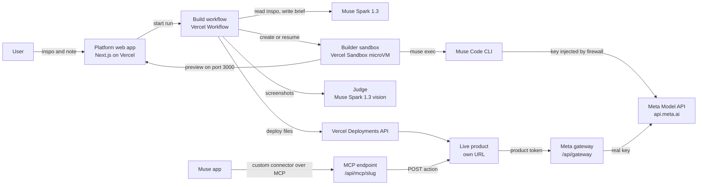

# Muse Muse design

Hackathon codename (see [Name](#name)). Written Oct 24, 2026 as design and scaffold only. Real code starts at kickoff on Oct 26.

## The product

You give it a muse and Muse makes it. A muse is an example or some inspiration, such as a photo of something you love, a screenshot of an app, a napkin sketch, a short video, a voice memo or a PDF. You can add an optional note, like "make this, but for my bakery." Text alone works too.

Muse Spark 1.3 reads the inspo and writes a brief. Muse Code then builds a working product from a starter template and uses Meta's models for the hard parts:

- Muse Spark 1.3 and Muse Wonder for reasoning
- Muse Image for pictures
- SAM 3.1 for finding and tracking things in photos and video
- Muse Voice Transcribe for speech

The platform tests what Muse Code wrote, deploys it to its own link, and turns its main action into a connector the Muse app can call.

## Why Meta needs this

Meta's models are strong and barely used.

- On OpenRouter's rankings for the week of Oct 19, 2026, Meta isn't among the top nine model authors. DeepSeek (26.5%), Google (20.1%) and OpenAI (18.5%) lead, and every other author, Meta included, shares 8.3%.
- Muse Spark 1.3 Contributor costs 92 to 95% less than standard Spark. It has processed 2.92T tokens on OpenRouter since Sep 2. DeepSeek V4.1 Flash processed 123T in the last 30 days.
- Meta's own Videos page still shows only Llama-era demos. All six on the first page use Llama, checked Oct 26, and none show Muse Spark, SAM 3.1, Muse Image or Voice Transcribe.

Muse Muse goes after both problems. Every product it ships is new Meta API usage, metered by the gateway, and its dashboard shows "Meta tokens driven" as the headline number. It also rebuilds Meta's outdated demos on current models and records each one. Screenshot the OpenRouter pages with dates for the pitch, because the numbers move.

## Decisions so far

| Decision | Choice | Reason |
|---|---|---|
| Input | An example or inspo, plus an optional note | Showing beats describing. Most prompt-to-app builders start from text only |
| Who writes product code | Muse Code, every time | Ethan's call. The platform makes it dependable with a starter template, skills and a verify loop |
| Platform hosting | Next.js on Vercel | Familiar stack, Node runtime, first-party sandbox and workflow products |
| Where Muse Code runs | Vercel Sandbox, one persistent microVM per product | Generated code is untrusted. Firecracker isolation, egress firewall, preview ports, snapshots |
| Orchestration | Vercel Workflow (`workflow` package) | Builds take minutes. Durable steps survive restarts, retry, and stream progress |
| UI | Dashboard-native, Meta-inspired, labeled as a concept | It should look like it belongs in the Meta AI dashboard without pretending to be Meta. See [Dashboard-native UI](#dashboard-native-ui) |
| Showcase | Rebuild Meta's Llama-era demo videos on current Muse models, with recordings | Measurable, useful to Meta's developer relations, and a fixed test set |
| Track | Startup | Judged on technical execution and whether it holds up in production |
| Today | Design and scaffold only | The Official Rules may require code written during the event |

## What a user sees

1. **Muse.** Drop in an example or some inspo: photos, screenshots, sketches, a short video, a voice memo or a PDF. Add a note if you want.
2. **Brief, about 15 seconds.** Includes the product name, who it's for and the main flow. Lists which Meta models it uses and why, honest limits and an estimated cost per use. Also says what it takes from your inspo and what it deliberately leaves out. Approved automatically unless you edit it.
3. **Build, 5 to 15 minutes.** A live log of what Muse Code is doing, the files it touched, and a live preview once the dev server starts.
4. **Check.** The platform runs the product's own tests, then Muse Spark 1.3 looks at screenshots and judges them against the brief. Failures go back to Muse Code, up to three rounds.
5. **Ship.** A public URL, a "how it was built" page, and a Muse app connector URL.
6. **Refine.** A follow-up like "add a dark mode" resumes the same Muse Code session in the same sandbox, then checks and ships again.

## Architecture

The master Meta key lives in two places only: the platform's server environment and the sandbox firewall rule that injects it. Generated code never sees it.

## Inspired by, never a copy

The inspo tells Muse what to make. It is not material to reproduce.

- **Take** the job it does, the flow, the layout ideas and the mood.
- **Leave out** names, logos, characters, copyrighted text, artwork and photos, and the exact look of a real product.
- **Restyle** everything with Muse Muse's own tokens.
- **Rename.** If the inspo is a screenshot of a real app, the product gets its own name and its own design.

The brief records what it takes and what it leaves out. The judge fails a build whose screens show a brand, logo or character from the inspo.

## Rebuilding Meta's demos

Meta's Videos page is a ready-made muse list. `catalog/meta-resources.json` holds each video's title, link, what it demonstrates, and a rebuild plan. The plan names the Muse models to use and an honest fit:

| Fit | Meaning | Videos |
|---|---|---|
| Clean | The same demo, built on current models | Blog posts from docs with RAG, insights from rich documents |
| Reframe | The goal still matters, but the method changed | Structured image extraction (now a JSON-schema prompt, no fine-tuning), fine-tuning in the real world (a few-shot check against the fine-tuning goal), Llama Protections (a Spark 1.3 safety check) |
| Partial | Part of it needs something outside Muse Muse | The WhatsApp chatbot. The web version works, and WhatsApp itself needs a Business account |

The catalog also lists demos Meta doesn't have yet: SAM 3.1, Muse Image, Voice Transcribe and Muse Wonder.

**Batch mode.** One command runs the whole list unattended. Each video becomes a muse whose inspo is the video's title, description and link, and whose note asks for a working demo on current models. The output is a Rebuilds gallery. Each card has the original video's link, the new live product, its recorded demo, and its build time and cost. The headline for the pitch is the total, something like "N of Meta's demos rebuilt in X hours for $Y."

Rebuilds link to Meta's videos. They never download, re-upload or edit them.

## Dashboard-native UI

The goal is that a Meta judge can picture Muse Muse as a tab in the Meta AI developer dashboard.

- **Match** the layout patterns: left navigation, a page header, cards, tables, and a playground-style split view for the build room. Also match the type scale, spacing, pill and tab shapes, and both themes.
- **Don't use** Meta's logo or wordmark, "Meta" in the product header, Meta's proprietary font files, a domain that looks like dev.meta.ai, or any sign-in or API-key page styled like Meta's.
- **Always show** a "Concept" tag in the header and "Not an official Meta product" in the footer.
- **Never ask for keys.** Users never paste a Meta key into Muse Muse. The platform uses its own key on the server.

In the video, a clearly labeled mock frame can show where it would sit in the dashboard. A page that copies Meta's look and asks people to sign in or paste keys reads as phishing, to users and to Meta's security team, so that line stays firm.

## Components

### 1. Platform web app

| Route | Purpose |
|---|---|
| `/` | Muse box (drop inspo, add a note), examples, gallery of shipped products |
| `/b/[buildId]` | Build room: brief, live log, file list, preview, check results |
| `/rebuilds` | Meta's videos and their rebuilds, with recorded demos, time and cost |
| `/gallery` | Every shipped product with its muse and recorded demo |
| `/usage` | Meta tokens driven, builds, products live, spend |
| `/p/[slug]` | Product page: live link, the original inspo, how it was built, models used, cost, connector URL |
| `POST /api/inspirations` | Save the inspo and note, then start the build workflow |
| `GET /api/builds/[buildId]/events` | Server-sent events for the build room |
| `POST /api/builds/[buildId]/messages` | Follow-up refinement on a shipped product |
| `/api/gateway/v1/*` | Meta Model API proxy for live products |
| `POST /api/gateway/uploads` | Short-lived upload tickets so large files go straight to storage |
| `/api/mcp/[slug]` | MCP endpoint that exposes a product's actions to the Muse app |

Browsing is public. Building requires sign-in, because every build spends credits. Sign-in takes an email, a personal password (the first one typed claims the email) and the shared access code. Admin needs an email in `ADMIN_EMAILS` and the separate `ADMIN_ACCESS_CODE`; the shared code never grants it. Scripts start batch rebuilds with the `AUTOMATION_SECRET` bearer instead of signing in. Inspo uploads use the same direct-to-storage flow as products (see [Large files](#7-meta-gateway)).

### 2. Build workflow

One durable workflow per build. Each row is a step with its own retries.

| Step | What it does | Uses | Time cap | Retries |
|---|---|---|---|---|
| `brief` | Reads the inspo and note and writes a structured brief, or refuses with a reason. Voice memos are transcribed first | Muse Spark 1.3 (image, video and PDF input), Muse Voice Transcribe, structured output | 90 s | 2 |
| `provision` | Gets or creates the product's sandbox from the builder snapshot, copies the template, puts the inspo files in `inspo/`, writes `brief.md`, sets the network policy | Vercel Sandbox | 3 min | 2 |
| `build` | Runs `muse exec` detached and streams its JSONL events into build events | Muse Code | 20 min | 0 |
| `preview` | Starts `next dev` on `0.0.0.0:3000`, waits for a 200, saves `sandbox.domain(3000)` | Vercel Sandbox | 2 min | 1 |
| `verify` | Runs `npm run verify`, collects screenshots, asks the judge | Playwright, Muse Spark 1.3 | 8 min | 0 |
| `fix` | On failure, resumes the Muse Code session with the errors. Loops back to `verify`, at most 3 rounds | Muse Code | 10 min each | 0 |
| `record` | Reruns the test at 1280×720 with video, then makes an MP4 with a title card and step captions | Playwright, ffmpeg | 5 min | 1 |
| `deploy` | Pulls the source out of the sandbox, creates or updates the product's Vercel project, sets env vars, deploys, waits for READY | Vercel REST API | 6 min | 2 |
| `register` | Saves the product, mints its gateway token, builds its MCP tool list from `musemuse.json` | Postgres | 30 s | 3 |
| `hibernate` | Stops the sandbox. Persistent sandboxes snapshot on stop, so refinements resume where they left off | Vercel Sandbox | 1 min | 2 |

If checks still fail after three rounds, a new product ships as **partial** only when typecheck, build, start, console and the smoke test all passed and the judge failed for a non-blocking reason (the judge marks copying, implying Meta made it, or a missing main result as blocking). Otherwise the build ends as **failed** with Muse Code's notes. A refinement ships only when its checks fully pass; otherwise the live version is kept. A broken product is never presented as working.

Build status values: `queued`, `briefing`, `refused`, `provisioning`, `building`, `previewing`, `verifying`, `fixing`, `deploying`, `live`, `partial`, `failed`.

### 3. Builder sandbox

- **Image.** A Node 24 managed image plus the Muse Code CLI, the template with its `node_modules`, and Playwright's Chromium, saved once as a snapshot so each build starts warm. `scripts/make-builder-snapshot.ts` rebuilds it whenever `template/` changes. The snapshot is made with open egress, and builds run with the locked-down policy below.
- **One sandbox per product**, named `product-<slug>`, persistent, with port 3000 exposed for the preview.
- **Network policy.** Deny by default. The allowlist has three entries:
  - `api.meta.ai`, with a credentials-brokering rule that injects `Authorization: Bearer <MODEL_API_KEY>` only for the routes Muse Code uses (`lib/sandbox/policy.ts` BROKERED_META_ROUTES) and only when the request carries the sandbox's placeholder key. Every other `api.meta.ai` request gets a 403 from the firewall; product code reaches Meta through the gateway
  - `registry.npmjs.org`, for packages
  - the platform's own domain, so the product's tests can reach the gateway

  `dev.meta.ai` is allowed only while creating the snapshot, for the Muse Code installer.
- **Muse Code auth.** Only the Muse Code runner exports `META_API_KEY`, set to a per-sandbox placeholder derived from the real key (`placeholderKey()`). The firewall swaps it for the real key on the brokered routes. Spike 1 confirmed Muse Code accepts a placeholder, and the Oct 27 review fix confirmed builds work under the scoped routes.
- **Muse Code sees the inspo two ways.** The brief carries Spark 1.3's written description of every reference, so the build works even with text only. Image references are also attached with `muse exec --image`. One third-party guide lists that flag and Meta's docs don't, so spike 1 checks it.
- **Muse Code flags.** `muse exec --json --prompt-file brief.md --image inspo/<file> --model muse-spark-1.3 --reasoning-effort high --max-model-steps 200 --yolo`. `--yolo` turns off Muse Code's own sandbox and approvals. That is acceptable only because the whole microVM is disposable and firewalled, which is the case Muse Code's docs describe for it. Use `muse-wonder-1.0` when the brief marks the product as complex.
- **Sessions.** Save Muse Code's session id from the JSONL stream. Fix rounds and user refinements call `muse exec --session-id <id>`. `muse export --session <id>` produces the transcript for the "how it was built" page.
- **What never enters the sandbox.** The Vercel token, the database URL, and the master Meta key. The only credential inside is a short-lived build token for the gateway with a small budget.

### 4. Product template

`template/` is the starting repo for every product. It steers Muse Code in five ways.

- `AGENTS.md` holds the rules. Muse Code loads it automatically.
- `.agents/skills/` holds one skill per Meta capability (reasoning, image, SAM, voice, Glimmer), plus UI and verification skills.
- `inspo/` holds the user's reference files, with rules for using them without copying them.
- `musemuse.json` is the manifest Muse Code must fill in: name, the inspiration it worked from, models used, actions with JSON schemas, fixtures, limits and cost per run.
- `npm run verify` is the definition of done.

Products call Meta only through `lib/meta/*`, which talks to the gateway with the product token. Those helpers are the first code to write after kickoff, because every product depends on them.

### 5. Checks

Three layers, in order. A later layer cannot overrule an earlier failure.

1. **Mechanical.** Typecheck, `next build`, the server starts, the home page returns 200, no console errors.
2. **Behavioral.** The Playwright smoke test that Muse Code wrote runs the primary flow on the fixtures, with real model calls through the gateway on the build token.
3. **Judgment.** Muse Spark 1.3 gets the brief, the inspo and two to four screenshots. It returns pass or fail with reasons, as structured output. It checks that the product does what the brief says and doesn't copy a brand, logo or character from the inspo.

**Recorded demos.** Every product that passes gets a demo video made from its own smoke test:

1. Playwright reruns the primary flow in a 1280×720 browser with video recording on and a short slow-motion delay.
2. ffmpeg turns the WebM into an MP4 and adds a title card with the product name and the muse.
3. Captions mark each step.

Meta's API has no text-to-speech, so the videos use captions. You can narrate the hackathon video yourself. The build room's time-lapse is recorded the same way, from the platform's own page.

### 6. Publisher

The platform, never the sandbox, talks to Vercel. It reads the source tree out of the sandbox, creates or reuses a Vercel project named `musemuse-<slug>`, sets `GATEWAY_URL` and `PRODUCT_TOKEN`, and creates a deployment from the files so Vercel builds it. If that is too slow, deploy prebuilt output instead.

### 7. Meta gateway

`/api/gateway/v1/*` mirrors the Meta Model API paths a product may use: `responses`, `images/generations`, `images/edits`, `files` and `asr/transcribe`. Each request goes through five checks:

1. Look up the product token.
2. Check the endpoint and model against the product's allowlist, which comes from its brief.
3. Check the product's daily budget and a per-IP rate limit.
4. Forward to `https://api.meta.ai/v1` with the real key, streaming the response through.
5. Record usage: tokens, images, video frames or audio seconds.

Each product has a kill switch. Realtime voice over WebSocket is out of scope for v1, so products use file transcription.

**Large files.** Vercel Functions accept at most 4.5 MB per request body, and phone videos, audio and full-size photos run past that. The flow:

1. The product's server asks `POST /api/gateway/uploads` for a short-lived ticket.
2. The browser uploads straight to Vercel Blob with that ticket.
3. The product passes the returned public URL to the model, as SAM 3.1's `video_url` or `image_url`, or to the transcription helper.

Uploads expire after 24 hours. Photos are also resized in the browser to about 1600 px before they're sent.

### 8. Muse app connector (stretch)

`/api/mcp/[slug]` speaks MCP over streamable HTTP. Its tools come from the `actions` in `musemuse.json`, and each tool call POSTs to the product's `/api/actions/<name>`. The Muse app adds custom connectors when you ask it to and reaches remote MCP servers over HTTPS, so a public URL works. Per Parallel's write-up, servers on a laptop are not reachable from the Muse app's VM.

### 9. Data

| Table | Key fields |
|---|---|
| `users` | id, email, daily build quota |
| `inspirations` | id, user id, note, references (url, kind, file name), created at |
| `builds` | id, inspiration id, rebuild of (catalog id or empty), product id, status, brief json, sandbox name, muse session id, fix rounds, preview url, cost |
| `build_events` | id, build id, seq, type, payload json, at |
| `products` | id, slug, name, manifest json, vercel project id, live url, demo video url, status, owner |
| `gateway_tokens` | id, product id, hash, scope (`build` or `live`), allowed models, daily budget, revoked at |
| `usage` | id, product id, token id, endpoint, model, units, unit type, cost estimate, at |

Inspo files, uploads and screenshots go to Vercel Blob. Uploads and screenshots expire. Inspo stays as long as its product does, so the product page can show what it was made from.

## Model routing

| Job | Model | Reason |
|---|---|---|
| Reading inspo, brief and policy check | `muse-spark-1.3` | Takes images, video and PDFs. Fast and cheap, structured output |
| Voice memo inspo | `muse-voice-transcribe-1.0`, then Spark 1.3 | Turns the memo into text the brief writer can use |
| Building products | Muse Code on `muse-spark-1.3` | Default. `muse-wonder-1.0` for briefs marked complex |
| Judging screenshots | `muse-spark-1.3` | Accepts images |
| Inside products | Whatever the brief picks | Spark 1.3, Wonder, `muse-image-1.0`, `sam-3.1`, `muse-voice-transcribe-1.0` |
| Local or offline | Muse Glimmer | Self-hosted only, not on the Model API |

**What the Model API doesn't have yet.** Meta leads on perception: reading text, images, video and PDFs, making and editing images, outlining and tracking objects, and transcribing speech. It doesn't have everything, though. As of Oct 26 it has no text-to-speech, no video generation (Muse Video was previewed in July and hasn't shipped), no embeddings model and no realtime speech-to-speech. Products stay Meta-only with these workarounds, and the brief lists each one as a limit:

- Browser speech synthesis for spoken output.
- Spark 1.3's 1M-token context instead of embeddings for small document sets.
- Image sequences from Muse Image instead of generated video.

## Security and abuse

- Generated code runs only inside a microVM with deny-by-default egress and brokered credentials.
- Live products hold a product token, never a Meta key. Tokens are scoped to models and endpoints, budgeted, rate limited and revocable.
- The brief step refuses requests that impersonate real people or organizations, clone a real brand or product, monitor people without consent, or involve sexual content, weapons, malware or scams.
- Inspo is used under the rules in [Inspired by, never a copy](#inspired-by-never-a-copy).
- Products use a Meta-inspired look with no Meta logos or wordmarks, and carry the footer "Built with Muse Muse. Not an official Meta product."
- Sandbox preview URLs are public, so previews never contain secrets.
- User uploads expire. Products don't store personal data unless the brief requires it and says so.

## Cost model

These are estimates to check on day one, not quotes.

- Muse Spark 1.2 standard pricing was $1.25 per million input tokens, $4.25 per million output and $0.15 per million cached input. Reports say 1.3 kept the same price. The contributor tier is far cheaper, but Meta may train on those prompts, so use it only for test runs.
- Muse Wonder was listed at $4 in and $20 out per million tokens while in preview.
- Muse Image costs $0.01 per returned image. Muse Voice Transcribe costs $0.18 per audio hour. SAM 3.1 video is billed per frame with a 50-frame minimum, at rates on Meta's pricing page.
- **One build**, assuming 1.5M cached input, 0.3M fresh input and 80k output tokens on Spark 1.3, comes to about $0.94 for Muse Code. The brief, the inspo reading, the judge and smoke-test model calls add about $0.10. Call it $1, and up to $3 with fix rounds.
- **$150 in credits** covers roughly 50 to 150 builds. Cap builds per user per day and keep a separate budget for the demo.

## Demo, two to three minutes

1. **0:00** The problem, in two screenshots. Meta's share on OpenRouter, then Meta's Videos page, where every demo is Llama-era.
2. **0:20** One muse on screen. The Llama 4 WhatsApp chatbot video plus the note "rebuild this on today's models." The brief appears with its models and its honest "partial" note about WhatsApp.
3. **0:40** A time-lapse of Muse Code building, from the real log and labeled as sped up. Checks pass.
4. **1:10** The rebuilt product, live, from its own recorded demo.
5. **1:30** The Rebuilds gallery. Every video on Meta's page rebuilt, plus first demos for SAM 3.1, Muse Image and Voice Transcribe. The total time and cost on screen.
6. **2:00** A user muse to show range. A photo of a café bookshelf with "make me one for my wall" becomes a live product.
7. **2:20** The Muse app adds a product as a connector and uses it. Close on "Meta tokens driven" and a labeled concept frame of Muse Muse as a dashboard tab.

## Risks

| Risk | Mitigation |
|---|---|
| Muse Code output breaks | Template, skills, verify loop, fix rounds, honest partial status |
| Builds too slow to show live | Warm snapshot, Spark 1.3 by default, step cap, demo builds run ahead of time with real logs |
| Muse Code misbehaves inside the microVM | Spike 1 on day one. Fallback is the real key in the sandbox with egress limited to `api.meta.ai` and npm, plus a dedicated low-budget key |
| Muse Code can't see images | The brief's written description of each reference is the baseline. `--image` is a bonus |
| Inspo leads to copies | Brief records what to leave out, AGENTS.md rules, the judge checks for borrowed branding |
| Credits run out | Per-user daily caps, contributor tier for test runs, cache briefs |
| Crowded category | Inspo-first input, real deployed apps that passed their own tests, Muse app connectors, honest limits, the full Meta model range |
| Pre-existing code rules | Scaffold only before kickoff, disclose it in the submission |
| Undocumented API details | Spikes for structured output, video input to Spark and file transcription. Fall back to plain JSON prompting and validation |
| Dashboard look-alike reads as impersonation | Patterns only, no Meta logos, fonts or sign-in pages, a Concept tag, never ask for keys |
| Some videos can't be rebuilt literally | Fit labels in the catalog: clean, reframe or partial, stated in each brief |
| The name | See [Name](#name) |

## Name

Muse is Meta's product brand. Meta's brand guidelines say you may not use a Meta trademark "as or as part of any trademark, service mark, company name, trade name, username or domain registration." Muse isn't on Meta's published trademark list, but Meta also says leaving a name off doesn't waive its rights.

So treat Muse Muse as the hackathon codename:

- Don't register domains or social handles with it.
- Pick a name of your own before taking it past the hackathon.
- Referential phrases like "built with Muse" follow the pattern Meta shows for "Built with Llama."

## Open questions

- Where are the Official Rules? They weren't on the public event pages on Oct 26.
- Does Muse Code accept a placeholder `META_API_KEY` when the firewall injects the real header?
- Does `muse exec --image` exist and work headless?
- What is the exact managed image name and default size for a Node 24 sandbox?
- How does Spark 1.3 take a JSON schema on the Responses API?
- What is the request format for `POST /v1/asr/transcribe`?
- Do Muse app custom connectors work inside scheduled jobs? This is not needed for v1.

## References

- Meta Model API overview: https://dev.meta.ai/docs/overview
- Quickstart: https://dev.meta.ai/docs/quickstart
- Muse Image: https://dev.meta.ai/docs/image-generation
- SAM 3.1 segmenting: https://dev.meta.ai/docs/sam/segmenting
- SAM client libraries: https://dev.meta.ai/docs/sam/client-libraries
- Muse Code configuration: https://dev.meta.ai/docs/muse-code/configuration
- Muse Code extending and automating: https://dev.meta.ai/docs/muse-code/extending
- Muse Code auth: https://dev.meta.ai/docs/muse-code/auth
- Muse Code CLI guide listing `--image` (third party): https://qainsights.com/getting-started-with-muse-code-cli-commands-syntax-and-purpose/
- OpenRouter rankings: https://openrouter.ai/rankings
- Meta models on OpenRouter: https://openrouter.ai/meta
- Meta's Videos page: https://dev.meta.ai/resources/videos/
- Muse lineup and what's shipped (OrcaRouter): https://www.orcarouter.ai/blog/meta-muse
- Meta brand guidelines: https://www.meta.com/brand/resources/meta/company-brand/
- Meta trademarks: https://www.meta.com/brand/resources/meta/our-trademarks/
- Vercel Sandbox concepts: https://vercel.com/docs/vercel-sandbox/concepts
- Vercel Sandbox firewall: https://vercel.com/docs/sandbox/concepts/firewall
- Sandbox duration and persistence: https://vercel.com/kb/guide/vercel-sandbox-duration-and-persistence
- v0-style builder on Vercel Sandbox (reference architecture): https://vercel.com/kb/guide/v0-clone-openai-agents-vercel-sandbox
- Open Agents template (reference): https://vercel.com/templates/template/open-agents
- Muse custom connectors: https://parallel.ai/articles/meta-muse-custom-integrations
