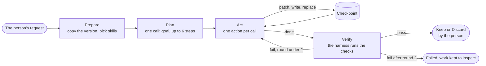

# The offline helper: a lean coding harness for block products

Design, Oct 31, 2026. Nothing here is built yet. Branch `tg-offline`. Read [OFFLINE.md](OFFLINE.md) first: this builds on
its blocks, tasks, endpoint registry, router, one exit, ledger and guards, and on `OFFLINE=1`.

The owner's words, Oct 31:

> I would want the offline mode to be able to have an offline harness thats like a leaner muse code too.

Tags, as in OFFLINE.md:

- **[V]** verified: in this repo's code or docs, a measured run, or checked on this laptop on Oct 31 (named where it
  matters).
- **[R]** reported by someone else (a model card, another repo's docs), not reproduced here.
- **[I]** inferred or estimated. Needs a test.

## Words used here

| Word | Means |
|---|---|
| Block product | A product that is one JSON config the platform's block runtime renders (OFFLINE.md section 1). No build, no per-product code until this design adds a little |
| The helper | What a person sees: "Change it with the helper". The harness in code, under `lib/harness/` |
| Run | One request to the helper, from the first plan to Keep or Discard |
| Round | One pass of acting then checking. Round 0 does the work; rounds 1 and 2 fix what the checks found. The build room already shows rounds |
| Work folder | `.data/harness/<runId>/work/`, a copy of one product version the helper may change. The only place it can write |
| Ext code | The small custom code a product may now carry: calc and format functions, in `ext/` |
| Build room | `components/build/`: the page that shows a Muse Code build live, with Show thinking, the Steps panel and Stop |
| `MuseLogLine` | One condensed line of agent activity (`lib/types.ts`), the unit the build room renders |

## In one page

- **Our own lean harness for the demo, not Muse Code.** llama.cpp's server on this laptop (b11972) does have a
  Responses API with streamed text and function call events [V], so a shim to run Muse Code locally is small. But Muse
  Code's first request is about 25,000 input tokens with 28 to 30 tools [V, the Oct 31 spike], which no model the demo
  can run will hold (8K context on the laptop and the Jetsons), the terms reading says Muse Code can't ship in a kit or
  on a drive, and the tuned Glimmer's control tokens drift. Muse Code against a local endpoint stays an owner-only
  experiment and a yardstick, after Nov 4.
- **The loop is plan, act, verify.** One planning call, then one constrained action per step, then checks the harness
  runs itself. "Done" from the model is a request to verify, never the verdict. At most 2 fix rounds.
- **Ten actions, no shell.** List, read, search, patch the config, write or replace an ext file, run a named check,
  undo, done, stuck. Paths outside the work folder can't be expressed: the grammar only allows the folder's own file
  names.
- **Constrained JSON, not native tool calls.** Every step is one chat completion with `response_format: json_schema`,
  which llama-server turns into a grammar. llama.cpp refuses a grammar and tools in the same request [V], native tool
  calls depend on each model's template, and the tuned Glimmer's headers drift [V]. One action format works the same on
  every model.
- **What it changes:** a product's config (copy, fields, views, task settings), plus pure calc and format functions and
  view blocks built from parts. Never React, CSS, routes or the platform. It can't change where data goes: patches to a
  task's sensitivity, route or a field's `sensitive` flag are refused.
- **"Worked" means checks passed on the final files:** the config schema and copy lint, the function's cases, a
  typecheck of ext code (TypeScript 6.0.3 is in `node_modules` [V]), and a server render with sample answers. Then the
  person sees the diff and the cases, and presses Keep or Discard. Nothing is applied on its own.
- **Contained without a container.** Folder-only tools, an allowlist of four checks, model calls only through
  OFFLINE.md's one exit, and every child process under macOS `sandbox-exec` with network denied (it blocks even
  loopback [V]) plus Node's permission model with no writes and no child processes [V]. Honest about what that doesn't
  guarantee.
- **The build room's shapes, not a fork.** The helper writes `{ type: "muse", lines: MuseLogLine[], round }`, `verify`,
  `status` and `control` events, and a small helper room composes the build room's own pure functions and chat kit, so
  Show thinking, Steps and Stop behave as they do for a build. Two default-preserving props are the only shared changes.
- **Models, honestly.** The demo can drive it only with LFM3-VL-2B on the owner's laptop (no Glimmer there, by the
  owner's rule). Base Glimmer Q4_K_M on a 32 or 36 GB Mac that isn't the laptop is the real target. A 20-task eval with a
  pass bar decides which task kinds the menu offers on each model.
- **Slice:** about 27 hours in 9 units after OFFLINE.md's slice, new files first. It makes the video only if its eval
  passes on the laptop by Nov 4, 12 PM ET. Otherwise it continues after Nov 4 unchanged.

## 1. Our own harness or Muse Code on a local endpoint

### What Muse Code needs, and what a local server gives

From the Oct 31 spike (`~/mm-wt/musecode/docs/spikes/musecode-2026-10-31/README.md`) and the strings in this laptop's
llama.cpp b11972 server library (`~/.local/llama.cpp/b11972/llama-b11972/libllama-server-impl.dylib`, read Oct 31).
A string in a binary is evidence a feature exists, not proof it behaves as Muse Code expects.

| Muse Code needs | llama.cpp b11972 | Gap |
|---|---|---|
| `POST {base_url}/responses`, `stream: true`, for every main, tool loop and subagent call [V, spike] | Routes `/v1/responses` and `/responses`, events `response.output_text.delta`, `response.function_call_arguments.delta`, `response.output_item.added` and `.done`, `response.completed` [V, strings] | Probably none for the path. Event details unproved [I] |
| `tools` as one `namespace` entry holding 28 to 30 tools (17 for a subagent) [V, spike] | No `namespace` string in the server library [V]. Tool calls need `--jinja` ("tool_choice param requires --jinja flag" [V]) and a template llama.cpp can parse | A shim flattens the namespace into plain function tools [I] |
| A non-streamed compaction call with no `instructions`, plus `tool_choice` and `parallel_tool_calls` [V, spike] | Accepts `tool_choice` auto, none or required and `parallel_tool_calls` [V]. A string reads `"instructions" must be provided` [V], which may refuse that call | The shim adds a one-line `instructions` if the server refuses [I] |
| `max_output_tokens: 128000` on every call [V, spike] | Must be an integer or "inf" [V]; past the context it fails or truncates [I] | The shim clamps it |
| Never `previous_response_id` [V, spike] | "llama.cpp does not support 'previous_response_id'" [V] | None |
| `GET /muse-code/models` at the host root, optional (a 403 still completed a turn) [V, spike] | Not served | The shim answers it or leaves it 403 |
| A first body of about 116 KB, about 25,000 input tokens, up to 141 KB [V, spike] | Fits only a context of 32K or more | Not a shim problem: the model must hold it |
| A key, or `auth:"none"`: with `base_url` alone and no key, "not logged in"; `auth:"none"` runs keyless [V, spike, on Linux] | Our llama-server takes `--api-key-file` | Keyless on loopback looks possible [I on macOS] |
| Telemetry to api.meta.ai unless `telemetry.enabled=false`; nothing else skipped the endpoint [V, spike] | | With the internet unplugged, any other start-up call is unknown [I] |
| The `@muse-code/sdk` and the session bridge, installed from npm in the sandbox [V, spike] | | Fetched while online, kept on disk [I] |

**What a shim would cost:** one small server on 127.0.0.1 in front of llama-server that flattens the tool namespace,
clamps `max_output_tokens`, adds `instructions` when missing, and answers the catalog route. About 4 to 6 hours with
tests [I]. It's cheap. The rest isn't:

1. **The prompt doesn't fit the models the demo has.** 25,000 tokens before the first step. The laptop's LFM3-VL-2B runs
   at `-c 8192` (OFFLINE.md), and the Jetsons' Bolt has 8K context [V, OFFLINE.md section 6]. Only Glimmer on a 24 to
   36 GB Mac (Q3_K_M or Q4_K_M) could hold it, and Glimmer's KV cache is small enough for 32K (2 KV heads, 39 of 52
   layers on a 2,048-token window [I, VIBE_TUNING.md]). Its prompt processing on 25,000 tokens is likely a minute or more on an
   M-series Max [I], and the owner's laptop may not run Glimmer at all.
2. **Its prompts and its 28 to 30 tools expect Meta's hosted models with a 1M context.** A small model picking among 30
   tools does worse than among 10 [I].
3. **The tuned Glimmer can't drive native tool calls today.** The knowledge run measured its channel headers drifting
   (the chance of "=self" after " to" fell from 0.99999 on base to 0.21), multi-step answers on the user channel fell
   from 149 to 64 of 150, and reasoning on fails [V, KNOWLEDGE_RUN_LOG.md, 3:45 AM]. Base Glimmer's tool calls through
   llama.cpp are untested.
4. **The terms.** From the reading in `~/mm-wt/_plan/muse-code-products.md` ("Meta's terms", a reading, not legal
   advice): if Muse Code is Downloadable Materials it can't be made available to third parties, so it never goes in a
   kit, on the flash drive or in an installer; the owner installs it on his own machine. 3.1 bars sharing the key, which
   keyless loopback avoids. There are no Muse Code-specific terms on pointing it at non-Meta models, so that needs the
   owner's own reading before the experiment.

**What Muse Code would give for free:** the build room already condenses its protocol (`lib/sandbox/msp-log.ts`), so
Show thinking, Steps and Stop would just work. That's real, and section 5 gets the same result with our own events.

### Recommendation

**Build our own lean harness for the demo.** It ships in the kit and on the drive, fits an 8K context, uses OFFLINE.md's
router, exit and ledger for every model call, and can be contained (section 4).

**Muse Code on a local endpoint is for the owner, after Nov 4:** an experiment on a 32 or 36 GB Mac (not the laptop)
with base Glimmer Q4_K_M at `-c 32768` behind the shim, installed by the owner, never shipped. Its job is a yardstick:
run the helper's eval (section 7) through it. If Muse Code plus Glimmer passes many more tasks, our prompts or tools are
the bottleneck; if not, the model is.

Our harness uses no Meta service when it runs LFM3 or Bolt, and base Glimmer is Apache 2.0 [V, OFFLINE.md], so Meta's
Terms of Service don't govern it. The model licenses do: OpenMDW for Bolt, Liquid's for LFM3, read before shipping.

## 2. The harness

### The loop



1. **Prepare (no model).** Copy the product's current version into the work folder: `product.json` and any `ext/`
   files. Write `ext/types.d.ts` from the config (section 3), read-only to the model. Pick the skills for the task kind
   (section 6). Ask the router for one endpoint for the whole run (below).
2. **Plan (one call).** Schema `{ goal (200 chars), steps: [{ text (120) }] (1 to 6), files: [path] (up to 5) }`. The
   goal and steps show at once as the build room's goal card and todo list.
3. **Act (one call per step).** The model picks one action (the table below). The harness checks it, takes a
   checkpoint if it changes a file, runs it inside the folder, and keeps a short observation for the next step. Steps
   tick todo items off when the model names one in `step`.
4. **Verify (no model choice).** On `done`, the harness runs every check the changed files require (section 3). The
   model's own `check` actions are for its information; only this run decides. An empty diff is "Nothing changed", never
   success (the spike's lesson: a run that made nothing exited 0 [V, spike, task b]).
5. **Fix rounds.** A failed verify starts round 1 with the failure (cut to 2,000 characters) as the first observation
   and the `fixing` skill added. Round 2 likewise. After round 2 the run fails, and the work folder stays so the person
   can look, take it anyway with a warning, or discard it.
6. **Finish.** The model's summary (400 characters), the diff, the cases as a table, and a live preview of the draft.
   **Keep** saves a new product version (OFFLINE.md: every save is a version, so it can be undone later). **Discard**
   deletes the work folder.

### The actions

| Action | Arguments (all strings capped) | What the harness does |
|---|---|---|
| `list` | `dir`: one of the folder's directories (enum) | Names and sizes, at most 100 |
| `read` | `path`: one of the folder's files (enum), `from` line | 120 lines or 6,000 characters, with line numbers |
| `search` | `text`: literal, at most 80 characters | Matching lines across the folder, at most 20 |
| `patch` | `ops`: 1 to 10 JSON Patch operations (`add`, `replace`, `remove`) on `product.json` | Applies them to a copy, validates the result with the config schema, and lands it only if valid; else the zod error is the observation |
| `write` | `path`: an `ext/` path matching the pattern below, `summary` (120) | A second call writes the file body as plain text (below). Size and lint checked before it lands |
| `replace` | `path` (enum of ext files), `find` and `with` (1,200 each) | `find` must match exactly once |
| `check` | `name`: `validate`, `cases`, `typecheck` or `render` | Runs that named check (section 3) |
| `undo` | | Restores the last checkpoint |
| `done` | `summary` (400) | Starts verify |
| `stuck` | `question` (300) | Pauses the run and shows the question; a note from the person continues it |

Every action also carries `why` (300 characters) and an optional `step` (the todo item it serves). `why` is what Show
thinking shows (section 5).

**Paths.** `read`, `replace` and `list` take an enum built fresh each step from what's in the folder, so the grammar
can't produce any other name. `write` takes a pattern: `^ext/(calc|format)/[a-z0-9-]{1,40}\.(ts|cases\.json)$`. Patches
reach only `product.json`. Behind the grammar, the folder module checks every path again (section 4).

**Why `patch` for the config.** A small model rewriting a 3 KB JSON file drops things; a JSON Patch names one change at
a time, and the schema check runs before anything lands. Example for "add a weather field" to OFFLINE.md's Pack Ready
List:

```json
{ "why": "The list should depend on the weather, so the form needs it and the task must take it.",
  "do": "patch", "step": 1,
  "ops": [
    { "op": "add", "path": "/blocks/1/fields/-", "value": { "name": "weather", "label": "Expected weather", "type": "choice", "options": ["hot", "mild", "cold", "rain"] } },
    { "op": "add", "path": "/tasks/0/inputs/-", "value": "weather" } ] }
```

**The patch filter.** Before the schema check, ops are refused when they touch `/tasks/*/tags`, `/tasks/*/route`, a
field's `sensitive` flag, or `limits`, and when they remove a privacy note. Those are the person's settings in plain
words in the editor (OFFLINE.md section 2), and they decide where data goes. Adding a field to a task's `inputs` is
allowed, because that's often the point, but the Keep card leads with it: "This change sends a new field to the model:
Expected weather."

**Why the file body is a second call.** Code inside a JSON string has to escape every quote and newline, which small
models get wrong, and a long `maxLength` makes a large grammar [I]. So `write` is two calls: the action (path and
summary), then a body call with no schema, `max_tokens` 1,536, told to answer with the file only. The harness strips one
code fence if present, then checks size and lint.

### Tool calling for small local models

| | Native tool calls (`tools` on chat completions) | Constrained JSON action (`response_format: json_schema`) |
|---|---|---|
| Works on | Models whose template llama.cpp parses, with `--jinja` [V string]. LFM3's and Glimmer's formats untested here | Any model llama-server serves: the schema becomes a grammar. OFFLINE.md's assembly and every structured task already rely on it |
| Tuned Glimmer | Its channel headers drift [V] | Works with json_schema on stage 2 Q4_K_M under the reasoning-off template [V, KNOWLEDGE_RUN_LOG.md] |
| Combined with a grammar | No: "Cannot specify grammar with tools" [V, b11972 string] | It is the grammar |
| Arguments | The model's own JSON, parsed by llama.cpp's per-format parser | Shape guaranteed. Enums limit paths to real files. Sense isn't guaranteed |
| Through the fleet gateway | Unknown whether it passes `tools` [I] | The probe already tests a schema call per endpoint (OFFLINE.md section 3) |
| Prior use nearby | Muse Privacy sends calls with tools to Glimmer only, never to LFM [R, its `docs/CONTRACTS.md`] | |

**So the harness uses constrained JSON.** The step schema is a `oneOf` of the ten actions, each with `do` as a
`const`, `additionalProperties: false`, and every string bounded. b11972's schema-to-grammar code names `oneOf`,
`anyOf`, `const`, `enum`, `maxLength` and `pattern` [V, strings in `libllama-common.dylib`]; `maxItems` didn't show in
the strings, so the probe checks it [I]. Patterns stay simple: "unsupported group syntax" is one of its errors [V], so no
lookarounds. Native tool calls come back later, per model, only where the probe and the eval pass with them.

The json_schema traps from OFFLINE.md and the knowledge run, all handled the same way:

- **Never send `chat_template_kwargs`.** On b11972, `enable_thinking: false` in a request breaks json_schema replies [R,
  Muse Privacy]. Thinking is off on the server: `--reasoning-format none`, and for Glimmer `tuned-reasoning-off.jinja`
  [V, KNOWLEDGE_RUN_LOG.md]. LFM3's thinking must be off too, or answers get cut off [R, Muse Privacy
  `docs/COMPLIANCE_PLAN.md`].
- **Always send the stop field for Glimmer** (`["<|eot|>"]`). Without it, HTTP 200 with channel markup in the content
  [V].
- **Never trust the status.** Every reply is parsed and validated against the step schema with zod. An invalid reply
  retries once at temperature + 0.2, then counts as a wasted step with "The model's answer didn't parse" in the log.
- **Schema size.** The step schema with its enums is about 2 KB [I]. The probe sends it once at run start: if it doesn't
  come back parsed, the run doesn't start on that endpoint.

### Endpoints and the router

The helper's model calls are tagged requests like any task's, so OFFLINE.md's rules apply unchanged:

- **Tags:** block `helper`, task `step`, purpose `helper`, sensitivity **`personal`** (the person's request and their
  product are theirs, the same rule as assembly). The person can raise a run to `private` ("Keep the helper on this
  computer"). It never goes lower in the slice, so the plain-http fleet gateway, which gets `general` requests only, never
  sees the helper.
- **Route:** `{ mode: "best", prefer: "biggest" }` with needs `text`, `structured`, and a context of at least 8,192.
  The router picks once per run and the run sticks to it, so the model doesn't change mid-run and llama-server's prompt
  cache stays warm. The "Runs on" chip shows it and offers the others that passed.
- **The one exit:** every call goes through `lib/offline/egress.ts` and writes a ledger row. The helper's request isn't
  a form, so `fields` holds the names of the prompt's parts (`request`, `plan`, `skill:calc`, `file:ext/calc/split-bill.ts`)
  and never their text; bytes and sha256 as usual. `TaggedRequest` gets a second variant, `kind: "helper"`, with
  `parts: { name, bytes, sha256 }[]` in place of `input`.
- **Failure:** before the first byte, one retry on the next device in the order (OFFLINE.md); after that, the run pauses
  with "This Mac's model stopped answering" and the person can pick another device to continue.
- **The same-machine server.** The helper and block tasks share one llama-server. Start it with `-c 16384 -np 2` in
  place of OFFLINE.md's `-c 8192`, so each slot keeps 8K and a block task can still answer while the helper works [I:
  llama.cpp has split `-c` across slots; check on the pinned build].

### Caps

| Cap | Value | Why |
|---|---|---|
| Model steps | 16 in round 0, 8 in each of 2 fix rounds: 32 at most, plus the plan and body calls | Small models loop. The eval checks how many tasks need more [I] |
| Wall clock | 10 minutes a run on this machine, 20 on a board | A demo-length wait; the laptop's heat |
| One call | 120 s; one retry when the reply doesn't parse | |
| Output | 400 tokens for the plan, 512 for an action, 1,536 for a file body | Short answers, small grammars |
| Prompt | 6,000 tokens estimated (characters / 4); older observations collapse to one line each past it | Fits an 8K slot with room for the answer |
| Tokens | 80,000 in and out per run | A runaway loop stops even when steps don't |
| Folder | 20 files, 32 KB each, `ext/` 256 KB in all, `product.json` 64 KB | Small enough to checkpoint whole |
| Concurrency | One run per machine, one check at a time | PGlite has one process; heat |

Each prompt tells the model where it stands ("Step 5 of 16, 6 minutes left"), so it can choose `done` or `stuck` before
the cap.

**Context, without a model.** Muse Code compacts with a model call; the helper doesn't. The system text, the skills and
the request come first and never change within a round (good for the prompt cache), then the plan and its ticks, a
one-line-per-block summary of `product.json` (about 300 tokens), the file list, the last 3 observations in full (at most
1,500 characters each), older ones as one line ("Read ext/calc/split-bill.ts, 32 lines"), and the person's notes.

### Checkpoints and undo

- **Before every `patch`, `write`, `replace` and `undo`,** the harness copies the whole work folder (at most about 512 KB)
  to `.data/harness/<runId>/checkpoints/<n>/` with a manifest: step, action, files changed and their sha256. Git isn't
  needed and isn't assumed on a house machine.
- **Undo** restores checkpoint `n - 1`. The model can call it, and the person can press "Undo the last change" while the
  run is paused or finished.
- **Keep** writes `product.json` and the ext files into a new `block_products` version, with ext sources inside the
  config (section 3), so the old version is one click back in the editor.
- **A restart mid-run** (the server stopped) marks the run failed, "The helper stopped when Muse Muse restarted". The
  folder and checkpoints stay, and Keep is offered only for a checkpoint whose verify passed.

### Stopping and steering

The helper room reuses the build room's steer box (section 5), posting to `POST /api/local/harness/<runId>/control`.

- **Stop:** sets the run's stop flag, aborts the open model call (the fetch's `AbortController`; llama-server stops
  generating when the client goes [I]), and kills a running check's process group with SIGKILL. Within 2 seconds [I,
  checked by a test with a slow fake model]. The run ends `failed` with "Stopped by you.", which the steps list already
  shows as stopped (`stepsEnd` in `components/build/steps.tsx`). The work folder stays, and the person can still Keep a
  checkpoint whose verify passed, or Discard.
- **Send now** (steer): the note goes into the next step's prompt, newest last, marked as the person's.
- **After this step** (queue): the note waits for the next round.
- **No change policy offline.** Online, a note passes `checkChange` on a Meta model first. Offline there's no Meta, and
  the note can only make the helper do what its ten actions allow inside the folder, so it goes straight in.
- **Rate:** 20 notes a minute, as online (`CONTROLS_PER_MINUTE`); Stop always goes through.

## 3. What it works on, and what "worked" means

### The product folder

```text
work/
  product.json                 the block config, OFFLINE.md's shape, v 1
  ext/
    types.d.ts                 written by the harness from the config; read-only to the model
    calc/split-bill.ts         one function named calc
    calc/split-bill.cases.json its cases: input, expect, note
    format/money.ts            one function named format
    format/money.cases.json
```

Ext code lives in the config as `ext: { "<path>": { source, sha256 } }`, at most 256 KB, so it is versioned with the
config and travels with it. The folder is that map written out. Ext code runs only on a house machine (section 4); the
online platform refuses a config with `ext` until it has a runner of its own.

### Three kinds of custom code

**A calc function.** A new task kind, `calc`, that asks no model:

```json
{ "id": "split", "kind": "calc", "inputs": ["total", "people", "tip"], "fn": "calc/split-bill",
  "output": [{ "name": "each", "type": "number", "format": "format/money" }, { "name": "tipTotal", "type": "number" }] }
```

The harness writes the types from the task: `interface SplitBillInput { total: number; people: number; tip?: number }`
from the form's fields, and `SplitBillOutput` from `output`, into `ext/types.d.ts`. The model writes the body:

```ts
function calc(input: SplitBillInput): SplitBillOutput {
  const tipTotal = Math.round(input.total * (input.tip ?? 0)) / 100;
  const each = Math.ceil(((input.total + tipTotal) / input.people) * 100) / 100;
  return { each, tipTotal };
}
```

Rules, enforced by a lint on the TypeScript syntax tree (`lib/harness/lint-ext.ts`): one top-level function named
`calc`, synchronous, no `import`, `export`, `require` or `import()`, no `eval`, `Function`, `globalThis`, `process`,
`fetch`, `WebAssembly` or `Atomics`, no `.constructor`, `__proto__` or `prototype`, no `with`, at most 80 lines. Inputs
can be the form's declared fields, or a records block's declared fields without ids (as `summarize` gets them), so a
streak or a weekly total fits. A calc runs on the house machine, so nothing leaves and there is no ledger row.

This is OFFLINE.md's planned `calc` block, done as a task, which brings Dinner Split Helper and Scale My Recipe (in its
"not at all" and "partly" rows) within reach.

**A formatter.** `function format(value: number | string, field: string): string`, with `Intl` allowed, named from an
output or records field's `format`. Money, units, dates in words, plurals.

**A custom block.** A `view` block made of parts, in the config, with no code:

```json
{ "kind": "view", "id": "streak", "source": { "task": "streak" }, "title": "Your streak",
  "parts": [
    { "part": "big-number", "value": "/days", "label": "Days in a row", "format": "format/plural-days" },
    { "part": "kv", "rows": [{ "label": "Best", "value": "/best" }, { "label": "This week", "value": "/week" }] },
    { "part": "progress", "value": "/week", "max": 7 } ] }
```

Parts: `text`, `big-number`, `kv`, `list`, `chips`, `progress`, `table` (3 columns on a phone), `note`. Values are JSON
Pointers into the source's answer, checked against the source's output schema. They render with the template's meta-ui
parts like every block (OFFLINE.md section 1). Not JSX: a small model writes it poorly, it would need a build, and it
would run with the page's powers.

### The checks

| Check | What it proves | How | Cap |
|---|---|---|---|
| `validate` | The config parses against `lib/blocks/schema.ts`, passes the copy lint (`lib/blocks/lint.ts`: labels, no em dashes, no model ids or "JSON" in copy, limits beside what they limit), every `fn` and `format` exists, every pointer resolves, and ext code passes `lint-ext.ts` | In the server process: it reads files, runs no ext code | 1 s |
| `cases` | Each calc and format gives the expected answer on each case. Numbers match within 0.005 unless a case says `exact` | The runner (section 4), each case alone, 500 ms each | 5 s |
| `typecheck` | Ext code type-checks against `ext/types.d.ts` | The TypeScript 6.0.3 compiler API [V, in `node_modules`] in a child process, `strict`, `lib: ["es2023"]`, `types: []`, so `process`, `fetch` and `require` are type errors too | 30 s |
| `render` | The product renders with sample answers: no throw, every block shows its title, no "undefined", "NaN" or "[object Object]" in the text, copy lint on what shows | Formatters run in the runner first; then `react-dom/server` renders `components/blocks/` with plain strings, so model-written code never runs in the server | 15 s |

Which checks a run needs, by what changed: `product.json` needs `validate` and `render`; a calc or format file needs
`validate`, `typecheck`, `cases` and `render`. Each calc or format needs a cases file with 3 to 20 cases, at least one
taken from the request or the plan.

**The cases problem.** A model's cases can share its function's mistake. So the Keep card shows the cases as a table in
plain words ("100 with a 15% tip, 3 people: each pays 38.34"), and the person reads them; the eval (section 7) uses
hidden cases the model never sees.

**What isn't checked.** How it looks: there is no screenshot check offline, because Playwright isn't in this repo's
`node_modules` [V] (Chromium builds sit in the user cache, without the package). Whether the copy is good. The person
judges both from the live preview.

### Task kinds, matched to small models

The helper starts from a menu, so the person picks the kind and the harness picks the skills. A free-text request goes
first through one `decide` call over the five kinds (OFFLINE.md's constrained pick), shown and changeable.

| Kind | Example | The model writes | Checks | Fit [I until the eval] |
|---|---|---|---|---|
| `edit-config` | "Call it Trip Packer and ask about the weather" | JSON Patch ops | validate, render | Good: short, constrained, checked |
| `add-calc` | "Split the bill, with a tip" | A calc task, one function under 40 lines, 3 to 8 cases | all four | Fair on a 2B model with the scaffold; better on Glimmer |
| `add-format` | "Show money as dollars and cents" | One format function, cases | typecheck, cases, render | Good: `Intl` does most of it |
| `add-view` | "Show the streak as a big number" | A view block | validate, render | Fair: pointers must match the answer |
| `fix-check` | "The checks fail since my edit" | patch or replace | The failing check | Fair: depends on the message |

### What small local models can't do here, said plainly

- Write or change React components, CSS, routes, the block runtime or anything in the platform. The helper can't see them.
- New interactive widgets: drag and drop, timers, drawing, games, charts beyond the view parts. Those stay Muse Code
  builds online.
- Call a network, an API or a model from ext code. Model calls happen only through tasks.
- Changes across more than about 6 files, or long files. The caps refuse them.
- Tricky arithmetic reliably: currency rounding rules, time zones, schedules. Cases catch some of it, not all.
- Judge taste, or see the page. Checks prove shape and behavior on cases.
- Recover from a wrong plan alone past a step or two. That's what Stop, notes and Undo are for.
- Vision tasks such as "make it look like this photo".

## 4. Containment on a house machine with no container runtime

The house machine has no Docker or VM for this, and the slice adds none. The helper is contained in layers, each simple
enough to test:

| Layer | What it stops | What it doesn't |
|---|---|---|
| **No shell.** Ten actions, each a function in `lib/harness/`. Checks are four names mapped to fixed code; the model never supplies a command or an argument beyond a check's name | Running anything the harness didn't define | |
| **The grammar.** Paths are an enum of the folder's own files, or one pattern under `ext/` | Most bad paths before they exist | Names inside a patch value; the next layer covers them |
| **The folder module** (`lib/harness/folder.ts`). Every path is checked again: relative only, no `..`, no backslash, NUL or leading dot, no symlink at any level (`lstat` each part), `realpath` inside the work folder, file types `.json`, `.ts`, `.d.ts` only, the size caps | Writing or reading outside the work folder, `.env.local`, the database, the repo | |
| **The patch filter.** Refuses ops on tags, routes, `sensitive` flags, limits and privacy notes | The helper changing where a product's data goes | A field added to a task's inputs, which the Keep card shows first |
| **Model calls only through the one exit,** inside the server, under `OFFLINE=1`'s guard (OFFLINE.md section 7) | The harness reaching anything but a registered endpoint; each call is a ledger row | |
| **Every child process under `sandbox-exec`** with a profile that denies `network*` and denies `file-write*` outside a per-check temp folder | Ext code or a check reaching any host, loopback included: a fetch to a local server failed with EPERM, and a write outside the allowed folder failed with "Operation not permitted" [V, both on this laptop, macOS 26.5.1] | Apple marks `sandbox-exec` deprecated; it could change in a macOS update [I]. Linux and Windows don't have it |
| **Node's permission model** in each child: `--permission --allow-fs-read=<the check's own files and the ext folder>`, no `--allow-fs-write`, `--allow-child-process`, `--allow-worker`, `--allow-addons` or `--allow-wasi` | A write and a child process both failed with `ERR_ACCESS_DENIED` [V, Node 22.22.2]. Node 22 has no network permission flag [V, `node --help`], so the sandbox profile covers network | It's a seat belt for mistakes, not a boundary against hostile code [R, Node's docs] |
| **A bare `vm` context** for ext code: a null-prototype global, `codeGeneration: { strings: false, wasm: false }`, input and output passed as JSON strings, a `timeout` per call | `eval` and `Function` failed with EvalError, the `this.constructor.constructor` escape failed in a null-prototype context though it worked in a plain `{}` one, and `while(true)` hit `ERR_SCRIPT_EXECUTION_TIMEOUT` at 100 ms [V, Node 22.22.2] | `vm` is not a security boundary; other escapes exist [R, Node's docs]. That's why the layers above it exist |
| **A scrubbed environment.** Children get `PATH` only: no tokens, no `DATABASE_URL`, no keys | A child reading a secret from its environment | |
| **Caps.** Time per check (above), SIGKILL to the process group at the cap, `--max-old-space-size=128`, 64 KB of stdout and stderr kept, 2,000 characters shown to the model | Hangs, floods and memory blowups | CPU burned until the cap |
| **The person.** Nothing lands in the product until Keep; the diff and cases show first | A plausible but wrong change going live unseen | A person keeping it anyway |

**The runner** (`lib/harness/runner.ts`) is the one way ext code runs, for checks and for the live product: the
`sandbox-exec` profile, then `node` with the permission flags and `runner-child.cjs`, which compiles each file with
TypeScript's `transpileModule` (types stripped, nothing else), evaluates it in the bare context, and answers each call
over stdin and stdout with a 1 s limit. For the live product it stays warm, one child per product, restarted after a
timeout, so a calc answers in milliseconds. At server start it runs a self-test (a fetch to a loopback port and a write
outside its folder, both of which must fail); if either succeeds, ext code is off and the helper offers config tasks
only.

**No network** holds three ways: the internet is unplugged for the demo (OFFLINE.md section 7), the server's guard refuses
off-LAN hosts, and children can't open a socket at all.

**What can't be guaranteed:**

- **Hostile code.** The design assumes a careless model, not a determined attacker. `vm` and Node's permissions are seat
  belts; `sandbox-exec` is the strongest layer, and it is deprecated.
- **Other systems.** On Linux (a Jetson, a Linux house machine), `unshare -n` or bubblewrap could replace `sandbox-exec`
  where they're allowed [I]; until that's built, the helper refuses ext code there and offers config tasks only. Windows
  likewise.
- **Wrong but passing.** Code can pass its own cases and still be wrong for inputs nobody tried.
- **Instructions inside files.** A product imported from someone else could hide instructions in its copy. The prompt
  says files are data, a small model may follow them anyway, and the worst it can do is bad edits in the work folder,
  which the person reviews before Keep.
- **A machine that is already compromised,** or a person who keeps a bad change.

## 5. The UI: the build room's shapes, not a fork

### What the build room already understands

The build room is driven by `BuildEvent`s (`lib/types.ts`). A Muse Code round is `{ type: "muse", lines, round }`,
where each line is a `MuseLogLine` with a `kind`, `text` and optional `itemId`: a later line with the same `itemId`
replaces the earlier one, so a tool call shows once and turns from running to done (`lib/sandbox/msp-log.ts`,
`upsertLine` in `components/build/derive.ts`). `reasoning` lines are what Show thinking opens; `tool` and `edit` lines are
the Steps; `goal` and `todo` lines are the goal card and todo list; `steer` lines count as the owner's only when a
`control` event lists their ids (`settleCommands`). Checks arrive as `verify` events with named steps.

### The helper's events, in those shapes

The harness writes its own lines (`lib/harness/events.ts`); it never parses Muse Code's protocol.

| Helper moment | Event or line | Shows as |
|---|---|---|
| Run starts | `status` (`building`), then line `start` "Started" | The working row |
| Plan | `goal` (itemId `goal`, `detail.goal`) and `todo` (itemId `todos`, `detail.todos`) | Goal card, todo list |
| A step's `why` | `reasoning`, itemId `r<round>s<step>` | Show thinking |
| `list`, `read`, `search` | `tool` with `tool` `list_files`, `read_file` or `search`, itemId `r<round>s<step>`, sent running then done | Steps rows ("Read `ext/calc/split-bill.ts`") |
| A skill put in the prompt | `tool` `read_skill` with `detail.source { kind: "skill", title }` | The Sources tab |
| `patch`, `write`, `replace`, `undo` | `edit` (itemId `r<round>s<step>#patch`, files, added, removed) just before the `tool` line | "Edited 1 file +6 −0" |
| `check` | `tool` `check`, `ok` from the result, text "Cases: 3 of 4 pass" | A failed row in red |
| Verify | `status` (`verifying`), then `verify` with steps named `validate`, `cases`, `typecheck`, `render` | The check turn: "Checks found problems, try 2" |
| Fix round | `status` (`fixing`), lines under `round: n` | A new round, as a build's fix round |
| A note from the person | `control` event with `commandIds`, and a `steer` line with `detail.delivery` | The person's note in the conversation |
| `stuck` | `say` with the question; the run pauses | The question, with the steer box below |
| Finish | `say` (the summary), `usage` ("12 model calls on this computer, LFM3-VL-2B, 41k tokens in, 3k out"), `done`, then `status` `live` | The answer and the Keep card |
| Failure or stop | `error` line, then `status` `failed` with "Stopped by you." or the reason | "Stopped" or the failure |

No `cost` events: the cost is zero, so the room shows time and the device instead.

### The helper room

`components/harness/HelperRoom.tsx`, about 250 lines, composed from the pieces the build room is made of:

- **The derive layer, unchanged:** `deriveRoom` over the run's events, with a `BuildView` the room makes from the run row
  (kind `refine`, `message` the request, status mapped as above, `buildModel` the model's label, cost 0).
- **The steps layer:** `conversationItems`, `roomSteps`, `currentStep`, `stepsEnd` and `finalWords` from
  `components/build/steps.tsx`.
- **The chat kit:** `WorkingStep`, `ShowThinking`, `StepsPanel`, `StepList`, `SourceList`, `ScrollButton`, `TitleChip`
  from `components/chat`, and `Thinking`, `GoalCard`, `TodoList`, `SteerNote` from `components/build/session.tsx`.
- **Its own parts:** a small EventSource effect on `GET /api/local/harness/<runId>/events` (the same SSE format as the
  builds route, through `lib/pipeline/sse.ts`), and the Keep card: the inputs change first if any, the diff by file, the
  cases table, the live preview (`/local/p/<slug>?draft=<runId>`, rendered from the work folder), and Keep, Undo the last
  change and Discard.

**The only shared changes, both keeping today's behavior when the prop is absent:**

1. `components/build/SteerBox.tsx` takes `controlUrl?: string`, default `/api/builds/${buildId}/control`. The body it
   posts (`action`, `text`) is already what the helper's control route parses with `lib/pipeline/control.ts`.
2. `components/build/steps.tsx`'s exported functions take an optional `words` (the `WORKING` map and the check-turn
   description), so the helper says "The helper is working on this computer" instead of "Muse Code is building". The
   default is today's map. `VERIFY_LABEL` in `turns.tsx` gains three entries (`validate` as Config, `cases`, `render`;
   `typecheck` is already there), which builds never send.

`BuildRoom.tsx` itself isn't touched: it's tied to builds (share links, the refine composer, previews, deploys), and
tg-ui-brand is restyling around it. A test feeds recorded helper events through `deriveRoom`, `conversationItems` and
`roomSteps` and checks the rows, so a later change to the build room that breaks the helper fails there.

### Storage and routes

Two tables, beside OFFLINE.md's, migration number set at merge:

- `harness_runs`: id, product, base version, kind, request, status, step, round, device, model, steps used, tokens in
  and out, stop requested, kept version, error, started and finished.
- `harness_events`: id (bigserial, the SSE cursor), run, type, payload (a `BuildEventBody`), at. The same shape as
  `build_events`, so the SSE helpers apply.

Routes under `app/api/local/harness/`, each with OFFLINE.md's local-only checks (Host is localhost, no cross-site
Origin): `POST` starts a run, `[runId]/events` streams, `[runId]/control` takes steer, queue and stop, `[runId]/keep`
saves or discards.

**Where the loop runs.** In the Next server process: PGlite allows one process, so a separate worker can't own the
database (OFFLINE.md section 7). The start route answers at once and runs the loop in `after()`, which Next 16 supports
fully under `next start` and drains on SIGTERM [V, `node_modules/next/dist/docs/01-app/02-guides/self-hosting.md`]. A
module-level registry keeps each run's AbortController for Stop.

## 6. Skill files

Fresh text in `lib/harness/skills/`, written for this harness. `template/.agents/skills` are written for Muse Code
building Next.js products on Meta's hosted models, and together run 58,175 bytes [V, `wc -c`], around 15,000 tokens by
characters / 4; meta-ui alone is 15.5 KB. None of them is copied or loaded.

| Skill | Holds | Used for |
|---|---|---|
| `blocks.md` | The config's shape in brief: blocks, fields, tasks, the JSON Patch form, the copy rules, one worked patch | `edit-config`, `add-view`, `add-calc` |
| `calc.md` | The calc contract, the allowed subset, rounding, the cases file, one worked example | `add-calc` |
| `format.md` | The format contract, `Intl`, cases | `add-format` |
| `view.md` | The parts, pointers, one worked view | `add-view` |
| `checks.md` | What each check proves and how to read its failure | Every run, about 200 tokens |
| `fixing.md` | Read the failure first, change one thing, run the failing check, undo if it got worse | Fix rounds and `fix-check` |

**Short.** Each skill at most 3,000 characters (about 750 tokens), and at most 6,000 characters of skill text in any
prompt. A unit test enforces both.

**Chosen by the harness, not the model.** The task kind picks the skills (as `lib/brief/render.ts` picks Muse Code's
skills from the brief's models), plus `checks.md` always and `fixing.md` in fix rounds. There is no "read a skill"
action: a small model browsing skills spends steps it doesn't have.

**Front matter:** `name`, `kinds` (which task kinds use it), and `version`. A changed skill reruns the eval before it
ships.

A taste of `calc.md`, to set the register:

```markdown
## The function
Write one function named `calc`. It takes the input type named in types.d.ts and returns the output type.
Use only plain arithmetic, Math, arrays and strings. Round money to cents only at the end.
Never import anything, read files or call the network: none of that exists here.
## The cases
Write 3 to 8 cases. Use the person's own example first. Add one with zero and one with the smallest allowed value.
```

## 7. Models: which drives it, where, and how it's measured

### Which model on which machine

| Machine | Model | For the helper | Status |
|---|---|---|---|
| The owner's laptop (M4 Max, 36 GB) | LFM3-VL-2B on the same-machine llama-server, port 8770 (OFFLINE.md decision 4) | The demo's only option without a download: no Glimmer on this laptop, by the owner's rule [V, OFFLINE.md] | Likely fine for `edit-config` and `add-format`, unsure for `add-calc` [I]. The eval decides what the menu offers |
| Jetsons 03 and 04 | Nemotron 3.5 Bolt E4B, Q4_K_M, 8K, one chat at a time, about 13.6 tokens per second [V, OFFLINE.md] | Bigger than 2B, and reported to use tools [R] | Not in the slice: plain http, so `general` only, and the helper is `personal`; and about 30 s a step [I] |
| jetson-05 | LFM3-VL-2B | The laptop's model, with less memory to spare | No reason to use it |
| A 32 or 36 GB Mac that isn't the laptop | **Base** Glimmer Q4_K_M (Meta's, 16.76 GB, Apache 2.0), reasoning off, stop field, `-c 16384` | The Meta model, and likely the best coder within reach [I: never measured on code] | The real target, after Nov 4, or for the demo only if the owner borrows such a Mac (OFFLINE.md decision 3 recommends not before Nov 4). About 23.7 tokens per second on an M4 Max [V, Meta's figure in VIBE_TUNING.md], so about 10 to 20 s a step [I] |
| A 16 GB Mac | Glimmer IQ2_XXS (7.96 GB): 18.7% on new-knowledge probes, 40/40 old facts [V] | Config tasks maybe [I] | Eval first |
| A Jetson with 1-bit Glimmer | IQ1_S (6.53 GB, 9.0%) or the 5.75 GB mix (9.2%) [V]; reasoning fails at IQ1_S [V] | No | Too tight and too weak. Don't claim it |
| Tuned Glimmer, any size | Channel headers drift, reasoning on fails, honesty pass not landed [V, KNOWLEDGE_RUN_LOG.md] | No | Only after Stage B and its channel checks pass, and then through the eval |
| Any 8 GB board, later | Meta's Llama 3.2 3B Instruct (about 2.0 GB at Q4_K_M) [R] | A small Meta model with its own tool-call format [R] | Not on any machine; license read first; after Nov 4 |

So the honest demo sentence is: "A small local model on this laptop, Liquid's LFM3-VL-2B, changed the product. Nothing
left the house." Not Glimmer, not a Jetson.

### The eval

`scripts/harness-eval.ts`, against any registered endpoint, offline, with no Meta calls, on made-up content only.

- **Three made-up products:** Pack Ready List (OFFLINE.md's example), a bill splitter (form to result, no calc yet) and
  a habit log (records, no streak yet).
- **20 tasks:** 8 `edit-config`, 5 `add-calc`, 3 `add-format`, 2 `add-view`, 2 `fix-check` (a deliberately broken
  folder). Each has a request in plain words and **hidden checks**: cases the model never sees, and facts about the
  final config ("a required number field named `tip` exists and the split task takes it", "no task's sensitivity
  changed").
- **3 runs each** at temperature 0.2 with seeds 1 to 3; 1 run each on a slow device.
- **Scored:** passed (the harness's own verify and every hidden check), steps, time, tokens, unparsed replies,
  `stuck`s, undos, and **false done**: verify passed but a hidden check failed, which is the dangerous number.
- **A fake model** that replays scripted actions runs the same harness in unit tests, so the eval measures the model, not
  harness bugs.

**The pass bar.** A task kind shows in the helper's menu for a given model only if, over its tasks and runs, at least
70% pass, at most 10% are false done, and the median run takes at most 3 minutes on that machine. Kinds under the bar
show greyed, with "This computer's model isn't reliable at this yet." Results go to `.data/harness-eval/` and a table
in this doc, with the model file's sha256.

On the laptop, 60 runs at about 1 minute each is about an hour of model time [I], one run at a time to keep the heat
down.

## 8. Demo slice, after OFFLINE.md's slice

The helper needs OFFLINE.md's units 1 (config schema), 3 (registry), 4 (router and exit), 5 (guards) and 6 (runtime).
Units H1 to H3 need none of them: they are pure code, new files only, driven by the fake model.

| # | Unit | Files | Hours | Heavy |
|---|---|---|---|---|
| H1 | Work folder, path checks, checkpoints, undo, Keep and Discard to a product version | `lib/harness/folder.ts`, `lib/harness/checkpoint.ts`, `lib/harness/__tests__/folder.test.ts` | 2 | No |
| H2 | Step schema (zod and the JSON schema sent), patch filter, prompt builder, skills and their size test | `lib/harness/actions.ts`, `lib/harness/patch.ts`, `lib/harness/prompt.ts`, `lib/harness/skills.ts`, `lib/harness/skills/*.md`, `__tests__/actions.test.ts`, `__tests__/skills.test.ts` | 3 | No |
| H3 | The loop: plan, act, verify, caps, stop and steer; events as `MuseLogLine`s; the fake model; the derive test | `lib/harness/loop.ts`, `lib/harness/events.ts`, `lib/harness/fake-model.ts`, `__tests__/loop.test.ts`, `__tests__/events.test.ts` | 4 | No |
| H4 | Checks and the runner: validate, cases, typecheck, render; the ext lint; the sandbox profile; escape tests (network, writes, `eval`, constructor, loops) | `lib/harness/checks.ts`, `lib/harness/lint-ext.ts`, `lib/harness/runner.ts`, `lib/harness/runner-child.cjs`, `lib/harness/typecheck-child.cjs`, `lib/harness/house.sb`, `__tests__/runner.test.ts` | 4 | Yes: sandboxed processes on the Mac |
| H5 | `calc` task, `view` block and formatters in the block runtime | `lib/blocks/schema.ts`, `lib/blocks/output.ts`, `components/blocks/ViewBlock.tsx`, `app/api/local/run/route.ts` | 3 | Yes: after OFFLINE unit 6; browser check |
| H6 | Tables, routes, SSE; `TaggedRequest`'s helper variant | `lib/db/schema.ts`, `drizzle/00NN_harness.sql`, `lib/offline/request.ts`, `app/api/local/harness/route.ts`, `app/api/local/harness/[runId]/events/route.ts`, `.../control/route.ts`, `.../keep/route.ts` | 3 | Yes: a shared migration |
| H7 | The helper room, the Keep card, the two shared props | `components/harness/HelperRoom.tsx`, `components/harness/KeepCard.tsx`, `app/local/p/[slug]/helper/[runId]/page.tsx`, `components/build/SteerBox.tsx`, `components/build/steps.tsx`, `components/build/turns.tsx` | 4 | Yes: browser checks |
| H8 | The eval: 3 products, 20 tasks, hidden checks, runner, report; the laptop run | `scripts/harness-eval.ts`, `lib/harness/eval/` | 3, plus about 1 hour of model time | Yes: model time |
| H9 | Proof run and a 15 to 20 second clip | the steps below | 1 | Yes: the owner |

About 27 hours plus model time. With OFFLINE.md's limit of two heavy agents for this branch:

- **Nov 2:** one light agent on H1 to H3. New files only, no model, no migration, so OFFLINE.md's 4 PM freeze isn't
  touched.
- **Nov 3:** one heavy agent on H4 and H6 once OFFLINE unit 10's proof has run, so a helper bug can't spoil it; a light
  agent writes H8's products and tasks.
- **Nov 4, morning:** H5 and H7 (heavy), then H8's laptop run and H9. **Go or no-go at 12 PM ET:** the helper is in the
  video only if H9 passed and the kinds it shows met the bar. Re-walk and submit as OFFLINE.md and the review plan say.

**The clip:** the internet unplugged; the bill splitter on the laptop; "Add a tip and show what each person pays"; the
goal and todo appear, steps stream, Show thinking opens on the reasons, the checks run, the Keep card says the new tip
field goes to no model (a calc runs on this computer) and shows the cases table; Keep; the product answers with the tip; the ledger shows the
helper's calls, all on this computer. Then a second run and Stop.

**Cut order,** first to go:

1. `fix-check` as a kind, and fix rounds past one.
2. `add-view` and the view block.
3. `add-format` and formatters.
4. The typecheck (keep validate, cases, render).
5. Steering notes (keep Stop).
6. `add-calc` and all ext code: config edits only. The runner and sandbox then aren't on the path, and H4 shrinks to
   validate and render in the server.
7. The eval's breadth: 8 config tasks, one run each.

**Never cut:** the folder checks and checkpoints, no shell tool, the patch filter, model calls only through the one
exit, Stop, Keep or Discard by the person, an eval for every kind the menu shows, and the honest copy. If even the
config-only helper misses Nov 4, 12 PM, it isn't in the video or the submission text.

### After Nov 4

1. Base Glimmer Q4_K_M on a 32 or 36 GB Mac (not the laptop) as the helper's model, through the eval; then the tuned
   model once Stage B passes its channel checks.
2. Muse Code against a local endpoint, owner-only: the shim, base Glimmer at 32K, the same eval, compared. Never in a
   kit.
3. Native tool calls per model where the probe and the eval pass with them.
4. Linux containment (`unshare -n` or bubblewrap) for a Jetson or a Linux house machine, then Windows; until then, config
   tasks only there.
5. A screenshot check with a pinned headless browser in the drive kit.
6. More kinds: records-based calcs (streaks, weekly totals), a chat guard, a new form field type.
7. Skills tuned from eval failures; a chooser that sends read and list steps to a small model and writes to a big one.
8. The helper on a paired board over pinned https (OFFLINE.md's pairing).
9. Llama 3.2 3B as a small Meta model for the helper, after its license read.
10. Ext code for online block products, once the online platform has a runner of its own.

## 9. Owner decisions and risks

### Decisions

1. **Which harness:** our own for the demo and Muse Code on a local endpoint as an owner-only yardstick after Nov 4,
   recommended.
2. **Muse Code in a kit:** never in the kit, the drive or an installer, and the owner reads whether Meta's terms allow it
   on non-Meta models before the experiment, recommended.
3. **The demo's model:** LFM3-VL-2B on the laptop's same-machine server, offering only the kinds that pass the bar,
   recommended, with base Glimmer Q4_K_M on a borrowed Mac after Nov 4.
4. **Sensitivity of helper requests:** `personal`, so they never reach the plain-http fleet gateway, recommended.
5. **What custom code may be:** pure calc and format functions in the checked subset, and view blocks from parts, never
   JSX or CSS, recommended.
6. **Where data goes:** the helper may never change a task's tags or route or a field's `sensitive` flag, and a new
   input field is shown first on the Keep card, recommended.
7. **The pass bar:** a kind shows only at 70% passed, at most 10% false done and a median of 3 minutes, recommended.
8. **Applying changes:** never automatic, always Keep or Discard by the person, recommended.
9. **The name:** "the helper" in the UI, never "Muse Code", recommended.
10. **Caps:** 16 steps plus two fix rounds of 8, 10 minutes, 80,000 tokens, one run at a time per machine, recommended.
11. **Shared components:** only the two default-preserving props, after tg-ui-brand lands its restyle, recommended.
12. **The video:** the helper only if it passes by Nov 4, 12 PM ET, said as "a small local model", recommended.
13. **Ext code off the Mac:** config tasks only on Linux and Windows until their containment is built, recommended.

### Risks

| Risk | What it would do | Mitigation |
|---|---|---|
| LFM3-VL-2B is too weak at code | `add-calc` fails the bar | The menu offers only what passed; config edits still demo; Glimmer on a big Mac after Nov 4 |
| The step schema meets a grammar gap (`maxItems`, `oneOf` details) on the pinned build | Unparsed replies, wasted steps | The run-start probe sends the real schema; flatten to one object with optional fields if `oneOf` fails |
| The json_schema traps (`enable_thinking`, the stop field) | 500s or markup in answers | Never send template kwargs; thinking off on the server; stop field for Glimmer; parse and validate every reply |
| Containment weaker than it looks | Ext code does more than it should | Layers, the internet unplugged, review before Keep, honest copy; ext code on the Mac only |
| `sandbox-exec` changes in a macOS update | Children run without the profile | The runner refuses to start unless a self-test (a blocked loopback fetch) passes at server start |
| The model's cases share its bug | A wrong calc passes | Cases shown in words before Keep; hidden cases in the eval |
| The 8K slot overflows | Lost context, poor steps | Caps on reads and files, observations collapsed, a run refused when its folder can't fit |
| The laptop runs hot | Slow runs, the owner's machine stressed | A 2B model, one run at a time, the 10-minute cap |
| Slice work collides with OFFLINE.md's slice and the freeze | Late risky merges | New files first; heavy units only after unit 10's proof; the go or no-go at Nov 4, 12 PM |
| tg-ui-brand changes the build room's pure functions | The helper room breaks | The derive test on recorded helper events; the two props kept tiny |
| A server restart mid-run | A run left half done | Marked failed on boot; checkpoints kept; Keep only for a verified checkpoint |
| Overclaiming in the submission | Judges are told something untrue | The honest sentence in section 7; not mentioned if not shown |

## Sources

- This repo: `docs/OFFLINE.md`, `docs/KNOWLEDGE_RUN_LOG.md`, `docs/VIBE_TUNING.md`, `docs/SUBMISSION.md`,
  `lib/sandbox/msp-log.ts`, `lib/sandbox/muse-log.ts`, `lib/sandbox/bridge-protocol.ts`, `lib/types.ts`
  (`MuseLogLine`, `BuildEventBody`), `lib/pipeline/control.ts`, `app/api/builds/[buildId]/control/route.ts` and
  `events/route.ts`, `components/build/` (`BuildRoom.tsx`, `derive.ts`, `steps.tsx`, `session.tsx`, `SteerBox.tsx`,
  `turns.tsx`), `components/chat/index.ts`, `lib/db/schema.ts` (`builds`, `build_events`), `lib/brief/render.ts`,
  `template/.agents/skills/` (sizes only, and the meta-glimmer and verify skills read), `package.json`, Next 16's docs
  in `node_modules/next/dist/docs/` (`after`, self-hosting).
- Plans: `~/mm-wt/_plan/offline-harness.md` (the note), `~/mm-wt/_plan/muse-code-products.md` ("Meta's terms", a
  reading, not legal advice).
- The Muse Code spike: `~/mm-wt/musecode/docs/spikes/musecode-2026-10-31/README.md`.
- Ideas and facts only, no code: Muse Privacy `docs/CONTRACTS.md` and `docs/COMPLIANCE_PLAN.md` (LFM3 on llama-server,
  tools sent to Glimmer only, thinking left on cuts answers off).
- Checked on this laptop on Oct 31, nothing installed, no model loaded, no network beyond loopback: the strings in
  llama.cpp b11972's `libllama-server-impl.dylib` and `libllama-common.dylib`; `node --help` and probes of Node
  22.22.2's permission model and `vm` options; `sandbox-exec` denying a loopback fetch and a write outside its folder on
  macOS 26.5.1; `node_modules` holding TypeScript 6.0.3 and no Playwright.
