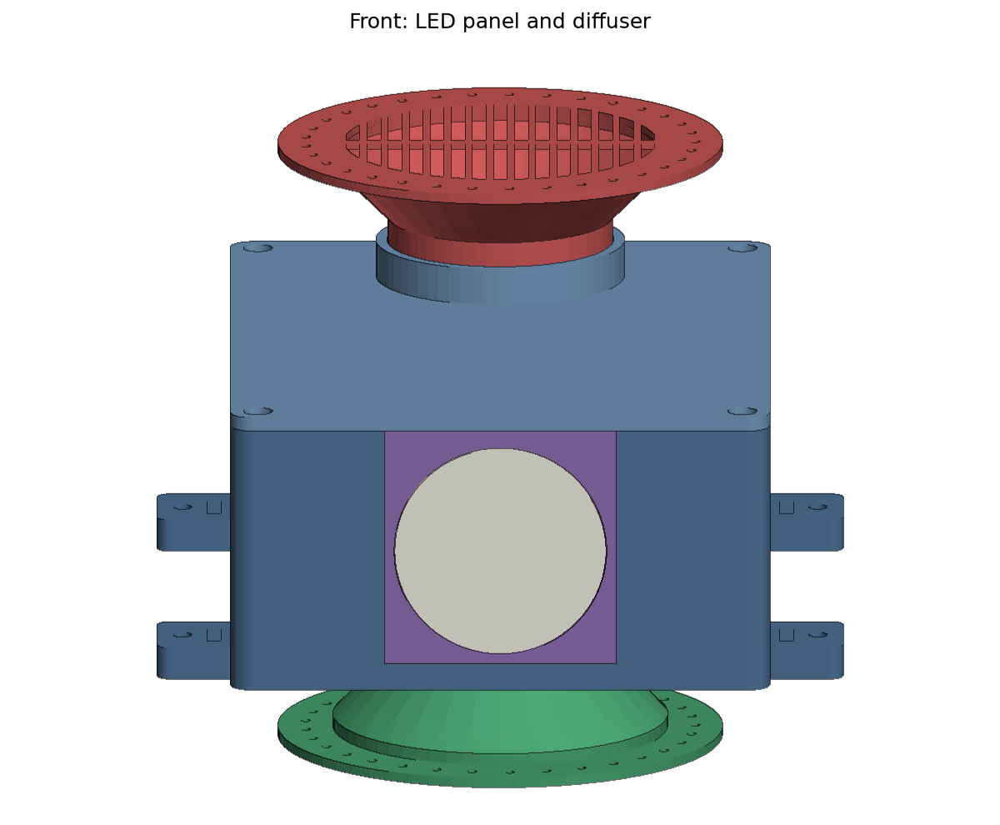
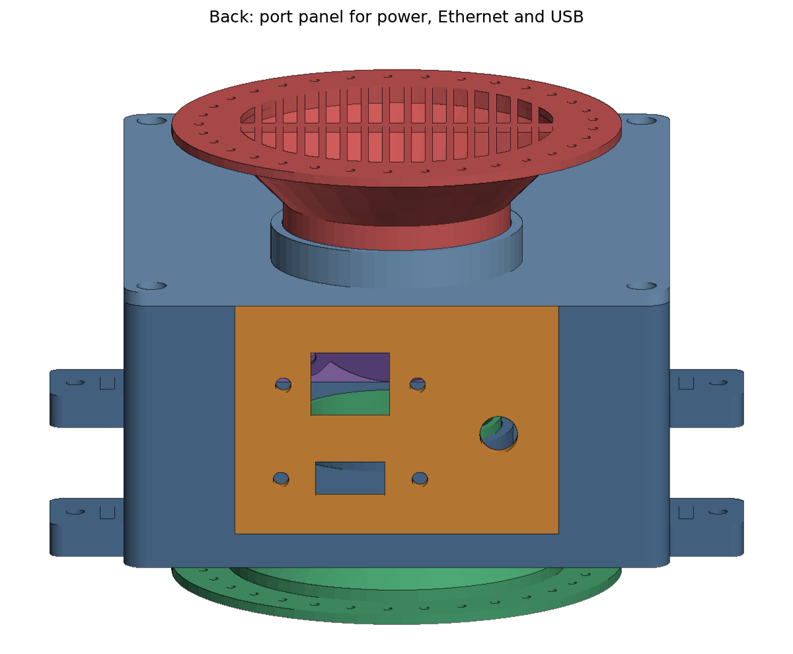
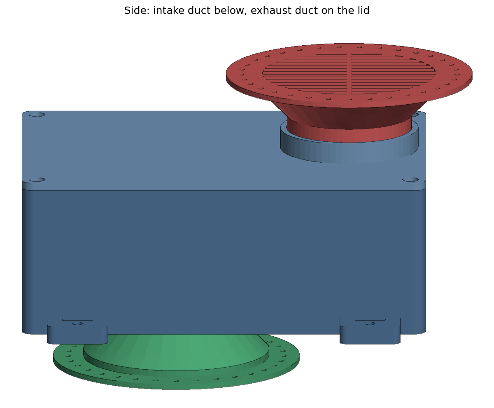
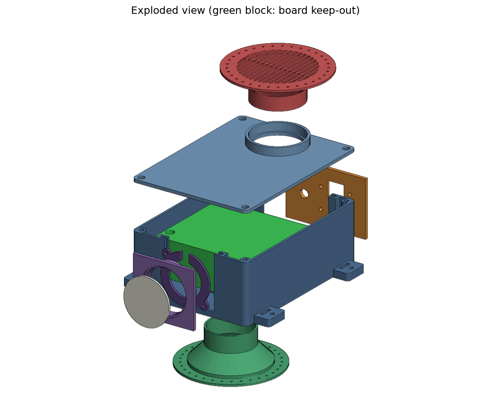

# Muse core enclosure

A 3D-printable core that holds a Jetson Orin Nano Super Developer Kit inside a Muse plush or printed shell. It is a rigid, closed box with its own air path, so stuffing never touches the board. No character or decorative shape is modeled here; the shell is built around this core.



| Back (ports) | Side (air path) | Exploded |
|---|---|---|
|  |  |  |

> **Before printing:** the board's hole pattern, fan position and stack height are placeholders. NVIDIA only publishes the outer envelope (103 x 90.5 x 34.77 mm). Measure the items in [MEASUREMENTS.md](MEASUREMENTS.md), update `Params` in `core.py`, and rebuild.

## Design

- **Board upside down.** The carrier hangs component side down on four posts, so the fan faces the floor. The intake duct rises through the floor to 1 mm under the fan (a foam ring seals it): outside air goes straight into the fan and cannot mix with the warm air in the box.
- **Chimney flow.** Warm air leaves the heatsink fins sideways, rises past the board edges and the cable bay, and leaves through the exhaust duct in the lid. Forced flow and natural convection point the same way.
- **Vent rings.** Each duct ends in a 70 mm slotted grille with a 12 mm flange. Cut a 70 mm hole in the shell or fabric and glue or sew the flange to its inside (2 mm sewing holes every 8 mm). The ring's length to the shell is a parameter (`intake_reach`, `exhaust_reach`).
- **One port panel.** Panel-mount DC (5.5 x 2.5 mm), RJ45 and USB-A on short extension cables with right-angle plugs at the board. A 42 mm cable bay holds the slack. Only this panel and the two vent rings need openings in the shell.
- **LED ring.** A 12 or 16 pixel WS2812 ring (`led_ring_od`, `led_ring_id`, or `with_ring(12)`) sits in a seat at the end of a 10 mm light tube, behind a 2 mm diffuser.
- **Mounting.** Four floor-level tabs, each with a strap slot and an M3 insert.
- **Printing.** PETG or ASA, every part under 220 x 220 mm, no supports, M3 heat-set insert holes (4.0 mm pilot, 6.2 mm deep).

Outside size without ducts and tabs: 117.8 x 159.3 x 61.3 mm.

## Airflow

From `uv run python core.py` (also written to `out/report.txt`). Ratios are against the fan's bore area. The fan size is a placeholder (38 mm blade diameter, 20 mm hub) until measured.

| Section | Open area (mm^2) | Ratio to fan bore (1134 mm^2) | Ratio to swept area (820 mm^2) |
|---|---|---|---|
| Vent ring grille (each ring) | 2317 | 2.04 | 2.83 |
| Intake duct bore (42 mm) | 1385 | 1.22 | 1.69 |
| Exhaust duct bore (46 mm) | 1662 | 1.47 | 2.03 |
| Risers around the board (side gaps, front gap, cable bay) | 6024 | 5.31 | 7.35 |
| Headroom over the board, toward the exhaust | 1356 | 1.20 | 1.65 |

Every section is at least as open as the fan itself, and the grilles, which add the most resistance, have twice the fan's area. `tests/test_core.py` fails if a parameter change drops the grille below 1.5x or any duct below 1.0x.

## Clearances

| Gap | mm |
|---|---|
| Board envelope to side walls | 5.0 |
| LED stack to board envelope | 4.9 |
| Cable bay behind the board, after the panel and rails | 36.3 |
| Lid to the tallest part on the PCB's bottom face | 12.0 |
| Intake duct tip to fan face (closed by foam) | 1.0 |
| Intake collar to fan face | 3.0 |
| Posts to the board's parts (radial) | 0.5 |
| LED fronts to diffuser (worst case) | 4.6 |

The board keep-out used for these checks is the full verified 103 x 90.5 mm footprint for the whole stack height, larger than the real parts.

## Files

| Path | What |
|---|---|
| `core.py` | All parameters (`Params`), the parts, the assembly, checks and reports. |
| `render.py` | PNG previews (a small z-buffer renderer on top of matplotlib). |
| `thermal_log.py` | Scores a tegrastats log against the thresholds in THERMAL_TEST.md. Standard library only. |
| `out/*.stl` | One STL per part, in print orientation. |
| `out/muse_core_assembly.step` | All parts assembled, plus the board keep-out as a reference solid. |
| `out/preview_*.png` | Front, side, back and exploded views. |
| `out/report.txt` | Sizes, clearances and airflow numbers. |
| `MEASUREMENTS.md` | Every number with its source, and the calipers list. |
| `ASSEMBLY.md` | Print settings, hardware list and build steps. |
| `THERMAL_TEST.md` | One hour load test: open air, bare core, inside the shell. |
| `tests/` | Bed fit, board clearance, collisions, airflow ratios, export, and the log scorer. |

## Commands

This folder is its own uv project (build123d, trimesh, matplotlib) with its venv in `.venv`, separate from the repo's main environment.

```bash
cd hardware/enclosure
uv sync                       # first time only
uv run pytest -q              # rebuilds every part and checks it
uv run python core.py         # STL + STEP + report into out/
uv run python render.py       # PNG previews into out/
uv run ruff check .
```

To try a 12 pixel ring or any other change without editing the file:

```python
import core
from dataclasses import replace
p = replace(core.with_ring(12), intake_reach=40.0)
parts = core.build_all(p)   # raises ValueError if the change cannot work
```
