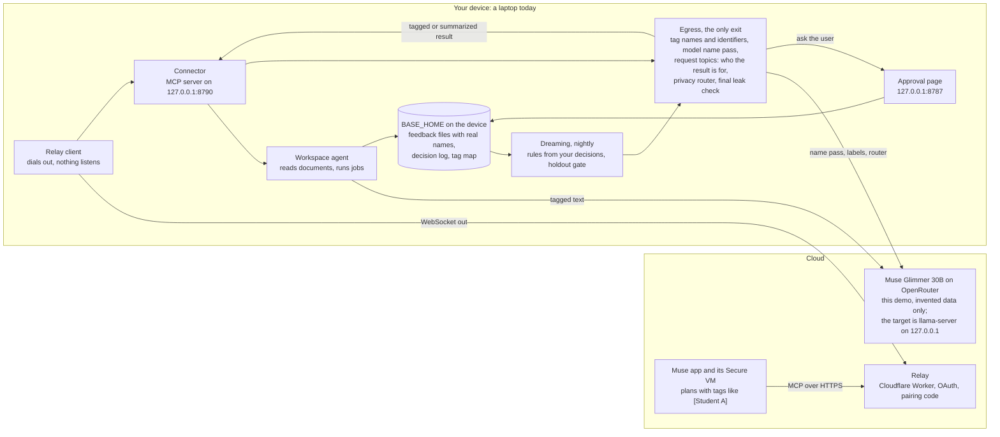
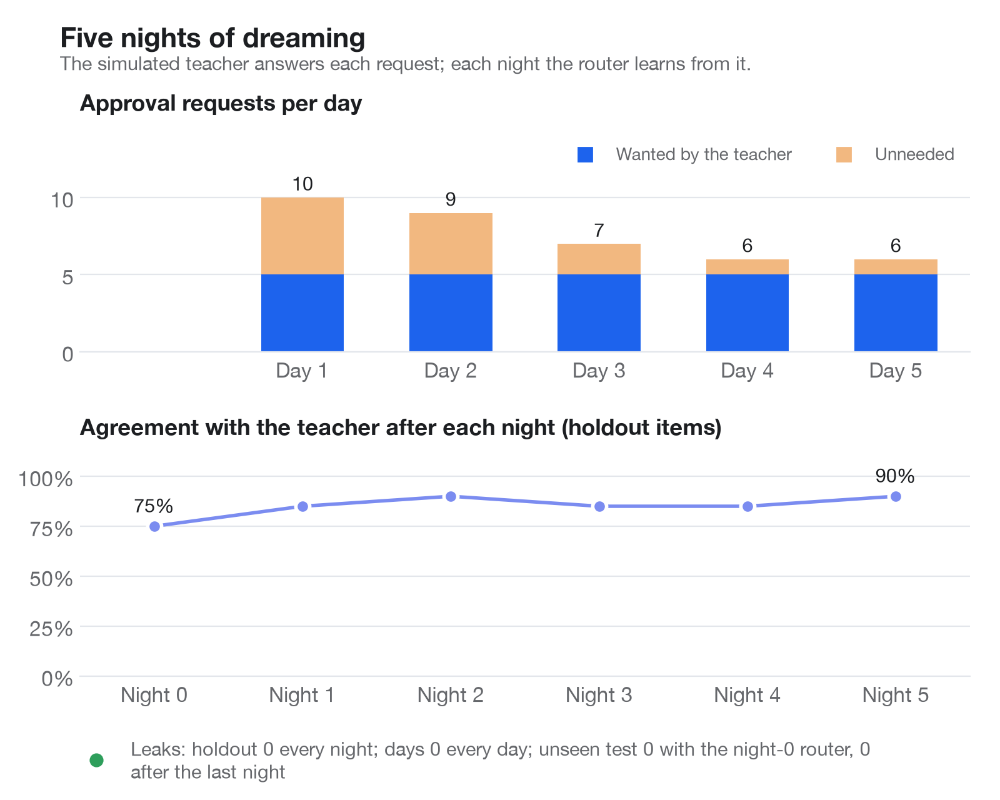

# Muse Privacy

Muse can already reach your files through connectors, but whatever it reads lands in its cloud VM, names and all. That keeps it away from the private, tedious work most ready for automation wherever records have to stay with their owner: grading student papers, medical records, city agency casework. Muse Privacy gives Muse a private workspace on hardware you own, connected through a Muse connector: a laptop today, and a Jetson Orin Nano version that is designed but not run on a board yet. Muse plans the work with tags, Muse Glimmer does every model step that touches the documents, and only tagged or summarized results go back to Muse: names and identifiers are swapped for tags on the device, and a final leak check runs on every text before it leaves. In this hackathon demo the model is Muse Glimmer 30B in the cloud, on OpenRouter, and the device reads only invented data. Glimmer on the device is the target, planned and not measured yet.

Part of Muse Muse, Offline Base's entry in the Meta Global AI Developer Hackathon (startup track, theme Push the Frontier), by Ethan and Hussam. An independent project, not made or endorsed by Meta. Every person, essay and record in this repo is invented.

**Status, Nov 2.** The hackathon organizers ruled on Nov 2 that every model the project calls must be a Meta model, with no non-Meta helper beside it. Until then this repo shipped a device-only setup on Liquid's LFM3-VL-2B, which is not a Meta model, so that setup is out. The setup it ships now (`.env.example`) is cloud mode: Muse Glimmer 30B (`meta/muse-glimmer-30b` on OpenRouter) does every model step, on invented data only, because in this mode the device refuses any folder without a `.synthetic` marker. Settings that would start a model that is not Meta's (LFM3-VL-2B, Google's EmbeddingGemma 2 for search, Llama Prompt Guard 2, LFM3-1.7B on a Jetson) are refused at start with a plain reason; their code stays in the repo for now. Today's defaults were scored on Glimmer on Nov 2, over the 200 invented items of `fresh_200_b`, a development set: [0 leaks of names or identifiers, with the 58 releases the simulated teacher approved checked too, and 71.5% decision accuracy (143 of 200), with 101 approval requests, 50 of them needless](eval/reports/glimmer_fresh_200_b_2026-11-02.md). No result was shared that should have been asked about or kept, and none was refused that should have been shared or asked about. Seven results the teacher would share only as a summary went out whole, tagged. Most misses are asks: of the 59 results the teacher would share tagged without asking, it shared 11 and asked about 48. On the 20 holdout items it was right 75.0% of the time (15 of 20), with 0 leaks ([holdout](eval/reports/glimmer_holdout_2026-11-02.md)). The run before it, on Oct 27 over 100 invented items and an older code state, had [0 leaks and 76% decision accuracy, with 48 approval requests](eval/reports/final_cloud.md). "Leaks" counts names and identifiers found in released text. It does not cover everything: a summary can still point at someone in words the floors do not list ([known limits](docs/THREAT_MODEL.md)). Numbers measured on LFM3-VL-2B are not results of this project; their reports stay in eval/reports as a record.

**What has not happened yet.** Glimmer has not been measured on the device. A tuned Glimmer at about 1.6-bit (IQ1_S) is planned and has not landed. Every Glimmer number in this README is from Glimmer on OpenRouter with invented data. The persona study has not run, so it has no results; anything from it will be labeled simulated, and there are no real users. Grading quality has not been measured, only that the job runs and how long it takes.

**The Muse app.** The reports in [eval/reports/muse_app](eval/reports/muse_app/) are scene rehearsals with a script playing Muse, against the connector in process. The [latest one](eval/reports/muse_app/rehearsal_cloud_2026-11-02.md), on Nov 2, ran in cloud mode with Muse Glimmer 30B on OpenRouter over the invented demo folders: scenes A to E reached their expected statuses, and 0 of 16 tool outputs held a private value. Scene F, a CUI task, was not run, because the privacy toggles need every model on the device. The Oct 30 and 31 rehearsals ran on LFM3-VL-2B and are a record, not a result. No session in the real Muse app has a report there yet, so these reports do not say how the app itself behaves.

**Claude and ChatGPT.** The connector is a plain remote MCP server behind the relay's OAuth, so Claude's custom connectors and ChatGPT's developer mode can link to it the same way: [docs/OTHER_APPS.md](docs/OTHER_APPS.md). A local test links clients that register as Claude, ChatGPT and Muse through the relay and gets tagged results back. Both real apps were linked on Oct 31, on the LFM setup of the time ([build log](docs/BUILD_LOG.md), 18:38 to 19:04): Claude ran an ask on the invented essays and fetched the result once asked to check again, and ChatGPT ran a search and two asks after a fix in the relay client for its newer MCP headers. Those were a few calls, not a measured session, and neither app has a report in eval/reports. `LINKED_APP=Claude` (or ChatGPT) makes the device's pages and notes name that app and its maker.

**The Meta AI app.** It works there by copy and paste, not as a connector: no public source found on Oct 31 shows the Meta AI app taking outside connectors (Muse takes them through its directory). On the device's Prepare page you write the question with real names and copy the tagged version into the Meta AI app; then paste the answer back under Put the names back, and the device swaps in the real names on that page only. Only tags the device handed out come back, and nothing on that page is saved or sent. The Meta AI app sees only what you paste, and it never reaches your files. If the Meta AI app opens to connectors, the same connector should work there, untested.

**Privacy toggles.** There are toggles for student, health, financial, work, privacy-law and government records, a setup page, a receipt for each result and one-command start. A toggle tags more, locks the settings that could undo it, and holds results it should; the government ones send nothing to Muse. A toggle does not make anyone legally covered: your school, clinic, agency or company still decides whether Muse may be used, and whatever you type into Muse reaches Meta before the device sees it. The toggles need every model on the device (`DEVICE_ONLY=1`), so they are off in the cloud demo. The plan and its limits are in [docs/COMPLIANCE_PLAN.md](docs/COMPLIANCE_PLAN.md).

## Who it's for

Anyone whose work runs on records that have to stay with whoever holds them, and who still wants an agent to do the tedious part. The privacy toggles cover six groups. Teachers are the most built out, and the only group with a measured job from start to finish. For the others, the toggles, invented records and simulated users exist, and most of it is not measured yet.

| Who | What Muse could do | What stays on the device | In this repo | Measured |
|---|---|---|---|---|
| Teachers | Grade essays, write feedback, sum up a class, draft parent notes | Essays, names, student ids, the feedback files | An invented class of 24 with essays, a rubric and records; FERPA, COPPA and state student-privacy toggles | Grading job and decisions, below and in the [status](#muse-privacy) |
| Special education coordinators, school privacy reviewers | Summaries around IEP and 504 work; an audit of what left the device | IEP and 504 notes, health office and lunch records | `demo/records/`; simulated sped_coordinator and privacy_officer users | Not yet: the persona study has not run |
| Clinic front desks, substance-use programs | Visit counts, referral lists, reminders | Visit notes, referrals, dates, record numbers, addiction treatment details | HIPAA and 42 CFR Part 2 toggles; a simulated clinic coordinator with 80 invented items | [HIPAA tagging](eval/reports/compliance.md) with the rules alone, no model, on invented sentences (Oct 30): 2 of 42 missed, 0 of 20 clean sentences changed (sentences used while the rules were written) |
| City casework and other government work | Nothing with the records: the caseworker asks on the device's own Ask page | Everything: the CUI, CJIS and export-control toggles send nothing to Muse, not even tagged text | `demo/casework/` (6 invented housing case files); a simulated housing caseworker | Not yet |
| Finance and tax offices | Summaries and lists over client files | Card numbers and SSNs, which are always tagged, and client details | GLBA, PCI DSS and tax preparer (IRC 7216) toggles | Not yet |
| Law offices, HR, anyone under GDPR or CCPA | Summaries over client or employee files | Client details, salary and reviews, special-category data such as religion or ethnicity | Attorney-client, employee records, GDPR and CCPA toggles | Not yet |
| Families: a parent setting up a teen, or an adult child setting up an older parent | Help with the family member's own forms, letters, bills and school work | Their files; card numbers and SSNs, always tagged; the home address and anything else on the family's never-share list | A Family toggle (codes, account numbers and a home address stay on the device; money, health and custody are asked) and a guardian PIN that locks the settings and, if chosen, approvals | Unit tests only. Not built: asks that reach the guardian away from the device |

Each toggle shows its own limit, such as "There is no BAA with Meta" for HIPAA, and none makes anyone legally covered (see Privacy toggles above).

**Families.** The guardian sets the rules, and the family member uses Muse with them. Two limits shape this case. What someone types or pastes into Muse reaches Meta before the device sees it, so the device keeps the family's files from going out, but it cannot stop a card number typed into the chat; when a request already holds a private detail, the device can only say so afterward. And Meta's terms set a minimum age of 13 for Muse, so this is for teens, not younger children. A guardian PIN on the Setup page locks the settings and, if the guardian chooses, approving results; anyone can still deny one. It stops changes at the device, not someone with an administrator account on the computer.

**Teachers, built out first.** The author builds AI tools with school districts, and grading and feedback, the job this build automates, has a student's name in every file, a problem the author knows firsthand. Under FERPA's school-official exception, a school may give education records to an outside service without parent consent only if, among other conditions, the service is "under the direct control of the agency or institution with respect to the use and maintenance of education records" ([US Department of Education](https://studentprivacy.ed.gov/faq/who-school-official-under-ferpa)). Muse Privacy is built so the essays stay on the teacher's own laptop: Muse plans the job with tags, the model grades the tagged essays, and the feedback files with real names are written only on the laptop. Keeping the essays on the laptop needs Muse Glimmer on the device, which is planned and not measured yet. In this demo Glimmer runs on OpenRouter, so the device reads only an invented class. With Glimmer on OpenRouter, [grading 24 invented essays](eval/reports/e2e_cloud_no_rules.md) took 118.8 s from Muse's request to the tagged result Muse read, on Oct 27. That measures the path and its time, not how good the grades are. Today it is a laptop install (below); the Jetson box, designed but not run on a board yet, is the version a school, clinic or office could own outright.

## How it works



1. You ask Muse in plain words. Muse plans the job on its VM and calls the connector's eight tools: `list_documents`, `search_documents`, `ask_device`, `run_private_task`, `save_on_device`, `get_result`, `run_dreaming`, `dreaming_report`.
2. Muse reaches the device through the relay, which the device dials out to, so nothing on the device is open to the internet.
3. On the device, the agent swaps tags back to names only to choose what to do, and gives Muse Glimmer the documents with every name and identifier already swapped for tags, so in cloud mode OpenRouter sees tagged invented text. Finished files with real names (for grading, one feedback file per student) are written only under `BASE_HOME`.
4. Every result goes through `base/egress.py`: exact checks for names on the roster and identifiers (phones, emails, SSNs, Luhn-checked cards, student ids, addresses, dates of birth), and a second pass where Muse Glimmer finds names the roster misses. Then the device reads Muse's request: a keyword scan for never-share topics, and one Glimmer call that labels who the result is for and what it asks (for a student's family, for someone outside the class, a whole text, who a tag really is, a class-level question). The privacy router then decides to share it tagged, share a summary, ask you on the approval page, or keep it; in cloud mode Muse Glimmer is the router, under floors it cannot loosen. A final leak check runs on every text before it leaves, and fails closed. If a check cannot run, the result is held on the device.
5. Each night, dreaming rebuilds the router's rules from your approve and deny decisions, grouped by the kind of result and its topics, request topics included. It keeps them only if they score no worse on a holdout set with zero leaks. A learned "ask first" or "refuse" rule is a floor: it holds for every narrower group of its kind, so a closer share rule can never loosen it.

On a Jetson (designed and tested in simulation, not run on a board), grading would be handed to the laptop: the laptop dials out to the Jetson (`base/heavy/worker.py`), so the managed laptop never listens on the network. The interfaces between modules are in [docs/CONTRACTS.md](docs/CONTRACTS.md).

## Built during the event, and before

All of the code in this repository was written during the event; the first commit is from Oct 27, 2026. Three earlier projects by the same author were read for ideas only, and nothing was copied from them: decision-guard (exact checks before text is sent, for `base/guard.py`), base-router-subagent (a device that dials out to a Cloudflare relay with OAuth and pairing codes, for `relay/` and `base/connector/`) and decision-tree (a status light, for `base/light.py` and `hardware/light/`). The code was written with Claude Code; Muse Spark 1.3 wrote the 2,000-item practice set and graded the invented essays a second time as a cross-check. Details and the open-source libraries used are in [docs/PRIOR_WORK.md](docs/PRIOR_WORK.md).

## Related work

Parts of this exist elsewhere; [docs/PRIOR_WORK.md](docs/PRIOR_WORK.md#related-work) lists them with links. Perplexity's hybrid compute on Mac (Sep 2026) also has cloud models plan while a local model guards private data, with a gate that can mask sensitive details, keep them local, refuse the action, ask for consent, or rewrite the request. PlanTwin is research on a cloud planner working over a de-identified twin of local private state, ARIEL learns a user's sharing judgments, and Canvas MCP and SafeGrader already give teachers pseudonymous student IDs over MCP and local grading. Meta's Muse Gadgets Linux SDK already pairs a Linux box with Muse so Muse "can run commands and move files on the machine"; Muse Privacy is the version where the device decides what Muse may see. Other entries in this hackathon also put Glimmer redaction in front of Meta's models, through the Meta Model API rather than the Muse app. What we did not find elsewhere is this combination inside Meta's Muse: the documents and the tag map stay on hardware the user owns, a Meta model does the document work, each result is routed four ways by its content and by who it is for, approvals appear on a page the device serves, and the rules are rebuilt each night from the user's answers behind a holdout gate.

## Setup

You need macOS or Linux, [uv](https://docs.astral.sh/uv/), and for the relay Node 22 and a Cloudflare account.

### Laptop, cloud mode (what `.env.example` sets, invented data only)

Glimmer runs on OpenRouter, so the device reads only folders marked `.synthetic`, such as `demo/`.

```sh
git clone https://github.com/Offline-Base/muse-privacy.git && cd muse-privacy
uv sync
cp .env.example .env                 # then set OPENROUTER_API_KEY
uv run pytest -q                     # unit tests; every model and API is mocked
uv run python -m base                # approval page http://127.0.0.1:8787, connector on 127.0.0.1:8790
```

### Laptop with your own Glimmer file (not run or measured yet)

Not run yet: it needs about 20 GB of free disk. Use llama.cpp b10353 or newer. Add `DEVICE_ONLY=1` for the privacy toggles. To plug in a tuned file, see "Plugging in your own model" in [docs/MUSE_SETUP.md](docs/MUSE_SETUP.md#plugging-in-your-own-model).

```sh
git clone https://github.com/Offline-Base/muse-privacy.git && cd muse-privacy && uv sync && cp .env.example .env
git clone https://github.com/ggml-org/llama.cpp ~/llama.cpp
cmake -S ~/llama.cpp -B ~/llama.cpp/build -DGGML_METAL=ON && cmake --build ~/llama.cpp/build -j --target llama-server
uvx --from huggingface_hub hf download meta-models/Muse-Glimmer-30B-GGUF Muse-Glimmer-30B-KQuant-17GB-Q4_K_M.gguf --local-dir models
printf 'GLIMMER_BACKEND=llama_server\nLLAMA_SERVER_BIN=%s\nGLIMMER_GGUF=%s\nWORKSPACE_ROOT=%s\n' "$HOME/llama.cpp/build/bin/llama-server" "$PWD/models/Muse-Glimmer-30B-KQuant-17GB-Q4_K_M.gguf" "$HOME/<your class folder>" >> .env
scripts/start.sh                     # Glimmer on 127.0.0.1:8081 and 8082, then the server; Ctrl-C stops all
```

Later lines in `.env` win, so the `printf` overrides the cloud defaults. `uv run python -m scripts.bench_speed --label laptop` then writes the laptop's speed report.

### Jetson Orin Nano 8GB

Not run on a board yet. Run as root from a checkout on the board; `install.sh` makes the service user, builds llama.cpp with CUDA, downloads and checks Glimmer i1-IQ1_S (6.5 GB), makes a self-signed certificate for the approval page and installs three systemd units. See [deploy/jetson/README.md](deploy/jetson/README.md).

```sh
git clone https://github.com/Offline-Base/muse-privacy.git && cd muse-privacy
sudo deploy/jetson/install.sh --build-llama
sudoedit /etc/muse-privacy/env       # APPROVAL_HOST, RELAY_URL, WORKSPACE_ROOT, LIGHT_SERIAL
sudo systemctl start muse-privacy-glimmer muse-privacy
j() { sudo -u muse-privacy env BASE_DEVICE=jetson GLIMMER_BACKEND=llama_server BASE_HOME=/var/lib/muse-privacy/home /opt/muse-privacy/app/.venv/bin/python -m "$@"; }
j base.connector.relay_client register --name "Jetson" --relay-url "https://muse-privacy-relay.<your-subdomain>.workers.dev"
sudo systemctl enable --now muse-privacy-relay
j base.connector.relay_client pair   # type this code in Muse
```

To hand grading to the laptop, print the worker token on the board with `j base.heavy.routes`, copy `/var/lib/muse-privacy/home/tls/cert.pem` to the laptop, and run there `uv run python -m base.heavy.worker --jetson-url https://<jetson address>:8787 --token <token> --ca-cert cert.pem`.

## Add the connector to Muse

1. Deploy the relay once: `cd relay && npx wrangler login && ./deploy.sh`. It prints `https://muse-privacy-relay.<your-subdomain>.workers.dev`.
2. On the laptop: put that address in `.env` as `RELAY_URL`, run `uv run python -m base.connector.relay_client register` once, then keep `uv run python -m base.connector.relay_client run` going next to `python -m base`.
3. In Muse, add it as a custom connector. Meta's Help Center says you "can ask Muse to create a Custom Connector" and shows no field for a connector address, so ask in chat: "Create a custom connector for a remote MCP server, then connect to it. Name: Muse Privacy. Transport: remote streamable HTTP. URL: the address plus `/mcp`. Auth: OAuth (the server supports dynamic client registration)." If your app shows an add-custom-connector option under **Settings > Connectors**, use it with the same address and leave the client ID and secret empty. If the app will not take it, use Muse Code, whose docs describe remote MCP servers with OAuth sign-in (step 5 of [docs/MUSE_SETUP.md](docs/MUSE_SETUP.md)).
4. Muse opens the relay's Link your device page. Run `uv run python -m base.connector.relay_client pair` and type the code there within 10 minutes. Each code works once.
5. Tell Muse who each result is for. The connector's instructions ask Muse to say it ("for my own grading", "for the family newsletter") in run_private_task's instructions and in search_documents' optional `purpose`; the device reads it to decide what it can share. A search whose check needs more time or your OK answers with a job id, and Muse gets the snippets with get_result.

[docs/MUSE_SETUP.md](docs/MUSE_SETUP.md) has the full steps, the Muse Code fallback, the two scheduled jobs to give Muse (dreaming at 2 AM, a one-sentence report at 8 AM) and a test script of prompts. No session in the real Muse app has a report yet, so these steps are not checked against one.

## What Meta's models do here

Every model the app calls is a Meta model, as the organizers' Nov 2 ruling requires. The app connects to the Muse app, Muse Glimmer 30B on OpenRouter does every model step on invented data in this demo, and Muse Spark wrote the invented eval data.

- **Muse plans over tags it cannot resolve.** Muse runs the job through eight tools and works only with tagged or summarized text: it asks for a grading job and gets back a tagged per-student table, not the essays. So far the reports have a script in Muse's place; in the [scene rehearsal](eval/reports/muse_app/rehearsal_cloud_2026-11-02.md) with Muse Glimmer 30B on OpenRouter on Nov 2, 0 of 16 tool outputs held a private value.
- **Muse is set up to drive the device's learning.** Two scheduled Muse jobs are meant to start dreaming at 2 AM and ask for a one-sentence report at 8 AM (no report from the app yet; the rehearsal's script makes the same two calls). Each night the device rebuilds its rules from the teacher's answers and keeps them only if they pass a holdout with zero leaks. In the Glimmer simulation on OpenRouter, approval requests fell from 10 to 6 a day, and accuracy on 100 items no step had seen rose from 72% to 81%; the cost was that ask first fell from 100% to 68%, with 8 snippets she wanted to see shared tagged ([final/nights.md](eval/reports/final/nights.md)).
- **Spark builds the test.** Muse Spark 1.3 wrote the 2,000 invented practice items and graded the essays a second time: the same total as Glimmer for 15 of 24, within one point for 23 of 24 ([grading_crosscheck.md](eval/reports/grading_crosscheck.md)).
- **Glimmer on OpenRouter, this demo's setup.** One 30B Muse Glimmer graded, found names the roster misses, read who Muse's request is for, wrote summaries and was the privacy router, every call at reasoning strength low. As the router on a first day it never shared an item it should have asked about or kept, in the Oct 27 run ([final_cloud.md](eval/reports/final_cloud.md)) or on today's defaults on Nov 2 ([glimmer_fresh_200_b_2026-11-02.md](eval/reports/glimmer_fresh_200_b_2026-11-02.md)). Its request labels follow contextual integrity, the idea Meta's Glimmer paper says its privacy training is inspired by ([arXiv 2610.24628](https://arxiv.org/html/2610.24628v1)). On 160 held-out invented requests, scored against Muse Spark's labels: for someone outside the class, Glimmer's recall was 0.84 at precision 0.75, where a keyword list's recall was 0.50; for class-level questions, precision and recall 0.94 and 0.94 against the keyword list's 0.92 and 0.67 ([request_topics.md](eval/reports/request_topics.md)).
- **A tuned Glimmer is planned for this app and not plugged in.** A tuned Glimmer at about 1.6-bit (IQ1_S) would take over answers and routing. No Glimmer has been measured in Muse Privacy on the device, so nothing here says it helps. The test it has to pass was written before any run ([glimmer_prereg.md](eval/reports/glimmer_prereg.md)). Outside Muse Privacy, Muse Muse has tried its knowledge-run file on a board since Nov 2. The result, in the repo root's docs/OFFLINE.md (section 6), is not good enough to use here.
- **A 30B model for an 8 GB board** (designed, not run on a board): the Jetson would use a published Glimmer quant at about 1.6-bit (IQ1_S), i1-IQ1_S at 6.5 GB, for lookups and tagging, and hand grading to the laptop.
- **SAM 3.1 is built and off by default.** With `SAM_ENABLED=1` it finds faces, signatures, ID cards and barcodes on page images and covers them before a model reads the page. The only page reader was LFM3-VL-2B, and the Glimmer files have no vision tensors ([model_file_r30b_iq1s.md](eval/reports/model_file_r30b_iq1s.md)), so page images are not read now and SAM has nothing to cover. No number in this README uses it.

Where each one runs:

| Model | Where | What it does |
|---|---|---|
| Muse, the app and its Secure VM | Meta's cloud | Plans the work with tags, calls the connector, runs the scheduled dreaming jobs. Gets only tags and tagged or summarized results; the documents stay on the device. |
| Muse Glimmer 30B, `meta/muse-glimmer-30b` on OpenRouter | OpenRouter, this demo's setup | Every model step on invented data: grading, the name pass, request labels, summaries and the privacy router. Folders without a `.synthetic` marker are refused in this mode. |
| SAM 3.1 | The laptop, off by default | Would cover faces, signatures, ID cards and barcodes on page images (`SAM_ENABLED=1`); page images are not read now, so it has nothing to do |
| Muse Glimmer, Meta's Q4_K_M GGUF (`Muse-Glimmer-30B-KQuant-17GB-Q4_K_M.gguf`) | Not run yet; designed for the laptop, llama-server | Would do grading, the name pass, summaries and the privacy router (Glimmer is its own router; its small assistant model is a speculative-decoding drafter, not a chat model). |
| Muse Glimmer i1-IQ1_S, about 1.6-bit (6.5 GB, `mradermacher/Muse-Glimmer-30B-i1-GGUF`) | Not run yet; designed for the Jetson Orin Nano 8GB, llama-server | Would do lookups, tagging and routing on the board, with grading going to the laptop when its worker is connected. |
| A tuned Muse Glimmer, about 1.6-bit (IQ1_S) | Not plugged in here. Muse Muse's knowledge-run file was tried outside this app (repo root docs/OFFLINE.md, section 6) | Planned for answers and routing. Not measured in Muse Privacy. |
| Muse Spark 1.3 | Meta Model API | The eval harness, the 2,000 invented practice items and a second-opinion grading cross-check on the tagged essays. `base/spark.py` refuses any text with a roster name or an identifier, and is never used for user data. Not called by the app at runtime. |

## Numbers

### Muse Glimmer 30B on OpenRouter, this demo's model

All are on OpenRouter's Glimmer with invented data. The first two rows are today's defaults, scored on Nov 2. The other router runs are dated Oct 27, before later router changes (the `ROUTER_LOOSEN` default of Oct 31 among them). Each links to the report, which starts with the command that made it; raw rows are next to each report under `raw/`. The summary with every source is [eval/reports/final.md](eval/reports/final.md).

| What | Number | Report |
|---|---|---|
| Leaks | 0 in every run: the 100-item run (34 approved releases checked too), the holdout, the night-5 rules on the 100 items, every night's holdout scoring, every simulated day with approvals, the unseen test with the night-0 router and after the last night, and both 24-essay grading jobs. The last round's one leak (an invented name off the roster, on the unseen test) came from a guard gap that is now closed: with a full-name-only name pass, that item leaked before the fix and not after. A name the pass misses entirely is still not caught | [final.md](eval/reports/final.md#leaks) |
| What the guard leaves when the name pass reports part of a name (1384 items, fixed answers, no model call) | Full name only: 15 items leaked before the fix, 0 after. Last word only: 31 before, 1 after. The cost: 30 to 33 extra name tags on 15 to 16 items, 0 before | [name_parts.md](eval/reports/name_parts.md) |
| Today's defaults, `fresh_200_b`, 200 items, first day (Nov 2) | 0 leaks, with 58 approved releases checked too. 71.5% (143 of 200): share tagged 11 of 59, share a summary 35 of 44 (7 went out whole, tagged, and 2 asked), ask first 51 of 51, refuse 46 of 46; 101 approval requests, 50 of them needless; 0 shared that should have been asked about or kept, 0 refused that should not have been. Spend $0.14 | [glimmer_fresh_200_b_2026-11-02.md](eval/reports/glimmer_fresh_200_b_2026-11-02.md) |
| Today's defaults, the 20 holdout items (Nov 2) | 0 leaks. 75.0% (15 of 20), 10 approval requests, 4 of them needless | [glimmer_holdout_2026-11-02.md](eval/reports/glimmer_holdout_2026-11-02.md) |
| Router accuracy, 100 items, first day, inputs as the connector sends them (Oct 27) | 76% overall: share tagged 3 of 25, share a summary 25 of 25, ask first 25 of 25, refuse 23 of 25; 48 approval requests. No item was shared that should have been asked about or kept | [final_cloud.md](eval/reports/final_cloud.md) |
| Agreement with the simulated teacher on the 20 holdout items, first day | 75% | [final_cloud_holdout.md](eval/reports/final_cloud_holdout.md) |
| Router accuracy, the same 100 items with the rules after night 5 | 88%, 35 approval requests. In-sample: the holdout and the day items the rules learned from are among the 100. One item she would refuse (t085, a discipline note) was shared tagged | [final_cloud_night5_rules.md](eval/reports/final_cloud_night5_rules.md) |
| Approval requests per simulated day (20 items a day, 5 she wants to be asked about) | 10, 9, 7, 6, 6 (unneeded ones 5, 4, 2, 1, 1) | [final/nights.md](eval/reports/final/nights.md) |
| Holdout agreement after each of five nights of dreaming | 75, 85, 90, 85, 85, 90%; the gate kept all five nights. The gate selects on the holdout, so this is an upper bound | [final/nights.md](eval/reports/final/nights.md) |
| Unseen test: 100 practice items no step ever saw | 72% with no rules, 81% after the last night; approval requests 53 to 28. Ask first fell from 100% to 68%: 8 snippets she wanted asked about were shared tagged | [final/nights.md](eval/reports/final/nights.md#unseen-test) |
| Grading 24 essays, from Muse's request to the tagged result Muse read | 118.8 s on a first day (the job itself 102.2 s, 28 Glimmer calls), with an instant approval; 84.9 s with one learned rule. OpenRouter was slow that hour: the same job took 33.4 s and 30.1 s earlier the same day, with about the same tokens | [e2e_cloud_no_rules.md](eval/reports/e2e_cloud_no_rules.md), [e2e_cloud.md](eval/reports/e2e_cloud.md) |
| Cloud speed per step | Router 1805 ms mean in the 100-item run (p95 2950 ms). Bench means, taken while OpenRouter was slow: router 1640 ms, name pass 7521 ms, request topics 3031 ms, grading one essay 29030 ms | [final.md, section 7](eval/reports/final.md#7-speed-in-cloud-mode) |
| Request labels on 160 held-out invented requests (precision / recall) | parents 0.86 / 0.86, someone outside the class 0.75 / 0.84, class-level 0.94 / 0.94, who a tag is 1.00 / 1.00 (6 items), whole text 0.50 / 1.00 | [request_topics.md](eval/reports/request_topics.md) |
| Grading consistency | Same total for 21 of 24 essays between two Glimmer runs; Muse Spark 1.3 gave the same total for 15 of 24 and within one point for 23 of 24 | [grading_spotcheck.md](eval/reports/grading_spotcheck.md), [grading_crosscheck.md](eval/reports/grading_crosscheck.md) |



The chart's leak line counts the holdout, the simulated days and the unseen test with both routers. It counts names and identifiers, not policy misses: on day 2 a learned rule shared a discipline note the teacher would have kept (see Known limits).

### Earlier, on a model that is no longer allowed

From Oct 29 to Nov 2 the device setup ran on Liquid's LFM3-VL-2B. The organizers ruled on Nov 2 that only Meta models count, so those runs are not results of this project and are not quoted here, including the 0 leaks they measured on the device. Their reports stay in eval/reports (the `device_only_*`, `device_smoke_lfm*`, `matrix_*` and `nights_device_*` files) as a record.

Not measured yet: Glimmer of any size on the device, grade quality, Glimmer's speed on the laptop and on a Jetson, the Jetson's memory use, quantization quality (Q4_K_M against i1-IQ1_S), a router LoRA, how often Glimmer's name pass reports only part of a name, and the author's own grading spot-check ([eval/reports/grading_spotcheck.md](eval/reports/grading_spotcheck.md) is ready for those scores).

## Known limits

- **What the Nov 2 ruling took out.** Every model the project calls must be a Meta model, so these are off and refused at start (`base/config.py`, `refuse_non_meta`), with their code left in the repo until the owner decides whether to delete it:
  - Scanned page images. LFM3-VL-2B read them, and the Glimmer files have no vision tensors, so an image is no longer a document. SAM 3.1 covered images only on that path, so it has nothing to do.
  - Search passage picking and the `ask_device` tool, which ran only on LFM3-VL-2B. Search is keyword search (BM25) alone.
  - EmbeddingGemma 2 search. Without it, a query worded differently from the text can miss it.
  - Llama Prompt Guard 2. It flagged 6 of 10 explicit planted orders on invented text ([prompt_guard_22m.md](eval/reports/prompt_guard_22m.md)); that catch is gone. The canary, the floors and the approval page still stand.
  - The LFM3-1.7B fallback on a Jetson.
  - Speed. Every model step is now a cloud call: in the Glimmer bench the name pass averaged 7521 ms and the request labels 3031 ms, and a 24-essay grading job took 118.8 s, slower than the device-only setup it replaces.
  - "No model off the device." In the demo, tagged invented text goes to OpenRouter, and the privacy toggles, which need every model on the device, are off.
- **No Glimmer numbers on the device.** Every Glimmer number is on OpenRouter with invented data. Speed on the Jetson, the Jetson's memory, and how much the about 1.6-bit (IQ1_S) quant loses are all unmeasured. Cloud times also swing: the same grading job took 33.4 s in one round and 118.8 s in the next, with about the same tokens.
- **No real users, and the persona study has not run.** Every teacher here is a policy file, and every item is invented. `fresh_200_b` is a development set, and the sealed set has not been scored.
- **The real Muse app has no report yet.** The relay is deployed, and a script playing Muse has paired, listed the tools and listed the essays through it; no grading job or approval has a report through the deployed relay. The reports in `eval/reports/muse_app` have a script in Muse's place, in process. Whether the app takes this connector reliably (Meta documents asking Muse in chat to build a custom connector, not a field for an MCP address), which OAuth client style it uses, whether it fills in who a result is for, how it waits for approvals, whether it uses tags across several steps, and its scheduled jobs all have no report. Pre-registered OAuth clients are not supported, and redirect URIs must be https or loopback.
- **A name off the roster still depends on the device model's name pass finding it once.** The roster cannot know siblings, guardians or staff. The guard now tags every word of a name the pass reports, and a one-word name takes in up to two capitalized words on each side, so a pass that reports "Bennick Cinderfall" also covers a later "Bennick" (the one leak in an earlier Glimmer round). Each of these values joins the tag map, so later texts are tagged and the final check catches them with no model call. What still depends on the pass: a name it misses entirely, which an approved card releases and the final check cannot stop, and a name it reports only in part where the guard cannot widen it (a lowercase common word, or a name split by a comma or a line break). On a real device you would see the name on the card before you approve. The cost: more tags. A part gets its own `[Person N]`, so Muse can read one person as two, and a capitalized word next to a name, or a part that is also a common word ("Grace period"), can be tagged as a name.
- **The router errs on the strict side on a first day.** On today's defaults (Nov 2, 200 items) it asked about 48 of the 59 results the simulated teacher would share tagged without asking ([glimmer_fresh_200_b_2026-11-02.md](eval/reports/glimmer_fresh_200_b_2026-11-02.md)); in the Oct 27 run over 100 items it asked about 21 and refused 1 of 25 such results ([final_cloud.md](eval/reports/final_cloud.md)). All of that is one simulated teacher's policy.
- **Dreaming can learn too broad a rule from a few answers.** In the earlier Glimmer simulation, two approvals of snippets with no topics taught "share tagged" for every such snippet. On the unseen test the router then no longer asked about 8 of 25 items the teacher wanted to see first, and on day 2 of the simulation it shared t085, a discipline note her policy refuses, with no card (the night-5 rules did the same on the 100 items). These went out tagged, so they are not leaks, and the leak count does not see a policy miss like this.
- **The learning numbers are simulated and partly selected on.** The teacher is a policy file. In the earlier Glimmer runs the gate selects on the 20 holdout items, and the request-topic descriptions were written with the eval requests in view, so the holdout's 75% to 90% is an upper bound, and the night-5 rules' 88% on the 100 items is in-sample. The unseen test's 72% to 81% is the more honest number, and its items are Spark-written in a similar style. One changed decision moves a holdout category by 20 points, and the same rules scored 90% and then 85% on two runs.
- **Request topics depend on how Muse asks.** A search query alone rarely says who the snippets are for, so the device needs Muse to fill in `purpose`. Earlier, Glimmer over-labeled whole-text requests (precision 0.50 on held-out requests), so asking for one paragraph can be treated as asking for a whole essay.
- **A never-share word only in Muse's request asks instead of refusing.** "Do not mention any IEP" is a caution, so it no longer refuses a harmless result; the cost is that "Which students have an IEP?" over a list of tags also asks, unless the router or a learned refuse rule refuses it.
- **A broader learned "ask first" or "refuse" rule outranks a narrower share rule you taught.** If free-text answers with no topics learn "ask first", a learned "share a summary" for class-level answers does not take effect under it.
- **Each result costs up to two extra model calls,** the name pass and the request-topic label (none for document lists and dreaming reports). A name the pass wrongly finds in a summary makes egress refuse that summary. Initials such as "C.R." are not tagged.
- **Long jobs work by polling.** Muse starts a job and calls get_result until it is done, and get_result can wait on the device for up to 40 seconds; the relay holds no stream open and answers 504 after 60 seconds without a reply from the device. A search whose check runs past 40 seconds or waits for you returns a job id, so Muse has to follow it with get_result too.
- **A Jetson's approval page uses a self-signed certificate,** so browsers warn on first visit; the laptop worker pins it.
- **The status light and the enclosure are designed, not built.** The firmware is unit-tested but not flashed, and the enclosure's mounting holes are placeholders until a board is measured.

## Layout

| Path | What |
|---|---|
| `base/` | The device: guard, model client, workspace and agent, router, approvals, egress, connector, relay client, approval page, heavy-step queue and worker, dreaming, light |
| `relay/` | The Cloudflare Worker Muse connects to |
| `eval/` | The eval set, holdout, invented roster and teacher policy, the harness, and every report |
| `scripts/` | Simulation, charts, synthetic data, speed bench, secrets scan, Modal scripts |
| `deploy/jetson/` | systemd units and the installer for the board |
| `hardware/` | Status light firmware and the enclosure model |
| `demo/` | The invented class folder (marked `.synthetic`) |
| `docs/` | Contracts, decisions, prior work, Muse setup, demo script, handoff |
| `site/` | The landing page with the animated walkthrough: static HTML, CSS and JS that load nothing from other sites. Open `site/index.html`, or serve it with `python3 -m http.server 8765 --bind 127.0.0.1 --directory site` |
